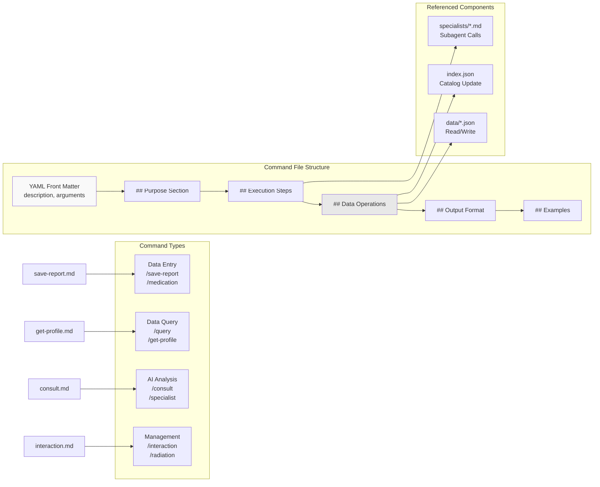
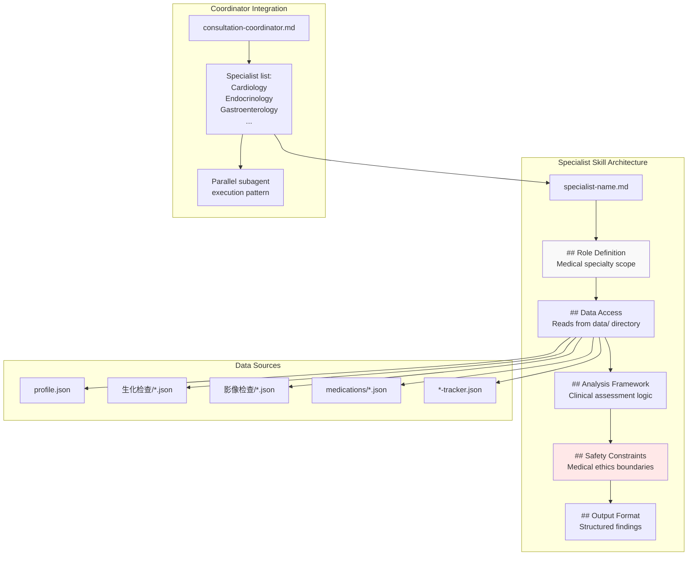
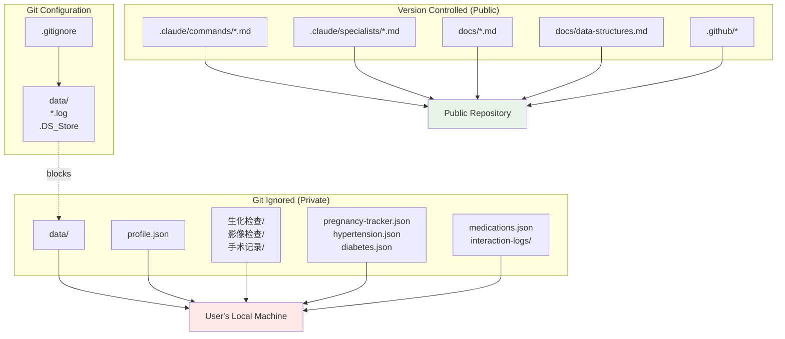
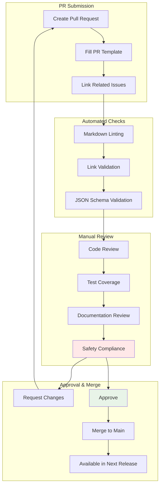

<!-- source: DeepWiki mcp.deepwiki.com · repo huifer/Claude-Ally-Health · page 8 Development & Contributing · fetched 2026-10-26 -->

# Development & Contributing

<details>
<summary>Relevant source files</summary>

The following files were used as context for generating this wiki page:

- [.claude/commands/get-profile.md](.claude/commands/get-profile.md)
- [.github/CONTRIBUTING.en.md](.github/CONTRIBUTING.en.md)
- [.github/SECURITY.en.md](.github/SECURITY.en.md)
- [README.md](README.md)
- [README.zh-CN.md](README.zh-CN.md)
- [docs/data-structures.md](docs/data-structures.md)

</details>


This document provides technical guidance for developers who want to contribute to Claude-Ally-Health. It covers the development workflow, security practices, and contribution process. For specific topics, see:
- [Development Workflow](#8.1) - Branch conventions, commit standards, and PR process
- [Security & Privacy](#8.2) - Security model, vulnerability reporting, and privacy practices
- [Testing Framework](#8.3) - Testing architecture and validation methods

The Claude-Ally-Health system is built on a **declarative, file-based architecture** where functionality is defined through Markdown skill files and JSON data structures. There is no traditional application code to compile or run - the system operates through Claude Code's slash command interface, which interprets the `.claude/` directory structure.

## System Architecture for Contributors

```mermaid
graph TB
    subgraph "Repository Structure"
        Claude[".claude/"]
        Commands[".claude/commands/"]
        Specialists[".claude/specialists/"]
        Data["data/<br/>(gitignored)"]
        Docs["docs/"]
        Github[".github/"]
    end
    
    subgraph "Command Files (.md)"
        SaveReport["save-report.md"]
        Query["query.md"]
        Profile["profile.md"]
        Consult["consult.md"]
        Medication["medication.md"]
        Interaction["interaction.md"]
    end
    
    subgraph "Specialist Skill Files (.md)"
        Cardio["cardiology.md"]
        Endo["endocrinology.md"]
        Gastro["gastroenterology.md"]
        Coord["consultation-coordinator.md"]
    end
    
    subgraph "Data Structures (JSON)"
        ProfileJSON["profile.json"]
        IndexJSON["index.json"]
        InteractionDB["interaction-db.json"]
        Trackers["*-tracker.json"]
    end
    
    subgraph "Documentation"
        UserGuide["user-guide.md"]
        DataStructures["data-structures.md"]
        TechDetails["technical-details.md"]
    end
    
    Claude --> Commands
    Claude --> Specialists
    Commands --> SaveReport
    Commands --> Query
    Commands --> Profile
    Commands --> Consult
    Commands --> Medication
    Commands --> Interaction
    
    Specialists --> Cardio
    Specialists --> Endo
    Specialists --> Gastro
    Specialists --> Coord
    
    Data --> ProfileJSON
    Data --> IndexJSON
    Data --> InteractionDB
    Data --> Trackers
    
    Docs --> UserGuide
    Docs --> DataStructures
    Docs --> TechDetails
    
    Github --> Contributing["CONTRIBUTING.en.md"]
    Github --> Security["SECURITY.en.md"]
    
    style Commands fill:#f9f9f9
    style Specialists fill:#f9f9f9
    style Data fill:#e8e8e8
    style Docs fill:#f0f0f0
```



**Key Directory Purposes:**

| Directory | Purpose | Contribution Focus |
|-----------|---------|-------------------|
| `.claude/commands/` | User-facing slash commands | Add new health tracking features |
| `.claude/specialists/` | AI specialist skill definitions | Enhance medical analysis capabilities |
| `data/` | Runtime data storage (gitignored) | Define new JSON schemas in docs |
| `docs/` | User and developer documentation | Improve guides and examples |
| `.github/` | Repository configuration | Contribution and security policies |

**Sources:** [README.md:40-90](), [.github/CONTRIBUTING.en.md:1-202]()

## Command Development Pattern

Commands are Markdown files located in `.claude/commands/` that define the interface between users and the health data system. Each command follows a consistent structure.



**Anatomy of a Command File:**

1. **Front Matter** ([.claude/commands/get-profile.md:1-4]()): YAML metadata defining command signature
   ```yaml
   ---
   description: 查询并可视化展示用户基本信息
   arguments: []
   ---
   ```

2. **Purpose Statement** ([.claude/commands/get-profile.md:6-8]()): Clear description of command functionality

3. **Execution Steps** ([.claude/commands/get-profile.md:10-20]()): Numbered procedural instructions for Claude Code to follow

4. **Data Operations** ([.claude/commands/get-profile.md:12-13]()): Explicit file read/write operations with JSON path specifications

5. **Output Formatting** ([.claude/commands/get-profile.md:19-60]()): Visual presentation templates using ASCII art or structured text

**Sources:** [.claude/commands/get-profile.md:1-156](), [README.md:40-56]()

## Adding New Health Tracking Features

To add a new health domain (e.g., `/sleep-tracking` command):

**Step 1: Define Data Structure**

Create schema documentation in `docs/data-structures.md` following the pattern:

```markdown
## Sleep Tracking Data Structure

```json
{
  "id": "sleep_20251231123456789",
  "date": "2025-12-31",
  "sleep_onset": "2025-12-30T23:00:00",
  "wake_time": "2025-12-31T07:00:00",
  "total_duration_minutes": 480,
  "quality_score": 7,
  "interruptions": 2
}
```
```

**Step 2: Create Command File**

Create `.claude/commands/sleep.md`:

```markdown
---
description: Record and analyze sleep patterns
arguments:
  - name: action
    description: "record | status | history"
  - name: details
    description: "Sleep time details or date range"
---

# Sleep Tracking

## Execution Steps

1. **Parse Input**
   - Extract sleep onset, wake time, or query parameters

2. **Data Storage**
   - Save to `data/sleep-tracker.json`
   - Update `data/index.json` with new entry

3. **Analysis**
   - Calculate sleep efficiency
   - Detect patterns (e.g., consistent bedtime)
   - Flag concerning trends (< 6 hours regularly)

4. **Output**
   - Display sleep metrics
   - Show weekly trends
   - Provide recommendations
```

**Step 3: Update Index Schema**

Modify `data/index.json` to include new tracking category:

```json
{
  "sleep_records": [
    {
      "id": "sleep_20251231123456789",
      "date": "2025-12-31",
      "file_path": "data/sleep-tracker.json"
    }
  ]
}
```

**Step 4: Create Specialist Integration (Optional)**

If medical analysis is needed, create `.claude/specialists/sleep-medicine.md`:

```markdown
# Sleep Medicine Specialist

## Role Definition
You are a sleep medicine specialist analyzing sleep patterns...

## Analysis Framework
1. Sleep architecture assessment
2. Insomnia screening (ISI)
3. Sleep apnea risk (STOP-BANG)
4. Circadian rhythm evaluation

## Safety Constraints
- No diagnosis of sleep disorders
- Recommend polysomnography when indicated
- Flag excessive daytime sleepiness
```

**Step 5: Add to Global Consultation**

Update `.claude/specialists/consultation-coordinator.md` to include sleep specialist in MDT panel.

**Sources:** [docs/data-structures.md:1-510](), [.claude/commands/get-profile.md:1-156]()

## Specialist Skill Development



**Specialist Skill Template:**

```markdown
# [Specialty] Specialist

## Role Definition
- Board-certified [specialty] physician
- Scope: [specific organ systems/conditions]
- Excluded: [out-of-scope areas]

## Data Access Patterns
Read-only access to:
- `data/profile.json` - Basic demographics
- `data/生化检查/` - Laboratory results
- `data/影像检查/` - Imaging studies
- `data/[specialty]-tracker.json` - Domain-specific tracking

## Analysis Framework
1. **Data Aggregation**
   - Collect relevant historical data
   - Identify trends and patterns

2. **Clinical Assessment**
   - Apply medical guidelines (cite sources)
   - Calculate risk scores (e.g., ASCVD, FRAX)
   - Identify abnormalities

3. **Risk Stratification**
   - Low/Medium/High risk classification
   - Time-sensitive concerns

4. **Recommendations**
   - Lifestyle modifications
   - Further testing needed
   - Specialist referral criteria

## Safety Constraints (Critical)
- **No Diagnoses**: Describe findings, never state "you have X disease"
- **No Prescriptions**: Never specify drug names or dosages
- **No Prognosis**: Avoid predicting outcomes or survival
- **Consultation Required**: Always recommend professional medical evaluation

## Output Format
```json
{
  "specialty": "[Specialty Name]",
  "key_findings": ["Finding 1", "Finding 2"],
  "concerns": ["Concern 1 with severity"],
  "recommendations": ["Recommendation 1"],
  "risk_level": "low|medium|high",
  "urgent_flags": []
}
```
```

**Integration with Coordinator:**

The `consultation-coordinator.md` file orchestrates specialist calls. To add a new specialist:

1. Create the specialist skill file in `.claude/specialists/`
2. Add to the coordinator's specialist list
3. Define data routing logic
4. Specify opinion integration priority

**Sources:** [README.md:56-66](), [.github/CONTRIBUTING.en.md:89-113]()

## Contribution Workflow

```mermaid
graph LR
    subgraph "1. Fork & Clone"
        Fork["Fork on GitHub"]
        Clone["git clone<br/>YOUR_USERNAME/<br/>Claude-Ally-Health"]
    end
    
    subgraph "2. Branch"
        Checkout["git checkout -b"]
        BranchTypes["feature/<br/>fix/<br/>docs/<br/>refactor/<br/>test/"]
    end
    
    subgraph "3. Develop"
        EditFiles["Edit .md or .json<br/>schema files"]
        TestLocal["Test with Claude Code"]
        Documentation["Update docs/"]
    end
    
    subgraph "4. Commit"
        Stage["git add ."]
        Commit["git commit -m<br/>type(scope): subject"]
        CommitTypes["feat|fix|docs|<br/>refactor|test"]
    end
    
    subgraph "5. Push & PR"
        Push["git push origin<br/>branch-name"]
        PR["Create Pull Request<br/>on GitHub"]
        Review["Code review &<br/>feedback"]
    end
    
    Fork --> Clone
    Clone --> Checkout
    Checkout --> BranchTypes
    BranchTypes --> EditFiles
    EditFiles --> TestLocal
    TestLocal --> Documentation
    Documentation --> Stage
    Stage --> Commit
    Commit --> CommitTypes
    CommitTypes --> Push
    Push --> PR
    PR --> Review
    
    style TestLocal fill:#f9f9f9
    style Documentation fill:#e8e8e8
    style Review fill:#f0f0f0
```



**Branch Naming Convention:**

| Prefix | Purpose | Example |
|--------|---------|---------|
| `feature/` | New functionality | `feature/add-sleep-tracking` |
| `fix/` | Bug fixes | `fix/correct-bmi-calculation` |
| `docs/` | Documentation updates | `docs/update-contribution-guide` |
| `refactor/` | Code restructuring | `refactor/optimize-json-schema` |
| `test/` | Test additions | `test/add-pregnancy-validation` |

**Commit Message Format:**

```
<type>(<scope>): <subject>

[optional body]

[optional footer]
```

**Type Values:**
- `feat` - New feature ([.github/CONTRIBUTING.en.md:145]())
- `fix` - Bug fix ([.github/CONTRIBUTING.en.md:146]())
- `docs` - Documentation only ([.github/CONTRIBUTING.en.md:147]())
- `style` - Formatting changes ([.github/CONTRIBUTING.en.md:148]())
- `refactor` - Code refactoring ([.github/CONTRIBUTING.en.md:149]())
- `perf` - Performance optimization ([.github/CONTRIBUTING.en.md:150]())
- `test` - Testing additions ([.github/CONTRIBUTING.en.md:151]())
- `chore` - Build/tooling changes ([.github/CONTRIBUTING.en.md:152]())

**Scope Values:**
- `profile` - User profile system
- `medication` - Medication management
- `radiation` - Radiation tracking
- `consult` - Consultation system
- `interaction` - Drug interactions
- `pregnancy` - Pregnancy tracking
- `elderly` - Elderly health modules
- Any new health domain you're adding

**Example Commits:**
```bash
feat(medication): add drug interaction checking
fix(radiation): correct dose calculation for children
docs(readme): update installation instructions
refactor(data): optimize json structure for better performance
```

**Sources:** [.github/CONTRIBUTING.en.md:48-88](), [.github/CONTRIBUTING.en.md:136-181]()

## File System and Data Privacy



**Critical Rule:** The `data/` directory is **never committed** to version control. All patient health information remains on the user's local machine.

**What Contributors Work On:**

| File Type | Contribution Area | Security Level |
|-----------|------------------|----------------|
| `.claude/commands/*.md` | Command interface logic | Public (no patient data) |
| `.claude/specialists/*.md` | Medical analysis algorithms | Public (no patient data) |
| `docs/data-structures.md` | JSON schema definitions | Public (examples only) |
| `docs/*.md` | User documentation | Public |
| `.github/*` | Repository policies | Public |
| `data/*` | Runtime storage | **Private (gitignored)** |

**Gitignore Configuration:**

Contributors must ensure `.gitignore` includes:
```
data/
*.log
.DS_Store
```

**Testing with Sample Data:**

When testing new features:
1. Create temporary test data in `data/` (it won't be committed)
2. Use realistic but fictional patient information
3. Delete test data before pushing commits
4. Document expected data structures in `docs/data-structures.md`

**Sources:** [README.md:111-116](), [.github/SECURITY.en.md:53-84](), [.github/CONTRIBUTING.en.md:129-134]()

## Medical Safety Constraints

All contributions involving medical analysis must adhere to strict safety boundaries defined in the system architecture.

**Safety Red Lines** (Enforced in All Specialist Skills):

| Prohibited Action | Reason | Alternative Approach |
|------------------|--------|---------------------|
| **Diagnoses** | Only licensed physicians can diagnose | "Findings suggest..." or "Results indicate..." |
| **Prescriptions** | Prescribing requires medical license | "Commonly used medications include..." (educational) |
| **Dosages** | Individualized dosing requires clinical judgment | "Typical dosing ranges from..." (reference) |
| **Prognosis** | Predicting outcomes is complex and regulated | "Evidence shows..." (cite studies) |

**Required Disclaimers:**

Every AI specialist output must include:
```markdown
⚠️ **Important**: This analysis is for reference only and does not constitute 
medical advice. All health decisions should be made in consultation with 
qualified healthcare professionals. In case of emergency, seek immediate 
medical attention.
```

**Risk Flag System:**

When implementing new health tracking features, include urgency classification:

```json
{
  "urgency_level": 1,  // 1=observation, 2=outpatient, 3=urgent, 4=emergency
  "recommendation": "observation",
  "red_flags": []  // Empty if no immediate concerns
}
```

Example from symptom tracking ([docs/data-structures.md:259-264]()):
- Level 1 (observation): Home monitoring appropriate
- Level 2 (outpatient): Schedule appointment within 1 week
- Level 3 (urgent): Seek care within 24 hours
- Level 4 (emergency): Call emergency services immediately

**Testing Safety Constraints:**

When adding new specialist skills, verify:
1. No definitive diagnoses in output
2. No specific drug prescriptions
3. No life expectancy predictions
4. Includes professional consultation disclaimer

**Sources:** [README.md:148-159](), [.github/SECURITY.en.md:85-92](), [docs/data-structures.md:259-264]()

## Code Review Checklist

Before submitting a Pull Request, ensure compliance with these technical standards:

**Command File Requirements:**
- [ ] YAML front matter includes `description` and `arguments`
- [ ] Execution steps are numbered and procedural
- [ ] File paths use exact references (e.g., `data/profile.json`)
- [ ] Output formatting is clearly specified
- [ ] Examples demonstrate typical usage

**Data Structure Requirements:**
- [ ] JSON schema documented in `docs/data-structures.md`
- [ ] Field types clearly specified (string, number, boolean, array, object)
- [ ] Date fields use ISO 8601 format (`YYYY-MM-DD` or `YYYY-MM-DDTHH:mm:ss`)
- [ ] IDs use consistent prefix pattern (e.g., `med_` for medications)
- [ ] Required vs optional fields indicated

**Specialist Skill Requirements:**
- [ ] Role definition clearly scoped to medical specialty
- [ ] Data access patterns specify exact JSON paths
- [ ] Analysis framework includes clinical guidelines references
- [ ] Safety constraints section present with all four prohibitions
- [ ] Output format matches coordinator integration schema

**Documentation Requirements:**
- [ ] Bilingual support (English and Chinese) where applicable
- [ ] User guide updated with new commands
- [ ] Technical details documented for complex features
- [ ] Example outputs included

**Security Requirements:**
- [ ] No hardcoded patient data in examples
- [ ] `data/` directory not referenced in commits
- [ ] Privacy implications documented
- [ ] External service calls (MCP servers) explicitly noted

**Sources:** [.github/CONTRIBUTING.en.md:114-134](), [README.md:95-98]()

## Testing New Features

Claude-Ally-Health uses a **native testing approach** where commands are tested directly through Claude Code's slash command interface. There is no separate test harness.

**Manual Testing Process:**

1. **Create Test Data Directory**
   ```bash
   mkdir -p data/test
   ```

2. **Initialize Test Profile**
   ```
   /profile set 175 70 1990-01-01
   ```

3. **Test Command Functionality**
   ```
   /your-new-command [arguments]
   ```

4. **Verify Data Persistence**
   - Check `data/` directory for expected JSON files
   - Verify `data/index.json` updated correctly
   - Confirm data structure matches schema in `docs/data-structures.md`

5. **Test Edge Cases**
   - Invalid input handling
   - Missing data scenarios
   - Boundary value testing (e.g., age 0, age 150)

6. **Cleanup Test Data**
   ```bash
   rm -rf data/test
   ```

**Validation Scripts:**

For complex data structures, contributors may create Python validation scripts in `tests/` directory (this directory is not currently in the repository but can be added):

```python
# tests/validate_medication_schema.py
import json
from jsonschema import validate

schema = {
    "type": "object",
    "required": ["id", "name", "dosage"],
    "properties": {
        "id": {"type": "string", "pattern": "^med_"},
        "name": {"type": "string"},
        "dosage": {
            "type": "object",
            "required": ["value", "unit"],
            "properties": {
                "value": {"type": "number"},
                "unit": {"type": "string"}
            }
        }
    }
}

# Test against sample data
with open('data/medications/medications.json', 'r') as f:
    data = json.load(f)
    for med in data['medications']:
        validate(instance=med, schema=schema)
        print(f"✓ {med['name']} validated")
```

**Integration Testing:**

Test cross-module interactions:
1. Create medication record → Check drug interactions
2. Save imaging report → Verify radiation tracking update
3. Record pregnancy → Test emergency card aggregation
4. Run MDT consultation → Validate all specialist outputs

**Testing Documentation:**

When adding features requiring specific testing procedures, document in `docs/testing-guide.md` (to be created) with:
- Test data setup instructions
- Expected output examples
- Edge case scenarios
- Cleanup procedures

**Sources:** [.github/CONTRIBUTING.en.md:183-187](), [docs/data-structures.md:1-510]()

## Pull Request Process



**PR Template Requirements:**

When creating a Pull Request, include:

1. **Summary**
   - Brief description of changes
   - Motivation for the feature/fix

2. **Type of Change**
   - [ ] New feature (non-breaking change adding functionality)
   - [ ] Bug fix (non-breaking change fixing an issue)
   - [ ] Documentation update
   - [ ] Refactoring (no functional changes)

3. **Testing Performed**
   - Commands tested
   - Sample data used
   - Edge cases validated

4. **Safety Verification**
   - [ ] No medical diagnoses in outputs
   - [ ] No specific prescriptions
   - [ ] Disclaimers included
   - [ ] Professional consultation recommended

5. **Documentation Updated**
   - [ ] User guide (`docs/user-guide.md` or `docs/user-guide.en.md`)
   - [ ] Data structures (`docs/data-structures.md`)
   - [ ] README.md (if adding major feature)

**Review Timeline:**

- Initial response: Within 48 hours
- Full review: Within 7 days
- Revisions: Iterative as needed

**Merge Criteria:**

PRs are merged when:
- All automated checks pass
- At least one maintainer approval
- Documentation complete
- Safety constraints verified
- No conflicts with main branch

**Sources:** [.github/CONTRIBUTING.en.md:46-88](), [.github/SECURITY.en.md:37-49]()

## Security Reporting

**Vulnerability Disclosure:**

Do **NOT** create public issues for security vulnerabilities. Instead:

1. **Email**: huifer97@163.com
2. **Subject**: `[Security] Claude-Ally-Health Security Vulnerability Report`
3. **Include**:
   - Vulnerability description and location
   - Affected versions
   - Reproduction steps
   - Potential impact
   - Suggested fix (optional)

**Response Timeline** ([.github/SECURITY.en.md:37-42]()):
- Acknowledgment: Within 48 hours
- Assessment: Within 7 days
- Fix notification: When complete

**Common Security Concerns:**

| Issue Type | Severity | Example |
|-----------|----------|---------|
| Data exposure in Git | Critical | `data/` directory committed |
| Patient info in documentation | High | Real names/dates in examples |
| External service privacy | Medium | MCP server data handling |
| Unauthorized file access | Medium | Command reading non-medical files |

**Security Checklist for Contributors:**

- [ ] No patient data in commit history
- [ ] `.gitignore` correctly excludes `data/`
- [ ] Examples use fictional information
- [ ] External API calls documented
- [ ] Privacy implications noted in PR

**Sources:** [.github/SECURITY.en.md:1-136]()

## Community Guidelines

**Code of Conduct** ([.github/CONTRIBUTING.en.md:14-22]()):

- Respect differing viewpoints and experiences
- Accept constructive criticism gracefully
- Focus on community benefit
- Show empathy toward other members

**Communication Channels:**

- **Issues**: Bug reports, feature requests
- **Pull Requests**: Code contributions
- **Email**: Security issues, private matters
- **Website**: [WellAlly Tech](https://www.wellally.tech/)

**Types of Contributions Welcomed:**

1. **Code Contributions**
   - New health tracking modules
   - Specialist skill enhancements
   - Bug fixes and optimizations

2. **Documentation**
   - Usage examples
   - Translation improvements
   - Technical clarifications

3. **Medical Expertise**
   - Clinical guideline validation
   - Drug interaction database expansion
   - Safety constraint improvements

4. **Testing**
   - Edge case identification
   - Validation script creation
   - Integration testing

**Recognition:**

Contributors are acknowledged in:
- Repository contributors list
- Release notes for significant features
- Documentation credits

**Sources:** [.github/CONTRIBUTING.en.md:1-22](), [.github/CONTRIBUTING.en.md:188-201]()

---

**Next Steps:**
- Review [Development Workflow](#8.1) for detailed branch and commit conventions
- See [Security & Privacy](#8.2) for complete security model
- Check [Testing Framework](#8.3) for validation methods

For questions or clarifications, create an issue at [GitHub Issues](https://github.com/huifer/Claude-Ally-Health/issues).

---

