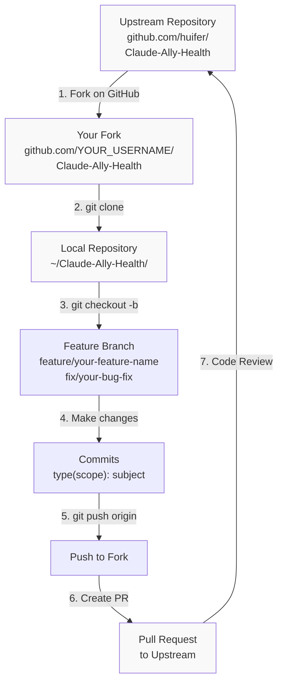
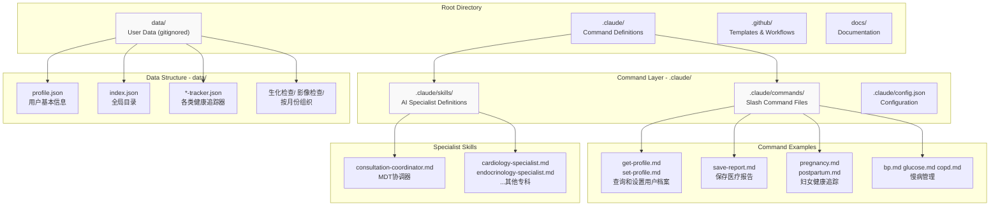
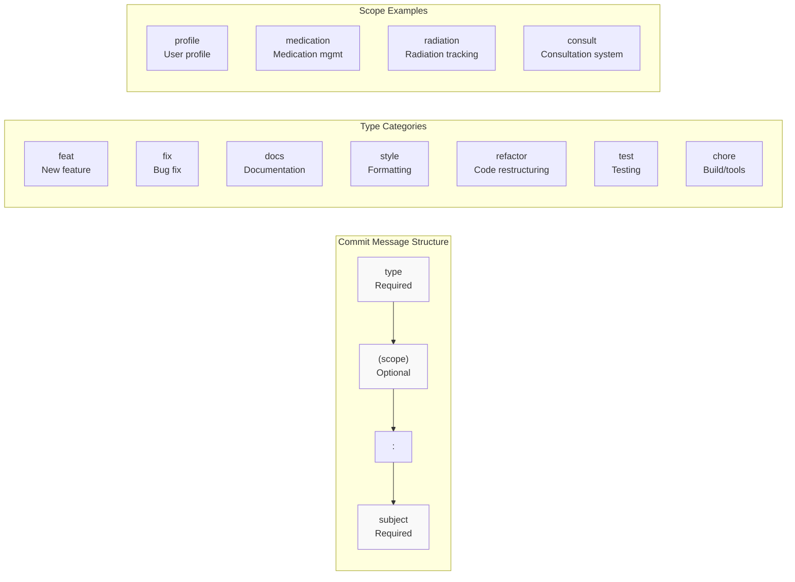
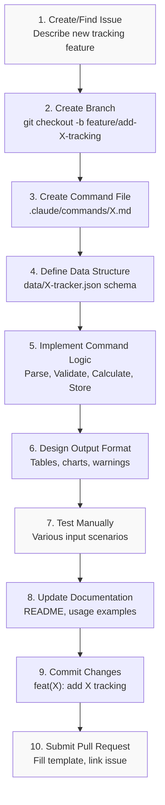
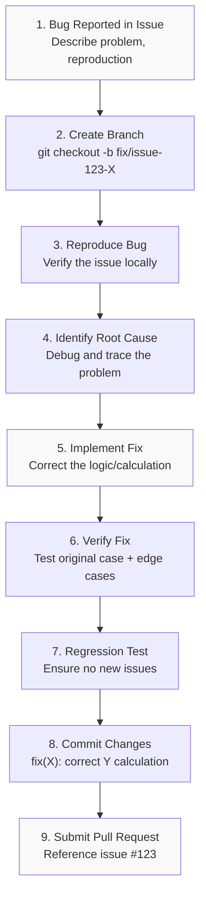

<!-- source: DeepWiki mcp.deepwiki.com · repo huifer/Claude-Ally-Health · page 8.1 Development Workflow · fetched 2026-10-26 -->

# Development Workflow

<details>
<summary>Relevant source files</summary>

The following files were used as context for generating this wiki page:

- [.claude/commands/get-profile.md](.claude/commands/get-profile.md)
- [.github/CONTRIBUTING.en.md](.github/CONTRIBUTING.en.md)
- [.github/SECURITY.en.md](.github/SECURITY.en.md)

</details>


This page describes the contribution process for Claude-Ally-Health developers, including fork procedures, branch naming conventions, commit message standards, and pull request guidelines. For security considerations during development, see [Security & Privacy](#8.2). For testing procedures and validation methods, see [Testing Framework](#8.3).

## Overview

Claude-Ally-Health follows a fork-based contribution workflow with semantic commit messages and standardized branch naming. All contributions must maintain the project's privacy-first architecture (local-only storage, no cloud synchronization) and adhere to medical safety principles (no diagnoses, no prescriptions, no prognosis).

Sources: [.github/CONTRIBUTING.en.md:1-202]()

## Fork and Clone Workflow

The contribution process begins with forking the repository and creating a local development environment.



**Development Workflow: Fork and Clone**

### Step 1: Fork the Repository

Navigate to `https://github.com/huifer/Claude-Ally-Health` and click the Fork button to create a copy under your GitHub account.

### Step 2: Clone Your Fork

```bash
git clone https://github.com/YOUR_USERNAME/Claude-Ally-Health.git
cd Claude-Ally-Health
```

### Step 3: Create a Feature Branch

```bash
# For new features
git checkout -b feature/your-feature-name

# For bug fixes
git checkout -b fix/your-bug-fix
```

Sources: [.github/CONTRIBUTING.en.md:48-66]()

## Branch Naming Conventions

Branch names follow a prefix-based convention that categorizes the type of work being performed.

| Prefix | Purpose | Example |
|--------|---------|---------|
| `feature/` | New functionality or commands | `feature/add-blood-pressure-tracking` |
| `fix/` | Bug fixes and corrections | `fix/fix-date-parsing-error` |
| `docs/` | Documentation updates | `docs/update-readme-installation` |
| `refactor/` | Code restructuring without behavior change | `refactor/optimize-data-structure` |
| `test/` | Test additions or modifications | `test/add-unit-tests-for-medication` |

### Branch Naming Pattern

```
<prefix>/<descriptive-kebab-case-name>
```

**Rules:**
- Use lowercase letters
- Separate words with hyphens
- Be descriptive but concise
- Reference the issue being addressed when applicable (e.g., `fix/issue-123-date-parsing`)

Sources: [.github/CONTRIBUTING.en.md:89-113]()

## Project Structure for Contributors

Understanding the file organization is critical for making effective contributions.



**File Organization for Contributors**

### Key Directories

| Directory | Purpose | Typical Changes |
|-----------|---------|-----------------|
| `.claude/commands/` | Slash command definitions | Add new health tracking commands |
| `.claude/skills/` | AI specialist definitions | Add new specialist skills or modify existing ones |
| `data/` | User data storage (gitignored) | Never commit - data structure changes only |
| `.github/` | GitHub templates and workflows | Update contributing guidelines, issue templates |
| `docs/` | Project documentation | Add usage guides, API references |

### Adding a New Command

New slash commands are Markdown files in `.claude/commands/` with YAML frontmatter:

```markdown
---
description: Brief description of the command
arguments: [arg1, arg2]
---

# Command Title

Execution steps and logic...
```

Example structure from [.claude/commands/get-profile.md:1-8]()

### Adding a Specialist Skill

Specialist skills are Markdown files in `.claude/skills/` defining domain expertise and analysis rules. They are invoked by the consultation coordinator during MDT consultations.

Sources: [.github/CONTRIBUTING.en.md:114-134]()

## Commit Message Convention

Commit messages follow semantic versioning conventions to maintain a clear project history.



**Commit Message Structure**

### Format

```
<type>(<scope>): <subject>

[optional body]

[optional footer]
```

### Type Values

| Type | Description | Use Case |
|------|-------------|----------|
| `feat` | New feature | Adding a new tracking module or command |
| `fix` | Bug fix | Correcting calculation errors or data parsing issues |
| `docs` | Documentation | Updating README, adding usage examples |
| `style` | Code formatting | Whitespace, indentation (no logic change) |
| `refactor` | Code restructuring | Improving code structure without changing behavior |
| `perf` | Performance optimization | Improving query efficiency or calculation speed |
| `test` | Testing | Adding or modifying test scripts |
| `chore` | Build/tools | Updating dependencies, CI configuration |
| `ci` | CI configuration | GitHub Actions workflow changes |

### Scope Values

Common scopes in Claude-Ally-Health:

| Scope | Module |
|-------|--------|
| `profile` | User profile management [.claude/commands/get-profile.md]() |
| `medication` | Medication and interaction tracking |
| `radiation` | Radiation dose tracking |
| `consult` | MDT consultation system |
| `pregnancy` | Pregnancy tracking |
| `postpartum` | Postpartum care |
| `bp` | Blood pressure management |
| `glucose` | Diabetes management |
| `prostate` | Prostate health |
| `cognitive` | Cognitive assessment |
| `nutrition` | Nutrition tracking |
| `emergency` | Emergency card generation |

### Subject Rules

- Use imperative mood, present tense: "add" not "added" or "adds"
- First letter lowercase
- No period at the end
- Maximum 50 characters

### Examples

```bash
feat(medication): add drug interaction checking
fix(radiation): correct dose calculation for children
docs(readme): update installation instructions
refactor(data): optimize json structure for better performance
test(pregnancy): add unit tests for due date calculation
chore(deps): update claude-code version
```

Sources: [.github/CONTRIBUTING.en.md:135-180]()

## Making Changes

### Adding a New Slash Command

**Step 1: Create Command File**

Create a new Markdown file in `.claude/commands/` with the pattern:
- Query commands: `get-<feature>.md`
- Update commands: `set-<feature>.md` or `<feature>.md`
- Recording commands: `record-<feature>.md` or `<feature>-record.md`

**Step 2: Define Command Structure**

```markdown
---
description: Command description in Chinese
arguments: [arg1, arg2, ...]
---

# Command Title in Chinese

Brief explanation of what the command does.

## 执行步骤

1. **Read/Validate Data**
   - File paths and data validation
   
2. **Process Input**
   - Natural language parsing or structured input
   
3. **Calculate/Assess**
   - Metrics, risk scores, classifications
   
4. **Store Data**
   - JSON file operations
   
5. **Generate Output**
   - Formatted display with visualizations
```

**Step 3: Implement Data Structure**

If the command requires new data files, define the JSON structure:
- Simple tracking: `data/<feature>-tracker.json`
- Time-series data: `data/<feature>/YYYY-MM/<records>.json`
- Reference data: `data/<feature>-database.json`

**Step 4: Update Index**

Ensure `data/index.json` is updated programmatically to catalog new data files.

### Modifying Data Structures

When changing existing JSON structures:

1. **Maintain Backward Compatibility**: Add new fields, don't remove existing ones
2. **Provide Migration**: If breaking changes are necessary, provide migration instructions
3. **Update All Commands**: Ensure all commands reading/writing the data are updated
4. **Test Existing Data**: Verify existing user data still loads correctly

### Adding a New Specialist Skill

**Step 1: Create Skill File**

Create a new Markdown file in `.claude/skills/` following the pattern `<specialty>-specialist.md`

**Step 2: Define Specialist Role**

```markdown
# <Specialty> Specialist (中文名称)

## Role Definition

You are a senior <specialty> specialist analyzing patient data...

## Data Sources

List which data files this specialist analyzes:
- profile.json
- <specialty>-tracker.json
- Relevant lab results from 生化检查/
- Relevant imaging from 影像检查/

## Analysis Framework

1. **Data Collection**
2. **Risk Assessment**
3. **Recommendations**

## Safety Constraints

- No diagnoses
- No prescriptions
- No prognosis
```

**Step 3: Register with Coordinator**

Ensure the new specialist is invoked by `.claude/skills/consultation-coordinator.md` during MDT consultations.

Sources: [.claude/commands/get-profile.md:1-156](), [.github/CONTRIBUTING.en.md:114-134]()

## Pull Request Process

### Before Submitting

**Checklist:**
- [ ] Code follows project coding standards
- [ ] All tests pass (see [Testing Framework](#8.3))
- [ ] Documentation updated for new features
- [ ] Commit messages follow semantic convention
- [ ] No sensitive data in commits (check `.gitignore`)
- [ ] Security considerations reviewed (see [Security & Privacy](#8.2))

### Creating a Pull Request

1. **Push to Your Fork**
   ```bash
   git push origin feature/your-feature-name
   ```

2. **Open Pull Request on GitHub**
   - Navigate to your fork
   - Click "New Pull Request"
   - Select base: `huifer/Claude-Ally-Health:main`
   - Select compare: `YOUR_USERNAME/Claude-Ally-Health:feature/your-feature-name`

3. **Fill Out PR Template**

   Provide:
   - **Description**: What does this PR do?
   - **Motivation**: Why is this change needed?
   - **Testing**: How was this tested?
   - **Screenshots**: For UI/output changes
   - **Related Issues**: Link to GitHub issues

4. **Wait for Code Review**
   - Address reviewer comments
   - Push additional commits to the same branch
   - Re-request review when ready

5. **Merge**
   - Once approved, maintainers will merge the PR
   - Your branch can then be deleted

Sources: [.github/CONTRIBUTING.en.md:84-88]()

## Coding Standards

### File Organization

- **Modularity**: Keep related functionality together
- **Naming**: Use descriptive file names in kebab-case
  - Commands: `<action>-<feature>.md`
  - Skills: `<specialty>-specialist.md`
  - Data: `<feature>-tracker.json`
- **Directory Structure**: Follow existing patterns
  - Commands by function (not by medical specialty)
  - Data organized by domain and time period

### Code Style

- **Consistency**: Match existing command and skill styles
- **Comments**: Use Chinese for user-facing messages, English for technical comments
- **Naming Conventions**:
  - JSON keys: `snake_case` or `camelCase` (be consistent within a file)
  - Display labels: Chinese with appropriate medical terminology
- **Simplicity**: Avoid over-engineering; prefer clear, straightforward implementations

### Documentation Standards

- **Bilingual**: Maintain both Chinese (primary) and English documentation where applicable
- **Examples**: Include usage examples for all commands
- **Medical Accuracy**: Verify medical terminology and calculations with authoritative sources
- **Safety Notes**: Clearly state limitations and when to seek professional medical care

Sources: [.github/CONTRIBUTING.en.md:114-134]()

## Security Considerations for Developers

### Data Privacy During Development

**Critical Rules:**

1. **Never Commit User Data**
   - The `data/` directory is gitignored in [.gitignore]()
   - Verify `.gitignore` is working: `git status` should not show `data/` contents
   - Use example/test data in separate directories if needed for documentation

2. **No Cloud Dependencies**
   - Do not add features requiring cloud synchronization
   - Do not integrate remote databases
   - External API calls must be explicitly documented and optional

3. **Local-Only Architecture**
   - All data operations use local file system
   - No background uploads or telemetry
   - Optional AI features (e.g., image analysis) must clearly disclose external service usage

### Version Control Hygiene

```bash
# Before committing, always check
git status

# Ensure no data/ files are staged
git diff --staged

# If data/ files appear, check .gitignore
cat .gitignore | grep data
```

### Security Checklist for New Features

- [ ] Feature does not require network access (or is clearly optional)
- [ ] No hard-coded credentials or API keys
- [ ] User data remains on local file system
- [ ] `.gitignore` prevents accidental commits
- [ ] Documentation explains any external service dependencies
- [ ] AI safety constraints maintained (no diagnoses/prescriptions/prognosis)

Sources: [.github/SECURITY.en.md:1-136]()

## Testing Requirements

Before submitting a pull request, ensure:

1. **Manual Testing**
   - Test all modified commands end-to-end
   - Verify data files are created/updated correctly
   - Check output formatting and visualizations

2. **Edge Cases**
   - Test with missing data
   - Test with invalid input
   - Test boundary conditions (e.g., extreme dates, values)

3. **Existing Data Compatibility**
   - Verify existing data structures still load
   - Test migration logic if data format changed

4. **Cross-Module Integration**
   - If changes affect multiple modules, test interactions
   - Verify `index.json` updates correctly
   - Test emergency card generation with new data

For detailed testing procedures and available test scripts, see [Testing Framework](#8.3).

Sources: [.github/CONTRIBUTING.en.md:182-186]()

## Common Development Workflows

### Workflow 1: Adding a New Health Tracking Command



**Workflow: Adding a New Health Tracking Command**

### Workflow 2: Fixing a Bug



**Workflow: Fixing a Bug**

Sources: [.github/CONTRIBUTING.en.md:23-66]()

## Contact and Support

For development questions:

- **GitHub Issues**: [https://github.com/huifer/Claude-Ally-Health/issues](https://github.com/huifer/Claude-Ally-Health/issues)
- **Email**: huifer97@163.com
- **Website**: [https://www.wellally.tech/](https://www.wellally.tech/)

### Issue Templates

Use appropriate issue templates:
- **Bug Report**: For defects and incorrect behavior
- **Feature Request**: For new functionality proposals
- **Documentation**: For documentation improvements

Sources: [.github/CONTRIBUTING.en.md:188-193](), [.github/SECURITY.en.md:127-131]()

---

