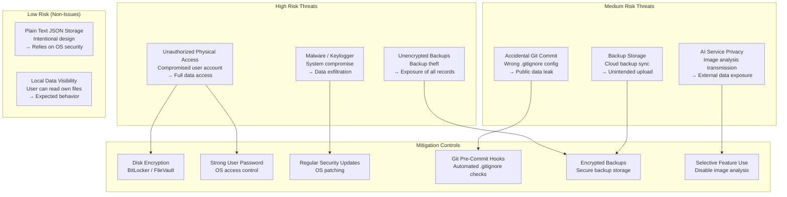
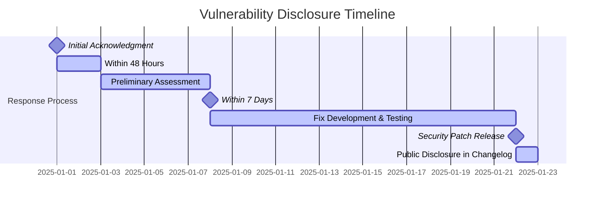
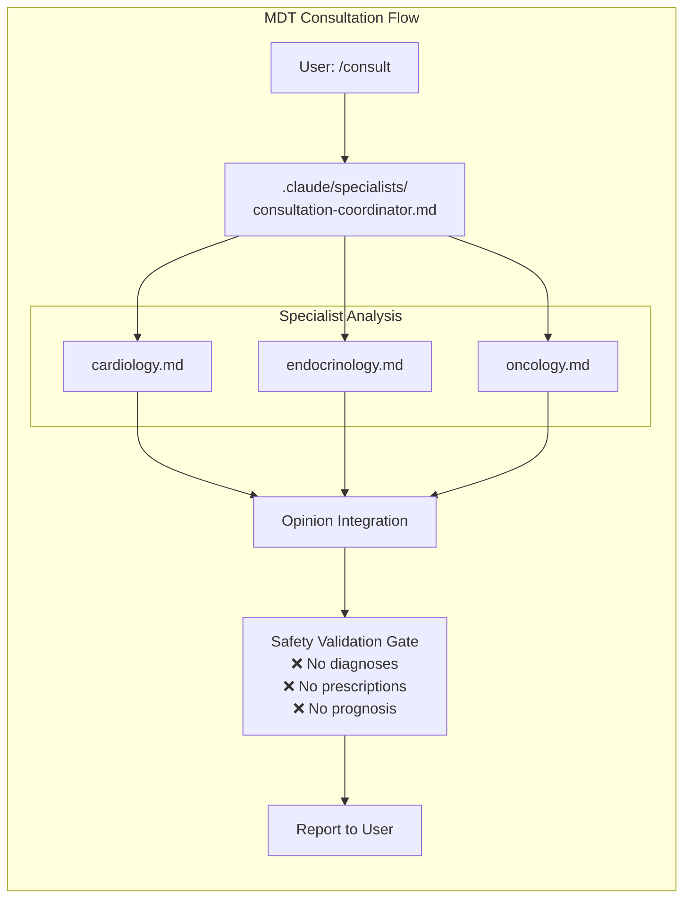

<!-- source: DeepWiki mcp.deepwiki.com · repo huifer/Claude-Ally-Health · page 8.2 Security & Privacy · fetched 2026-10-26 -->

# Security & Privacy

<details>
<summary>Relevant source files</summary>

The following files were used as context for generating this wiki page:

- [.claude/commands/get-profile.md](.claude/commands/get-profile.md)
- [.github/CONTRIBUTING.en.md](.github/CONTRIBUTING.en.md)
- [.github/SECURITY.en.md](.github/SECURITY.en.md)
- [README.md](README.md)
- [README.zh-CN.md](README.zh-CN.md)
- [docs/data-structures.md](docs/data-structures.md)

</details>


This document describes the security model, privacy features, and data protection mechanisms implemented in Claude-Ally-Health. The system employs a privacy-first architecture with local-only storage, explicit data sovereignty, and defense-in-depth security layers.

For information about medical safety principles and usage limitations, see [Medical Safety Principles](#6.2). For details on development practices and code contribution security, see [Development Workflow](#8.1).

---

## Privacy Architecture Overview

Claude-Ally-Health implements a **local-only, file-based storage architecture** with zero external data transmission (except for optional AI image analysis features). All health data remains on the user's local file system under complete user control.

### Core Privacy Principles

| Principle | Implementation | Status |
|-----------|---------------|---------|
| **Local Storage Only** | JSON files in `data/` directory | ✅ Enforced |
| **No Cloud Synchronization** | No remote upload functionality | ✅ Enforced |
| **No External Database** | Pure file-based storage | ✅ Enforced |
| **Complete User Control** | User owns all data files | ✅ Enforced |
| **Transparent Data Format** | Human-readable JSON | ✅ Enforced |

Sources: [README.md:111-116](), [README.md:25](), [README.md:37](), [.github/SECURITY.en.md:54-62]()

---

## Data Storage Model

### File System Architecture

```mermaid
graph TB
    subgraph "User Machine - Local File System"
        subgraph "Project Root"
            Commands[".claude/commands/<br/>save-report.md<br/>query.md<br/>profile.md<br/>interaction.md"]
            Specialists[".claude/specialists/<br/>cardiology.md<br/>endocrinology.md<br/>consultation-coordinator.md"]
            GitIgnore[".gitignore<br/>Excludes: data/"]
        end
        
        subgraph "data/ Directory - EXCLUDED FROM GIT"
            Profile["profile.json<br/>User basic info"]
            Allergies["allergies.json<br/>Allergy history"]
            Radiation["radiation-records.json<br/>Radiation exposure"]
            
            subgraph "Medications Subdirectory"
                Meds["medications/medications.json<br/>Active medications"]
                MedLogs["medications/medication-logs/YYYY-MM/YYYY-MM-DD.json<br/>Daily adherence"]
            end
            
            subgraph "Interactions Subdirectory"
                InteractionDB["interactions/interaction-db.json<br/>Drug interaction rules"]
                InteractionLogs["interactions/interaction-logs/<br/>Check history"]
            end
            
            subgraph "Medical Records - Month-Based"
                Biochem["生化检查/YYYY-MM/YYYY-MM-DD_test_name.json"]
                Imaging["影像检查/YYYY-MM/YYYY-MM-DD_test_name.json"]
                Images["影像检查/YYYY-MM/images/<br/>Original image backups"]
                Surgery["手术记录/YYYY-MM/YYYY-MM-DD_surgery.json"]
                Discharge["出院小结/YYYY-MM/YYYY-MM-DD_diagnosis.json"]
            end
            
            Index["index.json<br/>Global catalog"]
        end
    end
    
    subgraph "Operating System Security Layer"
        FilePerms["File System Permissions<br/>User access control"]
        DiskEncrypt["Disk Encryption<br/>BitLocker / FileVault"]
    end
    
    GitIgnore -.excludes.-> Profile
    GitIgnore -.excludes.-> Meds
    GitIgnore -.excludes.-> Biochem
    GitIgnore -.excludes.-> Index
    
    FilePerms -.protects.-> Profile
    FilePerms -.protects.-> Meds
    FilePerms -.protects.-> Biochem
    
    DiskEncrypt -.encrypts.-> Profile
    DiskEncrypt -.encrypts.-> Meds
    DiskEncrypt -.encrypts.-> Biochem
    
    style GitIgnore fill:#f9f9f9
    style FilePerms fill:#f9f9f9
    style DiskEncrypt fill:#f9f9f9
```



**Data Storage Security Model**

All health data files reside within the `data/` directory, which is explicitly excluded from version control via `.gitignore`. The system relies on three security layers:

1. **Application Layer**: `.gitignore` prevents accidental commits of sensitive data
2. **OS Layer**: File system permissions restrict access to the user account
3. **Hardware Layer**: Disk encryption protects data at rest

Sources: [README.md:40-90](), [.github/SECURITY.en.md:65-84]()

---

## Git Exclusion Patterns

### Version Control Protection

The `.gitignore` configuration must exclude the entire `data/` directory to prevent accidental exposure of health information in version control systems.

**Required `.gitignore` Entries:**

```
data/
*.json
!interaction-db.json
```

This pattern ensures:
- All files in `data/` directory are excluded
- All JSON files are excluded by default
- The drug interaction database template (`interaction-db.json`) can be included in version control as it contains no personal data

**Pre-Commit Verification Checklist:**

| Check | Command | Expected Result |
|-------|---------|-----------------|
| Git Status | `git status` | `data/` directory not listed |
| Tracked Files | `git ls-files data/` | No output (empty) |
| History Scan | `git log --all --full-history -- data/` | No commits |

Sources: [.github/SECURITY.en.md:80-84](), [README.md:66-88]()

---

## External Service Interactions

### AI Image Analysis Privacy Considerations

The system uses an external AI service for medical report image recognition, which represents the **only exception** to the local-only storage principle.

```mermaid
sequenceDiagram
    participant User
    participant ClaudeCode["Claude Code CLI"]
    participant SaveReport[".claude/commands/save-report.md"]
    participant MCPServer["GLM MCP Server<br/>mcp__4_5v_mcp__analyze_image"]
    participant LocalFS["Local File System<br/>data/影像检查/"]
    
    User->>ClaudeCode: "/save-report image.jpg"
    ClaudeCode->>SaveReport: Execute command
    
    Note over SaveReport,MCPServer: ⚠️ EXTERNAL SERVICE CALL
    SaveReport->>MCPServer: Send image for analysis
    MCPServer-->>SaveReport: Return structured data
    
    Note over SaveReport,LocalFS: LOCAL STORAGE
    SaveReport->>LocalFS: Save extracted data as JSON
    SaveReport->>LocalFS: Save original image backup
    
    SaveReport-->>User: Display structured results
```

**Privacy Implications:**

| Aspect | Details | Risk Level |
|--------|---------|------------|
| **Service Used** | GLM's `mcp__4_5v_mcp__analyze_image` | N/A |
| **Data Transmitted** | Medical report images (when user invokes `/save-report`) | Medium |
| **Data Retained by Service** | Unknown - depends on GLM's privacy policy | Unknown |
| **User Control** | Optional feature - user controls when images are sent | User-initiated |
| **Mitigation** | Original images stored locally; users can disable feature | Available |

**Recommendation**: Users concerned about image privacy should avoid the `/save-report` command with images and manually enter data using natural language commands instead.

Sources: [README.md:17](), [README.md:26](), [.github/SECURITY.en.md:86-92]()

---

## Threat Model

### Identified Security Risks



**Known Non-Security Issues** (by design):

- **Plain Text JSON Storage**: Data files are stored in human-readable JSON format without application-level encryption. This is intentional to ensure data portability and user accessibility. Protection relies on OS-level access controls.
- **Local Data Visibility**: The user who runs the application can read all data files. This is expected behavior and not a vulnerability.

Sources: [.github/SECURITY.en.md:94-105]()

---

## Operating System Security Dependencies

### Multi-Layer Security Model

The system's security model relies on the following OS-provided protections:

| Layer | Mechanism | Provided By | User Responsibility |
|-------|-----------|-------------|---------------------|
| **Authentication** | User account password | OS | Use strong password |
| **Authorization** | File system permissions | OS | Proper account setup |
| **Encryption at Rest** | Disk encryption | BitLocker (Windows)<br/>FileVault (macOS)<br/>LUKS (Linux) | Enable and configure |
| **Backup Security** | Encrypted backups | Time Machine<br/>Windows Backup<br/>User-chosen tools | Configure encryption |
| **Network Isolation** | No network services | Application design | None (enforced) |

**Security Checklist for Users:**

```
☐ Operating system fully updated
☐ User account protected with strong password
☐ Full disk encryption enabled (BitLocker/FileVault/LUKS)
☐ .gitignore correctly configured (excludes data/)
☐ Regular encrypted backups configured
☐ Backup storage secured with encryption
☐ No public cloud sync services enabled for data/ directory
```

Sources: [.github/SECURITY.en.md:107-115]()

---

## Backup Security Requirements

### Secure Backup Strategy

Since the system stores all data locally, **users are solely responsible** for implementing a backup strategy. Unencrypted backups represent a significant security risk.

**Recommended Backup Approach:**

1. **Regular Schedule**: Automate daily/weekly backups of the `data/` directory
2. **Encryption**: Always encrypt backup archives before storage
3. **Secure Storage**: Store backups on encrypted drives or secure cloud storage with zero-knowledge encryption
4. **Access Control**: Restrict backup access to trusted devices only
5. **Retention Policy**: Maintain multiple backup versions with 30-90 day retention

**Backup Security Matrix:**

| Backup Method | Security Level | Recommended |
|---------------|----------------|-------------|
| Unencrypted local drive | ❌ Low | No |
| Unencrypted cloud storage | ❌ Very Low | No |
| Encrypted local drive | ✅ High | Yes |
| Encrypted cloud with zero-knowledge | ✅ High | Yes |
| Encrypted removable media (off-site) | ✅ Very High | Yes |

**Example Secure Backup Command (Linux/macOS):**

```bash
# Create encrypted tarball of data directory
tar czf - data/ | gpg --symmetric --cipher-algo AES256 > backup-$(date +%Y%m%d).tar.gz.gpg

# Store backup.tar.gz.gpg securely
# Verify with: gpg --decrypt backup-20251231.tar.gz.gpg | tar tzf -
```

Sources: [.github/SECURITY.en.md:65-84]()

---

## Vulnerability Disclosure Process

### Reporting Security Issues

Security vulnerabilities must be reported privately through the following process:

**Reporting Channel:**

| Method | Contact | Subject Line |
|--------|---------|--------------|
| Email | huifer97@163.com | `[Security] Claude-Ally-Health Security Vulnerability Report` |

**DO NOT create public GitHub issues for security vulnerabilities.**

**Required Report Information:**

1. **Vulnerability Description**: Detailed explanation of the security issue
2. **Affected Versions**: Which versions/branches are vulnerable
3. **Reproduction Steps**: Step-by-step instructions to reproduce
4. **Potential Impact**: Severity assessment and potential harm
5. **Suggested Fix**: Proposed remediation (optional but helpful)

**Response Timeline:**



**Handling Process:**

1. **Confirmation** (48 hours): Acknowledge receipt and confirm vulnerability
2. **Assessment** (7 days): Evaluate severity and develop fix plan
3. **Fix** (varies): Implement, test, and release security patch
4. **Disclosure** (after fix): Public disclosure in changelog with credit to reporter

Sources: [.github/SECURITY.en.md:1-49]()

---

## Supported Versions and Updates

### Security Update Policy

| Version | Security Support | Recommendation |
|---------|------------------|----------------|
| **main branch** | ✅ Supported | Use for latest security patches |
| **Other branches** | ❌ Unsupported | Not recommended for production use |
| **Archived versions** | ❌ Unsupported | Upgrade to main branch |

**Update Notification:**

Security-related changes are documented in the project changelog with the following labels:

- `[SECURITY]` - Security vulnerability fixes
- `[PRIVACY]` - Privacy-related improvements
- `[BREAKING]` - Changes that require user action

**Staying Informed:**

Users should monitor:
- GitHub repository releases: `https://github.com/huifer/Claude-Ally-Health/releases`
- Security advisories (when available)
- Changelog for security labels

Sources: [.github/SECURITY.en.md:7-14](), [.github/SECURITY.en.md:117-125]()

---

## Medical Safety Boundaries

### Ethical Constraints and Safety Red Lines

While not strictly "security" in the technical sense, the system implements strict **medical safety boundaries** that prevent misuse and ensure ethical operation.

**Safety Red Lines** (Hard-Coded Constraints):

| Prohibited Action | Reason | Implementation |
|-------------------|--------|----------------|
| **Provide specific drug dosages** | Medical liability, individual variation | AI specialist instructions |
| **Prescribe prescription medications** | Requires medical license | AI specialist instructions |
| **Make definitive diagnoses** | Beyond AI capability | AI specialist instructions |
| **Predict life prognosis** | Ethical boundary | AI specialist instructions |

These constraints are embedded in specialist skill definitions (`.claude/specialists/*.md`) and cannot be overridden by users. All specialist outputs must pass through a **Safety Validation Gate** before being displayed.



**Example Safety Constraint from Specialist Skills:**

The consultation coordinator explicitly defines safety boundaries that all specialists must follow:

- "不提供具体用药剂量" (Do not provide specific drug dosages)
- "不直接开具处方药名" (Do not directly prescribe prescription drugs)
- "不判断生死预后" (Do not predict life prognosis)
- "不替代医生诊断" (Do not replace doctor diagnosis)

Sources: [README.md:148-158](), [README.zh-CN.md:149-158]()

---

## Security Best Practices for Users

### Recommended Security Configuration

**Environment Setup:**

```bash
# 1. Verify .gitignore configuration
cat .gitignore | grep "data/"
# Expected output: data/

# 2. Check for accidentally tracked files
git ls-files data/
# Expected output: (empty - no files listed)

# 3. Verify file permissions (Linux/macOS)
ls -la data/
# Ensure owner is your user account, permissions 700 or 600

# 4. Check disk encryption status
# macOS:
fdesetup status
# Expected: FileVault is On

# Windows PowerShell:
manage-bde -status
# Expected: Protection On
```

**Operational Security Practices:**

| Practice | Implementation | Frequency |
|----------|----------------|-----------|
| **System Updates** | Keep OS and software updated | Weekly |
| **Password Management** | Use strong, unique account password | One-time setup |
| **Backup Verification** | Test restore process | Monthly |
| **Access Audit** | Review who has access to device | Monthly |
| **Data Minimization** | Delete outdated health records | Quarterly |

**Multi-Device Usage:**

If using the system across multiple devices, ensure:

1. Each device has full disk encryption enabled
2. Backups are encrypted before cross-device transfer
3. No automatic cloud sync services are enabled for `data/` directory
4. Transfer methods are secure (encrypted USB, secure file transfer protocols)

Sources: [.github/SECURITY.en.md:50-115]()

---

## Development Security Practices

### For Contributors

Contributors must follow security guidelines when developing features:

**Code Review Security Checklist:**

```
☐ No hardcoded credentials or API keys
☐ No logging of sensitive health data
☐ No external network calls (except documented MCP server)
☐ Input validation for all user-provided data
☐ Proper file path sanitization
☐ No shell command injection vulnerabilities
☐ Documentation updated for any privacy-impacting changes
```

**Pull Request Requirements:**

1. **Privacy Impact Statement**: Describe any changes to data handling
2. **External Service Disclosure**: Document any new external service integrations
3. **Security Testing**: Demonstrate security considerations were reviewed
4. **Changelog Entry**: Add security-relevant changes to changelog with `[SECURITY]` or `[PRIVACY]` label

**Branch Security:**

- Feature branches must not contain real user data
- Test data must be synthetic and clearly marked
- No personal health information in commit messages or PR descriptions

Sources: [.github/CONTRIBUTING.en.md:69-87](), [.github/CONTRIBUTING.en.md:114-134]()

---

## Privacy Compliance Considerations

### Data Sovereignty and Regulations

The system's local-only architecture provides inherent compliance advantages:

**Regulatory Framework Alignment:**

| Regulation | Compliance Status | Notes |
|------------|-------------------|-------|
| **GDPR** (EU) | ✅ Compliant | No data processing, user controls all data |
| **HIPAA** (US) | ⚠️ Partial | Not a covered entity, but follows privacy principles |
| **PIPEDA** (Canada) | ✅ Compliant | Personal data remains with individual |
| **Personal Information Protection Laws** | ✅ Compliant | No third-party data sharing |

**Key Compliance Features:**

- **Right to Access**: User has complete access to all data files
- **Right to Erasure**: User can delete files at any time
- **Right to Portability**: JSON format enables easy data export
- **Consent**: No data processing without explicit user action
- **Transparency**: Open-source codebase enables full audit

**Limitations:**

The system is designed for **personal use only** and is not intended for:
- Healthcare provider use (requires HIPAA compliance infrastructure)
- Research data collection (requires IRB approval and consent frameworks)
- Commercial health services (requires additional regulatory compliance)

Sources: [README.md:111-116](), [.github/SECURITY.en.md:54-62]()

---

## Audit and Transparency

### Open Source Security Model

The project's open-source nature enables community security review:

**Transparency Features:**

- **Source Code**: Fully available at `https://github.com/huifer/Claude-Ally-Health`
- **Data Structures**: Documented in [docs/data-structures.md]()
- **Commands**: Visible in [.claude/commands/]()
- **Specialists**: Visible in [.claude/specialists/]()

**Security Audit Guidance:**

To audit the system's security properties:

1. **Review Data Storage**: Examine [docs/data-structures.md]() for data formats
2. **Inspect Commands**: Check [.claude/commands/]() for data handling logic
3. **Verify Privacy Claims**: Confirm no network code in command definitions
4. **Examine AI Specialists**: Review [.claude/specialists/]() for safety constraints
5. **Check External Dependencies**: Identify external service calls (currently only MCP image analysis)

**Community Security:**

Users are encouraged to:
- Report security issues privately (see Vulnerability Disclosure section)
- Contribute security improvements via pull requests
- Review code changes in pull requests for privacy impacts
- Participate in security discussions on GitHub Issues

Sources: [README.md:1-11](), [.github/CONTRIBUTING.en.md:1-201](), [.github/SECURITY.en.md:1-136]()

---

## Summary

Claude-Ally-Health implements a **privacy-first, security-in-depth** architecture:

- **Local-Only Storage**: All data resides on user's machine
- **No Cloud Dependencies**: Zero external data transmission (except optional image analysis)
- **User Data Sovereignty**: Complete user control over all health information
- **Defense-in-Depth**: Multiple security layers (Git exclusion, OS permissions, disk encryption)
- **Transparent Operation**: Open-source codebase enables security auditing
- **Medical Safety**: Hard-coded ethical boundaries prevent misuse

**Security Responsibility Model:**

| Layer | Responsible Party |
|-------|-------------------|
| Application Design | Claude-Ally-Health Project |
| OS Security | User |
| Disk Encryption | User |
| Backup Security | User |
| Physical Security | User |

Users must understand that local-only storage provides strong privacy guarantees but requires user responsibility for backup security and device protection.

Sources: [README.md:111-116](), [.github/SECURITY.en.md:50-115]()

---

