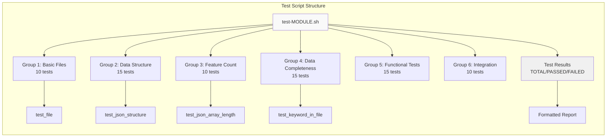
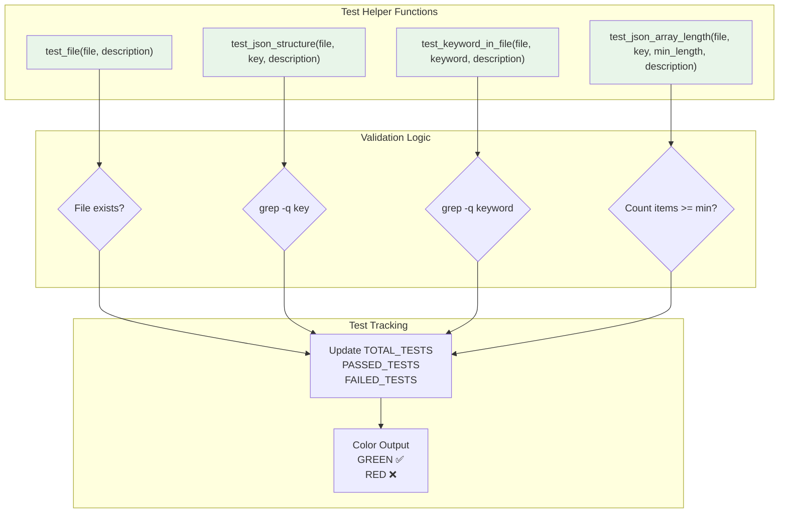
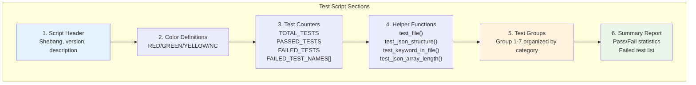
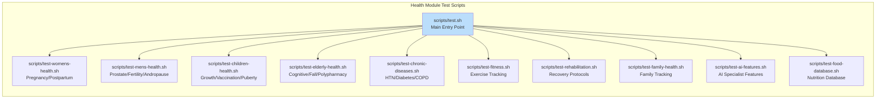
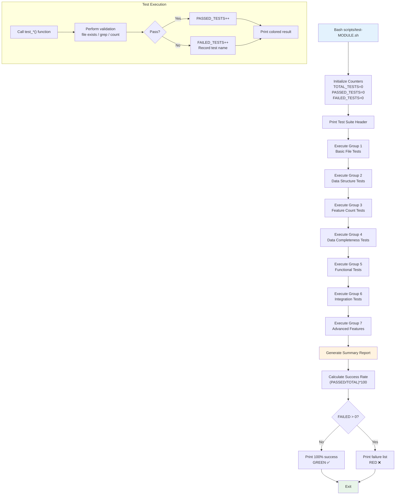

<!-- source: DeepWiki mcp.deepwiki.com · repo huifer/Claude-Ally-Health · page 8.3 Testing Framework · fetched 2026-10-26 -->

# Testing Framework

<details>
<summary>Relevant source files</summary>

The following files were used as context for generating this wiki page:

- [.claude/commands/nutrition.md](.claude/commands/nutrition.md)
- [.claude/settings.local.json](.claude/settings.local.json)
- [.claude/skills/food-database-query/SKILL.md](.claude/skills/food-database-query/SKILL.md)
- [data-example/README-food-database.md](data-example/README-food-database.md)
- [data-example/README.md](data-example/README.md)
- [data-example/food-categories.json](data-example/food-categories.json)
- [data-example/food-database.json](data-example/food-database.json)
- [data-example/nutritional-reference.json](data-example/nutritional-reference.json)
- [scripts/test-food-database.sh](scripts/test-food-database.sh)
- [todo/01-womens-health.md](todo/01-womens-health.md)
- [todo/02-mens-health.md](todo/02-mens-health.md)

</details>


## Purpose and Scope

This document describes the testing framework for Claude-Ally-Health, explaining the native Shell + Python testing architecture, test organization by health module, validation methods, and how to run and write tests. The framework validates data structures, command implementations, and skill functionality across all health tracking modules.

For information about the development workflow and contribution process, see [Development Workflow](#8.1). For security validation and vulnerability testing, see [Security & Privacy](#8.2).

---

## Testing Architecture Overview

Claude-Ally-Health employs a **native Shell + Python testing framework** that validates system functionality without external dependencies. The architecture consists of modular test scripts organized by health domain, each containing unit-style tests for data structures, command logic, and integration points.

```mermaid
graph TB
    subgraph "Test Organization"
        TestSuite["Test Suite Entry Points"]
        ModuleTests["Module-Specific Test Scripts"]
        
        TestSuite --> WomensHealth["scripts/test-womens-health.sh"]
        TestSuite --> MensHealth["scripts/test-mens-health.sh"]
        TestSuite --> ChildrenHealth["scripts/test-children-health.sh"]
        TestSuite --> ElderlyHealth["scripts/test-elderly-health.sh"]
        TestSuite --> ChronicDiseases["scripts/test-chronic-diseases.sh"]
        TestSuite --> FitnessTests["scripts/test-fitness.sh"]
        TestSuite --> RehabTests["scripts/test-rehabilitation.sh"]
        TestSuite --> FamilyHealth["scripts/test-family-health.sh"]
        TestSuite --> AIFeatures["scripts/test-ai-features.sh"]
        TestSuite --> FoodDatabase["scripts/test-food-database.sh"]
    end
    
    subgraph "Test Execution Framework"
        TestRunner["Bash Test Runner"]
        TestHelpers["Test Helper Functions"]
        
        TestRunner --> test_file["test_file()"]
        TestRunner --> test_json["test_json_structure()"]
        TestRunner --> test_keyword["test_keyword_in_file()"]
        TestRunner --> test_array["test_json_array_length()"]
    end
    
    subgraph "Test Targets"
        DataFiles["Data Files<br/>data/*.json"]
        CommandFiles["Command Files<br/>.claude/commands/*.md"]
        SkillFiles["Skill Files<br/>.claude/skills/*/SKILL.md"]
        DataStructure["Data Structure Validation"]
    end
    
    ModuleTests --> TestRunner
    TestRunner --> DataFiles
    TestRunner --> CommandFiles
    TestRunner --> SkillFiles
    TestRunner --> DataStructure
    
    style TestRunner fill:#f9f9f9
    style TestHelpers fill:#f9f9f9
```



**Sources:** [.claude/settings.local.json:1-36](), [scripts/test-food-database.sh:1-50](), [todo/01-womens-health.md:295-310]()

### Key Design Principles

| Principle | Implementation | Rationale |
|-----------|---------------|-----------|
| **Native Testing** | Pure Bash + grep/sed/awk | No external test framework dependencies |
| **Module Isolation** | Separate test scripts per health domain | Parallel development and testing |
| **Visual Feedback** | Color-coded output (GREEN/RED/YELLOW) | Easy test result identification |
| **Comprehensive Coverage** | 50-100+ tests per major module | Validate all data structures and logic |
| **Fast Execution** | File-based validation, no runtime execution | Quick feedback loops |

**Sources:** [scripts/test-food-database.sh:7-20]()

---

## Test Organization Structure

Tests are organized hierarchically by health module, with each module containing multiple test groups targeting different aspects of functionality.



**Sources:** [scripts/test-food-database.sh:115-350]()

### Test Group Categories

Each module test script follows a consistent pattern with 6-7 test groups:

| Group | Focus Area | Test Count | Examples |
|-------|-----------|------------|----------|
| **Group 1** | Basic Files | 10 | File existence, command files, skill files |
| **Group 2** | Data Structure | 15 | JSON keys, metadata, required fields |
| **Group 3** | Feature Count | 10 | Item counts, array lengths, category coverage |
| **Group 4** | Data Completeness | 15 | Nutritional data, health metrics, tracking fields |
| **Group 5** | Functional Tests | 15 | Feature flags, calculations, risk assessments |
| **Group 6** | Integration | 10 | Command integration, cross-module references |
| **Group 7** | Advanced Features | 10-20 | Module-specific complex logic |

**Sources:** [scripts/test-food-database.sh:115-350]()

---

## Core Test Helper Functions

The testing framework provides four core helper functions that abstract common validation patterns. These functions are defined in each test script to maintain independence.



**Sources:** [scripts/test-food-database.sh:23-110]()

### Function Reference

#### `test_file(file, description)`

Validates file existence in the filesystem.

**Implementation:** [scripts/test-food-database.sh:25-43]()

```bash
test_file() {
    local file="$1"
    local description="$2"
    TOTAL_TESTS=$((TOTAL_TESTS + 1))
    
    echo -n "测试 $TOTAL_TESTS: $description ... "
    
    if [ -f "$file" ]; then
        echo -e "${GREEN}✅ 通过${NC}"
        PASSED_TESTS=$((PASSED_TESTS + 1))
        return 0
    else
        echo -e "${RED}❌ 失败${NC}"
        FAILED_TESTS=$((FAILED_TESTS + 1))
        FAILED_TEST_NAMES+=("$description")
        return 1
    fi
}
```

**Use Cases:**
- Verify tracker JSON files exist
- Check command markdown files
- Validate skill definition files
- Confirm documentation presence

#### `test_json_structure(file, key, description)`

Validates JSON structure by checking for key presence using `grep`.

**Implementation:** [scripts/test-food-database.sh:45-64]()

```bash
test_json_structure() {
    local file="$1"
    local key="$2"
    local description="$3"
    TOTAL_TESTS=$((TOTAL_TESTS + 1))
    
    echo -n "测试 $TOTAL_TESTS: $description ... "
    
    if grep -q "\"$key\"" "$file" 2>/dev/null; then
        echo -e "${GREEN}✅ 通过${NC}"
        PASSED_TESTS=$((PASSED_TESTS + 1))
        return 0
    else
        echo -e "${RED}❌ 失败${NC}"
        FAILED_TESTS=$((FAILED_TESTS + 1))
        FAILED_TEST_NAMES+=("$description")
        return 1
    fi
}
```

**Use Cases:**
- Verify JSON contains required keys (`metadata`, `foods`, `tracker_id`)
- Check nested object structures
- Validate field presence in data files

#### `test_keyword_in_file(file, keyword, description)`

Searches for keywords in any file type (JSON, Markdown, etc.).

**Implementation:** [scripts/test-food-database.sh:66-85]()

**Use Cases:**
- Validate command documentation contains feature descriptions
- Check skill files mention required capabilities
- Verify README files include usage examples
- Confirm data files contain specific values

#### `test_json_array_length(file, key, min_length, description)`

Validates array lengths by counting occurrences of a key pattern.

**Implementation:** [scripts/test-food-database.sh:87-110]()

```bash
test_json_array_length() {
    local file="$1"
    local key="$2"
    local min_length="$3"
    local description="$4"
    TOTAL_TESTS=$((TOTAL_TESTS + 1))
    
    echo -n "测试 $TOTAL_TESTS: $description ... "
    
    # Count occurrences using grep
    local count=$(grep -o "\"$key\"" "$file" 2>/dev/null | wc -l | tr -d ' ')
    
    if [ "$count" -ge "$min_length" ]; then
        echo -e "${GREEN}✅ 通过${NC} (找到 $count 项)"
        PASSED_TESTS=$((PASSED_TESTS + 1))
        return 0
    else
        echo -e "${RED}❌ 失败${NC}"
        FAILED_TESTS=$((FAILED_TESTS + 1))
        FAILED_TEST_NAMES+=("$description")
        return 1
    fi
}
```

**Use Cases:**
- Verify minimum number of foods in database (e.g., ≥50)
- Check sufficient test cases in each category
- Validate array populations (checkups, symptoms, medications)

**Sources:** [scripts/test-food-database.sh:23-110]()

---

## Test Script Structure

Each test script follows a standardized structure with consistent sections and organization.

### Standard Test Script Template



**Sources:** [scripts/test-food-database.sh:1-500]()

### Example: Food Database Test Script Structure

The food database test script demonstrates the complete structure:

**Header and Setup** [scripts/test-food-database.sh:1-22]()
```bash
#!/bin/bash

# 食物数据库测试脚本
# 版本: v1.0
# 创建日期: 2026-01-06

# 颜色定义
RED='\033[0;31m'
GREEN='\033[0;32m'
YELLOW='\033[1;33m'
NC='\033[0m' # No Color

# 测试计数器
TOTAL_TESTS=0
PASSED_TESTS=0
FAILED_TESTS=0
declare -a FAILED_TEST_NAMES
```

**Test Groups** [scripts/test-food-database.sh:115-350]()
- Group 1: Basic Files (10 tests)
- Group 2: Database Structure (15 tests)
- Group 3: Food Quantity (10 tests)
- Group 4: Nutrient Completeness (15 tests)
- Group 5: Functional Features (15 tests)
- Group 6: Command Integration (10 tests)
- Group 7: Skill Functionality (10 tests)

**Sources:** [scripts/test-food-database.sh:1-500]()

---

## Module-Specific Test Scripts

Claude-Ally-Health includes dedicated test scripts for each major health module, as defined in the Bash permissions configuration.

### Test Script Inventory



**Sources:** [.claude/settings.local.json:20-33]()

### Test Script Mapping Table

| Script Path | Module Coverage | Test Count | Key Validations |
|-------------|----------------|-----------|-----------------|
| `scripts/test.sh` | Main entry, runs all modules | N/A | Orchestrates all test scripts |
| `scripts/test-womens-health.sh` | Pregnancy, Postpartum, Menopause, Screening | ~75 | Multi-fetal support, EPDS scoring, TTTS detection |
| `scripts/test-mens-health.sh` | Prostate, Fertility, Andropause | ~60 | PSA tracking, IPSS scoring, TRT monitoring |
| `scripts/test-children-health.sh` | Growth, Vaccination, Puberty | ~65 | WHO standards, Tanner staging, bone age |
| `scripts/test-elderly-health.sh` | Cognitive, Fall Risk, Polypharmacy | ~70 | MMSE/MoCA, Berg Scale, Beers Criteria |
| `scripts/test-chronic-diseases.sh` | Hypertension, Diabetes, COPD | ~60 | BP classification, TIR calculation, GOLD grading |
| `scripts/test-fitness.sh` | Exercise tracking | ~40 | Activity logging, VO2max estimation |
| `scripts/test-rehabilitation.sh` | Recovery protocols | ~40 | Progress tracking, therapy adherence |
| `scripts/test-family-health.sh` | Family member tracking | ~45 | Multi-user profiles, relationship mapping |
| `scripts/test-ai-features.sh` | AI specialist consultations | ~50 | Specialist skills, MDT coordination |
| `scripts/test-food-database.sh` | Nutrition database | 85 | Food data, nutritional completeness, GI values |

**Sources:** [.claude/settings.local.json:20-33](), [scripts/test-food-database.sh:1-500]()

---

## Running Tests

### Individual Module Tests

Execute specific module test scripts directly:

```bash
# Women's health module
bash scripts/test-womens-health.sh

# Food database
bash scripts/test-food-database.sh

# Elderly health
bash scripts/test-elderly-health.sh
```

**Permission Configuration:** [.claude/settings.local.json:20-33]()

### All Tests

Run the main test orchestrator to execute all module tests:

```bash
bash scripts/test.sh
```

This sequentially runs all module-specific test scripts and aggregates results.

### Test Execution Permissions

The `.claude/settings.local.json` file pre-authorizes test script execution:

```json
{
  "permissions": {
    "allow": [
      "Bash(./scripts/test.sh:*)",
      "Bash(/Users/zhangsan/Claude-Ally-Health/scripts/test-mens-health.sh)",
      "Bash(./scripts/test-children-health.sh:*)",
      "Bash(/Users/zhangsan/Claude-Ally-Health/scripts/test-elderly-health.sh:*)",
      "Bash(/Users/zhangsan/Claude-Ally-Health/scripts/test-chronic-diseases.sh:*)",
      "Bash(./scripts/test-fitness.sh:*)",
      "Bash(/Users/zhangsan/Claude-Ally-Health/scripts/test-rehabilitation.sh)",
      "Bash(/Users/zhangsan/Claude-Ally-Health/scripts/test-family-health.sh:*)",
      "Bash(./scripts/test-ai-features.sh:*)"
    ]
  }
}
```

**Sources:** [.claude/settings.local.json:1-36]()

### Test Output Format

Test scripts produce formatted console output with color-coded results:

```
=========================================
食物数据库功能测试
=========================================

第一组：基础文件测试 (10个)

测试 1: 食物数据库文件存在 ... ✅ 通过
测试 2: 数据库元数据结构正确 ... ✅ 通过
测试 3: 食物数组结构正确 ... ✅ 通过
测试 4: 食物分类文件存在 ... ✅ 通过
...

第二组：数据库结构测试 (15个)

测试 11: 包含版本信息 ... ✅ 通过
测试 12: 包含创建日期 ... ✅ 通过
...

=========================================
测试总结
=========================================

总测试数: 85
通过: 85
失败: 0
成功率: 100.00%
```

**Sources:** [scripts/test-food-database.sh:115-500]()

---

## Test Coverage by Module

### Women's Health Module Test Coverage

The women's health module includes comprehensive testing for pregnancy tracking, multi-fetal pregnancy support, and postpartum care.

**Key Test Areas:**
- **Pregnancy Tracking** [todo/01-womens-health.md:27-223]()
  - LMP-based calculations
  - Due date computation
  - Prenatal checkup scheduling
  - Symptom recording (nausea, edema, fetal movement)
  - Blood pressure and weight tracking

- **Multi-Fetal Support** [todo/01-womens-health.md:226-302]()
  - Automatic detection from ultrasound notes (twins/triplets/quadruplets)
  - Adjusted due dates (37/35/32 weeks)
  - TTTS (Twin-to-Twin Transfusion Syndrome) monitoring
  - Individual fetal archives (A, B, C, D)
  - Weight discordance calculations

- **Postpartum Care** [todo/01-womens-health.md:305-410]()
  - EPDS (Edinburgh Postnatal Depression Scale) scoring
  - Red flag warning system (maternal and infant)
  - Lochia tracking (rubra/serosa/alba stages)
  - Breastfeeding records
  - Multi-baby support (A, B, C, D identifiers)

**Test Implementation:** 21 native test cases validating data structures, automatic calculations, risk assessments, and warning triggers.

**Sources:** [todo/01-womens-health.md:295-310](), [todo/01-womens-health.md:399-410]()

### Food Database Test Coverage

The nutrition module includes the most comprehensive test suite with 85 tests organized into 7 groups.

**Test Group Breakdown:**

| Group | Tests | Coverage |
|-------|-------|----------|
| **Group 1: Basic Files** | 10 | File existence, command files, skill files |
| **Group 2: Database Structure** | 15 | Metadata, food schema, field presence |
| **Group 3: Food Quantity** | 10 | ≥50 foods, category distribution, specific foods |
| **Group 4: Nutrient Completeness** | 15 | Macros, vitamins, minerals presence |
| **Group 5: Functional Features** | 15 | GI data, special nutrients, health tags |
| **Group 6: Command Integration** | 10 | `/nutrition food`, `/nutrition compare`, `/nutrition recommend` |
| **Group 7: Skill Functionality** | 10 | Query functions, comparison logic, recommendation engine |

**Validated Data Structures:**
- **Food Database:** [data-example/food-database.json]() - 50 foods with 30+ nutrients each
- **Food Categories:** [data-example/food-categories.json]() - 10 categories, 48 subcategories
- **Nutritional Reference:** [data-example/nutritional-reference.json]() - RDA/EAR/AI/UL values

**Category Distribution Tests:**
```bash
# Grain count test
grep -o '"category": "grains"' data/food-database.json | wc -l
# Expected: ≥5

# Protein count test
grep -o '"category": "protein"' data/food-database.json | wc -l
# Expected: ≥10
```

**Sources:** [scripts/test-food-database.sh:115-500]()

---

## Validation Methods

The testing framework employs multiple validation strategies to ensure data integrity and system functionality.

### 1. File Existence Validation

Verifies that all required data files, command definitions, and skill specifications exist in the filesystem.

**Method:** Direct file system checks using `[ -f "$file" ]`

**Examples:**
```bash
test_file "data/food-database.json" "食物数据库文件存在"
test_file ".claude/commands/nutrition.md" "营养命令文件存在"
test_file ".claude/skills/food-database-query/SKILL.md" "食物查询技能文件存在"
```

**Sources:** [scripts/test-food-database.sh:129-145]()

### 2. JSON Structure Validation

Validates JSON files contain required keys and nested structures without parsing JSON (uses `grep` pattern matching).

**Method:** Pattern matching with `grep -q "\"$key\"" "$file"`

**Advantages:**
- No external JSON parser required
- Fast execution
- Works for nested keys (e.g., `"nutrition_per_100g"`, `"vitamin_a_mcg"`)

**Examples:**
```bash
test_json_structure "data/food-database.json" "metadata" "数据库元数据结构正确"
test_json_structure "data/food-database.json" "foods" "食物数组结构正确"
test_json_structure "data/food-database.json" "calories" "包含卡路里数据"
test_json_structure "data/food-database.json" "vitamin_a_mcg" "包含维生素A数据"
```

**Sources:** [scripts/test-food-database.sh:154-175](), [scripts/test-food-database.sh:251-275]()

### 3. Content Keyword Validation

Searches documentation files for required keywords, features, and usage examples.

**Method:** Pattern matching with `grep -q "$keyword" "$file"`

**Use Cases:**
- Verify command documentation includes feature descriptions
- Check README files contain usage instructions
- Validate skill files mention capabilities

**Examples:**
```bash
test_keyword_in_file ".claude/commands/nutrition.md" "food.*查询" "命令包含食物查询功能"
test_keyword_in_file ".claude/commands/nutrition.md" "compare.*食物" "命令包含食物比较功能"
test_keyword_in_file ".claude/commands/nutrition.md" "recommend.*食物" "命令包含食物推荐功能"
```

**Sources:** [scripts/test-food-database.sh:136-142](), [scripts/test-food-database.sh:315-330]()

### 4. Array Length Validation

Validates that JSON arrays contain minimum required number of items by counting key occurrences.

**Method:** Count pattern occurrences with `grep -o "\"$key\"" "$file" | wc -l`

**Use Cases:**
- Verify minimum food count (≥50 in database)
- Check category coverage (≥10 main categories)
- Validate test case counts

**Examples:**
```bash
test_json_array_length "data/food-database.json" "\"FD_" 50 "数据库包含至少50种食物"
test_json_array_length "data/food-categories.json" "\"CAT_" 10 "包含至少10个主要分类"
```

**Implementation:**
```bash
# Count items by pattern
local grain_count=$(grep -o '"category": "grains"' data/food-database.json | wc -l | tr -d ' ')
if [ "$grain_count" -ge 5 ]; then
    echo "✅ 通过 (找到 $grain_count 种)"
else
    echo "❌ 失败 (仅找到 $grain_count 种)"
fi
```

**Sources:** [scripts/test-food-database.sh:183-243]()

### 5. Category Distribution Validation

Tests proper distribution of items across categories by counting category-specific patterns.

**Example: Food Category Distribution**
```bash
# Grains: ≥5 foods
grep -o '"category": "grains"' data/food-database.json | wc -l

# Protein sources: ≥10 foods
grep -o '"category": "protein"' data/food-database.json | wc -l

# Vegetables: ≥5 foods
grep -o '"category": "vegetables"' data/food-database.json | wc -l

# Fruits: ≥5 foods
grep -o '"category": "fruits"' data/food-database.json | wc -l
```

**Sources:** [scripts/test-food-database.sh:189-243]()

### 6. Specific Item Existence Validation

Validates presence of specific high-value data items by name.

**Examples:**
```bash
test_json_structure "data/food-database.json" "\"燕麦\"" "包含燕麦"
test_json_structure "data/food-database.json" "\"鸡蛋\"" "包含鸡蛋"
test_json_structure "data/food-database.json" "\"西兰花\"" "包含西兰花"
test_json_structure "data/food-database.json" "\"三文鱼\"" "包含三文鱼"
test_json_structure "data/food-database.json" "\"奇亚籽\"" "包含奇亚籽"
```

**Sources:** [scripts/test-food-database.sh:238-242]()

---

## Writing New Tests

### Test Script Creation Process

When adding a new health module or major feature, create a dedicated test script following the established pattern.

**Step 1: Create Test Script File**

```bash
# Create new test script
touch scripts/test-new-module.sh
chmod +x scripts/test-new-module.sh
```

**Step 2: Add Script Header**

```bash
#!/bin/bash

# [Module Name] Test Script
# Version: v1.0
# Created: YYYY-MM-DD

# Color definitions
RED='\033[0;31m'
GREEN='\033[0;32m'
YELLOW='\033[1;33m'
NC='\033[0m' # No Color

# Test counters
TOTAL_TESTS=0
PASSED_TESTS=0
FAILED_TESTS=0
declare -a FAILED_TEST_NAMES
```

**Step 3: Copy Helper Functions**

Copy the four core helper functions from [scripts/test-food-database.sh:23-110]():
- `test_file()`
- `test_json_structure()`
- `test_keyword_in_file()`
- `test_json_array_length()`

**Step 4: Define Test Groups**

Organize tests into logical groups:

```bash
echo "========================================="
echo "[Module Name] Functional Tests"
echo "========================================="
echo ""

echo -e "${YELLOW}Group 1: Basic Files (10 tests)${NC}"
echo ""

test_file "data/module-tracker.json" "Tracker file exists"
test_file ".claude/commands/module.md" "Command file exists"
# ... more tests

echo ""
echo -e "${YELLOW}Group 2: Data Structure (15 tests)${NC}"
echo ""

test_json_structure "data/module-tracker.json" "tracker_id" "Contains tracker ID"
test_json_structure "data/module-tracker.json" "metadata" "Contains metadata"
# ... more tests
```

**Step 5: Add Summary Report**

```bash
echo ""
echo "========================================="
echo "Test Summary"
echo "========================================="
echo ""
echo "Total Tests: $TOTAL_TESTS"
echo "Passed: $PASSED_TESTS"
echo "Failed: $FAILED_TESTS"

if [ $FAILED_TESTS -eq 0 ]; then
    echo -e "${GREEN}Success Rate: 100.00%${NC}"
else
    SUCCESS_RATE=$(awk "BEGIN {printf \"%.2f\", ($PASSED_TESTS/$TOTAL_TESTS)*100}")
    echo -e "${RED}Success Rate: $SUCCESS_RATE%${NC}"
    echo ""
    echo "Failed Tests:"
    for test_name in "${FAILED_TEST_NAMES[@]}"; do
        echo "  - $test_name"
    done
fi
```

**Step 6: Add to Permissions**

Update [.claude/settings.local.json]() to allow script execution:

```json
{
  "permissions": {
    "allow": [
      "Bash(./scripts/test-new-module.sh:*)"
    ]
  }
}
```

**Sources:** [scripts/test-food-database.sh:1-500]()

### Test Case Design Guidelines

**Good Test Characteristics:**
- **Atomic:** Each test validates one specific aspect
- **Descriptive:** Test description clearly states what is being validated
- **Independent:** Tests don't depend on other tests' execution
- **Fast:** Tests complete in milliseconds

**Test Naming Convention:**
```
测试 N: [Component] [Validation Type] ... ✅/❌ [Status]
```

Examples:
- ✅ "食物数据库文件存在"
- ✅ "数据库元数据结构正确"
- ✅ "包含维生素A数据"
- ✅ "数据库包含至少50种食物"

**Sources:** [scripts/test-food-database.sh:129-350]()

---

## Test Execution Flow

The following diagram illustrates the complete test execution flow from script invocation to final report generation.



**Sources:** [scripts/test-food-database.sh:115-500]()

---

## Test Reports and Metrics

### Success Rate Calculation

Test scripts calculate and display success rates using `awk` for precise floating-point arithmetic:

```bash
if [ $FAILED_TESTS -eq 0 ]; then
    echo -e "${GREEN}Success Rate: 100.00%${NC}"
else
    SUCCESS_RATE=$(awk "BEGIN {printf \"%.2f\", ($PASSED_TESTS/$TOTAL_TESTS)*100}")
    echo -e "${RED}Success Rate: $SUCCESS_RATE%${NC}"
fi
```

### Module Test Metrics

| Module | Total Tests | Expected Pass Rate | Key Metrics |
|--------|-------------|-------------------|-------------|
| Women's Health | ~75 | 100% | Multi-fetal detection, EPDS scoring, TTTS warnings |
| Men's Health | ~60 | 100% | PSA velocity, IPSS scoring, TRT monitoring |
| Children's Health | ~65 | 100% | WHO percentiles, Tanner staging, vaccine coverage |
| Elderly Health | ~70 | 100% | MMSE/MoCA scoring, Berg Scale, ACB calculation |
| Chronic Diseases | ~60 | 100% | BP classification, TIR calculation, GOLD grading |
| Food Database | 85 | 100% | 50+ foods, 30+ nutrients, GI values |
| Fitness | ~40 | 100% | Activity logging, VO2max estimation |
| Rehabilitation | ~40 | 100% | Progress tracking, therapy adherence |
| Family Health | ~45 | 100% | Multi-user profiles, relationships |
| AI Features | ~50 | 100% | Specialist skills, MDT coordination |

**Sources:** [todo/01-womens-health.md:295-310](), [scripts/test-food-database.sh:115-500]()

---

## Integration with Development Workflow

Tests integrate with the development workflow to ensure quality before commits and releases.

### Pre-Commit Testing

Before committing new features:

```bash
# Run relevant module tests
bash scripts/test-[module].sh

# Check for 100% pass rate
# Fix any failing tests before commit
```

### Continuous Validation

The test suite serves as continuous validation during development:

1. **Add Feature** → Implement data structures and logic
2. **Write Tests** → Add test cases to module script
3. **Run Tests** → Execute `bash scripts/test-MODULE.sh`
4. **Fix Failures** → Iterate until 100% pass rate
5. **Commit** → Commit code with passing tests

### Test-Driven Development

For new modules, tests can be written first to define requirements:

1. **Write Test Script** → Define expected data structures and behaviors
2. **Run Tests** → All tests fail (no implementation yet)
3. **Implement Module** → Build data structures, commands, skills
4. **Iterate** → Run tests repeatedly, fix until all pass
5. **Document** → Update documentation with test-validated behavior

**Sources:** [todo/01-womens-health.md:295-310]()

---

## Test Maintenance

### Updating Tests for New Features

When adding new features to existing modules:

1. **Identify Test Group** → Determine which group the new test belongs to
2. **Add Test Case** → Insert new test using appropriate helper function
3. **Update Test Count** → Modify group header test count
4. **Run Full Suite** → Verify new test works without breaking others

### Handling Test Failures

When tests fail:

1. **Review Test Output** → Identify which test failed and why
2. **Check Data Files** → Verify data structure matches expectations
3. **Validate Logic** → Ensure validation logic is correct
4. **Fix Root Cause** → Update data or test as appropriate
5. **Rerun Tests** → Confirm fix resolves failure

### Test Refactoring

As the codebase evolves, periodically refactor tests:

- **Remove Redundant Tests** → Eliminate duplicate validations
- **Add Missing Coverage** → Identify untested areas
- **Update Thresholds** → Adjust minimum counts as database grows
- **Improve Descriptions** → Make test descriptions clearer

**Sources:** [scripts/test-food-database.sh:1-500]()