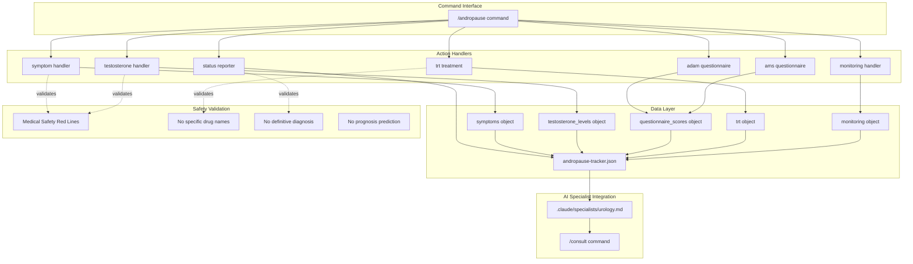
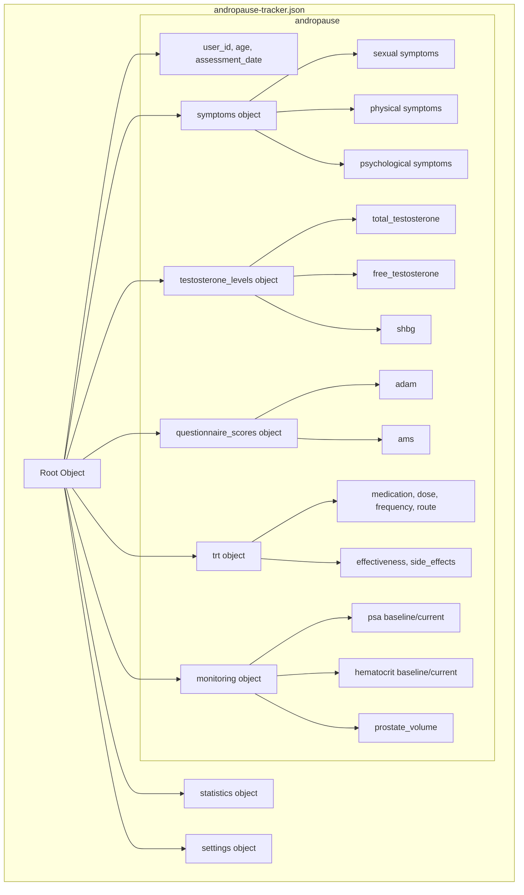
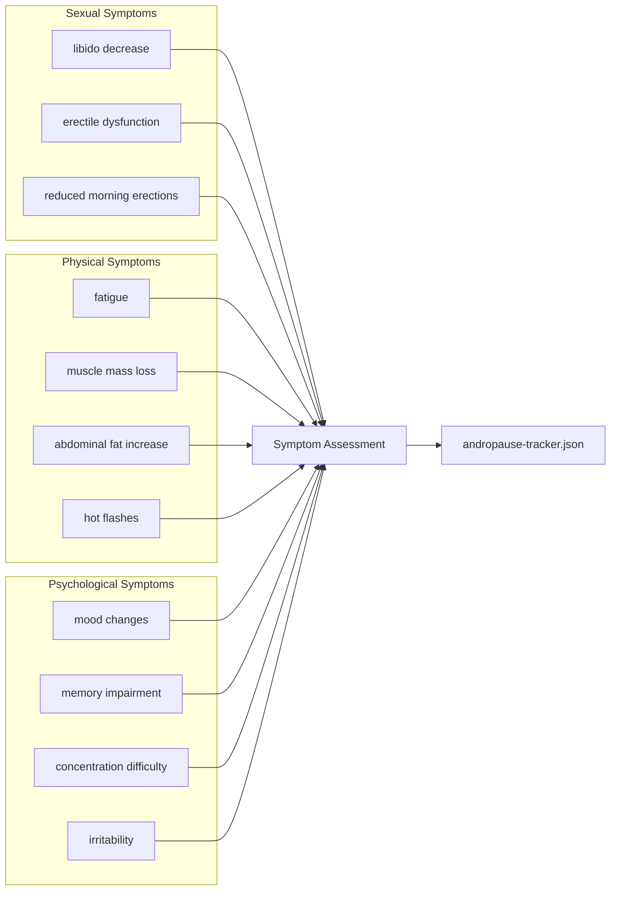
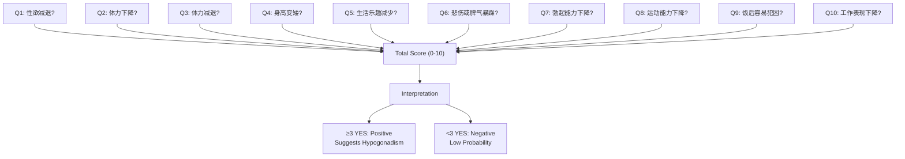
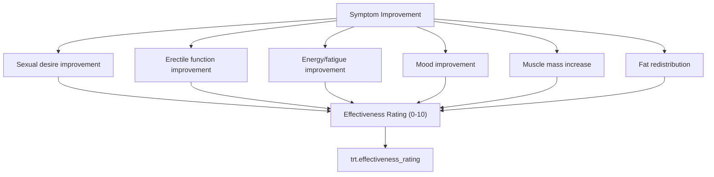
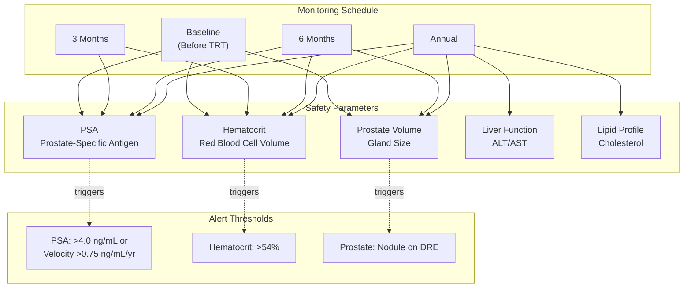
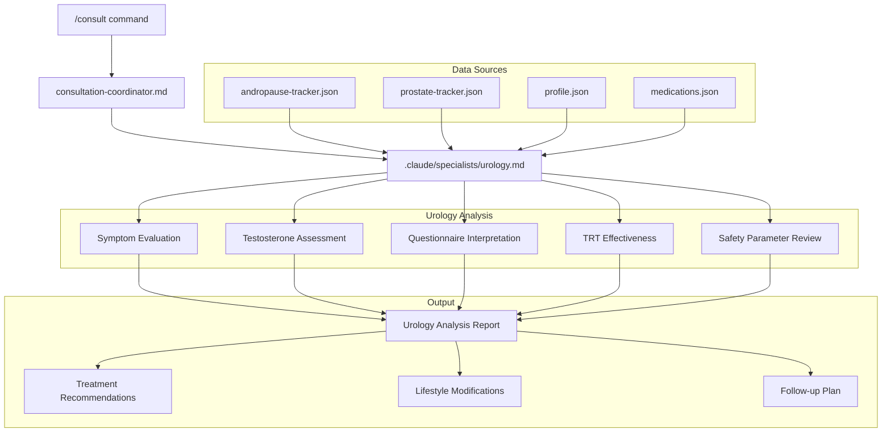
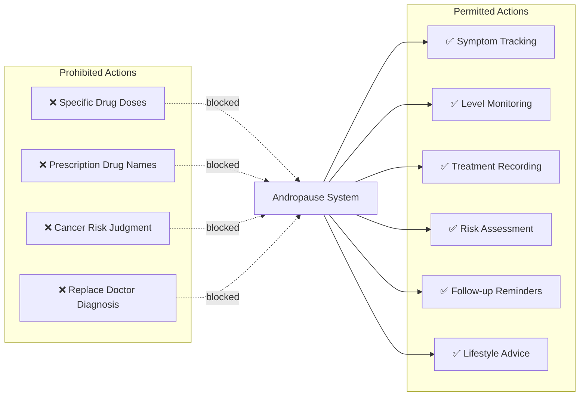
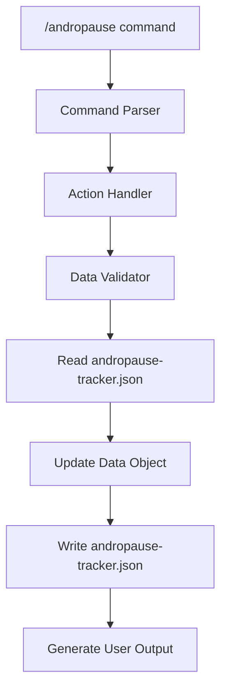

<!-- source: DeepWiki mcp.deepwiki.com · repo huifer/Claude-Ally-Health · extra page Andropause Management · fetched 2026-10-26 -->

# Andropause Management

<details>
<summary>Relevant source files</summary>

The following files were used as context for generating this wiki page:

- [.claude/commands/prostate-health.md](.claude/commands/prostate-health.md)
- [.claude/commands/puberty.md](.claude/commands/puberty.md)
- [.claude/settings.local.json](.claude/settings.local.json)
- [.claude/specialists/pediatrics.md](.claude/specialists/pediatrics.md)
- [.claude/specialists/urology.md](.claude/specialists/urology.md)
- [data-example/andropause-tracker.json](data-example/andropause-tracker.json)
- [data-example/child-vaccinations.json](data-example/child-vaccinations.json)
- [todo/01-womens-health.md](todo/01-womens-health.md)
- [todo/02-mens-health.md](todo/02-mens-health.md)

</details>


## Purpose and Scope

This document describes the Andropause Management module, which provides comprehensive tracking and monitoring for male age-related hypogonadism (andropause/male menopause). The system tracks testosterone levels, evaluates symptoms across sexual/physical/psychological domains, manages standardized questionnaires (ADAM/AMS), records Testosterone Replacement Therapy (TRT) treatment, and monitors safety parameters.

For prostate health monitoring, see [Prostate Health](#4.2.1). For male fertility assessment, see [Male Fertility Assessment](#4.2.2). For general men's health overview, see [Men's Health](#4.2).

**Status**: ✅ Fully implemented (completed 2026-01-02)

Sources: [todo/02-mens-health.md:1-10](), [todo/02-mens-health.md:427-433]()

---

## Clinical Background

### What is Andropause?

Andropause (male climacteric, late-onset hypogonadism, androgen deficiency in aging males) is a clinical syndrome characterized by declining testosterone levels combined with specific symptoms in middle-aged and older men. Unlike female menopause, the hormonal decline is gradual, typically beginning in the 40s with testosterone dropping approximately 1-2% per year.

**Diagnostic Criteria**:
- Total testosterone < 10 nmol/L (confirmed with ≥2 morning measurements)
- Presence of characteristic symptoms
- Exclusion of other causes (medications, chronic diseases)

**Symptom Categories**:
1. **Sexual symptoms**: Decreased libido, erectile dysfunction, reduced morning erections
2. **Physical symptoms**: Fatigue, decreased muscle mass, increased abdominal fat, reduced bone density
3. **Psychological symptoms**: Depression, irritability, memory impairment, decreased concentration

Sources: [todo/02-mens-health.md:432-456](), [data-example/andropause-tracker.json:10-71]()

---

## System Architecture

The following diagram illustrates the andropause management system's component architecture:



**Component Responsibilities**:
- **Command Interface**: Parses `/andropause` commands with natural language input
- **Action Handlers**: Process specific operations (symptom recording, testosterone tracking, questionnaires)
- **Data Layer**: Persists all andropause-related data in JSON structure
- **AI Specialist Integration**: Urology specialist analyzes data during multi-disciplinary consultations
- **Safety Validation**: Enforces medical safety principles throughout all operations

Sources: [todo/02-mens-health.md:427-649](), [data-example/andropause-tracker.json:1-189](), [.claude/specialists/urology.md:1-186]()

---

## Command Interface

The andropause module is accessed via the `/andropause` command with various action types:

### Command Syntax

```bash
/andropause [action] [info]
```

### Available Actions

| Action | Purpose | Example |
|--------|---------|---------|
| `symptom` | Record symptom (sexual/physical/psychological) | `/andropause symptom libido decreased` |
| `testosterone` | Record testosterone level with time | `/andropause testosterone 7.5 09:00` |
| `free-testosterone` | Record free testosterone | `/andropause free-testosterone 0.18` |
| `adam` | Complete ADAM questionnaire | `/andropause adam` |
| `ams` | Complete AMS questionnaire | `/andropause ams` |
| `trt start` | Begin TRT treatment | `/andropause trt start gel 50mg daily` |
| `trt effectiveness` | Evaluate treatment effectiveness | `/andropause trt effectiveness good` |
| `trt side-effects` | Record side effects | `/andropause trt side-effects` |
| `monitor psa` | Record PSA for safety | `/andropause monitor psa 2.1` |
| `monitor hematocrit` | Record hematocrit | `/andropause monitor hematocrit 46` |
| `status` | View comprehensive status | `/andropause status` |
| `diagnosis` | View assessment results | `/andropause diagnosis` |

### Natural Language Processing

The system supports flexible natural language input:

```bash
# All equivalent:
/andropause symptom libido decreased
/andropause symptom 性欲减退
/andropause symptom sex drive down

# Testosterone with Chinese units:
/andropause testosterone 7.5纳摩尔每升 早上9点
/andropause testosterone 7.5 nmol/L 09:00
```

Sources: [todo/02-mens-health.md:621-649](), [.claude/specialists/urology.md:26-31]()

---

## Data Model

### Primary Data Structure

The andropause tracking data is stored in `data/andropause-tracker.json` with the following schema:



### Key Data Objects

**Symptoms Object** [data-example/andropause-tracker.json:10-71]():
```json
{
  "symptoms": {
    "sexual": {
      "libido": {
        "present": true,
        "severity": "moderate",
        "impact": "noticeable"
      },
      "erectile_function": {
        "present": true,
        "severity": "mild",
        "morning_erection": "reduced"
      }
    },
    "physical": {
      "fatigue": {"present": true, "severity": "moderate"},
      "muscle_mass": {"present": true, "changes": "slight_decrease"},
      "body_fat": {"distribution": "abdominal"}
    },
    "psychological": {
      "mood": {"symptoms": ["depressed", "irritability"]},
      "memory": {"severity": "mild"},
      "concentration": {"severity": "moderate"}
    }
  }
}
```

**Testosterone Levels** [data-example/andropause-tracker.json:75-100]():
```json
{
  "testosterone_levels": {
    "total_testosterone": {
      "date": "2025-06-15",
      "time": "09:00",
      "value": 7.5,
      "reference": "10-35",
      "unit": "nmol/L",
      "result": "low",
      "confirmed": true,
      "repeat_count": 2
    },
    "free_testosterone": {
      "value": 0.18,
      "reference": "0.22-0.65",
      "result": "low"
    },
    "shbg": {
      "value": 45,
      "reference": "20-50",
      "result": "normal"
    }
  }
}
```

**TRT Object** [data-example/andropause-tracker.json:128-144]():
```json
{
  "trt": {
    "on_treatment": true,
    "medication": "睾酮凝胶",
    "type": "gel",
    "dose": "50mg",
    "frequency": "daily",
    "route": "transdermal",
    "start_date": "2025-12-01",
    "effectiveness": "good",
    "effectiveness_rating": 8,
    "side_effects": ["乳房胀痛"],
    "side_effects_severity": "mild"
  }
}
```

Sources: [data-example/andropause-tracker.json:1-189](), [todo/02-mens-health.md:504-619]()

---

## Symptom Assessment System

### Three-Domain Symptom Tracking

The system tracks symptoms across three clinical domains:



### Symptom Severity Levels

Each symptom is graded on a severity scale:
- `none`: Not present
- `mild`: Minimal impact on daily life
- `moderate`: Noticeable impact, manageable
- `severe`: Significant impact on quality of life

### Recording Symptoms

**Sexual Symptom Example**:
```bash
/andropause symptom libido decreased
# Records: libido.present = true, severity = "moderate"

/andropause symptom erectile_function mild
# Records: erectile_function.severity = "mild"
```

**Physical Symptom Example**:
```bash
/andropause symptom fatigue moderate
# Records: fatigue.present = true, severity = "moderate"

/andropause symptom muscle_mass decreased
# Records: muscle_mass.changes = "slight_decrease"
```

**Psychological Symptom Example**:
```bash
/andropause symptom mood depressed
# Records: mood.symptoms = ["depressed"]

/andropause symptom memory mild_impairment
# Records: memory.severity = "mild"
```

Sources: [todo/02-mens-health.md:435-455](), [data-example/andropause-tracker.json:10-71]()

---

## Testosterone Monitoring

### Measurement Timing and Standards

**Critical Measurement Requirements**:
- **Time**: Early morning (8:00-11:00 AM) when testosterone peaks
- **Confirmation**: ≥2 measurements required for diagnosis
- **Fasting**: Not strictly required but recommended
- **Avoid**: Recent sexual activity, strenuous exercise

### Testosterone Reference Ranges

| Parameter | Normal Range | Low | Diagnostic Threshold |
|-----------|-------------|-----|---------------------|
| Total Testosterone | 10-35 nmol/L | < 10 nmol/L | < 8 nmol/L (confirmed) |
| Free Testosterone | 0.22-0.65 nmol/L | < 0.22 nmol/L | - |
| SHBG | 20-50 nmol/L | - | - |

### Recording Testosterone Levels

**Total Testosterone with Time**:
```bash
/andropause testosterone 7.5 09:00
# Records:
# - value: 7.5 nmol/L
# - time: 09:00 (validates morning measurement)
# - result: "low" (automatic interpretation)
```

**Free Testosterone**:
```bash
/andropause free-testosterone 0.18
# Records:
# - value: 0.18 nmol/L
# - reference: 0.22-0.65
# - result: "low"
```

**SHBG (Sex Hormone Binding Globulin)**:
```bash
/andropause shbg 45
# Records:
# - value: 45 nmol/L
# - result: "normal"
```

### Repeat Measurement Tracking

The system tracks `repeat_count` to ensure diagnostic confirmation:

```json
{
  "total_testosterone": {
    "date": "2025-06-15",
    "value": 7.5,
    "confirmed": true,
    "repeat_count": 2
  }
}
```

**Interpretation Logic**:
- `repeat_count = 1`: Initial measurement, confirmation needed
- `repeat_count ≥ 2` + `value < 8`: Confirmed hypogonadism
- System prompts for second measurement if first is low

Sources: [todo/02-mens-health.md:457-470](), [data-example/andropause-tracker.json:75-100](), [.claude/specialists/urology.md:91-100]()

---

## Clinical Questionnaires

### ADAM Questionnaire (Androgen Deficiency in Aging Males)

The ADAM questionnaire consists of 10 yes/no questions screening for hypogonadism symptoms:



**ADAM Scoring** [data-example/andropause-tracker.json:102-126]():
- Each "Yes" answer = 1 point
- Total score: 0-10
- **≥3 positive answers**: Suggests possible androgen deficiency
- Sensitivity: ~97% (high false positive rate)
- Used as initial screening tool

**Recording ADAM**:
```bash
/andropause adam
# Interactive questionnaire, stores:
# - questions array with answers
# - total_score: 7
# - positive: true
# - interpretation: "提示可能存在男性更年期"
```

### AMS Score (Aging Males' Symptoms Scale)

The AMS is a more detailed 17-item questionnaire with 5-point Likert scale (1=none to 5=extremely severe):

**Scoring Categories**:
- **Psychological**: 5 questions
- **Somatic**: 7 questions  
- **Sexual**: 5 questions

**Total Score Interpretation**:
- **17-26**: No/minimal symptoms
- **27-36**: Mild symptoms
- **37-49**: Moderate symptoms
- **≥50**: Severe symptoms

**Recording AMS**:
```bash
/andropause ams
# Interactive questionnaire, stores:
# - total score: 27
# - severity: "moderate"
```

Sources: [todo/02-mens-health.md:561-580](), [data-example/andropause-tracker.json:102-126](), [.claude/specialists/urology.md:102-105]()

---

## Testosterone Replacement Therapy (TRT) Tracking

### TRT Treatment Types

The system tracks various TRT delivery methods:

| Type | Route | Examples | Typical Dose |
|------|-------|----------|--------------|
| `gel` | Transdermal | 睾酮凝胶 | 50mg daily |
| `injection` | Intramuscular | 睾酮酯类 | 250mg q2-4weeks |
| `oral` | Oral | 十一酸睾酮 | 40-80mg BID |
| `patch` | Transdermal | 睾酮贴片 | 2.5-5mg daily |

### Starting TRT

```bash
/andropause trt start gel 50mg daily
# Records:
# - on_treatment: true
# - medication: "睾酮凝胶"
# - type: "gel"
# - dose: "50mg" (descriptive, not prescriptive)
# - frequency: "daily"
# - route: "transdermal"
# - start_date: current date
```

**Important**: The system records descriptive information only. It **never prescribes** specific medications or dosages. All treatment decisions must be made by qualified physicians.

### Effectiveness Monitoring



**Recording Effectiveness**:
```bash
/andropause trt effectiveness good
# Records:
# - effectiveness: "good"
# - effectiveness_rating: 8
# - effectiveness_notes: "性欲明显改善,体力好转"
```

**Effectiveness Categories**:
- `none` (0-2): No improvement
- `poor` (3-4): Minimal improvement
- `fair` (5-6): Some improvement
- `good` (7-8): Significant improvement
- `excellent` (9-10): Dramatic improvement

### Side Effect Tracking

**Common TRT Side Effects**:
- Gynecomastia (breast tenderness/enlargement)
- Acne
- Fluid retention/edema
- Sleep apnea worsening
- Mood changes/irritability
- Testicular atrophy

**Recording Side Effects**:
```bash
/andropause trt side-effects
# Interactive prompt, records:
# - side_effects: ["乳房胀痛"]
# - side_effects_severity: "mild"
```

Sources: [todo/02-mens-health.md:476-502](), [data-example/andropause-tracker.json:128-144](), [.claude/specialists/urology.md:94-105]()

---

## Safety Monitoring

TRT requires ongoing monitoring of specific safety parameters to detect adverse effects:



### PSA Monitoring

**Purpose**: Detect prostate cancer or benign prostatic hyperplasia

**Recording PSA**:
```bash
/andropause monitor psa 2.1
# Records:
# - monitoring.psa.current: 2.1
# - monitoring.psa.change: 0.1 (vs baseline)
# - monitoring.psa.interpretation: "stable"
```

**Alert Conditions**:
- PSA > 4.0 ng/mL
- PSA velocity > 0.75 ng/mL/year
- PSA increase > 1.0 ng/mL in 1 year

### Hematocrit Monitoring

**Purpose**: Detect polycythemia (increased red blood cell production)

**Recording Hematocrit**:
```bash
/andropause monitor hematocrit 46
# Records:
# - monitoring.hematocrit.current: 46%
# - monitoring.hematocrit.threshold: 54%
# - monitoring.hematocrit.status: "normal"
```

**Alert Conditions**:
- Hematocrit > 54%
- Rapid rise (>3% in 3 months)

**Management if High**:
- Dose reduction
- Therapeutic phlebotomy
- Discontinuation if refractory

### Prostate Volume Monitoring

**Purpose**: Monitor benign prostatic hyperplasia progression

**Recording Prostate Volume**:
```bash
/andropause monitor prostate 29ml
# Records:
# - monitoring.prostate_volume.current: 29
# - monitoring.prostate_volume.change: "stable"
```

Sources: [todo/02-mens-health.md:492-502](), [data-example/andropause-tracker.json:146-167](), [.claude/specialists/urology.md:112-125]()

---

## Integration with AI Specialists

### Urology Specialist Analysis

The urology specialist (`urology.md`) provides comprehensive andropause assessment during MDT consultations:



### Urology Specialist Capabilities

From [.claude/specialists/urology.md:6-13]():

**Specialized Analysis Areas**:
- Andropause/male climacteric assessment
- Testosterone level interpretation (timing, confirmation)
- ADAM/AMS questionnaire evaluation
- TRT treatment effectiveness assessment
- Safety monitoring (PSA trends, hematocrit, prostate changes)
- Symptom-hormone correlation analysis

**Example Consultation**:
```bash
/consult
# Urology specialist automatically analyzes:
# 1. Testosterone levels (confirmed low: 7.5 nmol/L at 09:00)
# 2. ADAM positive (7/10 symptoms)
# 3. Moderate symptom burden (sexual + physical + psychological)
# 4. Current TRT: gel, 50mg daily, good effectiveness
# 5. Safety: PSA stable, hematocrit 46% (normal)
# 
# Recommendation:
# - Continue current TRT regimen
# - Monitor hematocrit every 3 months
# - Annual PSA and DRE
# - Consider bone density scan if not done
```

### Analysis Output Example

From [.claude/specialists/urology.md:48-131](), the urology specialist generates:

**Andropause Assessment Section**:
```markdown
### 更年期评估

**症状评估**:
- 性症状: 性欲减退、勃起功能轻度下降
- 躯体症状: 中度疲劳、肌肉量轻度减少
- 心理症状: 轻度情绪低落、注意力不集中

**睾酮水平**:
- 总睾酮: 7.5 nmol/L (参考值: 10-35) - 偏低 ✓
- 游离睾酮: 0.18 nmol/L (参考值: 0.22-0.65) - 偏低 ✓
- 测定时间: 早晨09:00 - 符合标准 ✓
- 确认次数: 2次 - 已确诊

**问卷结果**:
- ADAM问卷: 阳性 (7/10题阳性)
- AMS评分: 27/27分 - 中度

**评估**:
- 性腺功能减退: 确诊
- TRT治疗建议: 已在治疗中,效果良好

**TRT治疗监测**:
- 治疗方案: 睾酮凝胶 50mg 每日
- 治疗效果: 好 (8/10)
- 副作用: 轻度乳房胀痛
- PSA: 2.1 ng/mL (稳定)
- 血细胞比容: 46% (正常)
```

Sources: [.claude/specialists/urology.md:1-186](), [todo/02-mens-health.md:610-619]()

---

## Medical Safety Principles

### Safety Red Lines

The system strictly adheres to medical safety boundaries defined in [.claude/specialists/urology.md:33-38]():



### What the System Does NOT Do

1. **No Specific Drug Dosages**: Records descriptive dose information (e.g., "50mg daily") but never prescribes specific amounts
2. **No Prescription Drug Names**: Refers to drug classes (e.g., "testosterone gel") not specific brands
3. **No Cancer Risk Determination**: Flags abnormal PSA but doesn't diagnose prostate cancer
4. **No Medical Diagnosis**: Identifies low testosterone + symptoms but doesn't diagnose "hypogonadism" definitively

### What the System DOES Do

From [todo/02-mens-health.md:675-681]():

1. **Symptom Tracking**: Comprehensive three-domain symptom recording
2. **Testosterone Level Monitoring**: Tracks levels with proper timing validation
3. **Questionnaire Administration**: ADAM/AMS scoring with interpretation
4. **TRT Treatment Recording**: Documents treatment type, timing, effectiveness
5. **Safety Parameter Monitoring**: PSA, hematocrit, prostate volume trends
6. **Risk Factor Identification**: Flags concerning patterns requiring medical attention

### Example Safety Validations

**Testosterone Recording**:
```bash
/andropause testosterone 7.5 09:00
# System validates:
# ✓ Time is morning (8:00-11:00)
# ✓ Value in plausible range (0-50 nmol/L)
# ⚠️ Prompts for confirmation test if first measurement
# ℹ️ Suggests endocrinology/urology consultation if confirmed low
```

**TRT Recording**:
```bash
/andropause trt start gel 50mg daily
# System records BUT:
# ⚠️ Displays disclaimer: "此记录仅供追踪，实际用药需医生处方"
# ⚠️ Does NOT provide specific brand names
# ⚠️ Does NOT adjust dosages
# ℹ️ Reminds user of monitoring requirements
```

Sources: [todo/02-mens-health.md:653-681](), [.claude/specialists/urology.md:33-38]()

---

## File Organization

### Data Storage Structure

```
data/
├── andropause-tracker.json          # Primary andropause tracking file
├── profile.json                     # User age, basic info (referenced)
├── medications/
│   └── medications.json             # Current medications (cross-reference)
└── prostate-tracker.json            # Prostate health (integrated monitoring)
```

### Primary File: `andropause-tracker.json`

**Location**: `data/andropause-tracker.json`

**Structure Overview**:
```json
{
  "created_at": "ISO 8601 timestamp",
  "last_updated": "ISO 8601 timestamp",
  
  "andropause": {
    "user_id": "string",
    "age": "integer",
    "assessment_date": "YYYY-MM-DD",
    
    "symptoms": { /* 3 domains */ },
    "symptom_history": [ /* historical records */ ],
    
    "testosterone_levels": { /* total, free, SHBG */ },
    
    "questionnaire_scores": {
      "adam": { /* 10 questions, score, interpretation */ },
      "ams": { /* total score, severity */ }
    },
    
    "trt": { /* treatment details */ },
    
    "monitoring": {
      "psa": { /* baseline, current, change */ },
      "hematocrit": { /* baseline, current, threshold */ },
      "prostate_volume": { /* baseline, current */ }
    },
    
    "recommendations": [ /* action items */ ]
  },
  
  "statistics": {
    "tracking_duration_months": "integer",
    "total_symptom_records": "integer",
    "trt_use": "boolean",
    "total_testosterone_tests": "integer"
  },
  
  "settings": {
    "reminder_frequency": "monthly | quarterly | annual",
    "monitoring_reminder": "boolean"
  }
}
```

### Data Flow



### Cross-References

The andropause tracker integrates with:
- **Profile** (`profile.json`): Age, basic demographics
- **Medications** (`medications.json`): Current medications (drug interactions)
- **Prostate Tracker** (`prostate-tracker.json`): PSA history, DRE results, prostate volume
- **Index** (`index.json`): Global catalog entry for queries

Sources: [data-example/andropause-tracker.json:1-189](), [todo/02-mens-health.md:504-619]()

---

## Usage Examples

### Complete Andropause Assessment Workflow

**Step 1: Record Symptoms**
```bash
/andropause symptom libido decreased
/andropause symptom fatigue moderate
/andropause symptom mood depressed
```

**Step 2: Record Testosterone Levels**
```bash
# First measurement (morning)
/andropause testosterone 7.8 09:15

# Second measurement (confirmation, 1 week later)
/andropause testosterone 7.5 08:45
```

**Step 3: Complete Questionnaires**
```bash
/andropause adam
# Interactive questionnaire...
# Result: 7/10 positive (suggests hypogonadism)

/andropause ams
# Interactive questionnaire...
# Result: 27 points (moderate symptoms)
```

**Step 4: View Status**
```bash
/andropause status
# Shows:
# - All symptoms
# - Confirmed low testosterone (2 measurements)
# - ADAM positive, AMS moderate
# - Recommendation: Consider consultation for TRT
```

**Step 5: Record TRT (if prescribed by doctor)**
```bash
/andropause trt start gel 50mg daily
```

**Step 6: Monitor Treatment**
```bash
# After 3 months
/andropause trt effectiveness good
/andropause monitor psa 2.1
/andropause monitor hematocrit 46
```

### Querying Andropause Data

```bash
# View comprehensive status
/andropause status

# View diagnostic assessment
/andropause diagnosis

# Multi-disciplinary consultation
/consult
# Includes urology specialist andropause analysis
```

Sources: [todo/02-mens-health.md:621-649]()

---

## Integration Points

### Related Health Modules

The andropause module integrates with:

1. **Prostate Health** ([#4.2.1](#4.2.1)): Shared PSA monitoring, prostate volume tracking
2. **Male Fertility** ([#4.2.2](#4.2.2)): Testosterone levels affect fertility
3. **Chronic Disease Management** ([#4.5](#4.5)): Cardiovascular risk factors, diabetes
4. **Medication Management** ([#6.1](#6.1)): Drug interactions with TRT
5. **Emergency Card** ([#5.3](#5.3)): Critical TRT information included

### AI Specialist Consultations

**Available Consultation Types**:
- **Urology Specialist**: Primary specialist for andropause assessment
- **Endocrinology Specialist**: Hormonal regulation, complex cases
- **Cardiology Specialist**: Cardiovascular risk with TRT
- **General Specialist**: Overall health impact assessment

**Consultation Command**:
```bash
/consult
# Automatically includes andropause data in comprehensive assessment
```

Sources: [.claude/specialists/urology.md:1-186]()

---

## System Limitations and Disclaimers

### System Limitations

From [todo/02-mens-health.md:653-677]():

1. **Not a Diagnostic Tool**: Cannot diagnose hypogonadism; requires clinical evaluation
2. **Not a Treatment Provider**: Cannot prescribe TRT or adjust dosages
3. **Not a Monitoring Device**: Cannot replace laboratory testosterone measurements
4. **Not Emergency Response**: Cannot manage acute complications

### When to Seek Medical Attention

**Immediate Medical Attention Required**:
- Chest pain or shortness of breath (cardiovascular event)
- Severe depression or suicidal thoughts
- Acute urinary retention
- Signs of deep vein thrombosis (leg pain, swelling)

**Routine Medical Consultation Needed**:
- Confirmed low testosterone (< 8 nmol/L, 2 measurements)
- Moderate to severe symptoms affecting quality of life
- Hematocrit > 54% on TRT
- PSA > 4.0 ng/mL or rapid increase
- Side effects from TRT

### Privacy and Data Security

- All data stored locally in `data/andropause-tracker.json`
- No cloud synchronization
- Protected by `.gitignore` (excluded from version control)
- User maintains complete data sovereignty

Sources: [todo/02-mens-health.md:653-706]()

---

## Summary

The Andropause Management module provides comprehensive tracking for male age-related hypogonadism through:

- **Three-domain symptom assessment** (sexual, physical, psychological)
- **Validated testosterone monitoring** with timing and confirmation requirements
- **Standardized questionnaires** (ADAM, AMS) for clinical screening
- **TRT treatment tracking** with effectiveness and side effect monitoring
- **Safety parameter monitoring** (PSA, hematocrit, prostate volume)
- **AI specialist integration** via urology specialist consultation
- **Strict medical safety boundaries** preventing diagnostic/prescriptive overreach

All data is stored locally in `data/andropause-tracker.json` with full user privacy protection. The system serves as a tracking and monitoring tool, complementing professional medical care rather than replacing it.

Sources: [todo/02-mens-health.md:1-728](), [data-example/andropause-tracker.json:1-189]()

---

