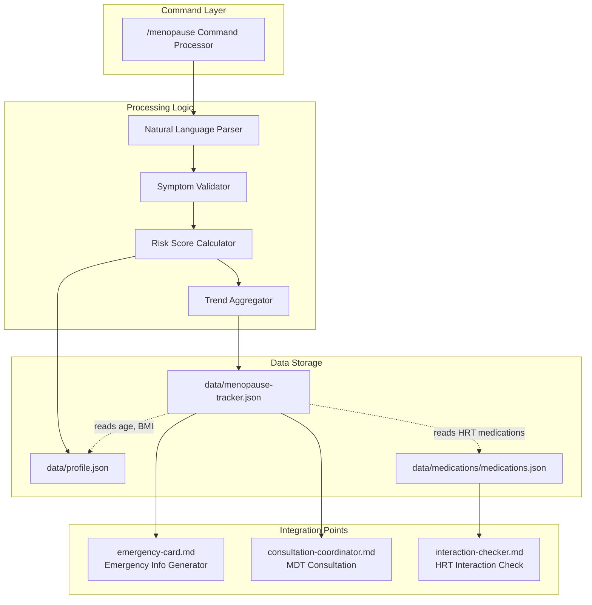
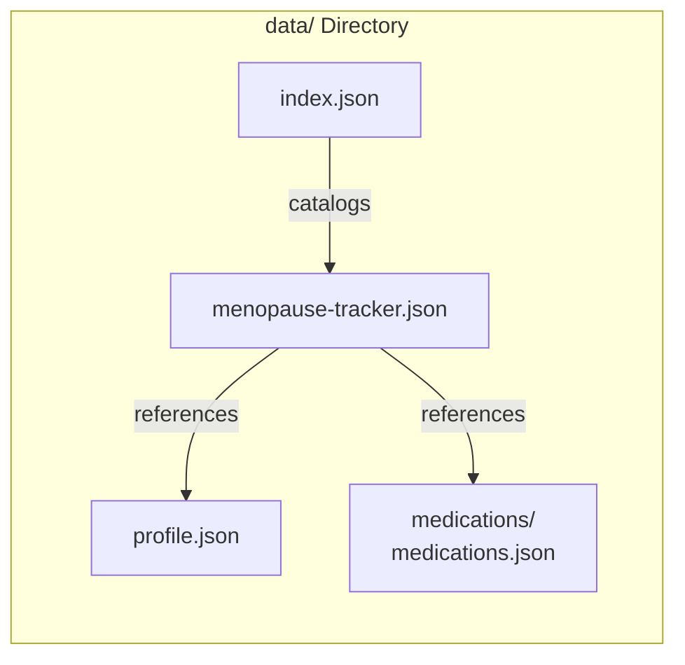
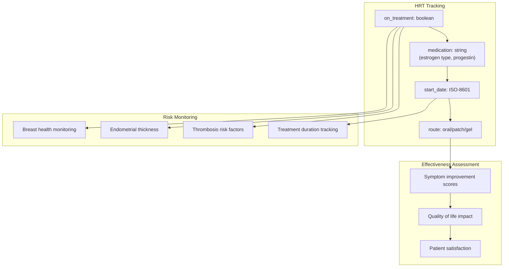
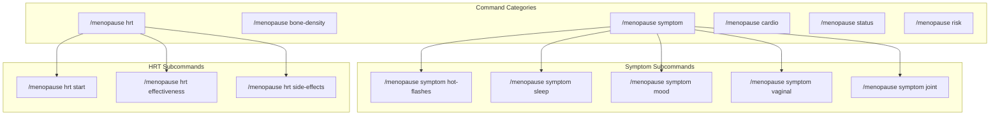
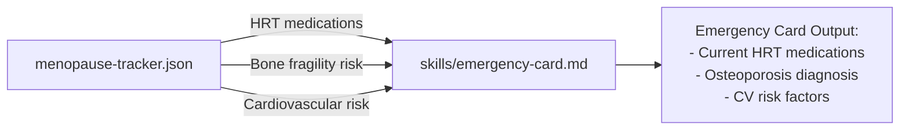

<!-- source: DeepWiki mcp.deepwiki.com · repo huifer/Claude-Ally-Health · extra page Menopause Management · fetched 2026-10-26 -->

# Menopause Management

<details>
<summary>Relevant source files</summary>

The following files were used as context for generating this wiki page:

- [.claude/settings.local.json](.claude/settings.local.json)
- [todo/01-womens-health.md](todo/01-womens-health.md)
- [todo/02-mens-health.md](todo/02-mens-health.md)

</details>


## Purpose and Scope

This page documents the Menopause Management module, which provides comprehensive tracking and monitoring capabilities for perimenopausal and postmenopausal women. The system tracks menopause symptoms (hot flashes, sleep disturbances, mood changes, vaginal dryness, joint pain), monitors hormone replacement therapy (HRT) if applicable, records bone density assessments, and evaluates cardiovascular risk factors.

This module is part of the Women's Health tracking domain (see [4.1](#4.1)). For pregnancy-related tracking, see [4.1.1](#4.1.1). For postpartum care, see [4.1.2](#4.1.2). For gynecological cancer screening, see [4.1.4](#4.1.4).

**Current Status**: This module is specified in design documentation but not yet fully implemented in the codebase.

Sources: [todo/01-womens-health.md:413-531]()

---

## System Architecture

The menopause management system follows Claude-Ally-Health's standard architecture pattern: slash command interface, local JSON storage, and integration with cross-cutting systems (emergency card, MDT consultation, drug interactions).

### Component Overview



**Diagram: Menopause Management System Architecture**

The command processor parses natural language inputs (e.g., "hot flashes 5-10 per day moderate"), validates symptom entries, calculates risk scores (FRAX for bone fracture risk, cardiovascular risk stratification), and aggregates trends over time. Data is stored in `data/menopause-tracker.json` with references to the user's profile for age and BMI calculations.

Sources: [todo/01-womens-health.md:413-531]()

### File Storage Structure



**Diagram: Data File Dependencies**

The menopause tracker file depends on the user profile for age and BMI data, and references the medication file when HRT is being tracked. The global index catalogs the menopause tracker for cross-domain queries.

Sources: [todo/01-womens-health.md:446-509]()

---

## Core Features

### Symptom Tracking

The system tracks five primary menopause symptom categories with structured severity and frequency assessments:

| Symptom Category | Tracked Metrics | Severity Levels | Frequency Options |
|------------------|-----------------|-----------------|-------------------|
| Hot Flashes | Frequency, severity, impact, triggers | mild, moderate, severe | daily count (e.g., 5-10/day) |
| Sleep Issues | Type, frequency, quality | N/A | rarely, sometimes, often, always |
| Mood Changes | Symptom types | N/A | present/absent for anxiety, depression, irritability |
| Vaginal Dryness | Severity, impact | mild, moderate, severe | N/A |
| Joint Pain | Location, severity | mild, moderate, severe | N/A |

**Hot Flashes**

The most common menopause symptom, tracked with:
- **Frequency**: Quantified as daily count (e.g., "5-10_per_day", "more_than_10_per_day")
- **Severity**: mild (brief, tolerable) / moderate (disruptive) / severe (debilitating)
- **Impact on Life**: none / mild / moderate / severe
- **Triggers**: Array of trigger factors (stress, hot drinks, spicy food, etc.)

**Sleep Issues**

Tracks sleep disturbances with:
- **Type**: difficulty_falling_asleep, frequent_awakening, early_awakening
- **Frequency**: rarely / sometimes / often / always
- **Sleep Quality**: poor / fair / good

**Mood Changes**

Boolean tracking of psychological symptoms:
- Anxiety
- Depression
- Irritability
- Each marked as present or absent

**Vaginal Dryness**

Tracks atrophic vaginitis symptoms:
- **Severity**: mild / moderate / severe
- **Impact**: none / mild / moderate / severe (on sexual function, daily comfort)

**Joint Pain**

Tracks musculoskeletal symptoms:
- **Location**: Array of affected joints
- **Severity**: mild / moderate / severe
- **Impact**: mobility limitations

Sources: [todo/01-womens-health.md:421-427](), [todo/01-womens-health.md:446-509]()

### Hormone Replacement Therapy (HRT) Monitoring

For women on HRT, the system tracks treatment details and effectiveness:



**Diagram: HRT Monitoring Components**

**Treatment Recording**
- **Medication**: Name of estrogen (e.g., "雌二醇", "结合雌激素") and progestin if applicable
- **Dose**: Recorded in medications file, not in menopause tracker
- **Route**: oral, transdermal patch, gel, vaginal
- **Start Date**: ISO-8601 format for treatment duration calculation

**Effectiveness Assessment**
- **effectiveness**: null (not assessed) / poor / fair / good / excellent
- **Symptom Relief**: Categorical improvement in hot flashes, sleep, mood
- **side_effects**: Array of reported side effects

**Risk Monitoring**
The system emphasizes three primary HRT risks:
1. **Breast Cancer Risk**: Increased with 5+ years of estrogen-progestin therapy
2. **Endometrial Cancer Risk**: Unopposed estrogen (no progestin) in women with intact uterus
3. **Thrombosis Risk**: DVT/PE risk, especially in first year

**Safety Principle**: The system does NOT prescribe HRT or dosages. It only records physician-prescribed treatments and tracks their effects. All HRT decisions must be made by qualified healthcare providers.

Sources: [todo/01-womens-health.md:429-433](), [todo/01-womens-health.md:477-483]()

### Bone Density Tracking

Postmenopausal women experience accelerated bone loss due to estrogen deficiency. The system tracks DEXA scan results and fracture risk:

**DEXA Scan Results**
- **T-score**: Compares bone density to healthy 30-year-old reference
  - T-score ≥ -1.0: Normal
  - T-score -1.0 to -2.5: Osteopenia (low bone mass)
  - T-score ≤ -2.5: Osteoporosis
- **Z-score**: Compares bone density to age-matched peers
- **Scan Date**: Last examination date
- **Diagnosis**: normal / osteopenia / osteoporosis

**Fracture Risk Assessment (FRAX)**
- **Risk Level**: low / moderate / high
- **10-Year Risk**: Major osteoporotic fracture probability
- Uses age, BMI, bone density, and clinical risk factors

**Supplementation Tracking**
- **Calcium**: Dose and frequency (recommended: 1000-1200mg/day)
- **Vitamin D**: Dose and frequency (recommended: 2000 IU/day)
- **Other**: Bisphosphonates, denosumab if prescribed

| T-Score Range | Diagnosis | Fracture Risk | Management |
|---------------|-----------|---------------|------------|
| ≥ -1.0 | Normal | Low | Preventive measures |
| -1.0 to -2.5 | Osteopenia | Low to Moderate | Calcium, Vitamin D, lifestyle |
| ≤ -2.5 | Osteoporosis | High | Medical treatment + supplements |
| ≤ -2.5 + fracture | Severe Osteoporosis | Very High | Aggressive treatment |

Sources: [todo/01-womens-health.md:435-437](), [todo/01-womens-health.md:485-494]()

### Cardiovascular Risk Assessment

Estrogen has cardioprotective effects; its loss during menopause increases cardiovascular disease risk. The system tracks:

**Blood Pressure Monitoring**
- **Systolic/Diastolic**: Standard BP measurement
- **Category**: normal / elevated / hypertension stage 1/2
- **Trend**: Tracked over time

**Lipid Panel Tracking**
- **Total Cholesterol**: Target <5.2 mmol/L (<200 mg/dL)
- **LDL Cholesterol**: Target <3.4 mmol/L (<130 mg/dL)
- **HDL Cholesterol**: Target ≥1.0 mmol/L (≥40 mg/dL)
- **Triglycerides**: Target <1.7 mmol/L (<150 mg/dL)

**Risk Stratification**
- **Risk Level**: low / moderate / high / very_high
- **ASCVD Risk**: 10-year atherosclerotic cardiovascular disease risk
- Factors: Age, BP, cholesterol, smoking, diabetes

**Lifestyle Recommendations**
- Mediterranean diet
- Regular aerobic exercise
- Weight management
- Smoking cessation

Sources: [todo/01-womens-health.md:439-443](), [todo/01-womens-health.md:495-503]()

---

## Data Model

### JSON Structure

The menopause tracker uses a single JSON file stored at `data/menopause-tracker.json`:

```json
{
  "menopause_tracking": {
    "stage": "perimenopausal | postmenopausal",
    "age": 48,
    "last_menstrual_period": "2025-11-15",
    
    "symptoms": {
      "hot_flashes": {
        "present": true,
        "frequency": "5-10_per_day",
        "severity": "moderate",
        "impact_on_life": "mild",
        "triggers": ["stress", "hot_drinks"]
      },
      "sleep_issues": {
        "present": true,
        "frequency": "often",
        "type": "difficulty_falling_asleep",
        "sleep_quality": "poor"
      },
      "mood_changes": {
        "present": true,
        "symptoms": ["anxiety", "irritability"]
      },
      "vaginal_dryness": {
        "present": false,
        "severity": null
      }
    },
    
    "hrt": {
      "on_treatment": false,
      "medication": null,
      "start_date": null,
      "effectiveness": null,
      "side_effects": null
    },
    
    "bone_density": {
      "last_check": "2025-06-15",
      "t_score": -1.5,
      "z_score": -1.2,
      "diagnosis": "osteopenia",
      "fracture_risk": "low",
      "calcium_supplement": "1000mg_daily",
      "vitamin_d_supplement": "2000IU_daily"
    },
    
    "cardiovascular_risk": {
      "blood_pressure": "120/80",
      "total_cholesterol": 5.2,
      "ldl": 3.2,
      "hdl": 1.5,
      "triglycerides": 1.3,
      "risk_level": "low"
    },
    
    "metadata": {
      "created_at": "2025-01-01T00:00:00.000Z",
      "last_updated": "2025-12-01T00:00:00.000Z"
    }
  }
}
```

### Field Definitions

**Top-Level Fields**

| Field | Type | Description | Valid Values |
|-------|------|-------------|--------------|
| `stage` | string | Menopause stage | "perimenopausal", "postmenopausal" |
| `age` | integer | Current age | Positive integer |
| `last_menstrual_period` | string | Date of last period | ISO-8601 date or null |

**Perimenopause** is defined as the transition period (typically 2-8 years before final menstrual period) with irregular periods and symptoms. **Postmenopause** begins 12 months after the final menstrual period.

**Symptoms Object**

Each symptom category has:
- `present`: Boolean indicating if symptom is currently experienced
- Category-specific fields for severity, frequency, type, impact
- `triggers`: Array of strings for hot flashes

**HRT Object**

| Field | Type | Description |
|-------|------|-------------|
| `on_treatment` | boolean | Currently on HRT |
| `medication` | string | Medication name(s) |
| `start_date` | string | ISO-8601 date |
| `route` | string | Administration route |
| `effectiveness` | string | Treatment effectiveness |
| `side_effects` | array | List of side effects |

**Bone Density Object**

| Field | Type | Description | Reference |
|-------|------|-------------|-----------|
| `t_score` | float | T-score from DEXA | ≥-1.0 normal |
| `z_score` | float | Z-score from DEXA | Age-matched |
| `diagnosis` | string | Clinical diagnosis | normal/osteopenia/osteoporosis |
| `fracture_risk` | string | FRAX risk level | low/moderate/high |

**Cardiovascular Risk Object**

All lipid values in mmol/L (SI units). Blood pressure in mmHg format "systolic/diastolic".

Sources: [todo/01-womens-health.md:446-509]()

---

## Command Interface

The menopause management system uses the `/menopause` slash command family for all operations:

### Command Structure



**Diagram: Menopause Command Hierarchy**

### Symptom Recording Commands

**Hot Flashes**
```bash
/menopause symptom hot-flashes 5-10 moderate
# Records: frequency "5-10_per_day", severity "moderate"

/menopause symptom hot-flashes 5-10 moderate triggers stress hot-drinks
# Adds trigger tracking
```

**Sleep Issues**
```bash
/menopause symptom sleep insomnia
# Records insomnia type sleep issue

/menopause symptom sleep frequent-awakening often
# Records type and frequency
```

**Mood Changes**
```bash
/menopause symptom mood anxiety
# Records anxiety as present

/menopause symptom mood depression irritability
# Records multiple mood symptoms
```

**Vaginal Dryness**
```bash
/menopause symptom vaginal moderate
# Records vaginal dryness with severity

/menopause symptom vaginal severe impact-sexual
# Records severity and impact type
```

**Joint Pain**
```bash
/menopause symptom joint knees moderate
# Records joint pain location and severity

/menopause symptom joint knees wrists severe
# Multiple joint locations
```

### Bone Density Commands

```bash
/menopause bone-density -1.5 osteopenia
# Records T-score and diagnosis

/menopause bone-density -2.6 osteoporosis high-risk
# Records with fracture risk level

/menopause supplement calcium 1000mg daily
# Records calcium supplementation

/menopause supplement vitamin-d 2000IU daily
# Records vitamin D supplementation
```

### HRT Commands

```bash
/menopause hrt start 雌二醇 1mg
# Records starting HRT (medication and dose)

/menopause hrt effectiveness good
# Assesses treatment effectiveness

/menopause hrt side-effects breast-tenderness headache
# Records side effects
```

**Safety Note**: The system records physician-prescribed HRT but does not prescribe medications or dosages. All HRT initiation requires consultation with a healthcare provider.

### Status and Risk Assessment Commands

```bash
/menopause status
# Displays current symptom profile, HRT status, bone health, cardiovascular metrics

/menopause risk
# Comprehensive risk assessment for osteoporosis, cardiovascular disease, and HRT complications

/menopause trend hot-flashes
# Shows trend analysis for specific symptom over time
```

Sources: [todo/01-womens-health.md:514-530]()

### Expected Output Format

When recording symptoms, the system provides immediate feedback:

```
✅ Symptom recorded: Hot flashes

Current Profile:
━━━━━━━━━━━━━━━━━━━━━━━━━━
Frequency: 5-10 per day
Severity: Moderate
Impact on life: Mild
Triggers: stress, hot drinks

💡 Management Tips:
- Avoid known triggers
- Dress in layers
- Keep environment cool
- Consider discussing HRT with your doctor

⚠️ When to Seek Medical Attention:
- Severe hot flashes affecting daily function
- Symptoms persist >1 year postmenopause
- Unusual bleeding
```

For status queries, the output includes:

```
📊 Menopause Health Status

Stage: Perimenopausal (Age 48)
Last Menstrual Period: 2025-11-15

Current Symptoms:
━━━━━━━━━━━━━━━━━━━━━━━━━━
✓ Hot flashes: Moderate (5-10/day)
✓ Sleep issues: Often (difficulty falling asleep)
✓ Mood changes: Anxiety, irritability
✗ Vaginal dryness: Not present

Bone Health:
━━━━━━━━━━━━━━━━━━━━━━━━━━
T-score: -1.5 (Osteopenia)
Fracture Risk: Low
Supplements: Calcium 1000mg/day, Vitamin D 2000IU/day

Cardiovascular Risk:
━━━━━━━━━━━━━━━━━━━━━━━━━━
Blood Pressure: 120/80 mmHg (Normal)
Total Cholesterol: 5.2 mmol/L
Risk Level: Low

⚠️ Important:
This tracking system supports health monitoring but does not replace
professional medical care. Consult your healthcare provider for
personalized treatment recommendations.
```

Sources: [todo/01-womens-health.md:514-530]()

---

## Integration with Cross-Cutting Systems

### Emergency Medical Information Card

The menopause tracker integrates with the emergency card system (see [5.3](#5.3)) to provide critical information during emergencies:



**Diagram: Emergency Card Integration**

**Data Contributed to Emergency Card:**
1. **HRT Medications**: Current hormone therapy included in active medications list
2. **Bone Fragility**: Osteoporosis/osteopenia diagnosis alerts emergency responders to fracture risk
3. **Cardiovascular Risk**: High BP or lipid abnormalities included in chronic conditions
4. **Thrombosis Risk**: HRT usage flags increased DVT/PE risk

Sources: [todo/01-womens-health.md:413-531]()

### Multi-Disciplinary Team (MDT) Consultation

The menopause data is accessible to relevant AI specialists during `/consult` (see [7.1](#7.1)):

| Specialist | Analyzes From Menopause Data |
|------------|------------------------------|
| **Endocrinology** | HRT effectiveness, hormone levels, bone density, metabolic changes |
| **Cardiology** | Cardiovascular risk factors, BP trends, lipid profiles, thrombosis risk |
| **Geriatrics** | Overall quality of life, polypharmacy with HRT, fall risk from bone loss |
| **Gynecology** | Menopause stage, symptom severity, HRT appropriateness, endometrial health |

The consultation coordinator aggregates menopause tracking data along with other health records to provide comprehensive, multi-specialty analysis.

Sources: [todo/01-womens-health.md:413-531]()

### Drug Interaction Detection

HRT medications are checked for interactions through the drug interaction system (see [6.1](#6.1)):

**Common HRT Interactions:**
- **CYP3A4 Inhibitors**: Increase estrogen levels (ketoconazole, erythromycin)
- **CYP3A4 Inducers**: Decrease estrogen levels (rifampin, St. John's Wort)
- **Anticoagulants**: Estrogen increases clotting risk (warfarin interaction)
- **Thyroid Hormones**: Estrogen may increase thyroid hormone requirement

The system cross-references `data/medications/medications.json` with `data/interactions/interaction-db.json` to identify severity levels (A/B/C/D/X) and provide management recommendations.

Sources: [todo/01-womens-health.md:413-531]()

---

## Medical Safety Principles

### Safety Red Lines

The menopause management system adheres to strict medical safety boundaries:

**❌ The System Will NOT:**

1. **Prescribe HRT or Dosages**
   - Does not recommend specific medications
   - Does not suggest starting, stopping, or adjusting HRT doses
   - HRT decisions must be made by qualified healthcare providers

2. **Diagnose Medical Conditions**
   - Does not diagnose osteoporosis (only records DEXA results)
   - Does not diagnose cardiovascular disease
   - Does not confirm menopause stage (clinical diagnosis required)

3. **Predict Outcomes**
   - Does not predict fracture occurrence
   - Does not predict cardiovascular events
   - Does not guarantee HRT effectiveness

4. **Replace Medical Care**
   - All tracking is supplementary to professional healthcare
   - Abnormal findings require physician evaluation
   - Regular medical checkups still necessary

**✅ The System DOES:**

1. **Track and Record**
   - Symptom patterns over time
   - Physician-prescribed treatments
   - Laboratory and imaging results
   - Supplement adherence

2. **Provide Reference Information**
   - Normal ranges for lab values
   - Standard risk stratification categories
   - Evidence-based lifestyle recommendations
   - Screening guideline reminders

3. **Alert to Concerning Patterns**
   - Worsening bone density trends
   - Elevated cardiovascular risk factors
   - Unusual bleeding patterns
   - Severe symptom burden

4. **Facilitate Healthcare Communication**
   - Organized symptom logs for provider visits
   - Trend visualizations
   - Emergency medical information
   - Treatment history summaries

### Warning Triggers

The system generates explicit warnings for:

| Condition | Warning Trigger | Recommended Action |
|-----------|----------------|-------------------|
| **Severe Osteoporosis** | T-score ≤ -2.5 + history of fracture | ⚠️ Contact doctor for treatment evaluation |
| **Very High CV Risk** | Multiple risk factors (HTN, high LDL, diabetes) | ⚠️ Schedule cardiovascular assessment |
| **Postmenopausal Bleeding** | Bleeding >12 months after last period | 🚨 **Immediate** medical evaluation required |
| **HRT >5 Years** | Treatment duration exceeds 5 years | ⚠️ Discuss risk-benefit with doctor |
| **Severe Symptoms** | Multiple severe symptoms affecting daily life | ⚠️ Consult healthcare provider |

Sources: [todo/01-womens-health.md:639-667]()

---

## Clinical Guidelines and References

The menopause management module bases its tracking categories and reference ranges on established clinical guidelines:

**Primary Guidelines:**
- **NICE Menopause Guideline (NG23)**: Diagnosis and management of menopause
- **NAMS (North American Menopause Society)**: Hormone therapy position statement
- **ACOG Practice Bulletin**: Management of menopausal symptoms
- **WHO Guidelines**: Bone health and osteoporosis prevention

**Risk Calculators:**
- **FRAX**: Fracture risk assessment tool (University of Sheffield)
- **ASCVD Risk Calculator**: Cardiovascular disease risk (ACC/AHA)

**Screening Recommendations:**
- **DEXA Scanning**: Age 65+ for all women; age 50+ if risk factors present
- **Lipid Panels**: Every 5 years; more frequently if abnormal or on HRT
- **Blood Pressure**: Every medical visit

Sources: [todo/01-womens-health.md:696-700]()

---

## Implementation Notes

### Current Status

Based on the design documentation, the menopause management module is **specified but not yet implemented**. The following components are planned:

1. **Command Processing**: `/menopause` command family
2. **Data Storage**: JSON file at `data/menopause-tracker.json`
3. **Validation Logic**: Symptom severity validation, reference range checking
4. **Risk Calculators**: FRAX integration, ASCVD risk calculation
5. **Trend Analysis**: Longitudinal symptom tracking
6. **Integration**: Emergency card, MDT consultation, drug interactions

### Design Considerations

**Multi-Language Support**
The command interface supports both English and Chinese symptom terms (e.g., "hot-flashes" or "潮热", "insomnia" or "失眠") to accommodate diverse users.

**Privacy-First Architecture**
All menopause data remains in local `data/` directory, never synchronized to cloud services. This ensures sensitive health information stays under user control.

**Extensibility**
The JSON structure allows for future additions:
- Alternative therapies (acupuncture, herbal supplements)
- Quality of life questionnaires (MRS, MENQOL)
- Sexual function assessments
- Cognitive function tracking

**Interdependencies**
The menopause module depends on:
- User profile (`profile.json`) for age and BMI
- Medication tracking (`medications/`) for HRT recording
- Drug interaction database (`interactions/`) for safety checks

Sources: [todo/01-womens-health.md:413-531]()

---

## Related Documentation

- [4.1 Women's Health](#4.1) - Overview of women's health modules
- [4.1.1 Pregnancy Tracking](#4.1.1) - Prenatal and antenatal care
- [4.1.2 Postpartum Care](#4.1.2) - Postpartum recovery and EPDS screening
- [4.1.4 Gynecological Cancer Screening](#4.1.4) - HPV, TCT, tumor markers
- [5.3 Emergency Medical Information Card](#5.3) - Emergency data aggregation
- [6.1 Drug Interaction Detection](#6.1) - HRT interaction checking
- [7.1 Multi-Disciplinary Team Consultation](#7.1) - Specialist analysis

Sources: [todo/01-womens-health.md:1-706]()

---

