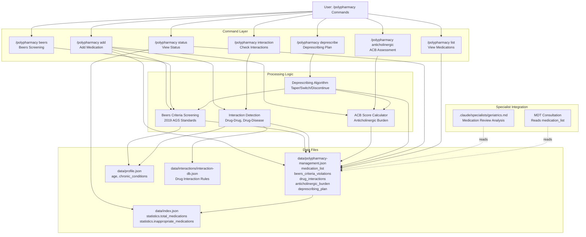
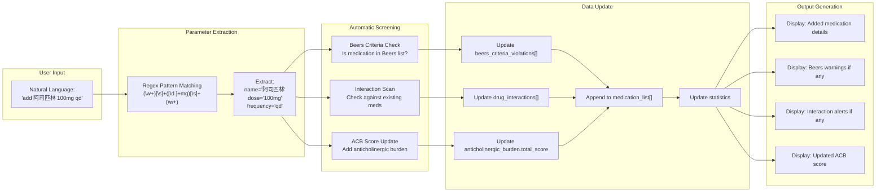
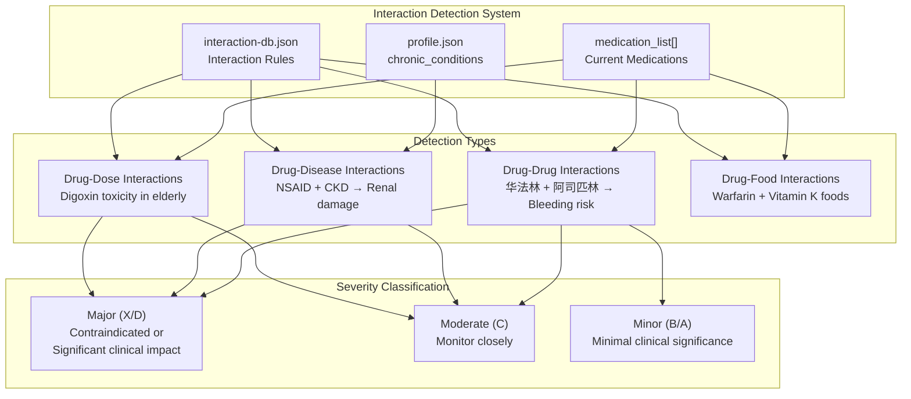
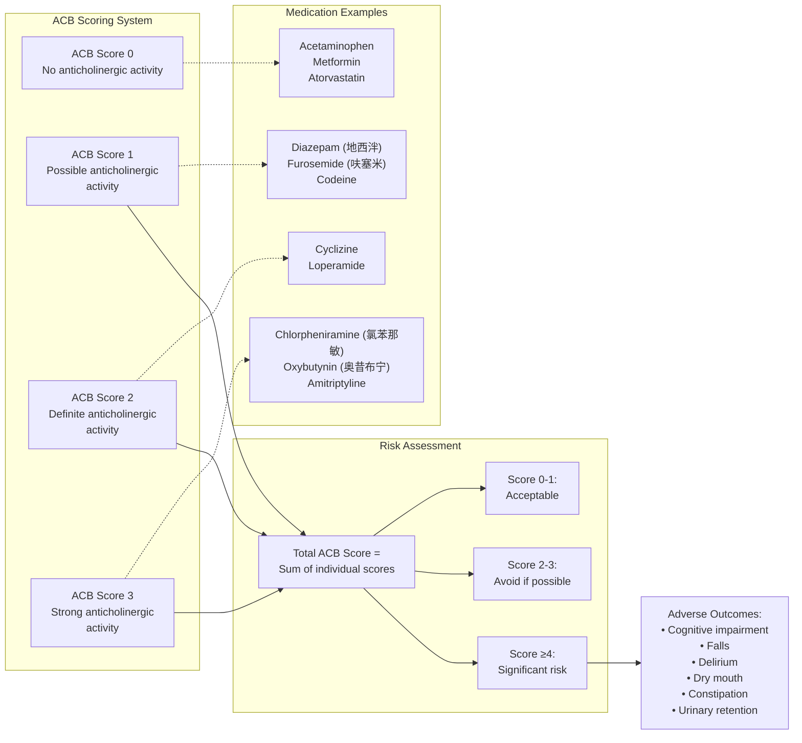
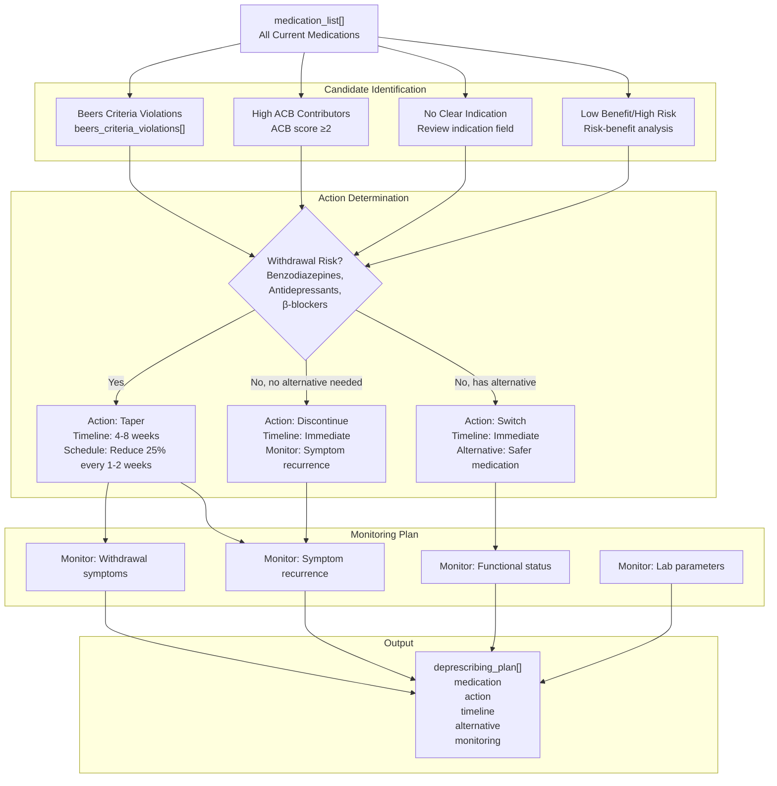
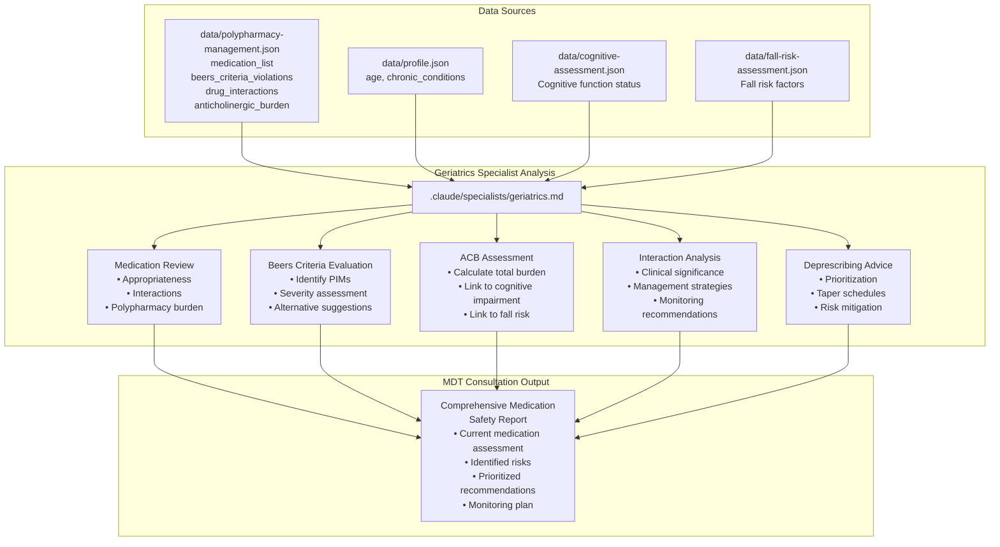

<!-- source: DeepWiki mcp.deepwiki.com · repo huifer/Claude-Ally-Health · extra page Polypharmacy Management · fetched 2026-10-26 -->

# Polypharmacy Management

<details>
<summary>Relevant source files</summary>

The following files were used as context for generating this wiki page:

- [.claude/commands/cognitive.md](.claude/commands/cognitive.md)
- [.claude/commands/fall.md](.claude/commands/fall.md)
- [.claude/commands/polypharmacy.md](.claude/commands/polypharmacy.md)
- [.claude/specialists/geriatrics.md](.claude/specialists/geriatrics.md)
- [data-example/index.json](data-example/index.json)
- [scripts/test-elderly-health.sh](scripts/test-elderly-health.sh)
- [todo/03-children-health.md](todo/03-children-health.md)
- [todo/04-elderly-health.md](todo/04-elderly-health.md)

</details>


## Purpose and Scope

This document describes the Polypharmacy Management module, which provides comprehensive medication safety management for elderly patients (age ≥65) taking multiple medications. The system tracks medication lists, screens for potentially inappropriate medications using Beers Criteria, detects drug-drug and drug-disease interactions, calculates anticholinergic burden, and generates deprescribing recommendations.

This module focuses on elderly patients with polypharmacy (≥5 concurrent medications). For drug interaction detection across all age groups, see [Drug Interaction Detection](#6.1). For general medication tracking in chronic disease contexts, see [Hypertension Management](#4.5.1), [Diabetes Management](#4.5.2), and [COPD Management](#4.5.3). For cognitive assessment related to medication effects, see [Cognitive Assessment](#4.4.1).

**Key Capabilities:**
- Medication list management with dosage and frequency tracking
- Beers Criteria (2019 version) screening for inappropriate medications
- Multi-level drug interaction checking (drug-drug, drug-disease, drug-dose)
- Anticholinergic Cognitive Burden (ACB) scale scoring
- Evidence-based deprescribing plan generation
- Medication adherence monitoring

**Key Limitations:**
- Does not prescribe or adjust medication dosages
- Does not replace physician/pharmacist professional assessment
- Serves as screening and decision support tool only

Sources: [.claude/commands/polypharmacy.md:1-49](), [todo/04-elderly-health.md:526-607]()

---

## System Architecture

### High-Level Data Flow



**Diagram: Polypharmacy Management System Data Flow**

This architecture shows the complete flow from user commands through processing logic to data storage. The system performs automatic screening whenever medications are added, updating Beers violations, interactions, and ACB scores in real-time.

Sources: [.claude/commands/polypharmacy.md:1-402](), [todo/04-elderly-health.md:609-743]()

---

### Command Processing Flow



**Diagram: Add Medication Command Processing Pipeline**

Sources: [.claude/commands/polypharmacy.md:52-90](), [todo/04-elderly-health.md:609-743]()

---

## Data Storage Architecture

### File Structure

The polypharmacy management system stores data in `data/polypharmacy-management.json` with references to other system files for comprehensive medication safety assessment.

| File Path | Purpose | Key Sections |
|-----------|---------|--------------|
| `data/polypharmacy-management.json` | Primary polypharmacy data | `medication_list`, `beers_criteria_violations`, `drug_interactions`, `anticholinergic_burden`, `deprescribing_plan` |
| `data/profile.json` | User demographics | `age`, `chronic_conditions` for interaction checking |
| `data/interactions/interaction-db.json` | Drug interaction rules | Drug-drug, drug-disease interaction definitions |
| `data/index.json` | Global statistics | `statistics.total_medications`, `statistics.inappropriate_medications` |

Sources: [data-example/index.json:1-61](), [.claude/commands/polypharmacy.md:1-402]()

---

### JSON Data Schema

```json
{
  "polypharmacy_management": {
    "user_id": "user_001",
    "age": 82,
    "assessment_date": "2025-06-20",
    
    "medication_list": [
      {
        "name": "阿司匹林",
        "dose": "100mg",
        "frequency": "qd",
        "indication": "cardiovascular_protection",
        "start_date": "2015-01-01",
        "prescriber": "cardiologist",
        "appropriate": true,
        "beers_criteria": false
      },
      {
        "name": "地西泮",
        "dose": "5mg",
        "frequency": "prn",
        "indication": "insomnia",
        "start_date": "2020-06-01",
        "prescriber": "gp",
        "appropriate": false,
        "beers_criteria": true,
        "beers_recommendation": "avoid",
        "alternative": "melatonin_sleep_hygiene"
      }
    ],
    
    "total_medications": 8,
    "prescribed_medications": 6,
    "otc_medications": 2,
    
    "beers_criteria_violations": [
      {
        "medication": "地西泮",
        "issue": "falls_risk_sedation",
        "recommendation": "avoid_use",
        "severity": "high",
        "alternative": "melatonin_cbt_i"
      }
    ],
    
    "drug_interactions": [
      {
        "medications": ["华法林", "阿司匹林"],
        "severity": "moderate",
        "interaction": "increased_bleeding_risk",
        "recommendation": "monitor_inr",
        "clinically_significant": true
      }
    ],
    
    "disease_drug_interactions": [
      {
        "medication": "布洛芬",
        "condition": "chronic_kidney_disease_stage_3",
        "interaction": "worsens_renal_function",
        "recommendation": "avoid_use_use_acetaminophen",
        "severity": "high"
      }
    ],
    
    "anticholinergic_burden": {
      "total_score": 4,
      "medications_contributing": [
        {"name": "地西泮", "score": 1},
        {"name": "氯苯那敏", "score": 2},
        {"name": "奥昔布宁", "score": 1}
      ],
      "interpretation": "significant_risk",
      "risks": ["cognitive_impairment", "falls", "dry_mouth", "constipation"]
    },
    
    "deprescribing_plan": [
      {
        "medication": "地西泮",
        "action": "taper",
        "timeline": "4-8_weeks",
        "taper_schedule": "reduce_by_25_every_1-2_weeks",
        "alternative": "sleep_hygiene_melatonin",
        "monitoring": ["withdrawal_symptoms", "sleep_quality"]
      }
    ],
    
    "medication_adherence": {
      "overall_adherence": "good",
      "missed_doses_weekly": 1,
      "barriers": ["pill_burden", "cost"],
      "aids": ["pill_box", "reminder_app"]
    },
    
    "next_medication_review": "2025-09-20"
  },
  
  "statistics": {
    "total_medications": 8,
    "inappropriate_medications": 2,
    "interaction_count": 3,
    "acb_score": 4,
    "last_review": "2025-06-20"
  },
  
  "settings": {
    "review_months": 6,
    "auto_screen_beers": true,
    "auto_check_interactions": true,
    "alert_level": "medium"
  }
}
```

**Key Data Structures:**

- **medication_list[]**: Array of medication objects with name, dose, frequency, indication, start date, prescriber, and Beers criteria status
- **beers_criteria_violations[]**: Identified inappropriate medications per AGS 2019 standards
- **drug_interactions[]**: Drug-drug interactions with severity and clinical significance
- **disease_drug_interactions[]**: Drug-disease interactions based on user's chronic conditions
- **anticholinergic_burden**: ACB total score and contributing medications
- **deprescribing_plan[]**: Medication reduction strategies with timelines and alternatives

Sources: [todo/04-elderly-health.md:609-743]()

---

## Command Interface

### Available Commands

The `/polypharmacy` command provides 9 operations for comprehensive medication management:

| Command | Purpose | Parameters |
|---------|---------|------------|
| `/polypharmacy add` | Add new medication | `info`: "药名 剂量 频次 [适应症]" |
| `/polypharmacy list` | View all medications | None |
| `/polypharmacy beers` | Run Beers Criteria screening | None |
| `/polypharmacy inappropriate` | View Beers violations | None |
| `/polypharmacy interaction` | Check drug interactions | `check` or `add 药名1 药名2 严重程度` |
| `/polypharmacy anticholinergic` | Calculate ACB score | None |
| `/polypharmacy acb-score` | Record manual ACB score | `info`: score value |
| `/polypharmacy deprescribe` | Generate deprescribing plan | `info`: "[药名 action]" (optional) |
| `/polypharmacy status` | View overall status | None |
| `/polypharmacy recommendations` | View management recommendations | None |

Sources: [.claude/commands/polypharmacy.md:1-49]()

---

### Command: Add Medication

```bash
/polypharmacy add 阿司匹林 100mg qd 心血管保护
/polypharmacy add 氨氯地平 5mg qd 高血压
```

**Processing Steps:**

1. **Parameter Extraction** using regex `(\w+)[\s]+([\d.]+mg)[\s]+(\w+)`
2. **Automatic Screening**:
   - Beers Criteria check
   - Drug interaction detection
   - ACB score update
3. **Data Updates**:
   - Append to `medication_list[]`
   - Update `beers_criteria_violations[]` if applicable
   - Update `drug_interactions[]` if applicable
   - Recalculate `anticholinergic_burden.total_score`
4. **Output**:
   - Medication added confirmation
   - Beers warnings (if any)
   - Interaction alerts (if any)
   - Updated medication count

Sources: [.claude/commands/polypharmacy.md:52-90](), [todo/04-elderly-health.md:750-770]()

---

### Command: List Medications

```bash
/polypharmacy list
```

**Output Format:**

```
Current Medications (8 total)
━━━━━━━━━━━━━━━━━━━━━━━━━━━━━━━━━━━━━━

Prescribed Medications (6):
1. 阿司匹林 100mg qd - Cardiovascular protection
   Started: 2015-01-01 | Prescriber: Cardiologist
   ✓ Appropriate

2. 地西泮 5mg prn - Insomnia
   Started: 2020-06-01 | Prescriber: GP
   ⚠ Beers Criteria Violation - Avoid use

OTC Medications (2):
...

Statistics:
- Inappropriate medications: 2
- Drug interactions: 3
- ACB score: 4 (Significant risk)
```

Sources: [.claude/commands/polypharmacy.md:94-120]()

---

### Command: Beers Criteria Screening

```bash
/polypharmacy beers
```

Screens all medications against the **American Geriatrics Society Beers Criteria (2019)** for potentially inappropriate medication use in older adults.

**Common Beers Criteria Violations:**

| Medication Class | Example | Issue | Severity | Alternative |
|------------------|---------|-------|----------|-------------|
| Benzodiazepines | 地西泮 (Diazepam) | Falls risk, sedation, cognitive impairment | High | Melatonin, CBT-I |
| Anticholinergics | 氯苯那敏 (Chlorpheniramine) | Cognitive impairment, constipation, dry mouth | Moderate | Loratadine, Cetirizine |
| First-generation antihistamines | 苯海拉明 (Diphenhydramine) | Sedation, anticholinergic effects | Moderate | Second-generation antihistamines |
| NSAIDs | 布洛芬 (Ibuprofen) | GI bleeding, renal impairment | High (with CKD) | Acetaminophen |
| Long-term corticosteroids | 泼尼松 (Prednisone) | Osteoporosis, hyperglycemia, infection risk | Moderate | Lowest effective dose |

**Screening Algorithm:**

1. Read `medication_list[]` from `data/polypharmacy-management.json`
2. For each medication, check against Beers Criteria database
3. Identify violations in three categories:
   - Potentially inappropriate medications (PIMs)
   - Medications to use with caution
   - Drug-disease interactions
4. Populate `beers_criteria_violations[]` with findings
5. Flag medications with `beers_criteria: true` in `medication_list[]`

Sources: [.claude/commands/polypharmacy.md:122-159](), [todo/04-elderly-health.md:542-557](), [.claude/specialists/geriatrics.md:106-118]()

---

## Drug Interaction Detection

### Interaction Types

The system checks four types of drug interactions:



**Diagram: Drug Interaction Detection Architecture**

Sources: [.claude/commands/polypharmacy.md:184-233](), [todo/04-elderly-health.md:559-571]()

---

### Common Critical Interactions

**High-Risk Drug-Drug Interactions:**

| Medication Combination | Interaction | Severity | Management |
|------------------------|-------------|----------|------------|
| Warfarin + Aspirin/NSAIDs | Increased bleeding risk | Major | Monitor INR frequently, consider PPI |
| ACEI + Potassium-sparing diuretics | Hyperkalemia | Major | Monitor potassium, consider alternative diuretic |
| β-blockers + Digoxin | Bradycardia, AV block | Moderate | Monitor heart rate, ECG |
| NSAIDs + ACEI/ARB/Diuretics | Acute kidney injury | Major | Monitor renal function, avoid combination in CKD |
| SSRIs + MAOIs | Serotonin syndrome | Major | Contraindicated, 2-week washout period |
| Multiple anticholinergics | Cumulative anticholinergic burden | Moderate-Major | Calculate ACB score, reduce burden |

**Drug-Disease Interactions:**

| Medication | Contraindicated Condition | Consequence | Recommendation |
|------------|---------------------------|-------------|----------------|
| NSAIDs | Peptic ulcer disease | GI bleeding, ulcer worsening | Use acetaminophen instead |
| β-blockers | Asthma, severe COPD | Bronchospasm exacerbation | Use cardioselective or avoid |
| Anticholinergics | BPH, urinary retention | Acute urinary retention | Avoid, use alternatives |
| Anticholinergics | Glaucoma (angle-closure) | Increased intraocular pressure | Contraindicated |
| Corticosteroids | Diabetes mellitus | Hyperglycemia | Use lowest dose, monitor glucose |
| Corticosteroids | Osteoporosis | Accelerated bone loss | Add bisphosphonate, calcium/vitamin D |

Sources: [todo/04-elderly-health.md:559-571](), [.claude/specialists/geriatrics.md:120-133]()

---

### Interaction Checking Command

```bash
/polypharmacy interaction check
/polypharmacy interaction add 华法林 阿司匹林 moderate
```

**Processing Logic:**

1. **Read Current Medications** from `medication_list[]`
2. **Cross-Reference**:
   - Check each medication pair against `interaction-db.json`
   - Check each medication against `profile.json` chronic conditions
3. **Severity Assessment**:
   - **Major (X/D)**: Contraindicated or significant risk
   - **Moderate (C)**: Clinically significant, requires monitoring
   - **Minor (B/A)**: Minimal clinical significance
4. **Update Data**:
   - Append to `drug_interactions[]`
   - Append to `disease_drug_interactions[]`
5. **Generate Recommendations**:
   - Management strategy (monitor, avoid, adjust dose)
   - Monitoring parameters (INR, potassium, renal function)
   - Alternative medications

Sources: [.claude/commands/polypharmacy.md:184-233]()

---

## Anticholinergic Burden Assessment

### ACB Scale Methodology

The Anticholinergic Cognitive Burden (ACB) scale quantifies cumulative anticholinergic exposure, which is associated with cognitive decline, falls, delirium, and mortality in elderly patients.



**Diagram: Anticholinergic Cognitive Burden (ACB) Scale**

Sources: [.claude/commands/polypharmacy.md:236-287](), [todo/04-elderly-health.md:574-589](), [.claude/specialists/geriatrics.md:134-147]()

---

### Common Anticholinergic Medications

| Medication Class | Examples | ACB Score | Clinical Impact |
|------------------|----------|-----------|-----------------|
| Benzodiazepines | Diazepam (地西泮), Alprazolam | 1 | Falls, sedation |
| First-generation antihistamines | Chlorpheniramine (氯苯那敏), Diphenhydramine (苯海拉明) | 2-3 | Sedation, cognitive impairment |
| Tricyclic antidepressants | Amitriptyline, Doxepin | 3 | Strong anticholinergic effects |
| Antipsychotics | Olanzapine (奥氮平), Chlorpromazine | 2-3 | Metabolic effects, sedation |
| Anti-Parkinson drugs | Benzhexol (苯海索), Trihexyphenidyl | 1-2 | Necessary for treatment |
| Bladder anticholinergics | Oxybutynin (奥昔布宁), Tolterodine | 1-2 | Urinary retention, dry mouth |
| GI antispasmodics | Hyoscyamine, Dicyclomine | 2-3 | Constipation |

Sources: [todo/04-elderly-health.md:574-589](), [.claude/specialists/geriatrics.md:134-147]()

---

### ACB Assessment Command

```bash
/polypharmacy anticholinergic
/polypharmacy acb-score 4
```

**Calculation Algorithm:**

1. **Identify Anticholinergic Medications**:
   - Scan `medication_list[]`
   - Match against ACB scale database
   - Assign score (0-3) to each medication
2. **Calculate Total Score**:
   - Sum individual medication scores
   - Store in `anticholinergic_burden.total_score`
3. **Risk Stratification**:
   - 0-1: Acceptable
   - 2-3: Minimize exposure
   - ≥4: Significant risk, prioritize reduction
4. **Identify Consequences**:
   - Cognitive impairment
   - Falls risk
   - Delirium risk
   - Peripheral effects (dry mouth, constipation, urinary retention)
5. **Generate Recommendations**:
   - Prioritize medications for deprescribing
   - Suggest alternatives with lower ACB scores
   - Monitor cognitive function

**Output Example:**

```
Anticholinergic Burden Assessment
━━━━━━━━━━━━━━━━━━━━━━━━━━━━━━━━━━━━━━

Total ACB Score: 4 (Significant Risk)

Contributing Medications:
• 地西泮 (Diazepam) - Score: 1
• 氯苯那敏 (Chlorpheniramine) - Score: 2
• 奥昔布宁 (Oxybutynin) - Score: 1

Associated Risks:
⚠ Cognitive impairment
⚠ Falls risk
⚠ Dry mouth
⚠ Constipation

Recommendations:
1. Consider switching 氯苯那敏 to loratadine (ACB=0)
2. Evaluate need for 奥昔布宁, consider behavioral interventions
3. Review 地西泮 for deprescribing (also Beers violation)
```

Sources: [.claude/commands/polypharmacy.md:236-287](), [todo/04-elderly-health.md:574-589]()

---

## Deprescribing Plans

### Deprescribing Principles

The system generates evidence-based deprescribing plans following established geriatric pharmacology principles:

**Deprescribing Indications:**
1. Medication with no clear indication
2. Medication with ineffective therapeutic benefit
3. Preventive medication with uncertain benefit (e.g., in limited life expectancy)
4. Medication causing adverse effects
5. Medications contributing to high pill burden
6. Medications to simplify dosing regimen

**Deprescribing Actions:**

| Action | Description | Monitoring | Timeline |
|--------|-------------|------------|----------|
| **Discontinue** | Abrupt cessation | Monitor for withdrawal symptoms | Immediate |
| **Taper** | Gradual dose reduction | Monitor for withdrawal and symptom recurrence | 4-12 weeks |
| **Switch** | Replace with safer alternative | Monitor therapeutic efficacy | Immediate |

Sources: [.claude/commands/polypharmacy.md:290-349](), [todo/04-elderly-health.md:591-605]()

---

### Deprescribing Algorithm



**Diagram: Deprescribing Decision Algorithm**

Sources: [.claude/commands/polypharmacy.md:290-349](), [todo/04-elderly-health.md:591-605]()

---

### Example Deprescribing Plans

**Case 1: Benzodiazepine Tapering**

```json
{
  "medication": "地西泮 (Diazepam)",
  "action": "taper",
  "rationale": "Beers criteria violation (falls risk, sedation)",
  "timeline": "4-8 weeks",
  "taper_schedule": [
    {"week": "1-2", "dose": "3.75mg (reduce by 25%)"},
    {"week": "3-4", "dose": "2.5mg (reduce by 50%)"},
    {"week": "5-6", "dose": "1.25mg (reduce by 75%)"},
    {"week": "7-8", "dose": "discontinue"}
  ],
  "alternative": "sleep_hygiene + melatonin_3mg",
  "monitoring": [
    "withdrawal_symptoms (anxiety, insomnia, tremor)",
    "sleep_quality",
    "fall_risk"
  ],
  "safety_notes": "Do not abruptly discontinue - risk of seizures"
}
```

**Case 2: Antihistamine Switching**

```json
{
  "medication": "氯苯那敏 (Chlorpheniramine)",
  "action": "switch",
  "rationale": "High ACB score (2), anticholinergic burden reduction",
  "timeline": "immediate",
  "alternative": "loratadine_10mg_qd (ACB score: 0)",
  "monitoring": [
    "allergy_symptom_control",
    "sedation_improvement",
    "cognitive_function"
  ],
  "safety_notes": "No taper needed, direct switch"
}
```

**Case 3: NSAID Discontinuation**

```json
{
  "medication": "布洛芬 (Ibuprofen)",
  "action": "discontinue",
  "rationale": "Drug-disease interaction (CKD stage 3), renal risk",
  "timeline": "immediate",
  "alternative": "acetaminophen_650mg_tid (safer in CKD)",
  "monitoring": [
    "pain_control",
    "renal_function (SCr, eGFR)",
    "GI_symptoms"
  ],
  "safety_notes": "Monitor renal function 2-4 weeks after discontinuation"
}
```

Sources: [.claude/commands/polypharmacy.md:290-349](), [todo/04-elderly-health.md:709-726]()

---

### Deprescribing Command

```bash
/polypharmacy deprescribe
/polypharmacy deprescribe 地西泮 taper
/polypharmacy deprescribe 氯苯那敏 switch 氯雷他定
```

**Processing Steps:**

1. **Identify Candidates**:
   - Beers criteria violations from `beers_criteria_violations[]`
   - High ACB contributors (score ≥2)
   - Medications with no clear indication
   - User-specified medication (if provided)

2. **Determine Action**:
   - **Taper**: For medications with withdrawal risk (benzodiazepines, antidepressants, β-blockers, corticosteroids)
   - **Switch**: For medications with safer alternatives
   - **Discontinue**: For medications safe to stop immediately

3. **Generate Plan**:
   - Action type
   - Timeline (immediate, 4-8 weeks, 12 weeks)
   - Taper schedule (if applicable)
   - Alternative medication (if applicable)
   - Monitoring parameters

4. **Update Data**:
   - Append to `deprescribing_plan[]`
   - Link to relevant Beers violations or interactions

5. **Output**:
   - Detailed deprescribing plan
   - Safety warnings
   - Monitoring requirements
   - Follow-up timeline

Sources: [.claude/commands/polypharmacy.md:290-349]()

---

## Integration with Geriatrics Specialist

The polypharmacy management system integrates deeply with the geriatrics specialist for comprehensive medication reviews during MDT consultations.



**Diagram: Geriatrics Specialist Integration with Polypharmacy Management**

Sources: [.claude/specialists/geriatrics.md:1-408]()

---

### Geriatrics Specialist Medication Analysis

The geriatrics specialist ([.claude/specialists/geriatrics.md:1-408]()) provides domain-specific analysis focusing on:

**1. Polypharmacy Burden Assessment**
- Defines polypharmacy as ≥5 concurrent medications ([.claude/specialists/geriatrics.md:104]())
- Reviews total medication count
- Evaluates pill burden impact on adherence

**2. Beers Criteria Expert Interpretation**

Common inappropriate medications flagged ([.claude/specialists/geriatrics.md:112-118]()):
- **Benzodiazepines** (diazepam, alprazolam): Falls, sedation, cognitive impairment
- **Anticholinergics** (oxybutynin, benzhexol): Cognitive impairment, constipation, urinary retention
- **First-generation antihistamines** (chlorpheniramine, diphenhydramine): Sedation, anticholinergic effects
- **NSAIDs** (ibuprofen, indomethacin): GI bleeding, renal impairment, hypertension worsening
- **Long-term corticosteroids**: Osteoporosis, hyperglycemia, infection risk
- **High-dose antipsychotics** in dementia: Stroke risk, increased mortality

**3. Drug Interaction Clinical Significance**

Prioritized interactions ([.claude/specialists/geriatrics.md:120-127]()):
- **Warfarin + Aspirin/NSAIDs**: Bleeding risk - Monitor INR, consider PPI
- **ACEI + Potassium-sparing diuretics**: Hyperkalemia - Monitor potassium
- **β-blockers + Digoxin**: Bradycardia - Monitor heart rate, ECG
- **NSAIDs + ACEI/ARB/Diuretics**: Acute kidney injury - Monitor renal function
- **SSRIs + MAOIs**: Serotonin syndrome - Contraindicated

**4. Drug-Disease Interactions**

Conditions requiring medication avoidance ([.claude/specialists/geriatrics.md:128-133]()):
- **NSAIDs + Peptic ulcer**: Bleeding risk → Use acetaminophen
- **β-blockers + Asthma/COPD**: Bronchospasm → Use cardioselective or avoid
- **Anticholinergics + BPH/Glaucoma**: Urinary retention, increased IOP → Avoid
- **Corticosteroids + Diabetes/Osteoporosis**: Hyperglycemia, bone loss → Lowest dose, monitoring

**5. ACB Score Clinical Context**

Interpretation ([.claude/specialists/geriatrics.md:134-147]()):
- **0-1 points**: Acceptable burden
- **2-3 points**: Minimize exposure, consider alternatives
- **≥4 points**: Significant risk - Prioritize reduction
- Links ACB to:
  - Cognitive impairment risk
  - Fall risk
  - Delirium risk
  - Peripheral anticholinergic effects

**6. Deprescribing Prioritization**

Evidence-based approach ([.claude/specialists/geriatrics.md:148-155]()):
- Stop medications with no clear indication
- Stop medications with ineffective benefit
- Stop preventive medications with uncertain benefit
- Reduce medication count
- Simplify dosing regimens
- Gradually taper to avoid withdrawal

Sources: [.claude/specialists/geriatrics.md:102-155]()

---

### Example MDT Consultation Output

When the `/consult` command is invoked, the geriatrics specialist generates a medication safety section:

```markdown
## 老年医学综合评估报告

### 3. 多重用药管理

#### 用药清单
- **总用药数**: 8种
- **处方药**: 6种
- **非处方药**: 2种

⚠ 警告: 多重用药(≥5种)增加药物不良反应和相互作用风险

#### Beers标准筛查
- **不适当用药**: 2种
  1. **地西泮 (Diazepam)**
     - 问题: 跌倒风险、过度镇静、认知障碍
     - 建议: 避免使用
     - 替代: 睡眠卫生教育 + 褪黑素
     - 严重程度: 高
  
  2. **氯苯那敏 (Chlorpheniramine)**
     - 问题: 抗胆碱能作用
     - 建议: 避免使用
     - 替代: 氯雷他定 (Loratadine)
     - 严重程度: 中等

#### 药物相互作用
- **重要相互作用**: 2个
  1. **华法林 + 阿司匹林**
     - 严重程度: 中等
     - 相互作用: 出血风险增加
     - 建议: 密切监测INR, 考虑质子泵抑制剂
     - 临床意义: 显著
  
  2. **地高辛 + 呋塞米**
     - 严重程度: 中等
     - 相互作用: 地高辛毒性风险增加(低钾)
     - 建议: 监测地高辛浓度和电解质
     - 临床意义: 显著

#### 抗胆碱能负荷
- **ACB评分**: 4分 - 显著风险
- **贡献药物**:
  - 地西泮: 1分
  - 氯苯那敏: 2分
  - 奥昔布宁: 1分
- **相关风险**: 认知障碍、跌倒、口干、便秘

#### 用药精简建议
优先级排序:
1. **地西泮**: 逐步减量(4-8周), 替代: 睡眠卫生+褪黑素
2. **氯苯那敏**: 立即更换为氯雷他定, 降低ACB负荷
3. **奥昔布宁**: 评估必要性, 考虑行为干预

### 综合建议
#### 用药管理
- 建议医生评估用药精简可能性
- 优先精简Beers标准不适当用药
- 降低抗胆碱能负荷至ACB<2分
- 简化给药方案以提高依从性
- 定期用药审查(每6个月)

#### 定期复查
- 用药审查: 每6个月
- 认知功能评估: 每年(监测ACB影响)
- 肾功能: 每3个月(使用NSAID/ACEI)
- INR监测: 每月(使用华法林)
```

Sources: [.claude/specialists/geriatrics.md:292-381]()

---

## Safety Constraints and Medical Ethics

### Safety Red Lines

The polypharmacy management system enforces strict safety boundaries to prevent inappropriate medical advice:

**1. No Medication Dosage Adjustment**
- ❌ Does NOT recommend specific dose changes (e.g., "reduce to 50mg")
- ❌ Does NOT instruct patients to stop medications
- ✅ DOES suggest physician evaluation for potential adjustment
- ✅ DOES flag potentially inappropriate medications

**2. No Replacement of Professional Assessment**
- ❌ Does NOT replace physician/pharmacist medication reviews
- ❌ Does NOT provide definitive clinical decisions
- ✅ DOES provide screening and decision support
- ✅ DOES recommend professional consultation

**3. No Specific Drug Brand Recommendations**
- ❌ Does NOT recommend specific medication brands
- ❌ Does NOT prescribe medications
- ✅ DOES suggest medication classes as alternatives
- ✅ DOES provide general pharmacologic alternatives

Sources: [.claude/commands/polypharmacy.md:20-35](), [.claude/specialists/geriatrics.md:169-196]()

---

### Appropriate System Expressions

**Medication Assessment:**
- ✅ "地西泮属于Beers标准不适当用药，建议医生评估是否可以调整"
- ✅ "抗胆碱能负荷评分4分，显著风险，建议精简抗胆碱能药物"
- ✅ "华法林和阿司匹林联用，出血风险增加，需监测INR"

**Deprescribing Suggestions:**
- ✅ "建议医生评估用药精简可能性"
- ✅ "氯苯那敏可考虑更换为氯雷他定，减少抗胆碱能负荷"
- ✅ "当前用药8种，建议定期用药审查"

**Interaction Management:**
- ✅ "NSAID与慢性肾病3期存在药物-疾病相互作用，建议避免使用或改用对乙酰氨基酚"
- ✅ "建议监测INR、电解质"

Sources: [.claude/specialists/geriatrics.md:199-226](), [.claude/commands/polypharmacy.md:20-49]()

---

### Prohibited Expressions

**Never Provide Specific Instructions:**
- ❌ "停用地西泮" (Do not instruct to stop medication)
- ❌ "阿司匹林每天100mg" (Do not prescribe dosages)
- ❌ "换成氯雷他定10mg每天一次" (Do not provide specific regimens)
- ❌ "减少剂量到50mg" (Do not adjust doses)

**Never Replace Clinical Judgment:**
- ❌ "这个药物必须停用" (Do not mandate actions)
- ❌ "绝对安全" (Do not make absolute safety claims)
- ❌ "不需要看医生" (Do not discourage medical consultation)

Sources: [.claude/specialists/geriatrics.md:228-250](), [.claude/commands/polypharmacy.md:20-35]()

---

## Testing and Validation

The polypharmacy management module is validated through comprehensive test suite [scripts/test-elderly-health.sh:1-218]().

### Test Coverage

**File Structure Tests:**
- Command file existence: `.claude/commands/polypharmacy.md` ([scripts/test-elderly-health.sh:56]())
- Data file existence: `data/polypharmacy-management.json` ([scripts/test-elderly-health.sh:63]())
- Specialist file existence: `.claude/specialists/geriatrics.md` ([scripts/test-elderly-health.sh:68]())

**JSON Structure Validation:**
- `medication_list` section ([scripts/test-elderly-health.sh:82]())
- `beers_criteria_violations` section ([scripts/test-elderly-health.sh:83]())
- `drug_interactions` section ([scripts/test-elderly-health.sh:84]())
- `anticholinergic_burden` section ([scripts/test-elderly-health.sh:85]())

**Statistics Section:**
- `total_medications` counter ([scripts/test-elderly-health.sh:99]())
- `inappropriate_medications` counter ([scripts/test-elderly-health.sh:100]())
- `interaction_count` tracker ([scripts/test-elderly-health.sh:101]())

**Medical Safety Validation:**
- Safety red lines section present ([scripts/test-elderly-health.sh:117]())
- System capabilities section present ([scripts/test-elderly-health.sh:118]())
- No medication adjustment instructions ([scripts/test-elderly-health.sh:121]())

**Command Completeness:**
- Add action ([scripts/test-elderly-health.sh:145]())
- List action ([scripts/test-elderly-health.sh:146]())
- Beers screening action ([scripts/test-elderly-health.sh:147]())
- Interaction check action ([scripts/test-elderly-health.sh:148]())
- Anticholinergic assessment action ([scripts/test-elderly-health.sh:149]())
- Deprescribing action ([scripts/test-elderly-health.sh:150]())

**Standards References:**
- Beers Criteria reference ([scripts/test-elderly-health.sh:172]())
- ACB scale reference ([scripts/test-elderly-health.sh:173]())

Sources: [scripts/test-elderly-health.sh:1-218]()

---

## Clinical Use Cases

### Use Case 1: Medication Safety Screening

**Scenario:** 78-year-old woman with hypertension, diabetes, and insomnia, taking 8 medications.

**Workflow:**

1. **Initial Assessment:**
   ```bash
   /polypharmacy list
   ```
   Output: 8 medications identified, including diazepam for insomnia

2. **Beers Criteria Screening:**
   ```bash
   /polypharmacy beers
   ```
   Output: Diazepam flagged as Beers violation (falls risk, sedation)

3. **Interaction Check:**
   ```bash
   /polypharmacy interaction check
   ```
   Output: 
   - Warfarin + Aspirin → Moderate severity bleeding risk
   - NSAID + ACEI → Major severity renal risk

4. **ACB Assessment:**
   ```bash
   /polypharmacy anticholinergic
   ```
   Output: Total ACB score 4 (significant risk)
   - Diazepam: 1 point
   - Chlorpheniramine: 2 points
   - Oxybutynin: 1 point

5. **Generate Deprescribing Plan:**
   ```bash
   /polypharmacy deprescribe
   ```
   Output: Prioritized plan to taper diazepam, switch chlorpheniramine to loratadine

Sources: [.claude/commands/polypharmacy.md:1-402]()

---

### Use Case 2: MDT Consultation Integration

**Scenario:** Comprehensive geriatric assessment for 82-year-old man with multiple chronic conditions.

**Workflow:**

1. **MDT Consultation Invoked:**
   ```bash
   /consult
   ```

2. **Geriatrics Specialist Analysis:**
   - Reads `data/polypharmacy-management.json`
   - Evaluates all 8 medications against Beers Criteria
   - Analyzes drug interactions with chronic conditions (CKD, heart failure)
   - Calculates ACB burden in context of cognitive assessment
   - Links fall risk to sedating medications

3. **Integrated Report Generated:**
   - Section 3: Polypharmacy Management
     - Current medications with appropriateness flags
     - Beers violations with severity and alternatives
     - Drug interactions with clinical significance
     - ACB score with cognitive/fall risk implications
     - Prioritized deprescribing recommendations
   
4. **Cross-Domain Insights:**
   - Links high ACB score to cognitive impairment (MMSE 24)
   - Links benzodiazepine use to fall history (2 falls/year)
   - Identifies NSAID contraindication with CKD stage 3
   - Recommends medication review as priority intervention

Sources: [.claude/specialists/geriatrics.md:1-408]()

---

### Use Case 3: Chronic Disease Medication Monitoring

**Scenario:** Diabetic patient with newly diagnosed CKD stage 3, needs medication review.

**Workflow:**

1. **Add New Diagnosis:** Update `profile.json` with CKD stage 3

2. **Automatic Interaction Scan:**
   ```bash
   /polypharmacy interaction check
   ```
   Output: Drug-disease interaction detected
   - Ibuprofen + CKD stage 3 → High severity, recommend discontinuation
   - Metformin + CKD stage 3 → Moderate severity, dose adjustment needed

3. **Review Alternative Analgesics:**
   ```bash
   /polypharmacy deprescribe 布洛芬 switch
   ```
   Output: Recommendation to switch to acetaminophen (safer in CKD)

4. **Ongoing Monitoring:**
   - Set medication review interval to 3 months
   - Monitor renal function (SCr, eGFR)
   - Adjust medications as kidney function changes

Sources: [.claude/commands/polypharmacy.md:184-233](), [todo/04-elderly-health.md:686-697]()

---

## Related Modules

This polypharmacy management module integrates with other elderly health modules:

- **[Cognitive Assessment](#4.4.1)**: ACB score impacts cognitive function; medication review considers cognitive status
- **[Fall Risk Management](#4.4.2)**: Sedating medications and ACB burden increase fall risk
- **[Drug Interaction Detection](#6.1)**: Shared interaction database for comprehensive safety checks
- **[Geriatrics Specialist](#7.3)**: Primary specialist for polypharmacy analysis in MDT consultations
- **[MDT Consultation](#7.1)**: Integrates medication review into comprehensive geriatric assessment

Sources: [.claude/specialists/geriatrics.md:1-408](), [todo/04-elderly-health.md:1-855]()

---

