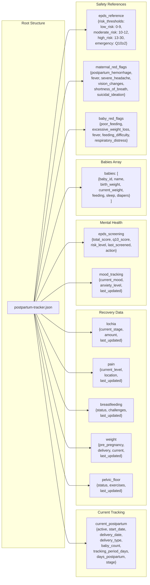
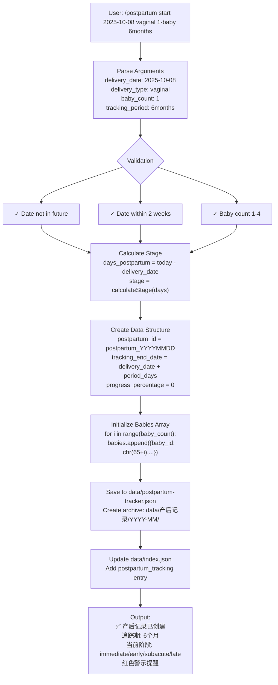
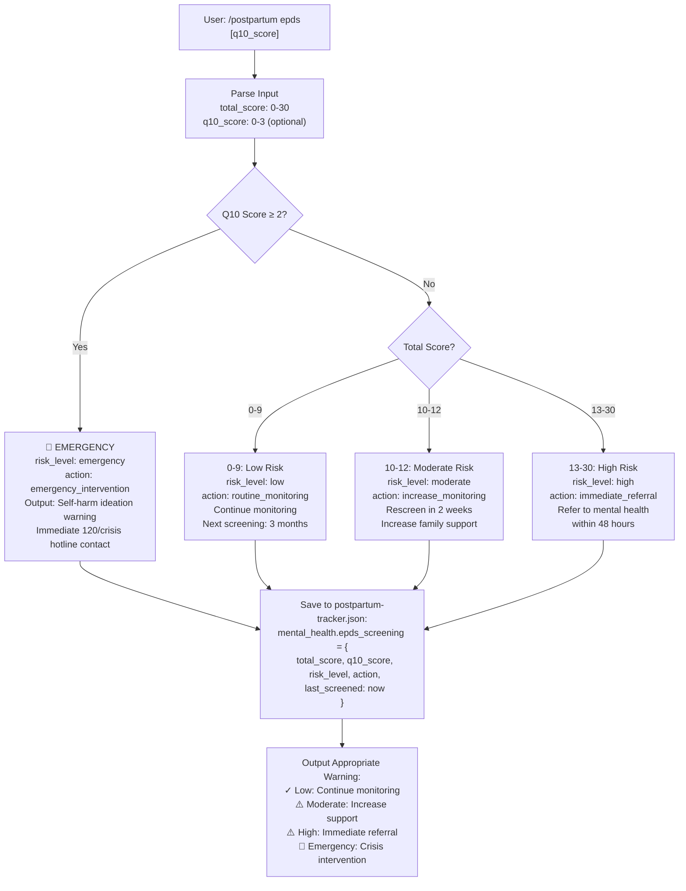
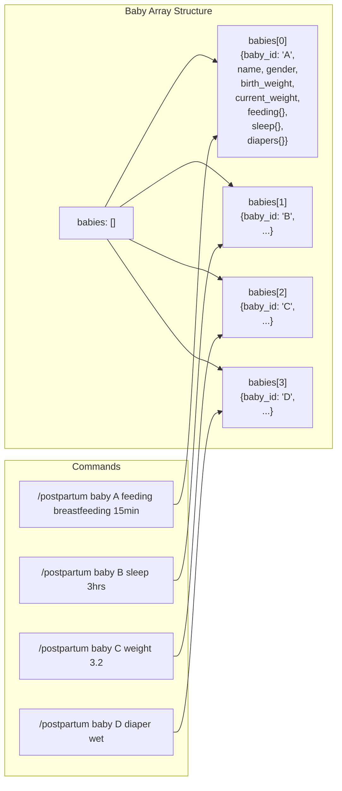
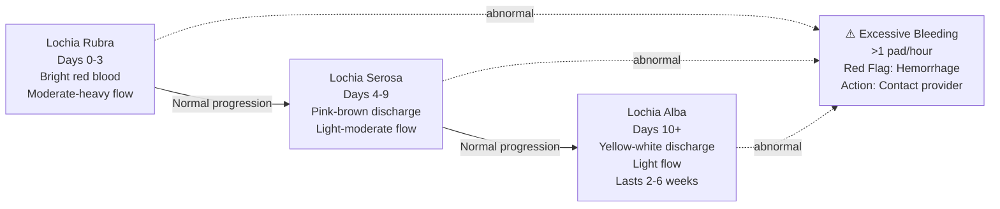
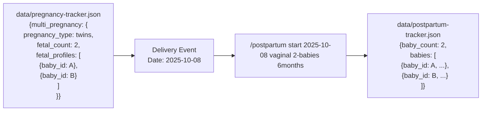

<!-- source: DeepWiki mcp.deepwiki.com · repo huifer/Claude-Ally-Health · extra page Postpartum Care · fetched 2026-10-26 -->

# Postpartum Care

<details>
<summary>Relevant source files</summary>

The following files were used as context for generating this wiki page:

- [.claude/commands/postpartum.md](.claude/commands/postpartum.md)
- [.claude/commands/pregnancy.md](.claude/commands/pregnancy.md)
- [.claude/settings.local.json](.claude/settings.local.json)
- [data-example/postpartum-tracker.json](data-example/postpartum-tracker.json)
- [docs/postpartum-care-guide.md](docs/postpartum-care-guide.md)
- [scripts/test.sh](scripts/test.sh)
- [todo/01-womens-health.md](todo/01-womens-health.md)
- [todo/02-mens-health.md](todo/02-mens-health.md)
- [todo/05-pregnancy-postpartum.md](todo/05-pregnancy-postpartum.md)

</details>


## Purpose and Scope

This module provides comprehensive postpartum recovery tracking from delivery through 6 weeks, 6 months, or 1 year. It monitors maternal physical recovery (lochia, pain, breastfeeding, weight, pelvic floor), mental health via Edinburgh Postnatal Depression Scale (EPDS) screening with 4-level risk stratification, and newborn care basics (feeding, sleep, weight, diapers). The system supports multi-baby tracking (twins, triplets, quadruplets) and implements automated red flag warning systems for emergency maternal and infant conditions.

For pregnancy management prior to delivery, see [Pregnancy Tracking](#4.1.1). For other women's health modules, see [Women's Health](#4.1).

Sources: [.claude/commands/postpartum.md:1-20](), [todo/05-pregnancy-postpartum.md:1-24]()

---

## System Architecture

### Overview of Postpartum Tracking Components

```mermaid
graph TB
    subgraph "Command Interface"
        CMD["/postpartum command"]
    end
    
    subgraph "Action Handlers"
        START["start<br/>Initialize tracking"]
        LOCHIA["lochia<br/>Vaginal bleeding"]
        PAIN["pain<br/>Pain assessment"]
        BF["breastfeeding<br/>Feeding status"]
        EPDS["epds<br/>Mental health screening"]
        MOOD["mood<br/>Emotional state"]
        WEIGHT["weight<br/>Weight recovery"]
        PELVIC["pelvic-floor<br/>Muscle recovery"]
        BABY["baby<br/>Infant care tracking"]
        STATUS["status<br/>Current state"]
        SUMMARY["recovery-summary<br/>Full report"]
        EXTEND["extend<br/>Prolong tracking"]
    end
    
    subgraph "Data Layer"
        TRACKER["data/postpartum-tracker.json<br/>Main tracking file"]
        MONTHLY["data/产后记录/YYYY-MM/<br/>Monthly archives"]
        INDEX["data/index.json<br/>Global catalog"]
    end
    
    subgraph "Safety Systems"
        EPDS_RISK["EPDS Risk Stratification<br/>0-9: Low<br/>10-12: Moderate<br/>13+: High<br/>Q10≥2: Emergency"]
        MATERNAL_FLAGS["Maternal Red Flags<br/>Hemorrhage, Fever<br/>Vision, Breathing<br/>Suicidal ideation"]
        BABY_FLAGS["Baby Red Flags<br/>Poor feeding<br/>Respiratory distress<br/>Fever, Dehydration"]
    end
    
    subgraph "Postpartum Stages"
        STAGE_IMM["Immediate: 0-2 days<br/>Hospital recovery"]
        STAGE_EARLY["Early: 3-14 days<br/>Establish feeding"]
        STAGE_SUB["Subacute: 15-42 days<br/>Healing, routines"]
        STAGE_LATE["Late: 43+ days<br/>Long-term recovery"]
    end
    
    CMD --> START
    CMD --> LOCHIA
    CMD --> PAIN
    CMD --> BF
    CMD --> EPDS
    CMD --> MOOD
    CMD --> WEIGHT
    CMD --> PELVIC
    CMD --> BABY
    CMD --> STATUS
    CMD --> SUMMARY
    CMD --> EXTEND
    
    START --> TRACKER
    LOCHIA --> TRACKER
    PAIN --> TRACKER
    BF --> TRACKER
    EPDS --> TRACKER
    EPDS --> EPDS_RISK
    MOOD --> TRACKER
    WEIGHT --> TRACKER
    PELVIC --> TRACKER
    BABY --> TRACKER
    
    TRACKER --> MONTHLY
    TRACKER --> INDEX
    
    LOCHIA -.monitors.-> MATERNAL_FLAGS
    PAIN -.monitors.-> MATERNAL_FLAGS
    BF -.monitors.-> MATERNAL_FLAGS
    BABY -.monitors.-> BABY_FLAGS
    
    TRACKER -.calculates.-> STAGE_IMM
    TRACKER -.calculates.-> STAGE_EARLY
    TRACKER -.calculates.-> STAGE_SUB
    TRACKER -.calculates.-> STAGE_LATE
    
    STATUS --> TRACKER
    SUMMARY --> TRACKER
    EXTEND --> TRACKER
```



**Diagram: Postpartum Care System Architecture**

The system provides 12 command actions that write to `data/postpartum-tracker.json`, with monthly archival in `data/产后记录/YYYY-MM/`. Three safety systems run concurrently: EPDS mental health screening with 4-level risk assessment, maternal red flag monitoring (hemorrhage, infection, cardiovascular events, suicidal ideation), and baby red flag monitoring (feeding inadequacy, respiratory distress, fever). The system automatically calculates postpartum stage (immediate/early/subacute/late) based on days since delivery.

Sources: [.claude/commands/postpartum.md:1-50](), [data-example/postpartum-tracker.json:1-203]()

---

## Data Structures

### Postpartum Tracker Schema

The primary data structure is `data/postpartum-tracker.json`:



**Diagram: Postpartum Tracker Data Model**

Sources: [data-example/postpartum-tracker.json:1-203](), [.claude/commands/postpartum.md:83-190]()

### Key Data Fields

| Section | Field | Type | Description |
|---------|-------|------|-------------|
| **current_postpartum** | `active` | boolean | Whether tracking is active |
| | `delivery_date` | string (YYYY-MM-DD) | Date of delivery |
| | `delivery_type` | enum | `vaginal`, `c-section`, `assisted`, `vbac` |
| | `baby_count` | integer (1-4) | Number of babies delivered |
| | `tracking_period_type` | enum | `6weeks`, `6months`, `1year` |
| | `days_postpartum` | integer | Days since delivery |
| | `stage` | enum | `immediate`, `early`, `subacute`, `late` |
| **recovery_tracking.lochia** | `current_stage` | enum | `rubra` (0-3d), `serosa` (4-9d), `alba` (10+d) |
| | `amount` | enum | `light`, `moderate`, `heavy`, `excessive` |
| **mental_health.epds_screening** | `total_score` | integer (0-30) | Sum of all 10 EPDS questions |
| | `q10_score` | integer (0-3) | Question 10 score (self-harm ideation) |
| | `risk_level` | enum | `low`, `moderate`, `high`, `emergency` |
| | `action` | enum | `routine_monitoring`, `increase_monitoring`, `immediate_referral`, `emergency_intervention` |
| **babies[i]** | `baby_id` | string | `A`, `B`, `C`, `D` for multi-baby tracking |
| | `feeding.type` | enum | `breastfeeding`, `formula`, `mixed` |
| | `diapers.wet_per_day` | integer | Wet diapers per 24 hours (≥6 expected) |

Sources: [data-example/postpartum-tracker.json:1-77](), [.claude/commands/postpartum.md:768-813]()

---

## Command Processing

### Start Command Flow



**Diagram: /postpartum start Command Processing**

The `start` action initializes postpartum tracking. It extracts delivery date, type, baby count (1-4), and tracking period from natural language input, validates constraints, calculates current postpartum stage based on days since delivery, creates a data structure with unique `postpartum_id`, initializes baby records with identifiers A-D, persists to `data/postpartum-tracker.json`, and updates the global index.

Sources: [.claude/commands/postpartum.md:24-239]()

### Postpartum Stage Calculation

```javascript
function calculateStage(days_postpartum) {
  if (days_postpartum <= 2) {
    return "immediate"; // Hospital recovery, initial breastfeeding
  } else if (days_postpartum <= 14) {
    return "early"; // Establish feeding, rest
  } else if (days_postpartum <= 42) {
    return "subacute"; // Healing, establish routines
  } else {
    return "late"; // Long-term recovery, mental health
  }
}
```

Sources: [.claude/commands/postpartum.md:66-79](), [data-example/postpartum-tracker.json:167-184]()

---

## EPDS Mental Health Screening

### Edinburgh Postnatal Depression Scale Implementation

The EPDS is a 10-question screening tool for postpartum depression and anxiety, scored 0-30.



**Diagram: EPDS Risk Stratification Algorithm**

Sources: [.claude/commands/postpartum.md:387-613](), [data-example/postpartum-tracker.json:83-107]()

### EPDS Risk Assessment Logic

The implementation at [.claude/commands/postpartum.md:433-465]() defines a JavaScript function for risk stratification:

```javascript
function assessEPDS(score, q10Score) {
  // Emergency override: Question 10 screens for self-harm thoughts
  if (q10Score >= 2) {
    return {
      risk_level: "emergency",
      recommendation: "immediate_intervention",
      message: "🚨 紧急情况：存在自我伤害想法"
    };
  }

  // High risk: Likely postpartum depression
  if (score >= 13) {
    return {
      risk_level: "high",
      recommendation: "immediate_referral",
      message: "⚠️ 高风险：需要立即就医评估"
    };
  }

  // Moderate risk: Subclinical symptoms
  if (score >= 10) {
    return {
      risk_level: "moderate",
      recommendation: "monitoring",
      message: "⚠️ 中度风险：建议密切监测和随访"
    };
  }

  // Low risk: Normal postpartum adjustment
  return {
    risk_level: "low",
    recommendation: "routine",
    message: "✓ 低风险：继续常规监测"
  };
}
```

The system stores risk thresholds in `data/postpartum-tracker.json` at [data-example/postpartum-tracker.json:85-106]():

```json
"risk_thresholds": {
  "low_risk": {
    "min": 0,
    "max": 9,
    "action": "routine_monitoring"
  },
  "moderate_risk": {
    "min": 10,
    "max": 12,
    "action": "increase_monitoring"
  },
  "high_risk": {
    "min": 13,
    "max": 30,
    "action": "immediate_referral"
  },
  "emergency": {
    "q10_threshold": 2,
    "action": "emergency_intervention"
  }
}
```

Sources: [.claude/commands/postpartum.md:433-465](), [data-example/postpartum-tracker.json:85-106]()

### EPDS Question 10 Emergency Protocol

Question 10 asks: "The thought of harming myself has occurred to me" (0-3 scale). A score ≥2 triggers immediate emergency protocols:

| Q10 Score | Interpretation | Action |
|-----------|----------------|--------|
| 0 | Never | No special action |
| 1 | Hardly ever | Monitor, discuss at next appointment |
| 2 | Sometimes | 🚨 **Emergency** - Contact provider immediately |
| 3 | Yes, quite often | 🚨 **Emergency** - Call 120 or crisis hotline |

The output template at [.claude/commands/postpartum.md:581-613]() displays:

```
🚨🚨🚨 紧急情况警示

第10题得分：2-3分
（有自我伤害想法）

🚨 必须立即行动：

第一步：立即告诉身边的人
• 伴侣/家人
• 朋友/邻居
• 不要独自面对！

第二步：立即寻求专业帮助
• 拨打120急救电话
• 前往最近医院急诊
• 联系您的产科医生

第三步：确保宝宝安全
• 请家人临时照顾
• 不要留宝宝独自一人

📞 24小时求助热线：
• 国家心理援助热线：400-161-9995
• 生命热线：400-821-1215
```

Sources: [.claude/commands/postpartum.md:581-613]()

---

## Red Flag Warning System

### Automated Safety Monitoring

The system continuously monitors for emergency conditions requiring immediate medical attention.

```mermaid
graph TB
    subgraph "Maternal Red Flags"
        M1["Postpartum Hemorrhage<br/>>1 pad/hour<br/>⚠️ Contact Provider"]
        M2["Fever<br/>>100.4°F (38°C)<br/>⚠️ Possible Infection"]
        M3["Severe Headache<br/>Persistent, unrelieved<br/>⚠️ Contact Provider"]
        M4["Vision Changes<br/>Blurred, flashing lights<br/>⚠️ Contact Provider"]
        M5["Shortness of Breath<br/>At rest<br/>🚨 Emergency Care"]
        M6["Chest Pain<br/>Any chest pain<br/>🚨 Call 120"]
        M7["Leg Pain/Swelling<br/>Unilateral (DVT risk)<br/>⚠️ Contact Provider"]
        M8["Wound Infection<br/>Red, swollen, pus<br/>⚠️ Contact Provider"]
        M9["Mastitis<br/>Breast pain + fever<br/>⚠️ 24h Medical Care"]
        M10["Suicidal Ideation<br/>Any thoughts<br/>🚨🚨 EMERGENCY"]
    end
    
    subgraph "Baby Red Flags"
        B1["Poor Feeding<br/><6 wet diapers/24h<br/>⚠️ Contact Provider"]
        B2["Weight Loss<br/>>10% birth weight<br/>⚠️ Contact Provider"]
        B3["Fever<br/>>100.4°F (38°C)<br/>🚨 Emergency Care"]
        B4["Feeding Difficulty<br/>Cannot suck/swallow<br/>🚨 Emergency Care"]
        B5["Respiratory Distress<br/>Grunting, retractions<br/>🚨🚨 EMERGENCY"]
        B6["Severe Jaundice<br/>Extends to extremities<br/>⚠️ Contact Provider"]
        B7["Dehydration<br/>Sunken fontanelle<br/>🚨 Emergency Care"]
    end
    
    subgraph "Monitoring Sources"
        LOCHIA_CMD["/postpartum lochia"]
        PAIN_CMD["/postpartum pain"]
        BF_CMD["/postpartum breastfeeding"]
        EPDS_CMD["/postpartum epds"]
        BABY_CMD["/postpartum baby"]
    end
    
    subgraph "Actions"
        WARN["Generate Warning Message"]
        LOG["Log to red_flags.active[]"]
        URGENT["Display Emergency Contact Info"]
    end
    
    LOCHIA_CMD -.triggers.-> M1
    PAIN_CMD -.triggers.-> M3
    PAIN_CMD -.triggers.-> M5
    PAIN_CMD -.triggers.-> M6
    BF_CMD -.triggers.-> M9
    EPDS_CMD -.triggers.-> M10
    BABY_CMD -.triggers.-> B1
    BABY_CMD -.triggers.-> B3
    BABY_CMD -.triggers.-> B5
    
    M1 --> WARN
    M10 --> WARN
    B5 --> WARN
    WARN --> LOG
    LOG --> URGENT
```



**Diagram: Red Flag Detection and Warning System**

Sources: [.claude/commands/postpartum.md:972-1001](), [data-example/postpartum-tracker.json:108-165]()

### Red Flag Definitions

The reference data at [data-example/postpartum-tracker.json:108-165]() defines thresholds and severity levels:

**Maternal Red Flags:**

| Flag | Threshold | Severity | Action |
|------|-----------|----------|--------|
| `postpartum_hemorrhage` | >1 pad/hour | High | Contact provider |
| `fever` | >100.4°F (38°C) | High | Possible infection evaluation |
| `severe_headache` | Persistent, not relieved by medication | High | Contact provider |
| `vision_changes` | Any visual disturbances | High | Contact provider |
| `shortness_of_breath` | At rest | Emergency | Emergency care |
| `chest_pain` | Any chest pain | Emergency | Call emergency services |
| `suicidal_ideation` | Any thoughts of self-harm | Emergency | **Immediate intervention** |

**Baby Red Flags:**

| Flag | Threshold | Severity | Action |
|------|-----------|----------|--------|
| `poor_feeding` | <6 wet diapers/24 hours | High | Contact provider |
| `excessive_weight_loss` | >10% of birth weight | High | Contact provider |
| `fever` | >100.4°F (38°C) | Emergency | Emergency care |
| `feeding_difficulty` | Unable to suck or swallow | Emergency | Emergency care |
| `respiratory_distress` | Grunting, retractions, cyanosis | Emergency | **Immediate emergency** |

Sources: [data-example/postpartum-tracker.json:108-165](), [.claude/commands/postpartum.md:972-1001]()

### Red Flag Triggering Logic

Commands that collect health data automatically check for red flag conditions:

1. **`/postpartum lochia heavy large_clots`** at [.claude/commands/postpartum.md:256-285]() checks:
   - If `amount == "excessive"` → Trigger `postpartum_hemorrhage` warning
   - Output: ⚠️ 恶露异常警示 + 🏥 立即就医检查

2. **`/postpartum pain severe 9`** at [.claude/commands/postpartum.md:308-327]() checks:
   - If `pain_level >= 8` and `location == "head"` → Trigger `severe_headache` warning
   - Output: ⚠️ 严重头痛警示 + Blood pressure check + Neurological evaluation

3. **`/postpartum epds 15 2`** at [.claude/commands/postpartum.md:581-613]() checks:
   - If `q10_score >= 2` → Trigger `suicidal_ideation` emergency
   - Output: 🚨🚨🚨 紧急情况警示 + Crisis hotline + Family notification

4. **`/postpartum baby A diaper wet 2`** checks:
   - If daily wet diapers < 6 → Trigger `poor_feeding` warning (baby dehydration risk)
   - Output: ⚠️ 宝宝摄入不足警示 + Lactation consultation

Sources: [.claude/commands/postpartum.md:256-847]()

---

## Multi-Baby Tracking

### Baby Identification System

For twins, triplets, and quadruplets, the system uses letter identifiers A, B, C, D.



**Diagram: Multi-Baby Tracking Architecture**

Sources: [.claude/commands/postpartum.md:739-847](), [data-example/postpartum-tracker.json:55-77]()

### Baby Data Structure

Each baby record at [data-example/postpartum-tracker.json:56-77]() contains:

```json
{
  "baby_id": "A",
  "name": "Emma",
  "birth_weight": 3.4,
  "current_weight": 4.2,
  "feeding": {
    "type": "breastfeeding",
    "pattern": "every 2-3 hours",
    "last_updated": "2025-10-22"
  },
  "sleep": {
    "pattern": "3-4 hours",
    "total_sleep": "14-16 hours/day",
    "last_updated": "2025-10-21"
  },
  "diapers": {
    "wet_per_day": 6,
    "soiled_per_day": 3,
    "last_updated": "2025-10-22"
  }
}
```

### Baby Command Syntax

The `/postpartum baby` command at [.claude/commands/postpartum.md:739-847]() uses this syntax:

```bash
# Feeding
/postpartum baby A feeding breastfeeding left 15min
/postpartum baby B feeding formula 90ml
/postpartum baby C feeding mixed 50ml

# Sleep
/postpartum baby A sleep 3hrs
/postpartum baby D sleep 45min

# Weight
/postpartum baby A weight 3.2
/postpartum baby B weight 3.0

# Diapers
/postpartum baby A diaper wet
/postpartum baby B diaper both
/postpartum baby C diaper wet 3
```

Sources: [.claude/commands/postpartum.md:739-847](), [docs/postpartum-care-guide.md:240-306]()

---

## Recovery Tracking Subsystems

### Lochia (Vaginal Bleeding) Tracking

Lochia progresses through three stages after delivery:



**Diagram: Lochia Stages and Red Flag Conditions**

The `lochia` tracking at [.claude/commands/postpartum.md:243-285]() stores:

```json
{
  "lochia": {
    "current_stage": "serosa",
    "amount": "light",
    "last_updated": "2025-10-20"
  }
}
```

Valid stages: `rubra`, `serosa`, `alba`  
Valid amounts: `light`, `moderate`, `heavy`, `excessive`

If `amount == "excessive"`, the system triggers a postpartum hemorrhage warning with immediate medical attention recommendation.

Sources: [.claude/commands/postpartum.md:243-285](), [data-example/postpartum-tracker.json:14-18]()

### Breastfeeding Tracking

The breastfeeding subsystem at [.claude/commands/postpartum.md:330-382]() tracks:

| Field | Values | Description |
|-------|--------|-------------|
| `status` | `exclusive`, `supplemented`, `formula`, `pumping`, `weaning` | Feeding method |
| `challenges` | Array: `engorgement`, `mastitis`, `low-supply`, `latch-issues`, `nipple-pain`, `clogged-duct` | Current issues |
| `last_updated` | ISO timestamp | Last modification |

**Mastitis Detection:**

When user reports `mastitis` challenge:
```bash
/postpartum breastfeeding exclusive mastitis
```

The system checks for red flag combination:
- Breast pain/redness + Fever >100.4°F → Trigger `mastitis` warning
- Output: ⚠️ 可能的乳腺炎 + Antibiotic recommendation + 24h follow-up requirement

Sources: [.claude/commands/postpartum.md:330-382](), [data-example/postpartum-tracker.json:23-28]()

### Pelvic Floor Recovery

Pelvic floor tracking at [.claude/commands/postpartum.md:699-733]() monitors:

```bash
/postpartum pelvic-floor kegel-exercises    # Performing Kegel exercises
/postpartum pelvic-floor recovering         # Normal recovery
/postpartum pelvic-floor weakness           # Feeling weakness
/postpartum pelvic-floor prolapse-symptoms  # Organ prolapse symptoms ⚠️
```

Recovery timeline:
- **Weeks 0-6:** Gentle Kegel exercises (10 reps/day)
- **Weeks 6-12:** Increase intensity (20-30 reps/day)
- **Months 3-6:** Continue strengthening

Stress urinary incontinence (leaking with cough/sneeze) is common and tracked. If `prolapse-symptoms` reported, system recommends pelvic floor physical therapy referral.

Sources: [.claude/commands/postpartum.md:699-733]()

---

## Testing Framework

### Test Coverage

The native test suite at [scripts/test.sh:1-152]() validates 21 test cases across 6 test suites:

**Test Suite 1: JSON Structure Validation**
- Validates `data/postpartum-tracker.json` is valid JSON
- Validates `data/pregnancy-tracker.json` (for integration)
- Validates `data/index.json`

**Test Suite 2: Required Field Validation**
- Verifies `postpartum-tracker` contains `epds_reference`
- Verifies `red_flags.maternal` exists
- Verifies `red_flags.baby` exists

**Test Suite 3: Medical Safety Validation**
- Tests EPDS `risk_thresholds` structure exists
- Tests low_risk range is 0-9
- Tests high_risk range is 13-30
- Tests emergency threshold Q10≥2

**Test Suite 4: Multi-Pregnancy Support** (Integration with pregnancy module)
- Tests pregnancy tracker supports 4 types
- Tests twins/triplets/quadruplets included
- Tests max_fetal_count is 4

**Test Suite 5: Command Files Exist**
- Tests `.claude/commands/postpartum.md` exists
- Tests `.claude/commands/pregnancy.md` exists

**Test Suite 6: Data Directories**
- Tests `data/` directory exists
- Tests `data-example/` directory exists

Sources: [scripts/test.sh:1-152]()

### Running Tests

```bash
# Execute all 21 tests
./scripts/test.sh

# Example output:
# ================================
# Claude Code Health Tracking Tests
# ================================
# 
# Test Suite 1: JSON Structure Validation
# -------------------------------------
# Testing: pregnancy-tracker.json is valid JSON ... ✓ PASSED
# Testing: postpartum-tracker.json is valid JSON ... ✓ PASSED
# ...
# 
# ================================
# Test Summary
# ================================
# Total Tests: 21
# Passed: 21
# All tests passed!
```

The test framework uses Python's `json.tool` for validation and custom Python scripts for field checking:

```bash
# Test EPDS thresholds
python3 -c "import json; d=json.load(open('data/postpartum-tracker.json')); \
rt=d['epds_reference']['risk_thresholds']; \
exit(0 if rt['high_risk']['min']==13 and rt['high_risk']['max']==30 else 1)"
```

Sources: [scripts/test.sh:77-91]()

---

## Integration with Pregnancy Module

### Pregnancy-to-Postpartum Transition

The postpartum module integrates with pregnancy tracking (see [Pregnancy Tracking](#4.1.1)) by:

1. **Delivery Data Transfer**: When starting postpartum tracking with `/postpartum start`, the system can read from `data/pregnancy-tracker.json` to:
   - Verify delivery date matches pregnancy due date
   - Transfer baby count from multi-pregnancy data
   - Import pre-pregnancy weight for weight recovery tracking

2. **Shared Baby Identifiers**: Multi-baby identifiers (A, B, C, D) carry over:
   - Pregnancy module assigns fetal IDs at [.claude/commands/pregnancy.md:1273-1447]()
   - Postpartum module uses same IDs for baby tracking
   - Continuity enables: "Fetus A" (pregnancy) → "Baby A" (postpartum)

3. **Weight Continuity**: The postpartum weight tracker references:
   - `pre_pregnancy_weight` from pregnancy module
   - `delivery_weight` (final pregnancy weight)
   - Calculates postpartum weight loss progress

**Integration Flow:**



**Diagram: Pregnancy-to-Postpartum Data Handoff**

Sources: [.claude/commands/pregnancy.md:1273-1447](), [.claude/commands/postpartum.md:24-239]()

---

## Data Privacy and Storage

### Local-Only Storage Model

All postpartum data is stored locally:

- **Primary file**: `data/postpartum-tracker.json` - Current tracking state
- **Archives**: `data/产后记录/YYYY-MM/YYYY-MM-DD_产后记录.json` - Monthly archives
- **Index**: `data/index.json` - Global catalog with postpartum entry

The `.gitignore` excludes `data/` directory to prevent accidental version control commits of sensitive health information.

Sources: [.claude/commands/postpartum.md:1004-1030]()

### File System Layout

```
data/
├── postpartum-tracker.json          # Main tracking file
├── pregnancy-tracker.json           # Integration with pregnancy module
├── profile.json                     # User height, weight, birth date
├── index.json                       # Global data catalog
└── 产后记录/                        # Postpartum archives
    ├── 2025-10/
    │   ├── 2025-10-08_产后记录.json  # Delivery day
    │   ├── 2025-10-15_恶露记录.json
    │   └── 2025-10-20_EPDS筛查.json
    └── 2025-11/
        └── ...

data-example/
└── postpartum-tracker.json          # Example data structure
```

Sources: [.claude/commands/postpartum.md:1030]()

---

## Medical Safety Principles

### Safety Red Lines

The system adheres to strict medical safety principles defined at [.claude/commands/postpartum.md:1034-1049]():

**What the system DOES NOT do:**
1. **No diagnoses** - Does not diagnose postpartum depression, anxiety disorders, or physical complications
2. **No prescriptions** - Does not recommend specific medications or dosages
3. **No treatment plans** - Does not replace 6-week postpartum checkup or ongoing medical care
4. **No prognosis** - Does not predict recovery timeline or outcomes

**What the system DOES:**
1. **Screening** - EPDS screening tool for depression/anxiety risk assessment
2. **Monitoring** - Tracks recovery metrics (lochia, pain, weight, breastfeeding)
3. **Alerting** - Red flag warnings for emergency conditions
4. **Referral guidance** - Recommends when to contact healthcare provider
5. **Education** - Provides postpartum care information and normal ranges

### Emergency Contact Display

All high-risk outputs display emergency contacts:

```
📞 紧急求助：
• 产后抑郁热线：400-161-9995
• 妇幼保健热线：12320
• 急救：120

⚠️ 如有自杀想法：
立即告知家人或朋友！
立即拨打120或前往急诊！
```

Sources: [.claude/commands/postpartum.md:1034-1049](), [docs/postpartum-care-guide.md:442-452]()

---

## Summary

The Postpartum Care module provides structured tracking of maternal recovery and newborn care from delivery through 42 days, 180 days, or 365 days. Core features include:

- **EPDS mental health screening** with 4-level risk stratification (low/moderate/high/emergency) and special Q10 suicide ideation protocol
- **Red flag monitoring** for 10 maternal and 7 baby emergency conditions with automatic alerting
- **Multi-baby support** for twins, triplets, quadruplets using A/B/C/D identifiers with integration from pregnancy module
- **Recovery tracking** for lochia stages, pain levels, breastfeeding status, weight recovery, and pelvic floor rehabilitation
- **Baby care tracking** for feeding (type, frequency, duration), sleep patterns, weight gain, and diaper output
- **Postpartum stage calculation** (immediate/early/subacute/late) with stage-appropriate care recommendations
- **Local-only data storage** in `data/postpartum-tracker.json` with monthly archival, no cloud synchronization
- **Native test coverage** with 21 test cases validating JSON structure, EPDS thresholds, red flag definitions, and medical safety constraints

The implementation at [.claude/commands/postpartum.md]() defines 12 command actions processed through natural language parsing, validated against medical thresholds, stored in structured JSON, and output with appropriate warnings based on risk levels.

Sources: [.claude/commands/postpartum.md:1-1080](), [data-example/postpartum-tracker.json:1-203](), [docs/postpartum-care-guide.md:1-463]()

---

