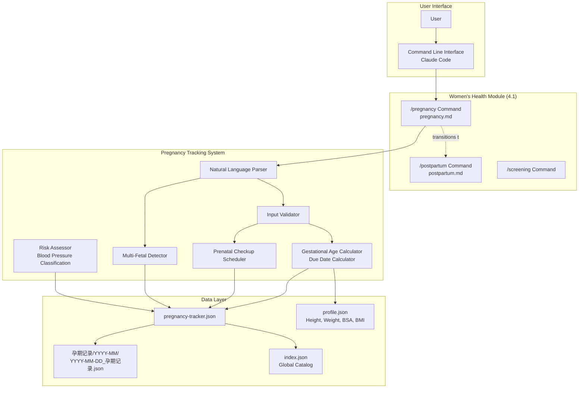
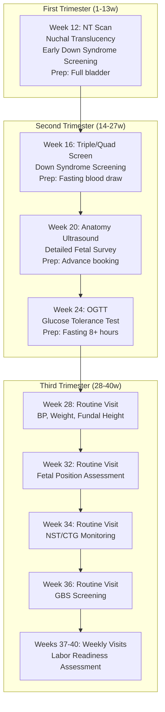
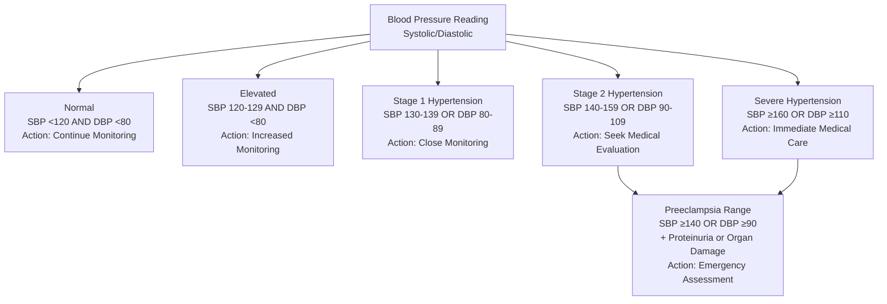
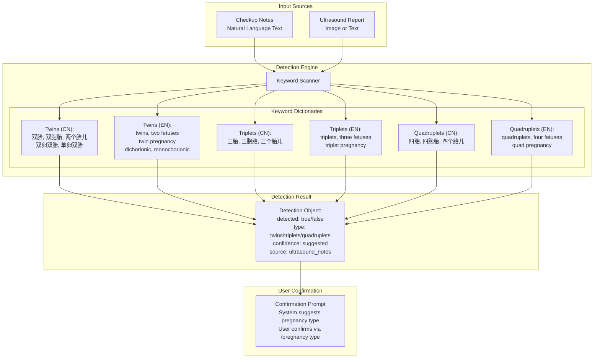
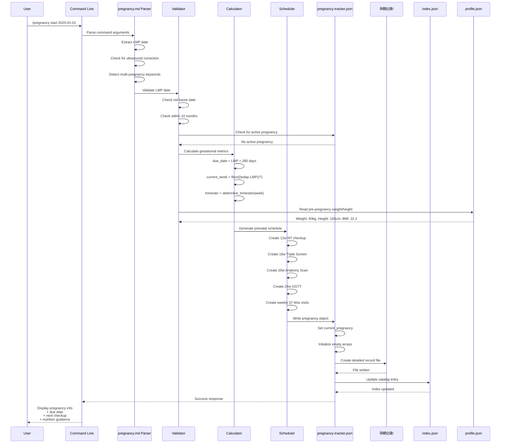
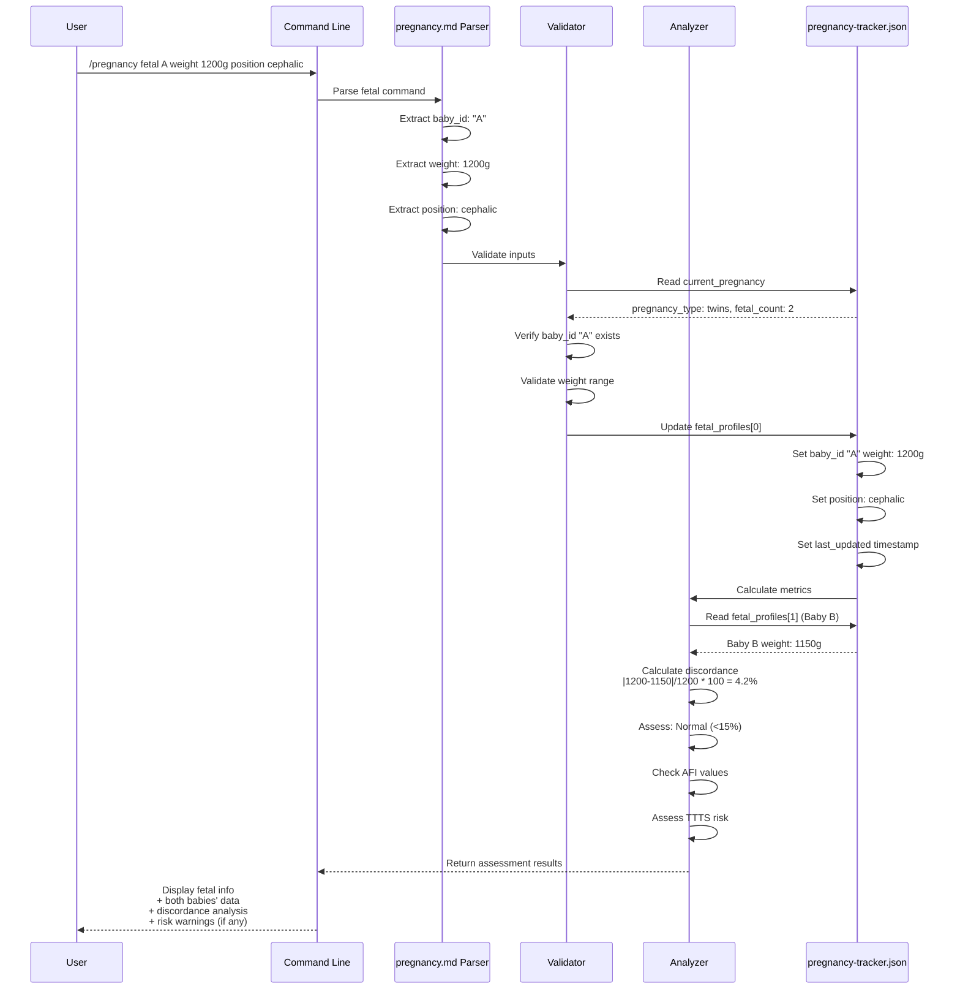

<!-- source: DeepWiki mcp.deepwiki.com · repo huifer/Claude-Ally-Health · extra page Pregnancy Tracking · fetched 2026-10-26 -->

# Pregnancy Tracking

<details>
<summary>Relevant source files</summary>

The following files were used as context for generating this wiki page:

- [.claude/commands/postpartum.md](.claude/commands/postpartum.md)
- [.claude/commands/pregnancy.md](.claude/commands/pregnancy.md)
- [.claude/settings.local.json](.claude/settings.local.json)
- [data-example/postpartum-tracker.json](data-example/postpartum-tracker.json)
- [docs/postpartum-care-guide.md](docs/postpartum-care-guide.md)
- [scripts/test.sh](scripts/test.sh)
- [todo/01-womens-health.md](todo/01-womens-health.md)
- [todo/02-mens-health.md](todo/02-mens-health.md)
- [todo/05-pregnancy-postpartum.md](todo/05-pregnancy-postpartum.md)

</details>


## Purpose and Scope

The Pregnancy Tracking system provides comprehensive management of pregnancy health records from conception through delivery. It implements LMP-based (Last Menstrual Period) gestational age calculations, prenatal checkup scheduling, symptom monitoring, vital signs tracking, and advanced multi-fetal pregnancy support (singleton through quadruplets). The system enforces medical safety constraints by providing health tracking without diagnostic capabilities.

For postpartum recovery tracking after delivery, see [Postpartum Care](#4.1.2). For general gynecological screening, see [Gynecological Cancer Screening](#4.1.4).

**Sources:** [.claude/commands/pregnancy.md:1-14](), [todo/01-womens-health.md:22-36]()

---

## System Architecture

### Position in Module Hierarchy

Pregnancy Tracking is a core component of the Women's Health module (4.1) within the broader Health Tracking system. It operates as a standalone tracker with optional integration points to other health modules.



**Sources:** [.claude/commands/pregnancy.md:1-10](), [todo/01-womens-health.md:1-27]()

---

## Command Interface

### `/pregnancy` Command Structure

The pregnancy tracking system is accessed through the `/pregnancy` command with the following action types:

| Action | Purpose | Key Parameters |
|--------|---------|----------------|
| `start` | Initialize pregnancy record | LMP date, ultrasound correction (optional) |
| `checkup` | Record prenatal checkup results | Week, checkup type, results |
| `symptom` | Log pregnancy symptoms | Symptom type, severity, frequency |
| `weight` | Track weight gain | Current weight (kg/lbs) |
| `vital` | Record blood pressure and vitals | BP reading, temperature, glucose |
| `type` | Set multi-fetal pregnancy type | singleton, twins, triplets, quadruplets |
| `fetal` | Update individual fetal profiles | Baby ID (A/B/C/D), measurements |
| `status` | Display current pregnancy state | None |
| `next-checkup` | Show upcoming prenatal checkup | None |

**Sources:** [.claude/commands/pregnancy.md:3-10](), [.claude/commands/pregnancy.md:17-195]()

### Command Processing Architecture

```mermaid
graph LR
    subgraph "Command Entry"
        UserInput["/pregnancy start 2025-01-01"]
    end
    
    subgraph "Natural Language Processing"
        ParseLMP["Extract LMP Date<br/>YYYY-MM-DD"]
        ParseUltrasound["Extract Ultrasound<br/>Correction Date"]
        ParseMulti["Detect Multi-Pregnancy<br/>Keywords"]
    end
    
    subgraph "Validation Layer"
        ValidateDate["Date Validation<br/>Not Future<br/>Within 10 Months"]
        CheckActive["Check Active Pregnancy<br/>pregnancy-tracker.json"]
    end
    
    subgraph "Calculation Engine"
        CalcDueDate["Calculate Due Date<br/>LMP + 280 Days<br/>Naegele's Rule"]
        CalcWeek["Calculate Current Week<br/>floor((today - LMP) / 7)"]
        CalcTrimester["Determine Trimester<br/>1-13w, 14-27w, 28-42w"]
    end
    
    subgraph "Schedule Generation"
        GenCheckups["Generate Prenatal Schedule<br/>12w NT, 16w Tang, 20w Anatomy<br/>24w OGTT, Weekly 37-40w"]
    end
    
    subgraph "Data Persistence"
        WriteTracker["Write pregnancy-tracker.json<br/>current_pregnancy Object"]
        WriteDetailed["Write 孕期记录/<br/>YYYY-MM-DD_孕期记录.json"]
        UpdateIndex["Update index.json<br/>Add to Catalog"]
    end
    
    UserInput --> ParseLMP
    UserInput --> ParseUltrasound
    UserInput --> ParseMulti
    
    ParseLMP --> ValidateDate
    ValidateDate --> CheckActive
    CheckActive --> CalcDueDate
    
    CalcDueDate --> CalcWeek
    CalcWeek --> CalcTrimester
    CalcTrimester --> GenCheckups
    
    GenCheckups --> WriteTracker
    WriteTracker --> WriteDetailed
    WriteDetailed --> UpdateIndex
```



**Sources:** [.claude/commands/pregnancy.md:37-305](), [.claude/commands/pregnancy.md:1623-1743]()

---

## Data Model

### Primary Data File: `pregnancy-tracker.json`

The main tracking file uses a singleton pattern with current active pregnancy and historical records:

```json
{
  "current_pregnancy": {
    "pregnancy_id": "pregnancy_20250101",
    "lmp_date": "2025-01-01",
    "due_date": "2025-10-08",
    "due_date_confidence": "high|medium|low",
    "corrected_by_ultrasound": false,
    
    "multi_pregnancy": {
      "pregnancy_type": "singleton|twins|triplets|quadruplets",
      "fetal_count": 1,
      "fetal_profiles": []
    },
    
    "prenatal_checks": [],
    "symptoms": {},
    "weight_tracking": [],
    "blood_pressure": []
  },
  
  "pregnancy_history": [],
  "statistics": {}
}
```

**Sources:** [.claude/commands/pregnancy.md:1628-1743](), [todo/01-womens-health.md:72-164]()

### Prenatal Checkup Data Structure

The `prenatal_checks` array contains scheduled examinations with preparation requirements:

| Field | Type | Description |
|-------|------|-------------|
| `check_id` | string | Unique identifier: `check_001`, `check_002`, ... |
| `week` | integer | Gestational week: 12, 16, 20, 24, 28, 32, 34, 36, 37-40 |
| `check_type` | string | Chinese: "NT检查", "唐筛", "大排畸", "糖耐量测试" |
| `check_type_en` | string | English: "NT_scan", "triple_test", "anatomy_ultrasound", "OGTT" |
| `scheduled_date` | string | ISO 8601 date |
| `completed` | boolean | Checkup completion status |
| `results` | object | Examination findings |
| `preparation` | string | Patient instructions: "需要憋尿", "空腹抽血" |

**Sources:** [.claude/commands/pregnancy.md:140-165](), [todo/01-womens-health.md:82-97]()

### Weight Tracking Data Structure

Weight records integrate with the user profile's pre-pregnancy baseline to calculate recommended gains:

```json
{
  "weight_tracking": [
    {
      "date": "2025-03-20",
      "week": 12,
      "weight": 62.5,
      "weight_unit": "kg",
      "weight_gain": 2.5,
      "bmi": 23.1,
      "bmi_category": "normal",
      "pre_pregnancy_weight": 60.0,
      "pre_pregnancy_bmi": 22.2,
      "recommended_total_gain": "11.5-16kg",
      "recommended_weekly_gain": "0.35-0.50kg",
      "weekly_gain": 0.4,
      "gain_status": "normal|too_fast|too_slow",
      "trimester": "first|second|third"
    }
  ]
}
```

The system calculates BMI-based recommendations according to IOM (Institute of Medicine) guidelines:

| Pre-Pregnancy BMI | Total Weight Gain | Weekly Gain (2nd/3rd Trimester) |
|-------------------|-------------------|----------------------------------|
| <18.5 (Underweight) | 12.5-18 kg | 0.51 kg (0.44-0.58) |
| 18.5-24.9 (Normal) | 11.5-16 kg | 0.42 kg (0.35-0.50) |
| 25.0-29.9 (Overweight) | 7-11.5 kg | 0.28 kg (0.23-0.33) |
| ≥30.0 (Obese) | 5-9 kg | 0.22 kg (0.17-0.27) |

**Sources:** [.claude/commands/pregnancy.md:719-741](), [.claude/commands/pregnancy.md:686-695](), [todo/01-womens-health.md:111-120]()

---

## Core Features

### LMP-Based Gestational Age Calculation

The system implements Naegele's Rule for due date calculation:

```javascript
// Calculation logic (conceptual representation)
due_date = LMP_date + 280_days  // 40 weeks
current_week = floor((today - LMP_date) / 7)
current_day = (today - LMP_date) % 7
trimester = determine_trimester(current_week)
```

**Trimester Classification:**
- **First Trimester:** Weeks 1-13 (organogenesis, NT screening)
- **Second Trimester:** Weeks 14-27 (anatomy scan, glucose tolerance)
- **Third Trimester:** Weeks 28-42 (fetal movement, weekly monitoring)

**Confidence Levels:**
- **High:** Ultrasound-corrected due date
- **Medium:** LMP-based calculation with reliable menstrual history
- **Low:** Uncertain LMP or irregular cycles

**Sources:** [.claude/commands/pregnancy.md:63-77](), [todo/01-womens-health.md:30-35]()

### Prenatal Checkup Scheduler

The scheduler generates a complete prenatal care timeline at pregnancy initialization:



**Sources:** [.claude/commands/pregnancy.md:83-97](), [todo/01-womens-health.md:42-47]()

### Symptom Tracking System

The system recognizes and categorizes common pregnancy symptoms with management guidance:

| Symptom Type | Keywords (CN/EN) | Severity Levels | Tracking Fields |
|--------------|------------------|-----------------|-----------------|
| Nausea/Vomiting | 孕吐, 恶心, 呕吐 / nausea, vomiting | mild, moderate, severe | frequency, triggers, relief_methods |
| Edema | 水肿, 脚肿, 手肿 / edema, swelling | mild, moderate, severe | location, worse_at, onset |
| Fatigue | 乏力, 疲劳, 累 / fatigue, tiredness | mild, moderate, severe | frequency, impact_on_daily_life |
| Back Pain | 腰痛, 背痛 / back_pain | mild, moderate, severe | location, radiation, triggers |
| Contractions | 宫缩 / contractions | false, true | frequency, duration, intensity |

**Red Flag Symptoms (Immediate Medical Attention):**
- Vaginal bleeding
- Severe abdominal pain (cramping)
- Severe headache with vision changes
- Sudden severe edema (face, hands)
- Significant decrease in fetal movement

**Sources:** [.claude/commands/pregnancy.md:468-629](), [todo/01-womens-health.md:49-55]()

### Blood Pressure Monitoring

The system implements ACOG (American College of Obstetricians and Gynecologists) hypertensive disorder classification:



**Data Structure for Blood Pressure Records:**
```json
{
  "blood_pressure": [
    {
      "date": "2025-03-20",
      "week": 12,
      "systolic": 115,
      "diastolic": 75,
      "classification": "normal|elevated|stage1|stage2|severe",
      "mean_arterial_pressure": 88.3,
      "measured_at": "clinic|home"
    }
  ]
}
```

**Sources:** [.claude/commands/pregnancy.md:783-929](), [.claude/commands/pregnancy.md:818-827]()

---

## Multi-Fetal Pregnancy Support

### Pregnancy Type Classification

The system supports four pregnancy types with type-specific medical protocols:

| Type | Fetal Count | Adjusted Due Date | Weight Gain Recommendation (BMI 18.5-24.9) |
|------|-------------|-------------------|---------------------------------------------|
| Singleton | 1 | 40 weeks (280 days) | 11.5-16 kg |
| Twins | 2 | 37 weeks (259 days, -21 days) | 16-20 kg (+4-5 kg) |
| Triplets | 3 | 35 weeks (245 days, -35 days) | 20-25 kg (+8-9 kg) |
| Quadruplets | 4 | 32 weeks (224 days, -56 days) | 22-27 kg (+10-11 kg) |

**Sources:** [todo/01-womens-health.md:232-239](), [.claude/commands/pregnancy.md:1197-1220]()

### Intelligent Multi-Fetal Detection

The system includes an NLP-based detection engine that scans ultrasound notes for multi-pregnancy keywords:



**Detection Logic (Conceptual):**
```javascript
function detectMultiples(checkupNotes) {
  const keywords = {
    twins: ["双胎", "twins", "双胞胎", "two fetuses"],
    triplets: ["三胎", "triplets", "三胞胎", "three fetuses"],
    quadruplets: ["四胎", "quadruplets", "四胞胎", "four fetuses"]
  };

  for (const [type, words] of Object.entries(keywords)) {
    if (words.some(word => checkupNotes.includes(word))) {
      return {
        detected: true,
        type: type,
        confidence: "suggested",
        source: "ultrasound_notes"
      };
    }
  }
  return { detected: false };
}
```

**Sources:** [todo/01-womens-health.md:280-292](), [.claude/commands/pregnancy.md:1476-1548]()

### Fetal Profile Management

Each fetus in a multi-pregnancy receives an individual profile with tracking for growth discordance:

```json
{
  "fetal_profiles": [
    {
      "baby_id": "A",
      "estimated_weight": {
        "value": 1200,
        "unit": "g",
        "percentile": 45,
        "last_updated": "2025-06-20T10:00:00.000Z"
      },
      "position": {
        "current": "cephalic|breech|transverse",
        "confirmed_at": "2025-06-20"
      },
      "heart_rate": {
        "value": 145,
        "unit": "bpm",
        "variability": "normal"
      },
      "amniotic_fluid_index": {
        "value": 9.0,
        "unit": "cm",
        "pocket": "normal|oligohydramnios|polyhydramnios"
      },
      "growth_percentile": {
        "value": 50,
        "trend": "stable|increasing|decreasing"
      }
    }
  ]
}
```

**Growth Discordance Calculation:**
```javascript
weight_discordance = |weight_A - weight_B| / max(weight_A, weight_B) * 100

// Classification:
// Normal: <15%
// Warning: 15-20%
// Abnormal: >20% (requires further evaluation)
```

**Sources:** [.claude/commands/pregnancy.md:1316-1388](), [todo/01-womens-health.md:260-267]()

### TTTS Monitoring (Twin-to-Twin Transfusion Syndrome)

For monochorionic diamniotic (MCDA) twin pregnancies, the system monitors for TTTS using Quintero staging:

| Stage | Diagnostic Criteria | Action Required |
|-------|---------------------|-----------------|
| **I** | Donor MVP <2cm, Recipient MVP >8cm, Bladder visible | Increased monitoring every 1-2 weeks |
| **II** | Stage I + Donor bladder not visible | Consider fetal therapy, weekly monitoring |
| **III** | Stage II + Abnormal Doppler (absent/reversed EDF, reversed DV a-wave) | Referral to fetal therapy center |
| **IV** | Stage III + Hydrops (ascites, pleural/pericardial effusion, skin edema) | Emergency fetal therapy evaluation |
| **V** | Death of one or both twins | Immediate MFM consultation |

**Sources:** [todo/01-womens-health.md:270-278](), [.claude/commands/pregnancy.md:1554-1594]()

---

## Data Flow Diagrams

### Command Processing: `/pregnancy start`



**Sources:** [.claude/commands/pregnancy.md:37-305]()

### Command Processing: `/pregnancy fetal`



**Sources:** [.claude/commands/pregnancy.md:1273-1473]()

---

## Medical Safety Constraints

### Safety Red Lines

The system implements strict boundaries to prevent medical advice beyond its scope:

**Prohibited Actions:**
1. **No Specific Medication Dosages** - Drug safety checks are reference only; actual prescribing requires physician consultation
2. **No Direct Prescriptions** - System does not recommend specific prescription medications
3. **No Pregnancy Outcome Predictions** - Does not predict miscarriage, preterm birth, or fetal health outcomes
4. **No Diagnosis** - All analysis is informational; diagnosis requires professional medical evaluation

**Permitted Functions:**
1. Gestational age calculation and due date estimation
2. Prenatal checkup schedule management
3. Symptom tracking and pattern recognition
4. Medication pregnancy category reference (FDA A/B/C/D/X)
5. Vital signs monitoring with medical reference ranges
6. Multi-fetal pregnancy detection and management

**Sources:** [todo/01-womens-health.md:639-667]()

### Warning System

The system generates warnings for concerning values:

| Metric | Warning Threshold | Action |
|--------|-------------------|--------|
| Blood Pressure | SBP ≥140 OR DBP ≥90 | ⚠️ Immediate medical evaluation for preeclampsia |
| Blood Pressure | SBP ≥160 OR DBP ≥110 | 🚨 Emergency care required |
| Weight Gain | >推荐周增重 + 0.1 kg/week | ⚠️ Nutritional counseling recommended |
| Glucose (OGTT) | Fasting >5.1, 1h >10.0, 2h >8.5 mmol/L | ⚠️ Gestational diabetes screening |
| Fetal Weight Discordance | >20% | ⚠️ TTTS evaluation, increased monitoring |
| Amniotic Fluid (Twin A) | MVP >8cm AND Twin B MVP <2cm | ⚠️ TTTS Stage I or higher |

**Sources:** [.claude/commands/pregnancy.md:899-928](), [.claude/commands/pregnancy.md:407-438](), [.claude/commands/pregnancy.md:1452-1473]()

---

## Testing Architecture

The pregnancy tracking system uses a native Shell + Python testing framework without Node.js dependencies:

**Test Script:** [scripts/test.sh:1-152]()

**Test Categories:**
1. **JSON Structure Validation** - Validates all data files are well-formed JSON
2. **Required Field Validation** - Ensures `multi_pregnancy_support`, tracking arrays exist
3. **Medical Safety Validation** - Verifies correct thresholds (e.g., EPDS ranges, BP classification)
4. **Multi-Pregnancy Support** - Confirms 4 pregnancy types, max fetal count
5. **Command File Existence** - Checks `.claude/commands/pregnancy.md` exists
6. **Data Directory Structure** - Verifies `data/`, `data-example/`, `docs/` directories

**Test Execution:**
```bash
./scripts/test.sh
# Runs 21 test cases
# Uses python3 -m json.tool for validation
# Uses python3 -c for field assertions
```

**Sources:** [scripts/test.sh:1-152](), [todo/05-pregnancy-postpartum.md:149-189]()

---

## Integration Points

### Profile System Integration

The pregnancy tracking system reads from `profile.json` to obtain:
- Pre-pregnancy weight and height for BMI calculation
- Body Surface Area (BSA) for radiation exposure tracking
- Birth date for age-based risk stratification

**Reference:** [.claude/commands/pregnancy.md:659-672]()

### Transition to Postpartum Care

Upon delivery, the system can transition to postpartum tracking:
```bash
# Complete pregnancy
/pregnancy complete 2025-10-08 vaginal

# Initialize postpartum tracking
/postpartum start 2025-10-08 vaginal 1-baby 6months
```

The `postpartum.md` command can read pregnancy data to pre-populate delivery information.

**Reference:** [.claude/commands/postpartum.md:1-80]()

### Index Catalog System

All pregnancy records are registered in `index.json` for cross-system queries:
```json
{
  "pregnancies": [
    {
      "pregnancy_id": "pregnancy_20250101",
      "lmp_date": "2025-01-01",
      "due_date": "2025-10-08",
      "file_path": "data/孕期记录/2025-01/2025-01-01_孕期记录.json"
    }
  ]
}
```

**Reference:** [.claude/commands/pregnancy.md:238-251]()

---

## File Structure

**Command Definitions:**
- [.claude/commands/pregnancy.md:1-2319]() - Complete command specification with 9 action types

**Data Files:**
- [data/pregnancy-tracker.json]() - Main tracking file (current pregnancy + history)
- [data/孕期记录/YYYY-MM/YYYY-MM-DD_孕期记录.json]() - Detailed monthly records
- [data/profile.json]() - User baseline data (height, weight, BSA, BMI)
- [data/index.json]() - Global catalog with pregnancy references

**Example Data:**
- [data-example/postpartum-tracker.json:1-203]() - Reference postpartum data structure

**Documentation:**
- [todo/01-womens-health.md:1-728]() - Functional requirements and medical protocols
- [todo/05-pregnancy-postpartum.md:1-195]() - Implementation status and testing results

**Testing:**
- [scripts/test.sh:1-152]() - Native Shell + Python test suite (21 test cases)

---

