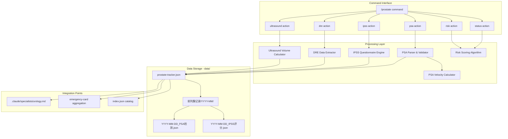
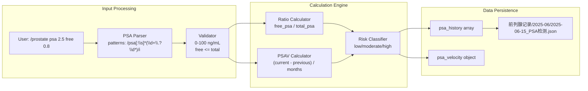
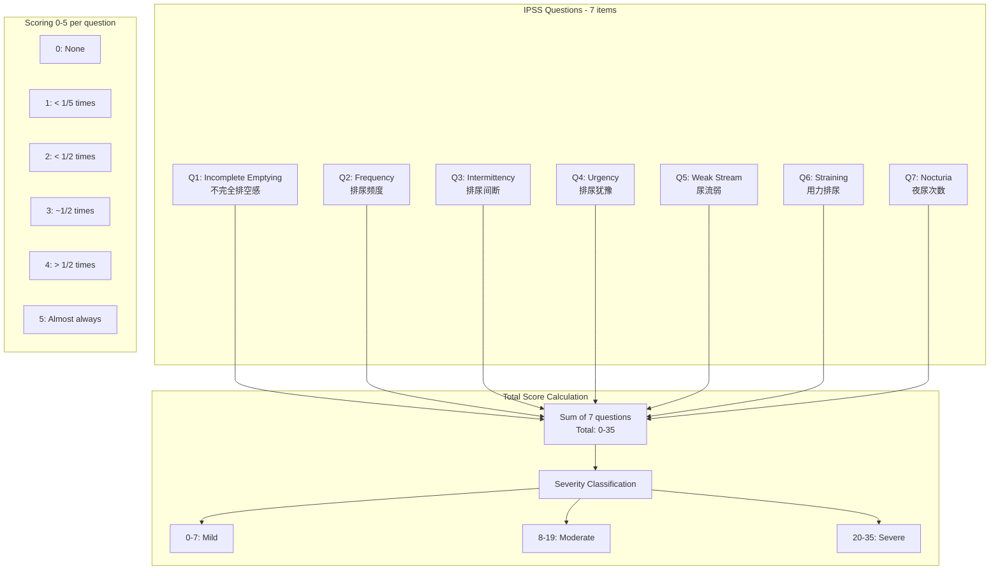

<!-- source: DeepWiki mcp.deepwiki.com · repo huifer/Claude-Ally-Health · extra page Prostate Health · fetched 2026-10-26 -->

# Prostate Health

<details>
<summary>Relevant source files</summary>

The following files were used as context for generating this wiki page:

- [.claude/commands/prostate-health.md](.claude/commands/prostate-health.md)
- [.claude/commands/puberty.md](.claude/commands/puberty.md)
- [.claude/settings.local.json](.claude/settings.local.json)
- [.claude/specialists/pediatrics.md](.claude/specialists/pediatrics.md)
- [.claude/specialists/urology.md](.claude/specialists/urology.md)
- [data-example/andropause-tracker.json](data-example/andropause-tracker.json)
- [data-example/child-vaccinations.json](data-example/child-vaccinations.json)
- [todo/01-womens-health.md](todo/01-womens-health.md)
- [todo/02-mens-health.md](todo/02-mens-health.md)

</details>


## Purpose and Scope

This document describes the **Prostate Health Management System** (module 4.2.1), which provides comprehensive tracking and monitoring of prostate-related health indicators for male users. The system focuses on three primary areas: PSA (Prostate-Specific Antigen) monitoring, symptom assessment through IPSS (International Prostate Symptom Score), and physical examination tracking.

For other men's health modules, see [Male Fertility Assessment](#4.2.2) and [Andropause Management](#4.2.3). For the AI specialist that analyzes prostate data, see [Urology Specialist](#7.3).

---

## System Overview

The Prostate Health system tracks key indicators for prostate cancer screening and benign prostatic hyperplasia (BPH) management. It maintains longitudinal records of PSA levels, calculates PSA velocity to detect concerning trends, administers the standardized IPSS questionnaire for symptom quantification, and archives results from digital rectal examinations (DRE) and ultrasound imaging.

### Key Capabilities

| Capability | Description | Clinical Standard |
|-----------|-------------|-------------------|
| **PSA Monitoring** | Total PSA, free PSA, ratio calculation | Reference: <4.0 ng/mL |
| **PSA Velocity** | Year-over-year change tracking | Alert threshold: >0.75 ng/mL/year |
| **IPSS Scoring** | 7-question symptom assessment | 0-35 point scale |
| **DRE Recording** | Size, texture, nodule documentation | Annual screening recommended |
| **Volume Tracking** | Prostate volume from ultrasound | Normal: 20-30 mL |
| **Risk Stratification** | Multi-factor cancer risk scoring | Age, family history, PSA, DRE |

The system does **not** provide medical diagnoses, recommend specific medications, or predict cancer outcomes. All outputs are framed as tracking data with guidance to consult medical professionals for clinical decisions.

**Sources:** [.claude/commands/prostate-health.md:1-1163](), [todo/02-mens-health.md:20-177]()

---

## System Architecture

### Component Diagram



**Sources:** [.claude/commands/prostate-health.md:959-1047](), [todo/02-mens-health.md:75-153]()

---

## PSA Monitoring System

### Data Flow and Calculation Pipeline

The PSA monitoring system processes user-reported test results through a multi-stage pipeline that validates inputs, calculates derived metrics, assesses risk levels, and stores longitudinal data for trend analysis.



### PSA Value Interpretation

The system applies clinical reference ranges to classify PSA levels and trigger appropriate user guidance:

| PSA Range (ng/mL) | Classification | System Response | User Guidance |
|-------------------|----------------|-----------------|---------------|
| < 2.5 (age <50) | Low | ✅ Continue routine screening | Annual screening |
| < 4.0 (age ≥50) | Normal | ✅ Continue routine screening | Annual screening |
| 4.0 - 10.0 | Grey Zone | ⚠️ Flag for monitoring | 3-month follow-up, consider free PSA |
| > 10.0 | Elevated | 🚨 Alert high priority | Immediate urologist consultation |

**Sources:** [.claude/commands/prostate-health.md:17-195](), [.claude/specialists/urology.md:156-162]()

### Free/Total PSA Ratio Analysis

When both total and free PSA values are provided, the system calculates the ratio to help differentiate benign from malignant causes of PSA elevation:

```
f/t_PSA_ratio = free_PSA / total_PSA

Interpretation:
  > 0.25  → Suggests benign etiology
  0.10-0.25 → Grey zone, requires clinical correlation
  < 0.10  → Concerning for malignancy
```

**Implementation:** [.claude/commands/prostate-health.md:80-91]()

### PSA Velocity (PSAV) Calculation

PSA velocity measures the rate of PSA change over time and serves as an independent risk indicator:

```javascript
// Code reference: .claude/commands/prostate-health.md:94-102
psav = (current_psa - previous_psa) / months_between * 12  // Annualized

if (psav > 0.75) {
  alert_level = "high"
  recommendation = "PSA升高过快,需进一步检查"
}
```

The system requires at least two PSA measurements separated by a minimum time interval to calculate a meaningful velocity. Historical data is stored in the `psa_history` array within `prostate-tracker.json`.

**Sources:** [.claude/commands/prostate-health.md:94-102](), [.claude/specialists/urology.md:162]()

---

## IPSS Symptom Assessment

### Questionnaire Structure

The International Prostate Symptom Score (IPSS) is a validated 7-item questionnaire that quantifies lower urinary tract symptoms. Each question assesses symptom frequency over the past month using a 0-5 Likert scale.



### Severity Classification and Clinical Recommendations

| Total Score | Severity | Management Recommendation |
|------------|----------|---------------------------|
| 0-7 | Mild | Observation, lifestyle modifications |
| 8-19 | Moderate | Consider pharmacotherapy (α-blockers, 5α-reductase inhibitors) |
| 20-35 | Severe | Urological evaluation, consider surgical intervention |

The system includes an eighth question (Quality of Life score, 0-6) that assesses patient satisfaction but is not included in the total IPSS score.

**Sources:** [.claude/commands/prostate-health.md:197-339](), [todo/02-mens-health.md:36-67](), [.claude/specialists/urology.md:164-168]()

### Data Structure

```json
{
  "ipss_score": {
    "date": "2025-06-20",
    "incomplete_emptying": 1,
    "frequency": 2,
    "intermittency": 1,
    "urgency": 2,
    "weak_stream": 1,
    "straining": 0,
    "nocturia": 2,
    "total_score": 9,
    "severity": "moderate",
    "quality_of_life_score": 2
  }
}
```

**Source:** [.claude/commands/prostate-health.md:262-280]()

---

## Physical Examination Tracking

### Digital Rectal Examination (DRE)

The system records structured DRE findings with standardized terminology:

| Field | Possible Values | Clinical Significance |
|-------|----------------|----------------------|
| `size` | normal, enlarged | Correlates with BPH severity |
| `texture` | soft, firm, hard, nodular | Hard/nodular suggests malignancy |
| `nodule` | true, false | Single most important cancer indicator |
| `tenderness` | true, false | Suggests prostatitis if present |
| `mobility` | normal, fixed | Fixed suggests advanced cancer |

**Abnormal Finding Alert Logic:**

```javascript
// Reference: .claude/commands/prostate-health.md:397-412
if (dre.nodule === true || dre.texture === "hard") {
  alert_level = "urgent"
  recommendation = "立即泌尿科就诊 - DRE异常"
  suggested_workup = ["PSA检测", "前列腺超声", "前列腺MRI", "前列腺活检"]
}
```

**Sources:** [.claude/commands/prostate-health.md:342-506](), [todo/02-mens-health.md:64-67]()

### Prostate Volume Measurement

Transrectal ultrasound (TRUS) provides objective measurement of prostate size:

```
Prostate Volume Classification:
  < 20 mL     → Atrophic/small
  20-30 mL    → Normal
  30-50 mL    → Mild enlargement (BPH I°)
  50-80 mL    → Moderate enlargement (BPH II°)
  > 80 mL     → Severe enlargement (BPH III°)

Estimated Weight: volume_mL × 1.05 = weight_g
```

Additional ultrasound parameters tracked:
- **Inner gland (transition zone) size**: Directly correlates with obstructive symptoms
- **Residual urine volume**: Indicates bladder emptying efficiency
- **Nodules/calcifications**: Structural abnormalities requiring follow-up

**Sources:** [.claude/commands/prostate-health.md:508-624](), [todo/02-mens-health.md:126-130]()

---

## Risk Assessment Framework

### Multi-Factor Risk Scoring Algorithm

The system calculates a composite risk score by aggregating multiple independent risk factors:

```javascript
// Risk scoring algorithm reference: .claude/commands/prostate-health.md:838-873
risk_score = 0

// Age factor
if (age >= 60) risk_score += 1
if (age >= 70) risk_score += 1

// Family history (independent risk factor)
if (family_history.father) risk_score += 2
if (family_history.brother) risk_score += 2

// PSA level
if (psa > 4.0) risk_score += 2
if (psa > 10.0) risk_score += 3  // Cumulative

// PSA velocity
if (psav > 0.75) risk_score += 2

// DRE findings
if (dre.nodule) risk_score += 3
if (dre.texture === "firm") risk_score += 1

// Risk stratification
if (risk_score >= 6) risk_category = "high"
else if (risk_score >= 3) risk_category = "moderate"
else risk_category = "low"
```

### Risk-Based Screening Recommendations

| Risk Category | PSA Screening Start Age | PSA Frequency | DRE Frequency |
|---------------|------------------------|---------------|---------------|
| Average risk | 50 years | Annual | Biennial |
| High risk (family history) | 45 years | Annual | Annual |
| Very high risk (multiple relatives) | 40 years | Annual | Annual |

**Sources:** [.claude/commands/prostate-health.md:819-956](), [todo/02-mens-health.md:68-74]()

---

## Data Storage Architecture

### Primary Tracker File

The main state file `data/prostate-tracker.json` maintains the current status and aggregated statistics:

```json
{
  "created_at": "ISO8601 timestamp",
  "last_updated": "ISO8601 timestamp",
  
  "prostate_health": {
    "user_id": "string",
    "age": "number",
    "family_history": {
      "father": "boolean",
      "brother": "boolean", 
      "age_at_diagnosis": "number | null"
    },
    
    "psa_history": [
      {
        "date": "YYYY-MM-DD",
        "total_psa": "number",
        "free_psa": "number | null",
        "ratio": "number | null",
        "reference": "<4.0",
        "unit": "ng/mL",
        "trend": "stable | rising | falling"
      }
    ],
    
    "psa_velocity": {
      "change_per_year": "number | null",
      "threshold": 0.75,
      "interpretation": "string | null"
    },
    
    "ipss_score": {
      "date": "YYYY-MM-DD | null",
      "incomplete_emptying": "0-5 | null",
      "frequency": "0-5 | null",
      "intermittency": "0-5 | null",
      "urgency": "0-5 | null",
      "weak_stream": "0-5 | null",
      "straining": "0-5 | null",
      "nocturia": "0-5 | null",
      "total_score": "0-35 | null",
      "severity": "mild | moderate | severe | null",
      "quality_of_life_score": "0-6 | null"
    },
    
    "prostate_volume": {
      "date": "YYYY-MM-DD | null",
      "volume_ml": "number | null",
      "weight_g": "number | null",
      "inner_gland_cm": "number | null",
      "residual_urine_ml": "number | null",
      "nodule": "boolean | null",
      "interpretation": "string | null"
    },
    
    "dre": {
      "last_exam": "YYYY-MM-DD | null",
      "findings": "string | null",
      "size": "normal | enlarged | null",
      "texture": "soft | firm | hard | nodular | null",
      "nodule": "boolean | null",
      "tenderness": "boolean | null",
      "notes": "string"
    },
    
    "screening_plan": {
      "psa_frequency": "annual | biennial | null",
      "dre_frequency": "annual | biennial | null",
      "next_psa": "YYYY-MM-DD | null",
      "next_dre": "YYYY-MM-DD | null",
      "risk_category": "low | moderate | high | null"
    },
    
    "urinary_symptoms": {
      "stream_weakness": "mild | moderate | severe | null",
      "frequency": "string | null",
      "nocturia": "number | null",
      "urgency": "occasional | frequent | null"
    }
  },
  
  "statistics": {
    "total_psa_tests": "number",
    "last_psa_date": "YYYY-MM-DD | null",
    "psa_trend": "stable | rising | falling",
    "ipss_severity": "mild | moderate | severe | null",
    "tracking_duration_months": "number"
  },
  
  "settings": {
    "reminder_frequency": "annual | biennial",
    "screening_reminder": "boolean"
  }
}
```

**Source:** [.claude/commands/prostate-health.md:959-1047]()

### Detailed Record Files

Individual test results are stored in timestamped files under `data/前列腺记录/YYYY-MM/`:

**PSA Test Record:**
```json
{
  "record_id": "prostate_20250615_001",
  "record_type": "PSA检测",
  "date": "2025-06-15",
  "psa_result": {
    "total_psa": 2.5,
    "free_psa": 0.8,
    "ratio": 0.32,
    "unit": "ng/mL",
    "reference": "<4.0",
    "lab": "string | null"
  },
  "interpretation": {
    "risk_level": "low | moderate | high",
    "trend": "stable | rising | falling",
    "clinical_significance": "string"
  },
  "notes": "string",
  "metadata": {
    "created_at": "ISO8601",
    "last_updated": "ISO8601"
  }
}
```

**Source:** [.claude/commands/prostate-health.md:1049-1079]()

---

## Command Interface

### Command Structure

All prostate health operations use the `/prostate` command with action-based subcommands:

```
/prostate <action> [info]

Actions:
  psa           - Record PSA test results
  ipss          - Complete IPSS questionnaire
  dre           - Record digital rectal exam findings
  ultrasound    - Record prostate ultrasound results
  status        - Display comprehensive health status
  screening     - Show personalized screening plan
  risk          - Calculate prostate cancer risk score
```

### Natural Language Input Parsing

The system employs regex-based pattern matching to extract structured data from free-text user input:

```javascript
// PSA value extraction patterns
psa_patterns = [
  /psa[:\s]*(\d+\.?\d*)/i,
  /总psa[:\s]*(\d+\.?\d*)/i,
  /前列腺特异性抗原[:\s]*(\d+\.?\d*)/i
]

// Free PSA patterns
free_psa_patterns = [
  /free[:\s]*(\d+\.?\d*)/i,
  /游离psa[:\s]*(\d+\.?\d*)/i,
  /fpsa[:\s]*(\d+\.?\d*)/i
]

// DRE finding keywords
dre_size_map = {
  "正常": "normal", "normal": "normal",
  "增大": "enlarged", "enlarged": "enlarged",
  "肿大": "enlarged"
}

dre_texture_map = {
  "软": "soft", "soft": "soft",
  "硬": "firm", "firm": "firm",
  "结节": "nodular", "nodular": "nodular"
}
```

**Sources:** [.claude/commands/prostate-health.md:42-49](), [.claude/commands/prostate-health.md:362-396](), [.claude/commands/prostate-health.md:1082-1110]()

### Example Command Sessions

**Recording PSA Test:**
```bash
/prostate psa 2.5
# Records total PSA = 2.5 ng/mL

/prostate psa 4.2 free 0.9
# Records total PSA = 4.2, free PSA = 0.9
# Calculates ratio = 0.9/4.2 = 0.214

/prostate psa 总PSA 2.5 游离PSA 0.8
# Chinese input supported
```

**IPSS Assessment:**
```bash
/prostate ipss
# Launches interactive questionnaire
# Prompts user for 7 symptom scores (0-5 each)
# Calculates total score and severity classification
```

**Recording DRE:**
```bash
/prostate dre normal
# Records normal DRE

/prostate dre enlarged firm
# Records enlarged prostate with firm texture

/prostate dre 前列腺增大 质地硬 有结节
# Chinese input: enlarged, hard, with nodule
# Triggers urgent alert
```

**Source:** [.claude/commands/prostate-health.md:1143-1163]()

---

## Integration with Other Systems

### Urology Specialist Skill

The system integrates with the AI Urology Specialist defined in [.claude/specialists/urology.md:1-186](). When `/consult` is invoked, the specialist receives:

1. Complete PSA history from `psa_history` array
2. Current IPSS score and severity classification
3. DRE findings and ultrasound measurements
4. Calculated risk scores and trends

The specialist analyzes this data to generate comprehensive assessments focusing on:
- PSA trend interpretation (stable vs. rising)
- IPSS severity and treatment recommendations
- DRE abnormality significance
- Integration with other urological conditions (fertility, andropause)

**Source:** [.claude/specialists/urology.md:1-186]()

### Emergency Card Aggregation

The emergency card system (see [Emergency Medical Information Card](#5.3)) pulls prostate health data for emergency responders:

| Emergency Card Field | Source Data | Priority |
|---------------------|-------------|----------|
| Active Conditions | IPSS severity if moderate/severe | Medium |
| Recent Tests | Latest PSA value and date | Low |
| Surgical History | Prostate surgeries (if recorded) | High |
| Medications | BPH medications (α-blockers, 5ARIs) | High |

**Sources:** Diagram 1 in system overview, [.claude/commands/prostate-health.md:1-1163]()

### Index Catalog Integration

The global `index.json` catalog maintains references to all prostate health records:

```json
{
  "mens_health": {
    "prostate": {
      "tracker_path": "data/prostate-tracker.json",
      "detail_records_path": "data/前列腺记录/",
      "last_updated": "ISO8601",
      "record_count": "number",
      "latest_psa": {
        "value": "number",
        "date": "YYYY-MM-DD"
      }
    }
  }
}
```

This enables the `/query` command to retrieve prostate data across the entire health record system.

**Sources:** Diagram 1 in system overview

---

## Medical Safety Principles

### Safety Red Lines

The system enforces strict boundaries to prevent inappropriate medical guidance:

| Prohibited Actions | Rationale |
|-------------------|-----------|
| **Medical Diagnosis** | "您有前列腺癌" | Only physicians can diagnose cancer |
| **Specific Medications** | "服用非那雄胺 5mg 每日" | Prescriptions require medical license |
| **Dosage Recommendations** | "坦索罗辛 0.4mg 每晚" | Dosing is individualized |
| **Prognosis Predictions** | "5年生存率80%" | Outcomes depend on staging/treatment |
| **Treatment Protocols** | "立即手术" | Treatment decisions require specialist evaluation |

**Implementation:** All output messages are templated to use conditional phrasing ("建议咨询", "可考虑", "需医生评估") rather than definitive statements.

**Sources:** [.claude/commands/prostate-health.md:1123-1140](), [.claude/specialists/urology.md:34-39](), [todo/02-mens-health.md:654-681]()

### Permitted System Functions

The system **can** provide:
- ✅ PSA value recording and historical trend visualization
- ✅ IPSS score calculation and severity classification
- ✅ Risk factor identification (age, family history, test results)
- ✅ Screening schedule generation based on risk category
- ✅ Red flag alerts (PSA >10, DRE nodule detected)
- ✅ Lifestyle modification suggestions (diet, exercise, stress reduction)
- ✅ Explicit guidance to seek professional medical evaluation

### Emergency Escalation Triggers

Certain data patterns trigger immediate "seek medical attention" alerts:

```javascript
// Urgent care indicators
if (psa > 10.0) {
  alert = "🚨 PSA显著升高 - 建议立即泌尿科就诊"
}

if (dre.nodule === true) {
  alert = "🚨 DRE发现结节 - 建议立即泌尿科就诊"
}

if (urinary_symptoms.retention === true) {
  alert = "🚨 尿潴留 - 需急诊处理"
}

if (hematuria === "gross") {
  alert = "🚨 肉眼血尿 - 建议立即就医"
}
```

**Sources:** [.claude/commands/prostate-health.md:163-194](), [.claude/commands/prostate-health.md:467-506]()

---

## Testing and Validation

### Test Framework

The prostate health module is validated through the native testing framework defined in:
- [scripts/test-mens-health.sh]()
- [.claude/settings.local.json:22]()

Test scenarios include:
1. PSA recording with various input formats (English/Chinese, with/without free PSA)
2. PSA velocity calculation with historical data
3. IPSS questionnaire completion and scoring
4. DRE abnormal finding detection and alert generation
5. Risk score calculation with multiple risk factors
6. Data persistence and retrieval

**Source:** [.claude/settings.local.json:22]()

---

## Future Enhancements

Based on the module proposal in [todo/02-mens-health.md:1-728](), potential future additions include:

1. **Prostate-Specific Antigen Density (PSAD)**: Calculate PSA/volume ratio for improved specificity
2. **PHI (Prostate Health Index)**: Integrate [-2]proPSA-based composite marker
3. **Nomogram Integration**: Implement PCPT or ERSPC risk calculators
4. **Treatment Tracking**: Record medication adherence for BPH pharmacotherapy
5. **Voiding Diary**: Structured frequency-volume charting for LUTS quantification
6. **Uroflowmetry**: Archive peak flow rate and voided volume measurements

**Source:** [todo/02-mens-health.md:1-728]()

---

