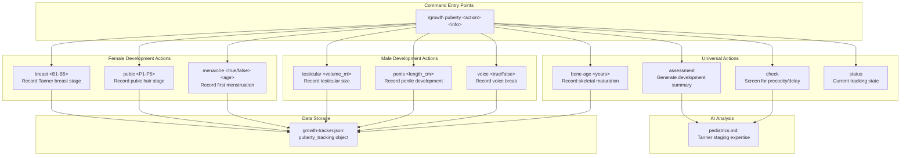
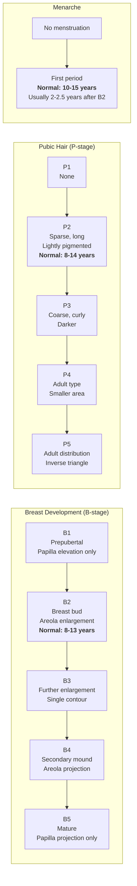
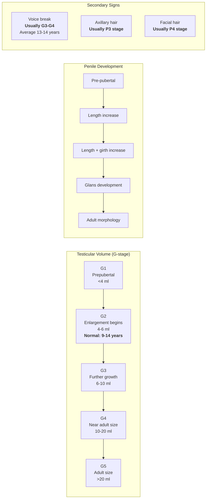
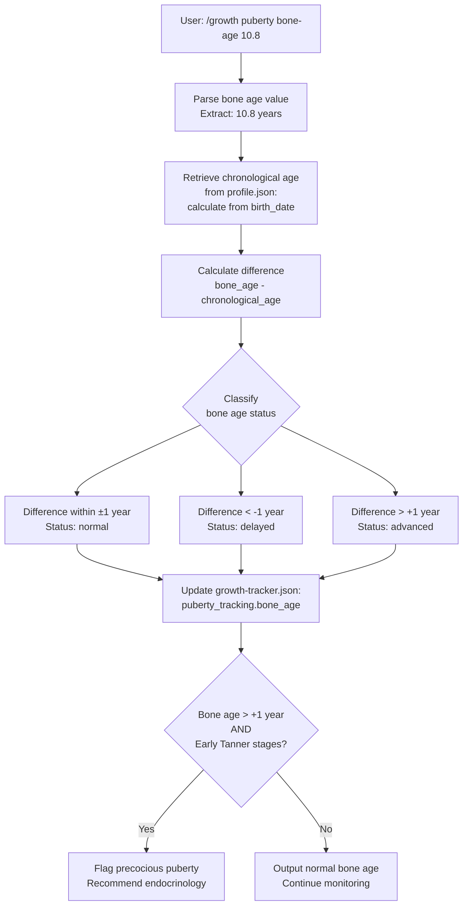
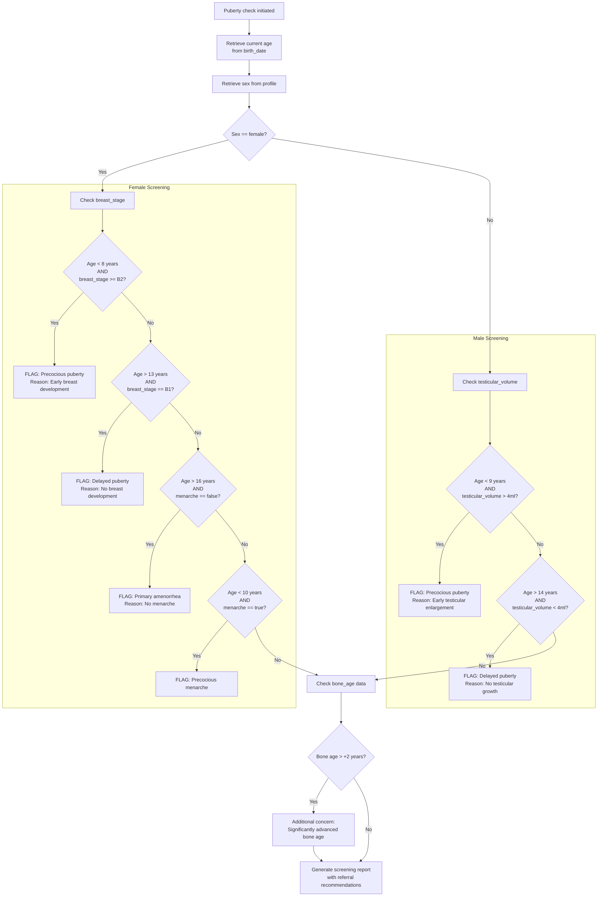
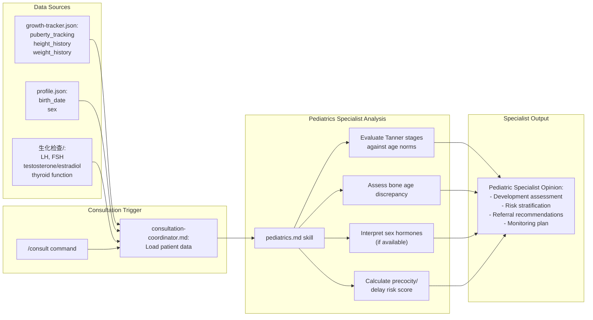
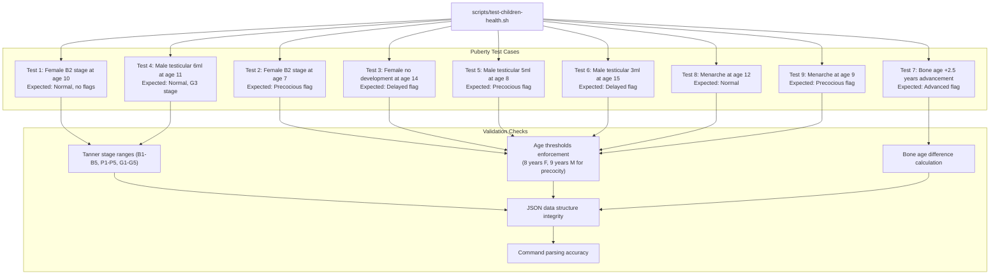

<!-- source: DeepWiki mcp.deepwiki.com · repo huifer/Claude-Ally-Health · extra page Puberty Assessment · fetched 2026-10-26 -->

# Puberty Assessment

<details>
<summary>Relevant source files</summary>

The following files were used as context for generating this wiki page:

- [.claude/commands/prostate-health.md](.claude/commands/prostate-health.md)
- [.claude/commands/puberty.md](.claude/commands/puberty.md)
- [.claude/settings.local.json](.claude/settings.local.json)
- [.claude/specialists/pediatrics.md](.claude/specialists/pediatrics.md)
- [.claude/specialists/urology.md](.claude/specialists/urology.md)
- [data-example/andropause-tracker.json](data-example/andropause-tracker.json)
- [data-example/child-vaccinations.json](data-example/child-vaccinations.json)
- [todo/01-womens-health.md](todo/01-womens-health.md)
- [todo/02-mens-health.md](todo/02-mens-health.md)

</details>


## Purpose and Scope

The Puberty Assessment module tracks adolescent sexual maturation using the **Tanner staging system**, monitors bone age development, and screens for **precocious puberty** (early onset) and **delayed puberty** (late onset). This module is part of the Child & Adolescent Health system (see [4.3](#4.3)) and integrates with growth monitoring (see [4.3.1](#4.3.1)) and the Pediatrics specialist (see [7.3](#7.3)).

The system records **Tanner stages B1-B5** (breast development), **P1-P5** (pubic hair), **G1-G5** (testicular volume), menarche status, voice changes, and bone age radiographs. It automatically flags abnormal development patterns requiring endocrinology referral but does **not provide diagnoses or treatment recommendations**.

## Command Interface

The puberty assessment system is accessed through the `/growth puberty` command hierarchy, which provides sex-specific recording and evaluation functions.

### Command Structure



**Sources:** [.claude/commands/puberty.md:1-213](), [.claude/specialists/pediatrics.md:366-507]()

### Command Examples by Development Type

| Development Aspect | Command Example | Data Field Updated |
|-------------------|-----------------|-------------------|
| Breast Tanner stage | `/growth puberty breast B3` | `female_development.breast_stage` |
| Pubic hair stage | `/growth puberty pubic P2` | `female_development.pubic_hair_stage` (or `male_development`) |
| Menarche occurrence | `/growth puberty menarche true 11.5` | `female_development.menarche.occurred`, `menarche.age_at_menarche` |
| Testicular volume | `/growth puberty testicular 8ml` | `male_development.testicular_volume` |
| Penile length | `/growth puberty penis 6.5cm` | `male_development.penile_length` |
| Voice change | `/growth puberty voice true` | `male_development.voice_break` |
| Bone age | `/growth puberty bone-age 10.8` | `bone_age.bone_age` |

**Sources:** [.claude/commands/puberty.md:13-90]()

## Tanner Staging System

The system implements the clinical Tanner staging framework developed by James Tanner (1962) for standardized assessment of pubertal development. Each stage is coded with a letter prefix (B=Breast, P=Pubic hair, G=Genital/testicular) and number 1-5.

### Female Development Stages



**Age Boundaries (from `pediatrics.md`):**
- **B2 appearance < 8 years**: Precocious puberty flag
- **B2 appearance 8-13 years**: Normal range (average 10 years)
- **No B2 by > 13 years**: Delayed puberty flag
- **Menarche < 10 years**: Precocious
- **Menarche 10-15 years**: Normal (average 12-13 years)
- **No menarche by > 16 years**: Primary amenorrhea

**Sources:** [.claude/specialists/pediatrics.md:369-398](), [.claude/commands/puberty.md:95-108]()

### Male Development Stages



**Age Boundaries (from `pediatrics.md`):**
- **Testicular volume > 4ml before 9 years**: Precocious puberty flag
- **Testicular volume > 4ml at 9-14 years**: Normal range (average 11 years)
- **Testicular volume < 4ml after 14 years**: Delayed puberty flag
- **Voice change**: Typically G3-G4 stage (13-14 years)

**Testicular Volume Measurement:** Uses orchidometer (Prader orchidometer) with standardized ellipsoid models from 1ml to 25ml. Volume correlates with Tanner genital stage.

**Sources:** [.claude/specialists/pediatrics.md:401-447](), [.claude/commands/puberty.md:109-116]()

## Data Structure

The puberty tracking data is stored within the `growth-tracker.json` file under the `puberty_tracking` object, maintaining a complete developmental history.

### JSON Schema

```json
{
  "puberty_tracking": {
    "sex": "female|male",
    "tracking_started_age": 8.5,
    
    "female_development": {
      "breast_stage": "B3",
      "breast_stage_date": "2025-06-15",
      "breast_history": [
        {"stage": "B2", "age": 8.8, "date": "2024-03-01"},
        {"stage": "B3", "age": 10.2, "date": "2025-06-15"}
      ],
      
      "pubic_hair_stage": "P2",
      "pubic_hair_date": "2025-06-15",
      
      "menarche": {
        "occurred": false,
        "age_at_menarche": null,
        "date": null,
        "expected_age": "11.8-12.3",
        "prediction_based_on": "breast_stage_B3"
      }
    },
    
    "male_development": {
      "testicular_volume": {
        "left": 8,
        "right": 8,
        "unit": "ml",
        "measurement_method": "orchidometer",
        "date": "2025-06-15"
      },
      
      "testicular_stage": "G3",
      "testicular_history": [
        {"stage": "G2", "age": 11.0, "volume_left": 5, "volume_right": 5},
        {"stage": "G3", "age": 12.2, "volume_left": 8, "volume_right": 8}
      ],
      
      "penile_length": 6.5,
      "penile_length_unit": "cm",
      
      "pubic_hair_stage": "P3",
      
      "voice_break": false,
      "voice_break_age": null,
      
      "facial_hair": false,
      "axillary_hair": true
    },
    
    "bone_age": {
      "chronological_age": 10.5,
      "bone_age": 10.8,
      "difference": "+0.3_years",
      "assessment_method": "Greulich-Pyle",
      "image_date": "2025-06-01",
      "interpretation": "normal"
    },
    
    "assessment": {
      "development_status": "normal_progression",
      "stage_appropriate_for_age": true,
      "concerns": [],
      "last_assessment_date": "2025-06-15"
    }
  }
}
```

**Key Design Decisions:**
- **Sex-specific objects**: Separate `female_development` and `male_development` objects prevent null confusion
- **Stage history arrays**: Track progression through Tanner stages with timestamped entries
- **Bone age comparison**: Always stores both chronological and skeletal age for delta calculation
- **Prediction fields**: `expected_age` for menarche based on current breast stage

**Sources:** [.claude/commands/puberty.md:142-169](), [.claude/specialists/pediatrics.md:366-507]()

## Bone Age Assessment

Bone age is determined from left hand and wrist radiographs using the **Greulich-Pyle atlas** method, comparing skeletal maturation to chronological age. Discrepancies indicate hormonal or growth disorders.

### Bone Age Interpretation Matrix

| Bone Age - Chronological Age | Clinical Interpretation | Action Required |
|------------------------------|-------------------------|-----------------|
| < -2.0 years | Significant delay | **Refer to endocrinology** |
| -2.0 to -1.0 years | Mild delay | Monitor, consider evaluation |
| -1.0 to +1.0 years | **Normal range** | Routine monitoring |
| +1.0 to +2.0 years | Mild advancement | Assess for precocious puberty |
| > +2.0 years | Significant advancement | **Refer to endocrinology** |

### Bone Age Processing Flow



**Bone Age Correlation with Puberty:**
- **Advanced bone age (>+1 year)** + early Tanner stage = Central precocious puberty likely
- **Delayed bone age (<-1 year)** + no Tanner progression = Constitutional delay or hypogonadism
- **Normal bone age (±1 year)** = Appropriate pubertal tempo

**Sources:** [.claude/specialists/pediatrics.md:434-437](), [.claude/commands/puberty.md:70-90](), [.claude/commands/puberty.md:133-139]()

## Precocious and Delayed Puberty Screening

The system automatically screens for abnormal pubertal timing when the `/growth puberty check` command is executed or when new developmental data is recorded.

### Screening Algorithm



**Screening Criteria (from pediatrics.md):**

**Female Precocious Puberty:**
- Breast development (B2) < 8 years
- Menarche < 10 years
- Bone age advancement > +1 year with early Tanner stage

**Female Delayed Puberty:**
- No breast development (B1) > 13 years
- No menarche > 16 years (primary amenorrhea)

**Male Precocious Puberty:**
- Testicular volume > 4ml < 9 years
- Voice change < 9 years
- Pubic hair (P2) < 9 years

**Male Delayed Puberty:**
- Testicular volume < 4ml > 14 years
- No secondary sexual characteristics > 14 years

**Sources:** [.claude/specialists/pediatrics.md:448-507](), [.claude/commands/puberty.md:121-129]()

### Referral Decision Tree

When abnormalities are detected, the system generates specific referral recommendations:

| Condition | Urgency | Specialist | Initial Workup |
|-----------|---------|-----------|----------------|
| Central precocious puberty | **Urgent** (2-4 weeks) | Pediatric endocrinology | GnRH stimulation test, LH, FSH, estradiol/testosterone, bone age, brain MRI |
| Peripheral precocious puberty | **Urgent** (2-4 weeks) | Pediatric endocrinology | Sex hormones, adrenal steroids, pelvic/testicular ultrasound |
| Delayed puberty (>13F/14M) | Routine (2-3 months) | Pediatric endocrinology | LH, FSH, testosterone/estradiol, prolactin, thyroid function, bone age, karyotype (if indicated) |
| Primary amenorrhea (>16 years) | **Urgent** (4-6 weeks) | Pediatric endocrinology or gynecology | Pelvic ultrasound, FSH, LH, prolactin, thyroid, karyotype |

**Sources:** [.claude/specialists/pediatrics.md:503-507]()

## Integration with Pediatrics Specialist

The puberty assessment module integrates with the AI Pediatrics specialist skill (see [7.3](#7.3)) for comprehensive evaluation during multi-disciplinary consultations.

### Data Flow to Specialist System



**Pediatric Specialist Capabilities (from `pediatrics.md:366-650`):**
1. **Tanner staging expertise**: Interprets B1-B5, P1-P5, G1-G5 stages with age-appropriate norms
2. **WHO growth standards**: Correlates puberty with height velocity and growth curve trajectories
3. **Bone age interpretation**: Greulich-Pyle method evaluation with clinical correlation
4. **Precocious puberty screening**: Central vs peripheral differentiation based on clinical patterns
5. **Delayed puberty screening**: Constitutional delay vs pathological hypogonadism assessment
6. **Referral guidelines**: Evidence-based criteria for endocrinology consultation

**Sources:** [.claude/specialists/pediatrics.md:366-657]()

## Safety Principles and Medical Boundaries

The puberty assessment module adheres to strict safety constraints defined in the pediatric specialist guidelines.

### Safety Red Lines (Prohibited Actions)

**The system DOES NOT:**
1. **Diagnose conditions**: No definitive diagnoses of "precocious puberty" or "hypogonadism" -- only flags for evaluation
2. **Prescribe treatments**: No recommendations for GnRH agonists, hormone replacement, or other therapies
3. **Predict adult height**: No final height predictions based on bone age or Tanner stages
4. **Provide prognosis**: No statements about fertility outcomes or disease trajectory
5. **Replace medical examination**: Cannot substitute for physical examination by pediatric endocrinologist

**Example of prohibited language:**
- ❌ "Diagnosis: Central precocious puberty, start Lupron treatment"
- ❌ "Based on bone age, adult height will be 5'4\""
- ❌ "Delayed puberty caused by Kallmann syndrome"

**Sources:** [.claude/commands/puberty.md:175-180](), [.claude/specialists/pediatrics.md:50-57](), [.claude/specialists/pediatrics.md:636-642]()

### Permitted System Functions

**The system DOES:**
1. **Record Tanner stages**: Structured tracking of developmental milestones
2. **Calculate age-stage discrepancies**: Compare development to statistical norms
3. **Flag abnormal patterns**: Identify cases requiring professional evaluation
4. **Provide educational information**: Explain normal puberty ranges and progression
5. **Track monitoring schedule**: Remind users of follow-up timing
6. **Generate referral recommendations**: Suggest appropriate specialist consultation

**Example of permitted language:**
- ✅ "Breast development at age 7 years is earlier than typical (normal range 8-13 years). Recommend pediatric endocrinology evaluation within 2-4 weeks."
- ✅ "Bone age is 2.5 years advanced compared to chronological age. This finding, combined with early Tanner B3 stage, suggests consultation with pediatric endocrinology."
- ✅ "No testicular enlargement at age 14.5 years warrants evaluation for delayed puberty. Recommend hormone testing (LH, FSH, testosterone) and bone age assessment."

**Sources:** [.claude/commands/puberty.md:181-188](), [.claude/specialists/pediatrics.md:643-650]()

## Testing and Validation

The puberty assessment module is validated through the native testing framework located at `scripts/test-children-health.sh`.

### Test Coverage



**Test Execution:**
```bash
# Run full children's health test suite (includes puberty module)
./scripts/test-children-health.sh

# Expected output includes puberty assessment validation
# Exit code 0 indicates all tests passed
```

**Sources:** [.claude/settings.local.json:23]()

## Related Wiki Pages

- **[4.3.1 Growth & Development Monitoring](#4.3.1)**: Height/weight percentiles and WHO growth standards that correlate with puberty
- **[4.3.2 Vaccination Tracking](#4.3.2)**: Age-based immunization schedule management
- **[7.3 Available Specialist Skills](#7.3)**: Complete list of AI specialists including Pediatrics
- **[3.3 AI Specialist Framework](#3.3)**: Architecture of specialist consultation system

---

