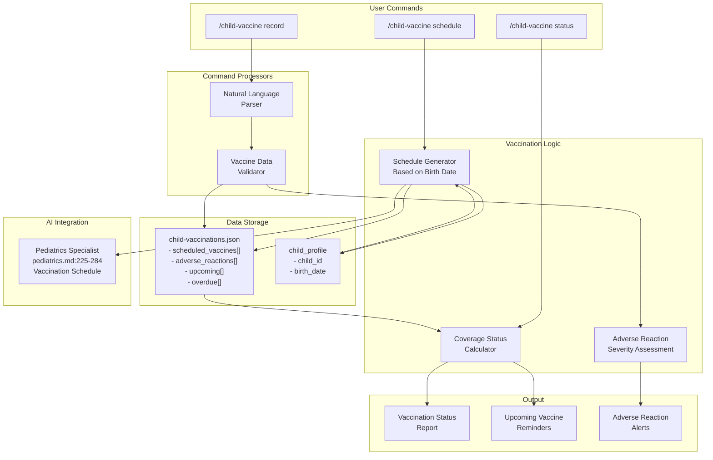
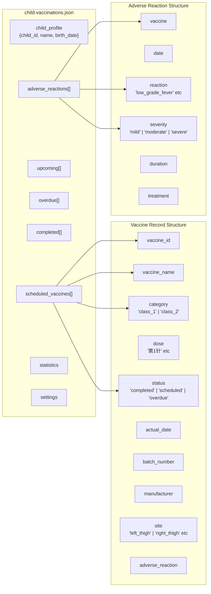
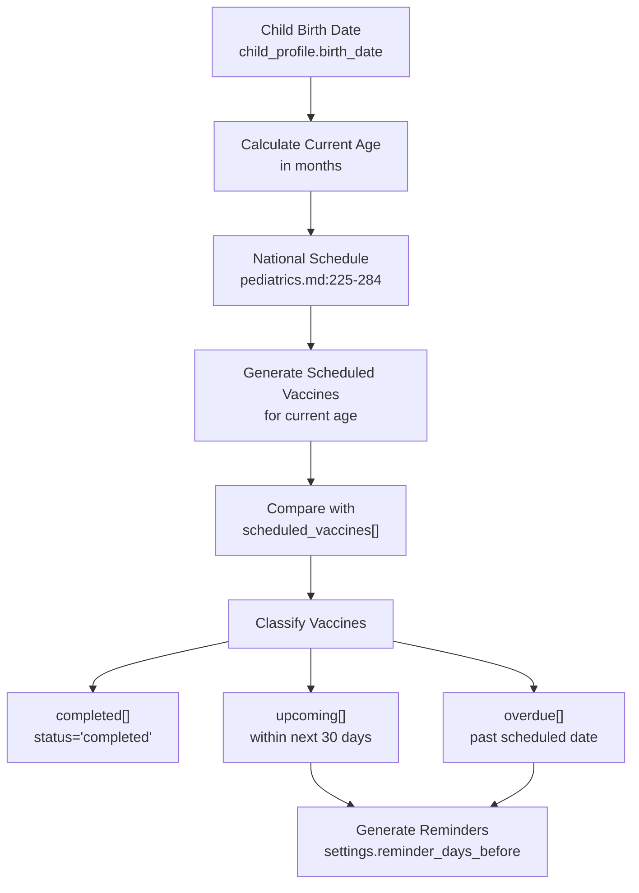
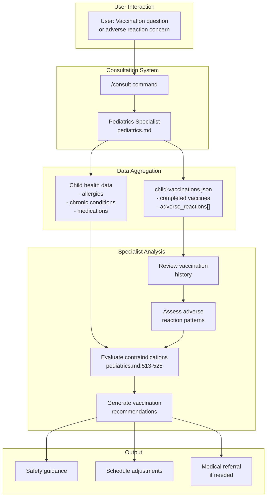

<!-- source: DeepWiki mcp.deepwiki.com · repo huifer/Claude-Ally-Health · extra page Vaccination Tracking · fetched 2026-10-26 -->

# Vaccination Tracking

<details>
<summary>Relevant source files</summary>

The following files were used as context for generating this wiki page:

- [.claude/commands/prostate-health.md](.claude/commands/prostate-health.md)
- [.claude/commands/puberty.md](.claude/commands/puberty.md)
- [.claude/specialists/pediatrics.md](.claude/specialists/pediatrics.md)
- [.claude/specialists/urology.md](.claude/specialists/urology.md)
- [data-example/andropause-tracker.json](data-example/andropause-tracker.json)
- [data-example/child-vaccinations.json](data-example/child-vaccinations.json)

</details>


## Purpose and Scope

This document describes the vaccination tracking system within Claude-Ally-Health, which manages childhood immunization schedules, records administered vaccines, tracks adverse reactions, and monitors coverage status. The system follows China's National Immunization Program (国家免疫规划) and supports both Class 1 (free, mandatory) and Class 2 (optional, self-paid) vaccines.

For broader child health monitoring including growth assessment, see [Growth & Development Monitoring](#4.3.1). For puberty-specific assessments, see [Puberty Assessment](#4.3.3).

---

## System Overview

The vaccination tracking system integrates with the pediatrics specialist AI to provide comprehensive immunization management. It maintains a complete vaccination history, generates age-appropriate schedules, identifies overdue vaccines, and logs adverse reactions for safety monitoring.

**Key Capabilities:**
- National immunization schedule tracking (birth to 6 years)
- Differentiation between Class 1 and Class 2 vaccines
- Batch number and manufacturer recording for traceability
- Adverse reaction severity assessment and logging
- Coverage status calculation and reminder generation
- Integration with pediatric specialist consultations

Sources: [.claude/specialists/pediatrics.md:6-14](), [data-example/child-vaccinations.json:1-130]()

---

## Architecture and Data Flow



**Diagram: Vaccination Tracking System Architecture**

The system processes vaccination commands through a natural language parser that extracts vaccine information (name, date, batch number, adverse reactions). The schedule generator uses the child's birth date and the national immunization program reference from `pediatrics.md` to create age-appropriate vaccination plans. All vaccination records are stored in `child-vaccinations.json` with complete traceability including batch numbers and manufacturers.

Sources: [data-example/child-vaccinations.json:1-130](), [.claude/specialists/pediatrics.md:225-284](), [.claude/specialists/pediatrics.md:599-607]()

---

## National Immunization Schedule

The system implements China's National Immunization Program, tracking Class 1 (一类疫苗) vaccines which are free and part of the mandatory schedule.

### Complete Class 1 Vaccine Schedule

| Age | Vaccine | Dose | Schedule Key |
|-----|---------|------|-------------|
| Birth | 乙肝疫苗 (Hepatitis B) | 第1针 | `hepb_b1` |
| Birth | 卡介苗 (BCG) | 第1针 | `bcg` |
| 1 month | 乙肝疫苗 | 第2针 | `hepb_b2` |
| 2 months | 脊灰疫苗 (Polio IPV) | 第1针 | `polio_ipv1` |
| 3 months | 脊灰疫苗 | 第2针 | `polio_ipv2` |
| 3 months | 百白破 (DPT) | 第1针 | `dpt_1` |
| 4 months | 脊灰疫苗 | 第3针 | `polio_ipv3` |
| 4 months | 百白破 | 第2针 | `dpt_2` |
| 5 months | 百白破 | 第3针 | `dpt_3` |
| 6 months | 乙肝疫苗 | 第3针 | `hepb_b3` |
| 6 months | 流脑A群 (MenA) | 第1针 | `mena_1` |
| 8 months | 麻腮风 (MMR) | 第1针 | `mmr_1` |
| 8 months | 乙脑减毒活疫苗 (JE) | 第1针 | `je_1` |
| 9 months | 流脑A群 | 第2针 | `mena_2` |
| 18 months | 百白破 | 第4针 | `dpt_4` |
| 18 months | 麻腮风 | 第2针 | `mmr_2` |
| 18 months | 甲肝减毒活疫苗 (HepA) | - | `hepa` |
| 2 years | 乙脑减毒活疫苗 | 第2针 | `je_2` |
| 3 years | 流脑A+C群 | 第1针 | `menac_1` |
| 4 years | 脊灰疫苗 | 第4针 | `polio_ipv4` |
| 6 years | 百白破 | 第5针 | `dpt_5` |
| 6 years | 流脑A+C群 | 第2针 | `menac_2` |

Sources: [.claude/specialists/pediatrics.md:225-284]()

### Class 2 (Optional) Vaccines

The system also tracks Class 2 vaccines (二类疫苗), which are self-paid and voluntary:

- **13价肺炎疫苗** (13-valent Pneumococcal): 12 months
- **五联疫苗** (5-in-1 Combined): Alternative to separate DPT and Polio doses at 2, 3, 4, 5 months
- **水痘疫苗** (Varicella): 12 months and 4 years (2 doses)
- **流感疫苗** (Influenza): Annually from 6 months
- **轮状病毒疫苗** (Rotavirus): 2, 4, 6 months

Sources: [.claude/specialists/pediatrics.md:236-279](), [data-example/child-vaccinations.json:122]()

---

## Data Structure

### Vaccination Record Schema



**Diagram: Vaccination Data Structure in child-vaccinations.json**

Sources: [data-example/child-vaccinations.json:1-130]()

### Example Vaccination Record

The following shows a completed vaccination record with full traceability:

```json
{
  "vaccine_id": "hepb_b1",
  "vaccine_name": "乙肝疫苗",
  "category": "class_1",
  "dose": "第1针",
  "scheduled_age": "birth",
  "scheduled_date": "2020-01-01",
  "status": "completed",
  "actual_date": "2020-01-01",
  "batch_number": "202001001",
  "manufacturer": "康泰生物",
  "site": "left_thigh",
  "adverse_reaction": null
}
```

Sources: [data-example/child-vaccinations.json:12-25]()

### Statistics and Coverage Tracking

The system maintains aggregate statistics:

```json
{
  "statistics": {
    "total_vaccines": 4,
    "class_1_completed": 4,
    "class_2_completed": 0,
    "overdue_count": 0,
    "upcoming_30_days": 0
  }
}
```

Sources: [data-example/child-vaccinations.json:117-123]()

---

## Recording Vaccinations

### Command Interface

The system processes vaccination records through natural language commands:

```bash
/child-vaccine record
```

This command triggers the vaccination recording workflow, which extracts:
- **Vaccine name**: Matches against national schedule
- **Dose number**: 第1针, 第2针, etc.
- **Administration date**: YYYY-MM-DD format
- **Batch number**: For traceability
- **Manufacturer**: Pharmaceutical company
- **Injection site**: left_thigh, right_thigh, left_arm, etc.
- **Adverse reactions**: If any occurred

Sources: [.claude/specialists/pediatrics.md:599-607]()

### Data Validation Rules

| Validation Check | Rule | Error Message |
|-----------------|------|---------------|
| Vaccine name | Must match national schedule | "Unknown vaccine name" |
| Dose sequence | Must follow logical order | "Invalid dose sequence" |
| Date | Cannot be future date | "Date cannot be in future" |
| Date | Must be after birth date | "Date before birth date" |
| Batch number | Required for traceability | "Batch number required" |
| Manufacturer | Required for safety tracking | "Manufacturer required" |

---

## Adverse Reaction Tracking

### Severity Classification

The system categorizes adverse reactions into three levels:

**Mild (轻微):**
- Local reactions: redness, swelling, pain, induration (24-48 hours)
- Low-grade fever (<38.5°C)
- Irritability
- Reduced appetite
- **Action**: Cold compress, rest, symptomatic treatment

**Moderate (中度):**
- Fever 38.5-39.5°C lasting >48 hours
- Extensive local swelling
- Persistent crying >3 hours
- **Action**: Medical consultation recommended

**Severe (严重) - Requires immediate medical attention:**
- Allergic reactions: difficulty breathing, laryngeal edema, generalized urticaria
- High fever ≥39.5°C or lasting >72 hours
- Seizures (febrile or afebrile)
- Severe local reaction (whole limb swelling)
- Hypotonic-hyporesponsive episode (HHE)
- **Action**: Immediate emergency medical care

Sources: [.claude/specialists/pediatrics.md:528-542]()

### Adverse Reaction Record Structure

```json
{
  "vaccine": "百白破",
  "date": "2020-09-15",
  "reaction": "low_grade_fever",
  "severity": "mild",
  "duration": "24_hours",
  "treatment": "physical_cooling"
}
```

All severe reactions are flagged for immediate medical follow-up and recorded for future vaccination decisions.

Sources: [data-example/child-vaccinations.json:103-112]()

---

## Vaccination Contraindications and Safety

### Absolute Contraindications

⚠️ **These require medical evaluation - the system does not automatically determine contraindications:**

- Severe allergic reactions to vaccine components
- Previous severe adverse reaction to the same vaccine
- Immunodeficiency (contraindication for live vaccines)

### Relative Contraindications

- Acute febrile illness
- Acute exacerbation of chronic disease
- Severe malnutrition
- Immunosuppressant therapy period

Sources: [.claude/specialists/pediatrics.md:513-525]()

### Special Population Guidelines

**Premature Infants:**
- Vaccinate according to chronological age (not corrected gestational age)
- Use caution if weight <2kg (requires medical evaluation)

**Allergic Children:**
- Mild allergies (eczema, allergic rhinitis): Normal vaccination
- Moderate to severe allergies: Medical evaluation required, emergency equipment on-site
- Egg allergy: Influenza and MMR vaccines require medical evaluation

**Immunodeficiency:**
- Primary immunodeficiency: Live vaccines contraindicated
- Secondary immunodeficiency (chemotherapy, immunosuppressants): Live vaccines contraindicated
- HIV infection: Decision based on CD4 count

**Chronic Disease:**
- Stable phase: Normal vaccination
- Acute phase: Defer vaccination
- Neurological disease: Medical evaluation required

Sources: [.claude/specialists/pediatrics.md:544-563]()

---

## Coverage Status and Reminders

### Schedule Generation Algorithm



**Diagram: Vaccination Coverage Status Calculation Flow**

The system calculates coverage by:
1. Computing the child's current age from `birth_date`
2. Loading the age-appropriate schedule from the national immunization program
3. Comparing scheduled vaccines against completed records
4. Classifying each vaccine as completed, upcoming, or overdue
5. Generating reminders based on `reminder_days_before` setting (default 7 days)

Sources: [data-example/child-vaccinations.json:1-130](), [.claude/specialists/pediatrics.md:225-284]()

### Reminder Configuration

```json
{
  "settings": {
    "reminder_days_before": 7,
    "include_class_2": true,
    "auto_generate_schedule": true
  }
}
```

**Configuration Options:**
- `reminder_days_before`: Number of days before scheduled date to trigger reminder
- `include_class_2`: Whether to include optional Class 2 vaccines in reminders
- `auto_generate_schedule`: Automatically generate schedule based on birth date and national program

Sources: [data-example/child-vaccinations.json:125-129]()

---

## Integration with Pediatrics Specialist

The vaccination system integrates deeply with the pediatrics specialist AI, which provides clinical context for vaccination decisions.

### Specialist Consultation Flow



**Diagram: Vaccination Consultation Integration with Pediatrics Specialist**

When users consult about vaccinations, the pediatrics specialist:
1. Reviews complete vaccination history from `child-vaccinations.json`
2. Assesses patterns in adverse reactions
3. Evaluates contraindications based on safety guidelines at [pediatrics.md:513-525]()
4. Generates age-appropriate recommendations
5. Issues medical referrals for severe reactions or contraindications

Sources: [.claude/specialists/pediatrics.md:599-629](), [.claude/specialists/pediatrics.md:510-579]()

### Multi-Disciplinary Consultation

For complex cases involving vaccination safety and special populations:

```bash
/consult 儿科+儿童保健科 严重湿疹患儿疫苗接种建议
```

This triggers collaboration between:
- **Pediatrics Specialist**: General vaccination guidance
- **Child Healthcare Specialist**: Age-specific health assessment
- **System Safety Validator**: Ensures no diagnosis/prescription violations

Sources: [.claude/specialists/pediatrics.md:624-629]()

---

## Safety Principles and System Limitations

### Medical Safety Red Lines

The vaccination tracking system strictly adheres to safety boundaries:

⚠️ **The system CANNOT:**
1. **Make medical diagnoses** - Cannot diagnose vaccine-preventable diseases
2. **Provide medication dosages** - Cannot prescribe fever medications or treatments
3. **Determine contraindications** - Cannot definitively rule in/out contraindications
4. **Handle severe adverse reactions** - Cannot provide emergency treatment protocols
5. **Predict vaccination outcomes** - Cannot predict individual immune response
6. **Recommend treatment protocols** - Cannot prescribe GnRH agonists or other medications

✅ **The system CAN:**
1. **Track vaccination records** - Complete history with batch numbers and manufacturers
2. **Calculate coverage status** - Percentage of age-appropriate vaccines completed
3. **Generate schedules** - Age-appropriate immunization plans based on national program
4. **Log adverse reactions** - Severity classification and documentation
5. **Provide health guidance** - Nutrition, lifestyle, and development support
6. **Issue medical referrals** - Clear guidance on when to seek professional care

Sources: [.claude/specialists/pediatrics.md:633-650]()

### Data Privacy

All vaccination data is stored locally in `data/child-vaccinations.json`:
- ❌ No cloud synchronization
- ❌ No third-party sharing
- ❌ No remote uploads
- ✅ Complete parent/guardian control
- ✅ Local file system storage only
- ✅ Protected by `.gitignore` from accidental version control commits

Sources: [.claude/specialists/pediatrics.md:651-656]()

---

## Example Usage

### Recording a Vaccination

```bash
# Record completed vaccination
/child-vaccine record 乙肝疫苗 第1针 2020-01-01 批号202001001 康泰生物 左大腿

# Record with adverse reaction
/child-vaccine record 百白破 第1针 2020-09-15 轻微发热
```

### Checking Vaccination Status

```bash
# View complete vaccination status
/child-vaccine status

# View upcoming vaccinations
/child-vaccine schedule

# Check for overdue vaccines
/child-vaccine overdue
```

### Consulting About Vaccinations

```bash
# General vaccination consultation
/consult 儿科 疫苗接种时间表

# Special population consultation
/consult 儿科 早产儿疫苗接种建议

# Adverse reaction consultation
/consult 儿科 接种后发热处理
```

Sources: [.claude/specialists/pediatrics.md:599-607]()

---

## Related Systems

- [Growth & Development Monitoring](#4.3.1) - WHO growth standards, percentile tracking
- [Puberty Assessment](#4.3.3) - Tanner staging, sexual development
- [Cognitive Assessment](#4.4.1) - MMSE/MoCA testing for elderly
- [Multi-Disciplinary Team Consultation](#7.1) - Complex case collaboration

---

