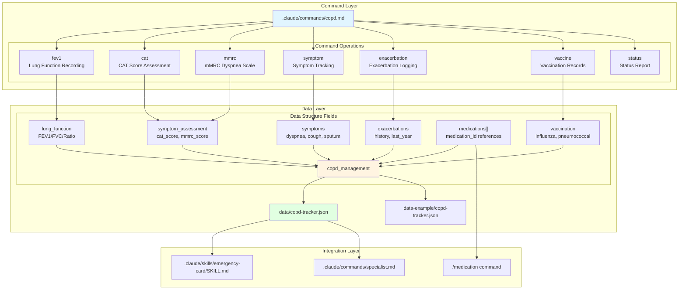
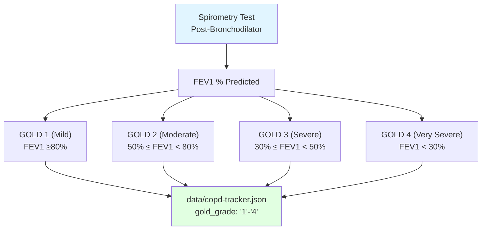
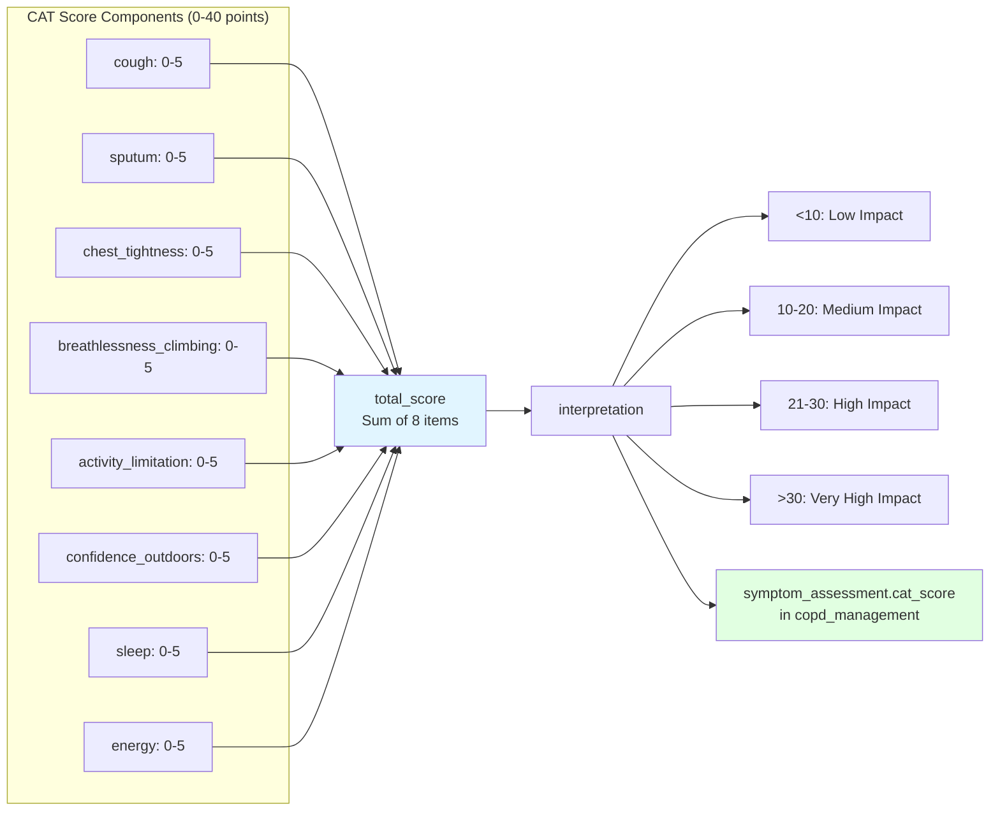
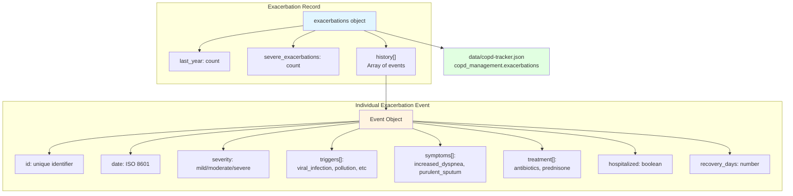
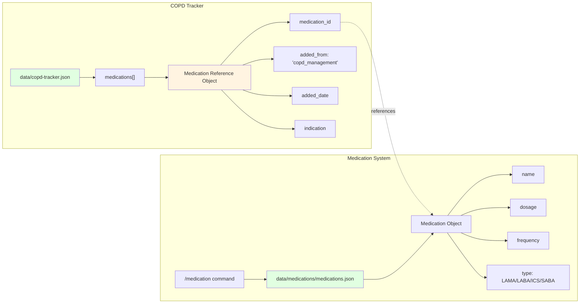

<!-- source: DeepWiki mcp.deepwiki.com · repo huifer/Claude-Ally-Health · extra page COPD Management · fetched 2026-10-26 -->

# COPD Management

<details>
<summary>Relevant source files</summary>

The following files were used as context for generating this wiki page:

- [.claude/skills/emergency-card/SKILL.md](.claude/skills/emergency-card/SKILL.md)
- [data-example/copd-tracker.json](data-example/copd-tracker.json)
- [data-example/diabetes-tracker.json](data-example/diabetes-tracker.json)
- [data-example/hypertension-tracker.json](data-example/hypertension-tracker.json)
- [scripts/test-chronic-diseases.sh](scripts/test-chronic-diseases.sh)
- [todo/06-chronic-diseases.md](todo/06-chronic-diseases.md)

</details>


The COPD Management module provides comprehensive tracking for chronic obstructive pulmonary disease, including lung function monitoring, symptom assessment, exacerbation logging, and medication management. This system implements GOLD (Global Initiative for Chronic Obstructive Lung Disease) guidelines for COPD classification and management.

For diabetes management, see [Diabetes Management](#4.5.2). For hypertension management, see [Hypertension Management](#4.5.1). For emergency medical information aggregation, see [Emergency Medical Information Card](#5.3).

---

## System Architecture

The COPD management system consists of three primary components: a natural language command interface, a JSON-based data store, and integration points with the medication management system and AI specialist consultations.

### Command Interface and Data Flow



**Sources:** [todo/06-chronic-diseases.md:397-602](), [data-example/copd-tracker.json:1-111]()

---

## Data Structure

The COPD tracker stores all patient data in `data/copd-tracker.json` using a hierarchical JSON structure anchored by the `copd_management` root object.

### Core Data Schema

| Field | Type | Description |
|-------|------|-------------|
| `diagnosis_date` | String (ISO 8601) | Date of COPD diagnosis |
| `gold_grade` | String ("1"-"4") | GOLD severity grade based on FEV1 |
| `gold_group` | String ("A"-"D") | GOLD assessment group (symptoms + exacerbations) |
| `lung_function` | Object | Spirometry results with FEV1, FVC, ratios |
| `symptom_assessment` | Object | CAT and mMRC scores with interpretations |
| `symptoms` | Object | Current symptom status (dyspnea, cough, sputum, wheeze) |
| `exacerbations` | Object | Exacerbation history with triggers and treatments |
| `medications` | Array | References to medications in `/medication` system |
| `vaccination` | Object | Influenza and pneumococcal vaccination records |
| `metadata` | Object | Timestamps for creation and last update |

**Sources:** [data-example/copd-tracker.json:1-111](), [todo/06-chronic-diseases.md:448-567]()

### Example Data Structure

```json
{
  "copd_management": {
    "diagnosis_date": "2020-03-15",
    "gold_grade": "2",
    "gold_group": "B",
    "lung_function": {
      "date": "2025-06-10",
      "post_bronchodilator": {
        "fev1": 1.8,
        "fev1_percent_predicted": 65,
        "fvc": 3.2,
        "fev1_fvc_ratio": 0.56
      },
      "interpretation": "中度气流受限"
    },
    "symptom_assessment": {
      "cat_score": {
        "total_score": 18,
        "interpretation": "中度症状影响"
      },
      "mmrc_score": {
        "score": 2,
        "interpretation": "平地行走时需停下喘气"
      }
    }
  }
}
```

**Sources:** [data-example/copd-tracker.json:1-111]()

---

## Lung Function Monitoring

The system tracks spirometry results with emphasis on post-bronchodilator measurements, which are used for COPD diagnosis and GOLD grading.

### GOLD Grading Classification



### Lung Function Data Fields

The `lung_function` object in [data/copd-tracker.json]() stores:

```json
{
  "lung_function": {
    "date": "2025-06-10",
    "post_bronchodilator": {
      "fev1": 1.8,
      "fev1_percent_predicted": 65,
      "fvc": 3.2,
      "fev1_fvc_ratio": 0.56
    },
    "interpretation": "中度气流受限"
  }
}
```

| Measurement | Field Name | Clinical Significance |
|-------------|------------|----------------------|
| FEV1 (absolute) | `fev1` | First-second forced expiratory volume in liters |
| FEV1 (% predicted) | `fev1_percent_predicted` | Used for GOLD grading (1-4) |
| FVC | `fvc` | Total forced vital capacity in liters |
| FEV1/FVC ratio | `fev1_fvc_ratio` | <0.70 confirms airflow obstruction |

**Sources:** [data-example/copd-tracker.json:8-16](), [todo/06-chronic-diseases.md:405-409]()

---

## Symptom Assessment

COPD symptoms are quantified using two validated clinical scales: CAT (COPD Assessment Test) and mMRC (modified Medical Research Council) dyspnea scale.

### CAT Score Structure



The CAT score data structure at `symptom_assessment.cat_score` contains:

```json
{
  "cat_score": {
    "date": "2025-06-20",
    "total_score": 18,
    "max_score": 40,
    "interpretation": "中度症状影响",
    "items": {
      "cough": 2,
      "sputum": 2,
      "chest_tightness": 2,
      "breathlessness_climbing": 3,
      "activity_limitation": 2,
      "confidence_outdoors": 2,
      "sleep": 3,
      "energy": 2
    }
  }
}
```

**Sources:** [data-example/copd-tracker.json:19-34](), [todo/06-chronic-diseases.md:413-428]()

### mMRC Dyspnea Scale

The mMRC scale measures breathlessness severity on a 0-4 scale:

| Grade | Description | Field: `mmrc_score.score` |
|-------|-------------|---------------------------|
| 0 | Breathless only with strenuous exercise | `"score": 0` |
| 1 | Short of breath when hurrying or walking up slight hill | `"score": 1` |
| 2 | Walks slower than contemporaries or stops for breath | `"score": 2` |
| 3 | Stops for breath after walking ~100 meters | `"score": 3` |
| 4 | Too breathless to leave house or breathless when dressing | `"score": 4` |

Data stored at `symptom_assessment.mmrc_score`:

```json
{
  "mmrc_score": {
    "date": "2025-06-20",
    "score": 2,
    "max_score": 4,
    "interpretation": "平地行走时需停下喘气"
  }
}
```

**Sources:** [data-example/copd-tracker.json:35-41](), [todo/06-chronic-diseases.md:423-428]()

---

## Exacerbation Management

Exacerbations (acute worsening of COPD symptoms) are critical events that require detailed tracking for prognosis and treatment planning.

### Exacerbation Data Model



### Exacerbation Tracking Fields

The `exacerbations` object structure:

```json
{
  "exacerbations": {
    "last_year": 2,
    "severe_exacerbations": 0,
    "history": [
      {
        "id": "exace_20250215000000001",
        "date": "2025-02-15",
        "severity": "moderate",
        "triggers": ["viral_infection"],
        "symptoms": ["increased_dyspnea", "purulent_sputum"],
        "treatment": ["antibiotics", "prednisone"],
        "hospitalized": false,
        "recovery_days": 10,
        "created_at": "2025-02-15T00:00:00.000Z"
      }
    ]
  }
}
```

The `last_year` count is used with symptom scores to determine GOLD group (A-D):
- Group A/C: 0-1 exacerbations, no hospitalizations
- Group B/D: ≥2 exacerbations OR ≥1 hospitalization

**Sources:** [data-example/copd-tracker.json:65-82](), [todo/06-chronic-diseases.md:430-436]()

---

## Medication Management Integration

COPD medications are not stored directly in `copd-tracker.json`. Instead, the system uses a reference-based approach linking to the centralized medication management system.

### Medication Reference Architecture



### Medication Reference Example

In `copd-tracker.json`:

```json
{
  "medications": [
    {
      "medication_id": "med_example_003",
      "added_from": "copd_management",
      "added_date": "2020-03-15",
      "indication": "COPD维持治疗"
    }
  ]
}
```

The actual medication details (name, dose, frequency) are stored in `data/medications/medications.json` and managed via the `/medication` command interface. This architecture prevents data duplication and enables cross-system medication interaction checking.

**Sources:** [data-example/copd-tracker.json:84-91](), [todo/06-chronic-diseases.md:437-447]()

### Common COPD Medication Types

| Type | Full Name | Examples | Usage Pattern |
|------|-----------|----------|---------------|
| SABA | Short-Acting Beta-Agonist | Albuterol (沙丁胺醇) | Rescue inhaler (prn) |
| SAMA | Short-Acting Muscarinic Antagonist | Ipratropium | Rescue/maintenance |
| LABA | Long-Acting Beta-Agonist | Formoterol, Salmeterol | Maintenance (daily) |
| LAMA | Long-Acting Muscarinic Antagonist | Tiotropium (噻托溴铵) | Maintenance (daily) |
| ICS | Inhaled Corticosteroid | Fluticasone | Combination therapy |

**Sources:** [todo/06-chronic-diseases.md:444-447]()

---

## Vaccination Tracking

The COPD management system tracks two critical vaccinations that reduce exacerbation risk: influenza and pneumococcal vaccines.

### Vaccination Data Structure

```json
{
  "vaccination": {
    "influenza": {
      "last_date": "2025-10-15",
      "next_due": "2026-10-01"
    },
    "pneumococcal": {
      "ppsv23": true,
      "date": "2024-05-10",
      "pcv13": false
    }
  }
}
```

| Vaccine | Field | Recommendation |
|---------|-------|----------------|
| Influenza | `influenza.last_date` | Annual vaccination (typically September-October) |
| PPSV23 | `pneumococcal.ppsv23` | 23-valent polysaccharide vaccine, once-only or booster after 5+ years |
| PCV13 | `pneumococcal.pcv13` | 13-valent conjugate vaccine, typically given before PPSV23 |

**Sources:** [data-example/copd-tracker.json:93-103](), [todo/06-chronic-diseases.md:550-560]()

---

## Integration with System Components

### Emergency Card Integration

The emergency card system extracts COPD diagnosis information for emergency medical situations. The extraction logic is implemented in [.claude/skills/emergency-card/SKILL.md:168-183]():

```javascript
// COPD extraction from emergency card skill
try {
  const copdData = readFile('data/copd-tracker.json');
  if (copdData.copd_management?.diagnosis_date) {
    chronicConditions.push({
      condition: '慢阻肺（COPD）',
      diagnosis_date: copdData.copd_management.diagnosis_date,
      gold_grade: `GOLD ${copdData.copd_management.gold_grade}级`,
      cat_score: copdData.copd_management.symptom_assessment?.cat_score?.total_score,
      exacerbations_last_year: copdData.copd_management.exacerbations?.last_year
    });
  }
} catch (e) {
  // 文件不存在或读取失败，跳过
}
```

The emergency card displays:
- COPD diagnosis with GOLD grade
- Current symptom burden (CAT score)
- Exacerbation frequency (last year)
- Key medications for respiratory support

**Sources:** [.claude/skills/emergency-card/SKILL.md:168-183]()

### Specialist Consultation Integration

The respiratory medicine specialist (`/specialist resp`) reads COPD tracker data to provide domain-specific analysis. The specialist system is documented in [.claude/commands/specialist.md]() and automatically incorporates:

- Lung function trends and GOLD progression
- Symptom assessment patterns
- Exacerbation frequency analysis
- Medication adherence and optimization recommendations
- Vaccination status and scheduling

**Sources:** [todo/06-chronic-diseases.md:730-733]()

---

## Command Interface Reference

The COPD management commands are defined in [.claude/commands/copd.md](). All commands follow the pattern `/copd <operation> [parameters]`.

### Core Commands

| Command | Syntax | Purpose |
|---------|--------|---------|
| `fev1` | `/copd fev1 1.8 65%` | Record FEV1 absolute value and % predicted |
| `lung-function` | `/copd lung-function fvc 3.2 ratio 0.56` | Record complete spirometry results |
| `cat` | `/copd cat` | Initiate CAT questionnaire (8 items, 0-5 each) |
| `mmrc` | `/copd mmrc 2` | Record mMRC dyspnea grade (0-4) |
| `symptom` | `/copd symptom dyspnea moderate` | Log individual symptom |
| `exacerbation` | `/copd exacerbation moderate` | Record acute exacerbation event |
| `medication` | `/copd medication lama 噻托溴铵 18μg` | Add COPD medication (delegates to `/medication`) |
| `vaccine` | `/copd vaccine flu 2025-10-15` | Log vaccination |
| `status` | `/copd status` | Display current COPD control status |
| `assessment` | `/copd assessment` | Calculate GOLD group (A-D) |

**Sources:** [todo/06-chronic-diseases.md:570-602]()

---

## Medical Safety Principles

The COPD management system adheres to strict medical safety boundaries documented in [todo/06-chronic-diseases.md:606-625]().

### Safety Red Lines

The system enforces the following constraints:

| Prohibited Action | Rationale |
|-------------------|-----------|
| ❌ Specific medication dosage adjustments | Dose changes require pulmonologist evaluation |
| ❌ Prescription drug recommendations | Medication selection requires clinical judgment |
| ❌ Diagnosis of COPD | Diagnosis requires spirometry and physician evaluation |
| ❌ Prognosis predictions | Cannot predict mortality or disease progression |

### Permitted Functions

The system provides:

| Function | Implementation |
|----------|----------------|
| ✅ Lung function tracking | Records FEV1, FVC, ratios over time |
| ✅ Trend analysis | Identifies deterioration patterns |
| ✅ Symptom monitoring | CAT/mMRC scores with historical comparison |
| ✅ Exacerbation logging | Frequency, triggers, recovery time tracking |
| ✅ Vaccination reminders | Schedules influenza and pneumococcal vaccines |
| ✅ Data export | Generates reports for physician review |

All output includes disclaimers stating analyses are "仅供参考" (for reference only) and "不能替代专业医疗诊断" (cannot replace professional medical diagnosis).

**Sources:** [todo/06-chronic-diseases.md:606-635](), [scripts/test-chronic-diseases.sh:134-144]()

---

## Testing and Validation

The COPD management system is validated by [scripts/test-chronic-diseases.sh](), which performs:

1. **Command File Validation** (lines 88-103): Verifies `.claude/commands/copd.md` exists and contains medical safety statements
2. **Data Structure Validation** (lines 119-122): Confirms `data/copd-tracker.json` has valid `copd_management` root object
3. **JSON Format Validation** (lines 178-197): Validates all JSON files parse correctly
4. **Medical Safety Compliance** (lines 134-144): Ensures all commands include "不替代医生" and "仅供参考" disclaimers
5. **Functionality Tests** (lines 166-172): Verifies presence of fev1, cat, exacerbation, vaccine commands
6. **Integration Tests** (lines 204-208): Confirms medication management integration via `/medication` references

Test execution: `bash scripts/test-chronic-diseases.sh`

**Sources:** [scripts/test-chronic-diseases.sh:1-265](), [todo/06-chronic-diseases.md:721-729]()

---

## File Locations

| File | Purpose |
|------|---------|
| `.claude/commands/copd.md` | Command interface definitions |
| `data/copd-tracker.json` | User's COPD tracking data (empty template) |
| `data-example/copd-tracker.json` | Example data structure with sample values |
| `.claude/skills/emergency-card/SKILL.md` | Emergency card extraction logic (lines 168-183) |
| `.claude/commands/specialist.md` | Specialist consultation integration |
| `scripts/test-chronic-diseases.sh` | Automated testing script |

**Sources:** [todo/06-chronic-diseases.md:754-767]()

---

