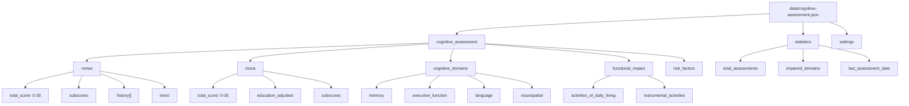
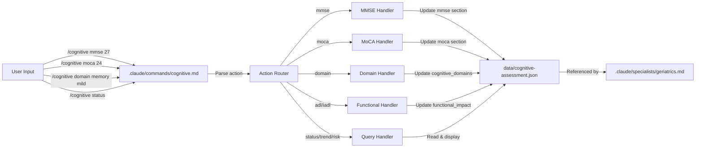
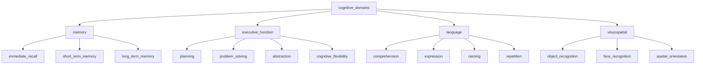
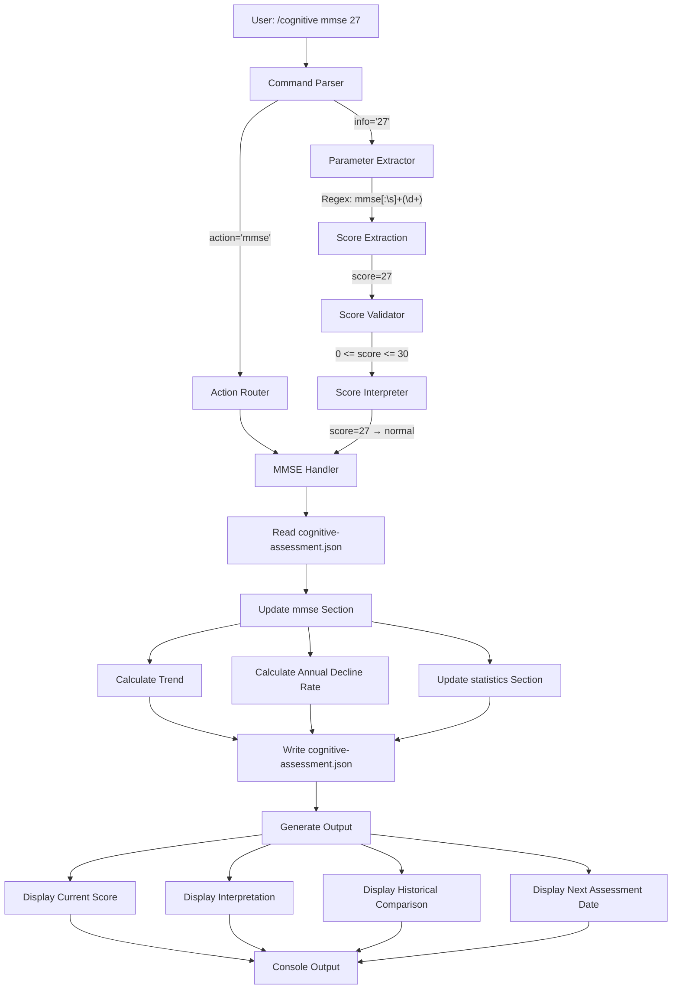
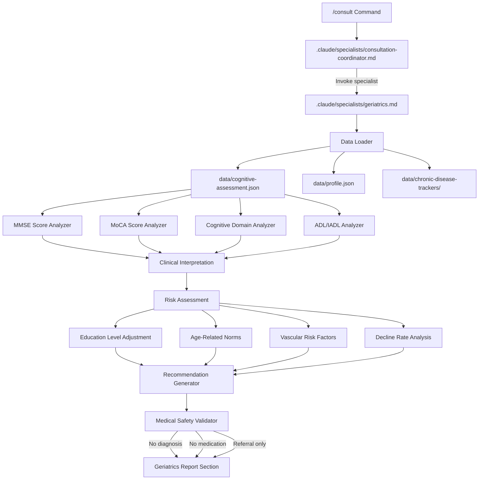

<!-- source: DeepWiki mcp.deepwiki.com · repo huifer/Claude-Ally-Health · extra page Cognitive Assessment · fetched 2026-10-26 -->

# Cognitive Assessment

<details>
<summary>Relevant source files</summary>

The following files were used as context for generating this wiki page:

- [.claude/commands/cognitive.md](.claude/commands/cognitive.md)
- [.claude/commands/fall.md](.claude/commands/fall.md)
- [.claude/commands/polypharmacy.md](.claude/commands/polypharmacy.md)
- [.claude/specialists/geriatrics.md](.claude/specialists/geriatrics.md)
- [data-example/index.json](data-example/index.json)
- [scripts/test-elderly-health.sh](scripts/test-elderly-health.sh)
- [todo/03-children-health.md](todo/03-children-health.md)
- [todo/04-elderly-health.md](todo/04-elderly-health.md)

</details>


## Purpose and Scope

The Cognitive Assessment module provides structured tracking and evaluation of cognitive function in elderly individuals, implementing standardized clinical assessment tools including MMSE (Mini-Mental State Examination) and MoCA (Montreal Cognitive Assessment). This system enables longitudinal monitoring of cognitive decline, functional status tracking through ADL/IADL evaluations, and risk stratification for cognitive impairment.

This module is one of three elderly health tracking systems. For fall risk evaluation, see [Fall Risk Management](#4.4.2). For medication safety screening, see [Polypharmacy Management](#4.4.3). The cognitive assessment data integrates with the [AI Consultation System](#7) where the geriatrics specialist provides comprehensive analysis.

**Key Capabilities:**
- Standardized cognitive test recording (MMSE, MoCA)
- Cognitive domain-specific assessment (memory, executive function, language, visuospatial)
- Functional status evaluation (ADL/IADL)
- Trend analysis and decline rate calculation
- Risk assessment with medical safety boundaries

**Medical Safety Constraint:** This system does not diagnose dementia or cognitive disorders. All assessments are screening tools that prompt professional medical evaluation when scores indicate impairment.

Sources: [todo/04-elderly-health.md:1-26](), [.claude/commands/cognitive.md:1-20]()

---

## Data Storage Architecture

Cognitive assessment data is stored in `data/cognitive-assessment.json` as a structured JSON document with four primary sections: assessment results, statistics, settings, and metadata.

### File Structure



Sources: [todo/04-elderly-health.md:128-244](), [scripts/test-elderly-health.sh:73-76]()

### Data Model

The cognitive assessment object follows this structure:

| Field | Type | Description |
|-------|------|-------------|
| `cognitive_assessment.mmse` | Object | MMSE test results including total score, subscores, history array, and trend analysis |
| `cognitive_assessment.moca` | Object | MoCA test results with education adjustment and subscore breakdown |
| `cognitive_assessment.cognitive_domains` | Object | Domain-specific assessments (memory, executive, language, visuospatial) |
| `cognitive_assessment.functional_impact` | Object | ADL (6 items) and IADL (8 items) functional status |
| `cognitive_assessment.risk_factors` | Array | Risk factors for cognitive decline (age, education, vascular factors) |
| `statistics.total_assessments` | Integer | Count of all assessments performed |
| `statistics.impaired_domains` | Integer | Number of cognitive domains showing impairment |
| `settings.reminder_months` | Integer | Frequency of assessment reminders (default: 12 months) |

**Score Interpretation Thresholds:**

```json
{
  "mmse": {
    "27-30": "normal",
    "21-26": "mild_impairment",
    "10-20": "moderate_impairment",
    "≤9": "severe_impairment"
  },
  "moca": {
    "≥26": "normal",
    "18-25": "mild_impairment",
    "10-17": "moderate_impairment",
    "<10": "severe_impairment"
  }
}
```

Sources: [todo/04-elderly-health.md:128-244](), [.claude/commands/cognitive.md:48-86]()

---

## Command Interface

The `/cognitive` command provides eight operations for recording and querying cognitive assessment data. The command processor follows a pattern-recognition approach to extract parameters from natural language input.

### Command-to-File Mapping



Sources: [.claude/commands/cognitive.md:1-10](), [.claude/commands/cognitive.md:46-323]()

### Operation Descriptions

| Operation | Action Keyword | Parameters | Updates Section |
|-----------|---------------|------------|-----------------|
| MMSE Test | `mmse` | `score <0-30>` | `cognitive_assessment.mmse` |
| MoCA Test | `moca` | `score <0-30>`, optional `education <years>` | `cognitive_assessment.moca` |
| Cognitive Domain | `domain` | `<domain_name> <status>` | `cognitive_assessment.cognitive_domains` |
| ADL Assessment | `adl` | `<activity> <status>` | `functional_impact.activities_of_daily_living` |
| IADL Assessment | `iadl` | `<activity> <status>` | `functional_impact.instrumental_activities` |
| View Status | `status` | None | Read-only query |
| View Trend | `trend` | None | Read-only, calculates decline rate |
| Risk Assessment | `risk` | None | Read-only, evaluates risk factors |

Sources: [.claude/commands/cognitive.md:46-323](), [todo/04-elderly-health.md:246-271]()

### Parameter Recognition Patterns

The command processor uses regular expressions to extract structured data from natural language:

**MMSE Score Extraction:**
```
Pattern: mmse[:\s]+(\d+) or score[:\s]+(\d+)
Examples:
  - "/cognitive mmse 27" → score=27
  - "/cognitive mmse score 24" → score=24
```

**MoCA Score with Education Adjustment:**
```
Pattern: moca[:\s]+(\d+) with optional 教育(\d+)年 or education[:\s]+(\d+)
Examples:
  - "/cognitive moca 24" → score=24, no adjustment
  - "/cognitive moca 25 教育12年" → score=25, adjusted=26
```

**Cognitive Domain Assessment:**
```
Pattern: (memory|executive|language|visuospatial)[:\s]+(\w+)
Domain Keywords: memory, executive_function, language, visuospatial
Status Keywords: normal, mild_impairment, moderate_impairment, severe_impairment
Examples:
  - "/cognitive domain memory mild_impairment"
  - "/cognitive domain language 轻度障碍"
```

**Functional Status Assessment:**
```
ADL Activities: bathing, dressing, toileting, transferring, continence, feeding
IADL Activities: shopping, cooking, managing_medications, using_telephone, 
                 managing_finances, housekeeping, transportation, laundry
Status Levels: independent, needs_assistance, supervision_needed, dependent

Examples:
  - "/cognitive adl bathing independent"
  - "/cognitive iadl managing_medications supervision_needed"
```

Sources: [.claude/commands/cognitive.md:59-62](), [.claude/commands/cognitive.md:100-103](), [.claude/commands/cognitive.md:147-150](), [.claude/commands/cognitive.md:189-192]()

---

## Assessment Tools and Scoring

### MMSE (Mini-Mental State Examination)

The MMSE is a 30-point questionnaire assessing five cognitive domains with specific point allocations:

**Test Structure:**

| Domain | Items | Max Points | Assessment |
|--------|-------|-----------|------------|
| Orientation | Time (year, season, month, date, day) | 5 | `subscores.orientation.time` |
| Orientation | Place (country, province, city, hospital, floor) | 5 | `subscores.orientation.place` |
| Registration | Immediate recall of 3 words | 3 | `subscores.registration` |
| Attention | Serial 7s subtraction (100-93-86-79-72-65) | 5 | `subscores.attention` |
| Recall | Delayed recall of 3 words | 3 | `subscores.recall` |
| Language | Naming (watch, pencil) | 2 | `subscores.language` |
| Language | Repetition of sentence | 1 | `subscores.language` |
| Language | 3-step command | 3 | `subscores.language` |
| Language | Reading comprehension | 1 | `subscores.language` |
| Language | Writing sentence | 1 | `subscores.language` |
| Language | Copying pentagons | 1 | `subscores.language` |

**Interpretation Algorithm:**
```
if (total_score >= 27) → "normal"
else if (total_score >= 21) → "mild_impairment"
else if (total_score >= 10) → "moderate_impairment"
else → "severe_impairment"
```

**Adjustment Factors:**
- Education level (≤12 years may show lower baseline)
- Cultural background
- Age-related normative data

Sources: [todo/04-elderly-health.md:30-66](), [.claude/specialists/geriatrics.md:22-32]()

### MoCA (Montreal Cognitive Assessment)

MoCA provides more sensitive detection of mild cognitive impairment (MCI) with broader cognitive domain coverage:

**Test Structure:**

| Domain | Items | Max Points | Data Field |
|--------|-------|-----------|-----------|
| Visuospatial/Executive | Trail Making, Cube Copy, Clock Drawing | 5 | `subscores.visuospatial_executive` |
| Naming | Animal naming (lion, rhino, camel) | 3 | `subscores.naming` |
| Attention | Digit span, vigilance, serial 7s | 6 | `subscores.attention` |
| Language | Sentence repetition, fluency | 3 | `subscores.language` |
| Abstraction | Similarity between concepts | 2 | `subscores.abstraction` |
| Delayed Recall | 5-word recall | 5 | `subscores.delayed_recall` |
| Orientation | Time and place | 6 | `subscores.orientation` |

**Education Adjustment:**
```python
if education_years <= 12:
    adjusted_score = raw_score + 1
else:
    adjusted_score = raw_score
```

The adjusted score is stored in `cognitive_assessment.moca.education_adjusted` while `total_score` contains the unadjusted value.

Sources: [todo/04-elderly-health.md:69-89](), [.claude/specialists/geriatrics.md:33-40]()

### Cognitive Domain Assessment

Beyond total scores, the system tracks four domain-specific assessments:



Each domain is assigned a status:
- `normal` - No impairment detected
- `mild_impairment` - Subtle deficits present
- `moderate_impairment` - Clear functional impact
- `severe_impairment` - Significant disability

Sources: [todo/04-elderly-health.md:90-119](), [.claude/commands/cognitive.md:130-167]()

### Functional Impact Assessment

**ADL (Activities of Daily Living) - 6 Basic Activities:**

| Activity | Field Name | Independence Levels |
|----------|-----------|-------------------|
| Bathing | `bathing` | independent, needs_assistance, dependent |
| Dressing | `dressing` | independent, needs_assistance, dependent |
| Toileting | `toileting` | independent, needs_assistance, dependent |
| Transferring | `transferring` | independent, needs_assistance, dependent |
| Continence | `continence` | independent, needs_assistance, dependent |
| Feeding | `feeding` | independent, needs_assistance, dependent |

**IADL (Instrumental Activities of Daily Living) - 8 Complex Activities:**

| Activity | Field Name | Independence Levels |
|----------|-----------|-------------------|
| Shopping | `shopping` | independent, needs_assistance, supervision_needed, dependent |
| Cooking | `cooking` | independent, needs_assistance, supervision_needed, dependent |
| Medication Management | `managing_medications` | independent, needs_assistance, supervision_needed, dependent |
| Telephone Use | `using_telephone` | independent, needs_assistance, supervision_needed, dependent |
| Financial Management | `managing_finances` | independent, needs_assistance, supervision_needed, dependent |
| Housekeeping | `housekeeping` | independent, needs_assistance, supervision_needed, dependent |
| Transportation | `transportation` | independent, needs_assistance, supervision_needed, dependent |
| Laundry | `laundry` | independent, needs_assistance, supervision_needed, dependent |

**Scoring Logic:**
- ADL: 6 points maximum (1 per activity independent)
- IADL: 8 points maximum (1 per activity independent)
- Functional decline often precedes or accompanies cognitive decline

Sources: [todo/04-elderly-health.md:211-227](), [.claude/commands/cognitive.md:170-247](), [.claude/specialists/geriatrics.md:49-51]()

---

## Processing Pipeline

The cognitive assessment command processing follows a multi-stage pipeline from user input to data persistence and output generation.

### Command Execution Flow



Sources: [.claude/commands/cognitive.md:58-86](), [todo/04-elderly-health.md:154-167]()

### Trend Analysis Algorithm

When recording new MMSE/MoCA scores, the system calculates cognitive decline trends:

**Trend Calculation:**
```python
# From history array in cognitive_assessment.mmse.history
def calculate_trend(current_score, history):
    if len(history) < 2:
        return "insufficient_data"
    
    # Calculate annual decline rate
    first_record = history[0]
    time_span_years = (current_date - first_record.date) / 365.25
    score_change = current_score - first_record.score
    annual_decline = -score_change / time_span_years
    
    # Classify trend
    if annual_decline < 0.5:
        return "stable"
    elif annual_decline < 2.0:
        return "slow_decline"
    else:
        return "rapid_decline"  # Red flag: requires medical evaluation
```

The `annual_decline` field is stored in `cognitive_assessment.mmse.annual_decline` and used by the geriatrics specialist for risk assessment.

Sources: [todo/04-elderly-health.md:154-167](), [.claude/commands/cognitive.md:270-291]()

---

## Integration with AI Specialists

The cognitive assessment data serves as a primary data source for the geriatrics specialist during MDT consultations.

### Geriatrics Specialist Analysis Framework



Sources: [.claude/specialists/geriatrics.md:1-17](), [.claude/specialists/geriatrics.md:254-289]()

### Specialist Interpretation Rules

The geriatrics specialist applies domain-specific rules when analyzing cognitive data:

**MMSE Interpretation with Context:**
```
Age Adjustment: None (cutoffs are age-standardized)
Education Adjustment: 
  - ≤12 years education: Consider 1-2 point lower threshold for impairment
  - Cultural factors: Language barriers may affect language subscores
  
Subscore Analysis:
  - Orientation loss → temporal lobe dysfunction, delirium risk
  - Attention deficit → executive dysfunction, depression screen
  - Recall impairment → memory system damage, early AD marker
  - Language errors → frontotemporal involvement, stroke sequelae
```

**MoCA Interpretation with Context:**
```
Primary Advantage: More sensitive to MCI detection than MMSE
Education Adjustment: Add 1 point if ≤12 years education

Domain-Specific Alerts:
  - Visuospatial/Executive < 3/5 → Frontoparietal dysfunction
  - Delayed Recall < 3/5 → Hippocampal pathology
  - Attention < 4/6 → Executive dysfunction, depression, delirium
  - Abstraction = 0/2 → Concrete thinking, frontal lobe involvement
```

**Functional Impact Correlation:**
```
ADL Independence + Cognitive Impairment → Mild cognitive changes, monitor
ADL Dependence + Normal Cognitive → Physical disability, not dementia
IADL Impairment → Often earliest functional marker of cognitive decline
```

Sources: [.claude/specialists/geriatrics.md:20-51](), [todo/04-elderly-health.md:59-66]()

### Safety Constraints in Specialist Output

The geriatrics specialist is bound by strict safety rules when generating reports:

**Prohibited Actions:**
1. **No Diagnostic Statements**
   - ❌ "诊断为阿尔茨海默病" (diagnosed with Alzheimer's disease)
   - ✅ "MMSE评分24分，提示轻度认知功能障碍，建议神经科就诊" (MMSE 24 suggests mild impairment, recommend neurology visit)

2. **No Medication Recommendations**
   - ❌ "服用多奈哌齐治疗" (take donepezil for treatment)
   - ✅ "建议神经科医生评估是否需要药物干预" (recommend neurologist evaluate medication needs)

3. **No Prognosis Predictions**
   - ❌ "很快会发展成重度痴呆" (will progress to severe dementia soon)
   - ✅ "年度下降2分，需密切监测认知变化" (2-point annual decline, close monitoring needed)

**Appropriate Expressions:**
```
Screening Results: "MMSE评分显示轻度认知功能障碍"
Referral Guidance: "建议神经科/老年科就诊进行全面评估"
Risk Factors: "存在高血压、糖尿病等血管危险因素"
Trend Analysis: "较去年下降2分，下降速度加快"
Functional Impact: "IADL中用药管理需要帮助"
```

Sources: [.claude/specialists/geriatrics.md:169-195](), [.claude/commands/cognitive.md:20-43]()

---

## Validation and Testing

The cognitive assessment module undergoes structured validation through automated tests.

### Test Coverage

The test script `scripts/test-elderly-health.sh` validates:

**File Existence:**
- Command file: `.claude/commands/cognitive.md`
- Data file: `data/cognitive-assessment.json`
- Specialist file: `.claude/specialists/geriatrics.md`

**JSON Structure Validation:**
```bash
# Test: Cognitive has mmse section
python3 -c "import json; d=json.load(open('data/cognitive-assessment.json')); 
exit(0 if 'cognitive_assessment' in d and 'mmse' in d['cognitive_assessment'] else 1)"

# Test: Cognitive has moca section
python3 -c "import json; d=json.load(open('data/cognitive-assessment.json')); 
exit(0 if 'cognitive_assessment' in d and 'moca' in d['cognitive_assessment'] else 1)"

# Test: Statistics section exists
python3 -c "import json; d=json.load(open('data/cognitive-assessment.json')); 
exit(0 if 'statistics' in d and 'total_assessments' in d['statistics'] else 1)"
```

**Medical Safety Validation:**
```bash
# Test: No dementia diagnosis in cognitive.md
! grep -E '(诊断为.*痴呆|确诊阿尔茨海默病|肯定性痴呆)' .claude/commands/cognitive.md | 
  grep -v '^#' | grep -q .

# Test: Safety red lines section exists
grep -q '安全红线' .claude/commands/cognitive.md

# Test: System capabilities section exists
grep -q '系统能做到的' .claude/commands/cognitive.md
```

**Command Completeness:**
```bash
# Verify all 8 operations are documented
grep -q '### 1. MMSE测试' .claude/commands/cognitive.md
grep -q '### 2. MoCA测试' .claude/commands/cognitive.md
grep -q '### 3. 认知域评估' .claude/commands/cognitive.md
grep -q '### 4. 日常活动能力评估' .claude/commands/cognitive.md
grep -q '### 5. 工具性日常活动能力评估' .claude/commands/cognitive.md
grep -q '### 6. 查看认知状态' .claude/commands/cognitive.md
grep -q '### 7. 查看变化趋势' .claude/commands/cognitive.md
grep -q '### 8. 认知功能风险评估' .claude/commands/cognitive.md
```

Sources: [scripts/test-elderly-health.sh:52-134](), [scripts/test-elderly-health.sh:110-123]()

### Reference Standards

The cognitive assessment implements clinically validated tools with published normative data:

| Assessment | Reference | Year | Application |
|-----------|-----------|------|-------------|
| MMSE | Folstein et al. | 1975 | Global cognitive screening |
| MoCA | Nasreddine et al. | 2005 | MCI detection |
| NIA-AA Criteria | National Institute on Aging | 2018 | Dementia diagnostic framework |
| Chinese Dementia Guidelines | Chinese Medical Association | 2020 | Local clinical practice |

These references are cited in both the command file and specialist file to ensure clinical validity.

Sources: [.claude/commands/cognitive.md:348-354](), [.claude/specialists/geriatrics.md:385-408]()

---

## Usage Examples

### Recording MMSE Results

**Simple Score Recording:**
```
User: /cognitive mmse 27
System: 
✓ MMSE评分已记录
━━━━━━━━━━━━━━━━━━━━━━━━━━━━━━━━━━━━━━
测试日期: 2025-06-20
总分: 27/30
解读: 正常认知功能
━━━━━━━━━━━━━━━━━━━━━━━━━━━━━━━━━━━━━━
与上次对比 (2024-06-20): 28分 → 27分 (下降1分)
年度下降率: 1.0分/年
下次评估建议: 2026-06-20
```

**Detailed Subscore Recording:**
```
User: /cognitive mmse score 24 定向力9分 记忆力5分 注意力3分
System:
⚠️ MMSE评分提示轻度认知功能障碍
━━━━━━━━━━━━━━━━━━━━━━━━━━━━━━━━━━━━━━
总分: 24/30 (轻度认知功能障碍)
分项分数:
  • 定向力: 9/10分
  • 记忆力: 5/6分 ⚠️
  • 注意力: 3/5分 ⚠️
  • 语言: 7/9分
━━━━━━━━━━━━━━━━━━━━━━━━━━━━━━━━━━━━━━
⚠️ 建议: 神经科/老年科就诊进行全面评估
```

### Recording MoCA with Education Adjustment

```
User: /cognitive moca 25 教育12年
System:
✓ MoCA评分已记录并调整
━━━━━━━━━━━━━━━━━━━━━━━━━━━━━━━━━━━━━━
测试日期: 2025-06-20
原始分数: 25/30
教育调整后: 26/30 (≤12年教育+1分)
解读: 正常认知功能
━━━━━━━━━━━━━━━━━━━━━━━━━━━━━━━━━━━━━━
MoCA对轻度认知功能障碍(MCI)更敏感
下次评估建议: 2026-06-20
```

### Domain-Specific Assessment

```
User: /cognitive domain memory mild_impairment
System:
✓ 认知域评估已记录
━━━━━━━━━━━━━━━━━━━━━━━━━━━━━━━━━━━━━━
认知域: 记忆力
状态: 轻度障碍
━━━━━━━━━━━━━━━━━━━━━━━━━━━━━━━━━━━━━━
所有认知域状态:
  • 记忆力: 轻度障碍 ⚠️
  • 执行功能: 正常 ✓
  • 语言能力: 正常 ✓
  • 视空间能力: 正常 ✓
━━━━━━━━━━━━━━━━━━━━━━━━━━━━━━━━━━━━━━
受损认知域数: 1/4
```

### Functional Impact Assessment

```
User: /cognitive iadl managing_medications supervision_needed
System:
✓ 工具性日常活动能力已评估
━━━━━━━━━━━━━━━━━━━━━━━━━━━━━━━━━━━━━━
活动: 用药管理
状态: 需要监督
━━━━━━━━━━━━━━━━━━━━━━━━━━━━━━━━━━━━━━
IADL评估摘要 (8项):
  ✓ 使用电话: 独立
  ⚠️ 购物: 需要帮助
  ⚠️ 用药管理: 需要监督
  ⚠️ 财务管理: 需要帮助
  ✓ 做饭: 独立
━━━━━━━━━━━━━━━━━━━━━━━━━━━━━━━━━━━━━━
功能依赖项: 3/8
```

### Trend Analysis

```
User: /cognitive trend
System:
认知功能变化趋势
━━━━━━━━━━━━━━━━━━━━━━━━━━━━━━━━━━━━━━
MMSE历史记录:
  2023-06-20: 29分 (正常)
  2024-06-20: 28分 (正常)
  2025-06-20: 27分 (正常)

趋势分析:
  • 年度下降率: 1.0分/年
  • 趋势: 稳定下降
  • 2年累计下降: 2分
━━━━━━━━━━━━━━━━━━━━━━━━━━━━━━━━━━━━━━
⚠️ 建议: 持续年度监测，如下降速度加快需就医
```

Sources: [.claude/commands/cognitive.md:78-86](), [.claude/commands/cognitive.md:117-127]()

---

## Clinical Considerations

### When to Refer for Professional Evaluation

The system generates referral recommendations when:

**MMSE Triggers:**
- Score ≤26 (below normal threshold)
- Annual decline >2 points (rapid decline)
- Subscore patterns suggesting specific pathology

**MoCA Triggers:**
- Adjusted score ≤25 (below normal threshold)
- Visuospatial/Executive <3/5 (frontal dysfunction)
- Delayed Recall <3/5 (hippocampal pathology)

**Functional Triggers:**
- Any ADL dependence with cognitive decline
- IADL decline in medication management or financial tasks
- Multiple IADL dependencies

**Domain-Specific Triggers:**
- ≥2 cognitive domains showing impairment
- Single domain with moderate/severe impairment
- Discrepancy between cognitive domains (asymmetric impairment)

Sources: [.claude/commands/cognitive.md:326-345](), [.claude/specialists/geriatrics.md:199-227]()

### Educational and Cultural Considerations

**Education Level Impact:**
- Individuals with ≤12 years education may score 1-2 points lower on MMSE without pathology
- MoCA provides explicit +1 point adjustment for ≤12 years education
- Consider pre-morbid educational attainment and literacy

**Cultural and Language Factors:**
- Language subscores may be affected by non-native speakers
- Some test items require specific cultural knowledge
- Interpreter use may affect performance validity

**Age-Related Norms:**
- Normal aging shows minimal MMSE decline (<1 point/year)
- Age 75-84: MMSE ≥24 often normal
- Age ≥85: MMSE ≥20 may be acceptable with functional preservation

Sources: [.claude/specialists/geriatrics.md:191-195](), [todo/04-elderly-health.md:59-66]()

---

## Summary

The Cognitive Assessment module provides a structured, medically-validated framework for tracking cognitive function in elderly individuals. It implements standardized assessment tools (MMSE, MoCA), domain-specific evaluation, functional status tracking, and longitudinal trend analysis while maintaining strict medical safety boundaries. The system serves as a screening tool that identifies individuals requiring professional evaluation rather than replacing clinical diagnosis.

**Key Design Principles:**
1. **Standardization** - Uses clinically validated instruments (MMSE, MoCA)
2. **Longitudinal Tracking** - Maintains historical records with trend analysis
3. **Multi-Dimensional** - Assesses cognition, function, and risk factors
4. **Safety-First** - Enforces referral for abnormal findings without making diagnoses
5. **Integration** - Provides data to geriatrics specialist for comprehensive analysis

**Data Flow:**
`User Input → /cognitive Command → cognitive-assessment.json → Geriatrics Specialist → MDT Report`

Sources: [todo/04-elderly-health.md:1-26](), [.claude/commands/cognitive.md:1-354](), [.claude/specialists/geriatrics.md:1-17]()

---

