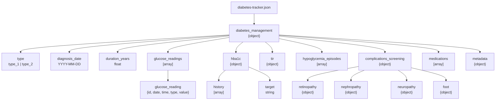
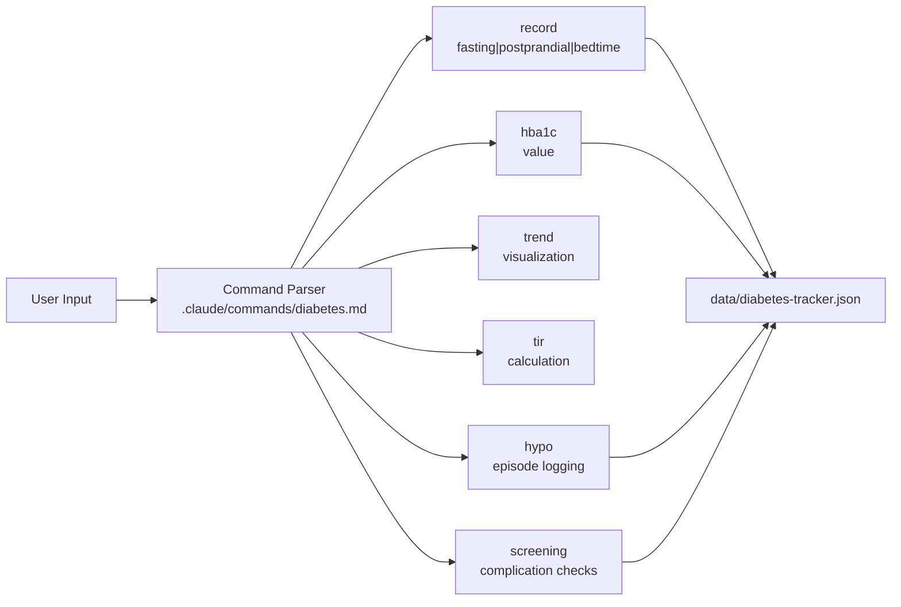
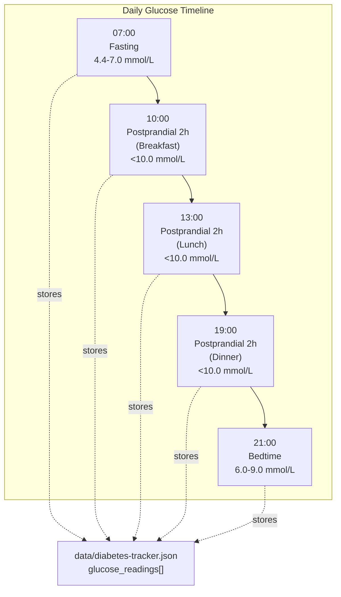
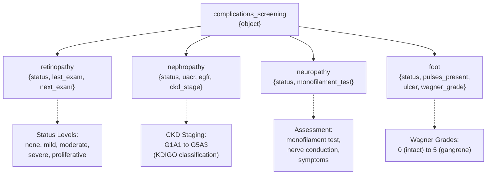
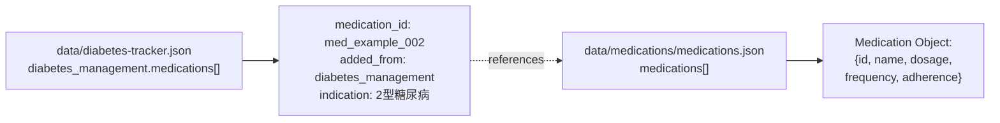
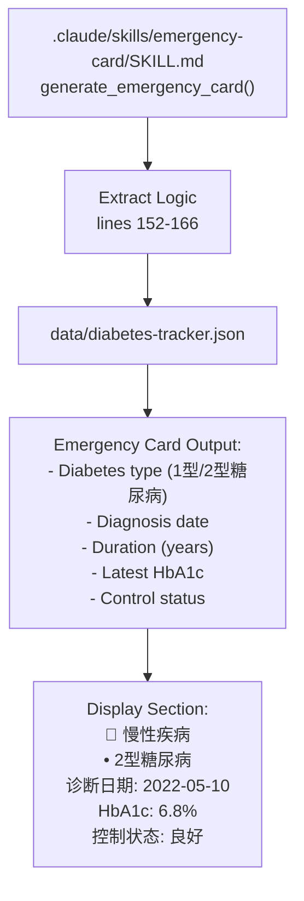

<!-- source: DeepWiki mcp.deepwiki.com · repo huifer/Claude-Ally-Health · extra page Diabetes Management · fetched 2026-10-26 -->

# Diabetes Management

<details>
<summary>Relevant source files</summary>

The following files were used as context for generating this wiki page:

- [.claude/skills/emergency-card/SKILL.md](.claude/skills/emergency-card/SKILL.md)
- [data-example/copd-tracker.json](data-example/copd-tracker.json)
- [data-example/diabetes-tracker.json](data-example/diabetes-tracker.json)
- [data-example/hypertension-tracker.json](data-example/hypertension-tracker.json)
- [scripts/test-chronic-diseases.sh](scripts/test-chronic-diseases.sh)
- [todo/06-chronic-diseases.md](todo/06-chronic-diseases.md)

</details>


## Purpose and Scope

This document describes the diabetes management system (module 4.5.2), which provides comprehensive blood glucose monitoring, HbA1c tracking, and diabetic complication screening for both Type 1 and Type 2 diabetes. The system enables users to record glucose readings across multiple daily timepoints (fasting, postprandial, bedtime), calculate Time-in-Range (TIR) metrics, log hypoglycemia episodes, and track progression of diabetic complications (retinopathy, nephropathy, neuropathy, diabetic foot).

For hypertension tracking, see [Hypertension Management](#4.5.1). For COPD management, see [COPD Management](#4.5.3). For medication interactions with diabetic drugs, see [Drug Interaction Detection](#6.1). For specialist consultations that analyze diabetic data, see [Multi-Disciplinary Team (MDT) Consultation](#7.1).

**Sources:** [todo/06-chronic-diseases.md:189-241](), [data-example/diabetes-tracker.json:1-141]()

---

## Data Architecture

### Storage Location

The diabetes management system stores all data in a single JSON file at `data/diabetes-tracker.json`. An example data file with complete structure is provided at `data-example/diabetes-tracker.json`.

### Root Data Structure



**Sources:** [data-example/diabetes-tracker.json:1-141](), [todo/06-chronic-diseases.md:241-361]()

### Glucose Reading Schema

Each glucose reading in the `glucose_readings` array contains the following fields:

| Field | Type | Description | Example |
|-------|------|-------------|---------|
| `id` | string | Unique identifier format: `glu_YYYYMMDDHHMMSS###` | `"glu_20250620070000001"` |
| `date` | string | Measurement date (ISO 8601) | `"2025-06-20"` |
| `time` | string | Measurement time (HH:MM) | `"07:00"` |
| `type` | enum | Reading type: `fasting`, `postprandial_2h`, `bedtime`, `random` | `"fasting"` |
| `value` | float | Glucose value | `6.5` |
| `unit` | string | Measurement unit | `"mmol/L"` |
| `meal` | string | (Optional) Associated meal for postprandial readings | `"breakfast"` |
| `notes` | string | (Optional) Additional notes | `""` |
| `created_at` | string | Record creation timestamp (ISO 8601) | `"2025-06-20T07:00:00.000Z"` |

**Sources:** [data-example/diabetes-tracker.json:7-37](), [todo/06-chronic-diseases.md:250-268]()

### Target Glucose Ranges

The system enforces medical standard target ranges:

| Measurement Type | Target Range | Unit | Reference |
|------------------|--------------|------|-----------|
| Fasting | 4.4 - 7.0 | mmol/L | ADA Guidelines |
| Postprandial (2h) | < 10.0 | mmol/L | ADA Guidelines |
| Bedtime | 6.0 - 9.0 | mmol/L | ADA Guidelines |

**Sources:** [data-example/diabetes-tracker.json:61-74](), [todo/06-chronic-diseases.md:282-295]()

### HbA1c Tracking Structure

```json
{
  "hba1c": {
    "history": [
      {
        "date": "2025-06-15",
        "value": 6.8,
        "unit": "%",
        "change_from_previous": -0.3,
        "created_at": "2025-06-15T00:00:00.000Z"
      }
    ],
    "target": "<7.0",
    "achievement": true
  }
}
```

The `change_from_previous` field automatically calculates the delta from the previous HbA1c measurement, enabling trend analysis.

**Sources:** [data-example/diabetes-tracker.json:40-59](), [todo/06-chronic-diseases.md:269-280]()

---

## Command Interface

### Command Routing

The diabetes management system is accessed through the `/glucose` command family, which is defined in `.claude/commands/diabetes.md`. All commands follow the pattern:

```
/glucose <subcommand> [arguments]
```



**Sources:** [todo/06-chronic-diseases.md:363-393]()

### Available Commands

| Command | Purpose | Example |
|---------|---------|---------|
| `/glucose record fasting <value>` | Record fasting glucose | `/glucose record fasting 6.5` |
| `/glucose record postprandial <value>` | Record 2-hour postprandial glucose | `/glucose record postprandial 8.2` |
| `/glucose record bedtime <value>` | Record bedtime glucose | `/glucose record bedtime 7.2` |
| `/glucose hba1c <value>` | Record HbA1c result | `/glucose hba1c 6.8` |
| `/glucose hba1c history` | View HbA1c trend | `/glucose hba1c history` |
| `/glucose trend` | View glucose trends | `/glucose trend` |
| `/glucose tir` | Calculate Time-in-Range | `/glucose tir` |
| `/glucose average` | Calculate average glucose | `/glucose average` |
| `/glucose hypo <value> [symptoms]` | Log hypoglycemia episode | `/glucose hypo 3.4 sweating` |
| `/glucose hypo history` | View hypoglycemia history | `/glucose hypo history` |
| `/glucose screening retina <status>` | Log retinopathy screening | `/glucose screening retina none` |
| `/glucose screening kidney uacr <value>` | Log nephropathy screening | `/glucose screening kidney uacr 45` |
| `/glucose screening nerve <status>` | Log neuropathy screening | `/glucose screening nerve normal` |
| `/glucose screening foot <status>` | Log diabetic foot screening | `/glucose screening foot normal` |
| `/glucose target` | View glucose targets | `/glucose target` |
| `/glucose achievement` | View goal achievement rate | `/glucose achievement` |

**Sources:** [todo/06-chronic-diseases.md:363-393]()

---

## Core Tracking Features

### Glucose Monitoring

The system supports four types of glucose measurements, each with specific clinical significance:



Each measurement type has distinct diagnostic value:
- **Fasting**: Reflects baseline hepatic glucose production and overnight control
- **Postprandial 2h**: Assesses meal-induced glucose excursion and insulin response
- **Bedtime**: Evaluates overnight safety and hypoglycemia risk

**Sources:** [todo/06-chronic-diseases.md:196-204](), [data-example/diabetes-tracker.json:7-37]()

### Time-in-Range (TIR) Calculation

TIR is a critical metric representing the percentage of time glucose remains within the target range (typically 3.9-10.0 mmol/L). The system calculates TIR over a configurable period (default: last 14 days).

```json
{
  "tir": {
    "percentage": 85,
    "target": ">70",
    "time_in_range_hours": 20.4,
    "time_above_range_hours": 3.0,
    "time_below_range_hours": 0.6,
    "measurement_period": "last_14_days"
  }
}
```

| TIR Metric | Clinical Interpretation |
|------------|------------------------|
| TIR > 70% | Excellent glucose control |
| TIR 50-70% | Acceptable control, needs improvement |
| TIR < 50% | Poor control, intervention required |
| Time below range > 4% | High hypoglycemia risk |

**Sources:** [data-example/diabetes-tracker.json:76-83](), [todo/06-chronic-diseases.md:297-304]()

### Hypoglycemia Episode Tracking

Hypoglycemia episodes (blood glucose < 3.9 mmol/L) are tracked separately due to their clinical significance and safety implications.

#### Hypoglycemia Episode Schema

```json
{
  "id": "hypo_20250618153000001",
  "date": "2025-06-18",
  "time": "15:30",
  "value": 3.4,
  "severity": "level_1",
  "symptoms": ["sweating", "palpitations"],
  "treatment": "glucose_tablets",
  "resolved": true,
  "created_at": "2025-06-18T15:30:00.000Z"
}
```

#### Severity Levels

| Level | Glucose Range (mmol/L) | Symptoms | Treatment |
|-------|----------------------|----------|-----------|
| Level 1 | 3.0 - 3.9 | Alert value | 15g fast-acting carbs |
| Level 2 | < 3.0 | Serious hypoglycemia | Immediate treatment |
| Level 3 | Severe | Cognitive impairment | Glucagon/medical assistance |

**Sources:** [data-example/diabetes-tracker.json:85-97](), [todo/06-chronic-diseases.md:306-316]()

### Complications Screening

The system tracks four major diabetic complications, each with specific assessment protocols:



**Sources:** [data-example/diabetes-tracker.json:99-124](), [todo/06-chronic-diseases.md:212-233]()

#### Diabetic Nephropathy Tracking

Nephropathy progression is assessed using UACR (urine albumin-to-creatinine ratio) and eGFR (estimated glomerular filtration rate):

```json
{
  "nephropathy": {
    "status": "microalbuminuria",
    "uacr": 45,
    "egfr": 78,
    "ckd_stage": "G2A2",
    "last_assessment": "2025-06-10"
  }
}
```

| UACR (mg/g) | Stage | Description |
|-------------|-------|-------------|
| < 30 | Normal | No albuminuria |
| 30-300 | A2 | Microalbuminuria |
| > 300 | A3 | Macroalbuminuria |

**Sources:** [data-example/diabetes-tracker.json:105-111]()

#### Diabetic Foot Assessment

The diabetic foot screening tracks ulcer risk using Wagner grading:

| Wagner Grade | Description | Ulcer Status |
|--------------|-------------|--------------|
| 0 | Intact skin | No ulcer, high-risk foot |
| 1 | Superficial ulcer | No infection, no gangrene |
| 2 | Deep ulcer | Tendon, bone, joint involved |
| 3 | Deep ulcer with abscess | Osteomyelitis |
| 4 | Forefoot gangrene | Partial foot |
| 5 | Whole foot gangrene | Amputation required |

**Sources:** [data-example/diabetes-tracker.json:117-123](), [todo/06-chronic-diseases.md:229-233]()

---

## Integration Architecture

### Medication Management Integration

Diabetic medications are stored separately in the medication management system and referenced by ID from the diabetes tracker:



This architecture avoids data duplication and enables cross-system medication interaction checking via the `/interaction` command (see [Drug Interaction Detection](#6.1)).

**Sources:** [data-example/diabetes-tracker.json:126-133](), [todo/06-chronic-diseases.md:345-354]()

### Emergency Card Integration

The emergency card system automatically extracts diabetes diagnosis information from `data/diabetes-tracker.json`:



**Sources:** [.claude/skills/emergency-card/SKILL.md:152-166](), [.claude/skills/emergency-card/SKILL.md:281-287]()

### Specialist Consultation Integration

When users invoke `/consult` (MDT consultation) or `/specialist endo` (endocrinology consultation), the AI specialists automatically read and analyze data from `data/diabetes-tracker.json`. This integration enables specialist skills to provide diabetes-specific analysis including:

- Glucose control trends and patterns
- HbA1c trajectory analysis
- Hypoglycemia risk assessment
- Complication screening status review
- Medication adherence evaluation

The specialist consultation system is described in [Multi-Disciplinary Team (MDT) Consultation](#7.1) and [Individual Specialist Consultations](#7.2).

**Sources:** [todo/06-chronic-diseases.md:732-733]()

---

## Medical Safety Constraints

### Safety Red Lines

The diabetes management system adheres to strict medical safety principles defined in the command documentation:

| Prohibited Action | Rationale |
|-------------------|-----------|
| ❌ Specific medication dosage recommendations | Dosing requires physician evaluation of renal function, age, comorbidities |
| ❌ Direct prescription of diabetes medications | Drug selection depends on contraindications, drug interactions, patient factors |
| ❌ Definitive diabetes diagnosis | Diagnosis requires laboratory confirmation and clinical criteria (ADA/WHO) |
| ❌ Prognosis predictions | Complication progression depends on multiple unmeasurable factors |

### Permitted System Functions

| Allowed Action | Purpose |
|----------------|---------|
| ✅ Glucose measurement recording | Data tracking and trend visualization |
| ✅ HbA1c history tracking | Long-term control monitoring |
| ✅ TIR calculation | Standardized glucose variability metric |
| ✅ Hypoglycemia episode logging | Safety event documentation |
| ✅ Complication screening reminders | Preventive care adherence |
| ✅ Lifestyle recommendations | Evidence-based general guidance |
| ✅ Data export for physician review | Clinical decision support |

**Sources:** [todo/06-chronic-diseases.md:606-635]()

### Disclaimer Requirements

All output from the diabetes management system must include explicit disclaimers:

```
⚠️ 医学安全声明
━━━━━━━━━━━━━━━━━━━━━━━━━━
本系统提供的所有分析和建议仅供参考，不能替代专业医疗诊断和治疗。
糖尿病管理需要在医生指导下进行，特别是：
• 用药调整必须咨询医生
• 出现低血糖症状立即就医
• 定期进行并发症筛查
• 血糖控制不佳时及时就诊
```

**Sources:** [todo/06-chronic-diseases.md:606-635]()

---

## File Structure Summary

| File Path | Purpose | Lines of Interest |
|-----------|---------|-------------------|
| `.claude/commands/diabetes.md` | Command definitions and routing logic | (File referenced but not provided) |
| `data/diabetes-tracker.json` | Active patient diabetes data (empty template) | N/A |
| `data-example/diabetes-tracker.json` | Complete example with realistic values | 1-141 |
| `.claude/skills/emergency-card/SKILL.md` | Emergency card integration logic | 152-166, 281-287 |
| `todo/06-chronic-diseases.md` | Complete specification and implementation notes | 189-393, 679-801 |
| `scripts/test-chronic-diseases.sh` | Validation test suite | 158-164 |

**Sources:** [todo/06-chronic-diseases.md:754-770]()

---

