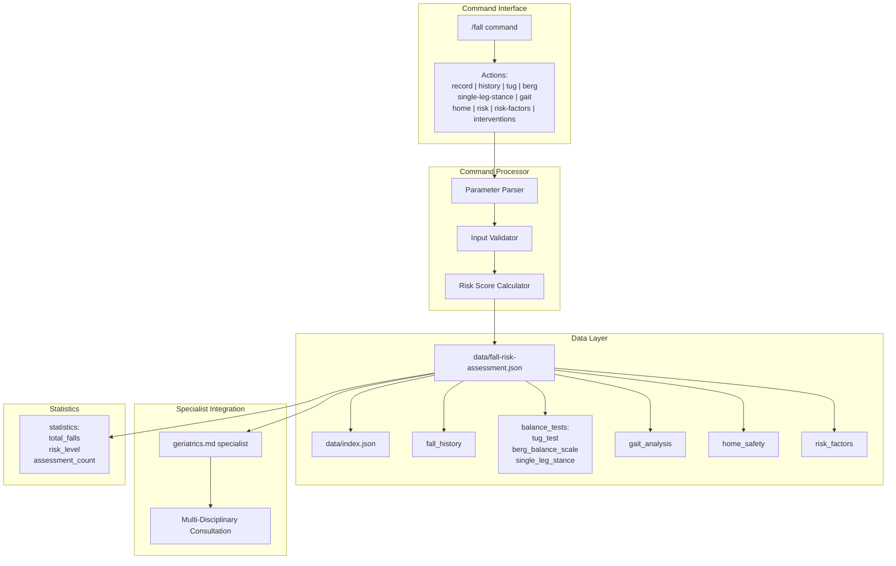
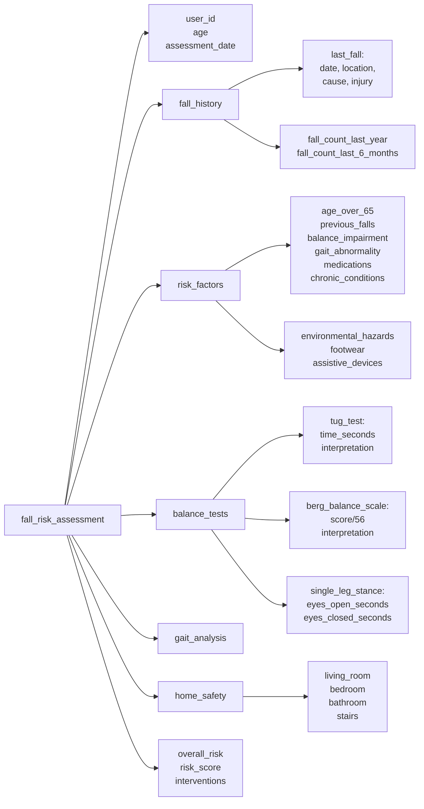
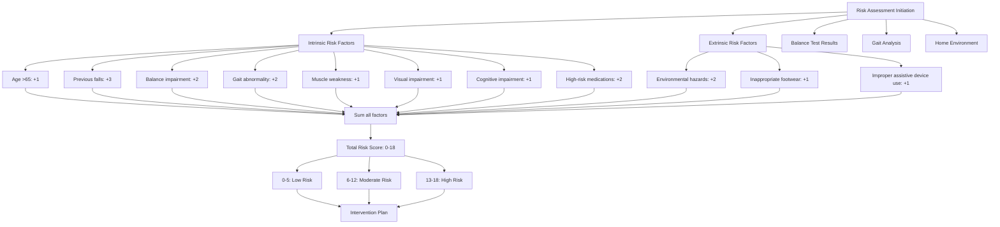
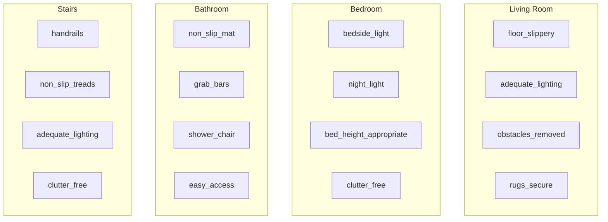
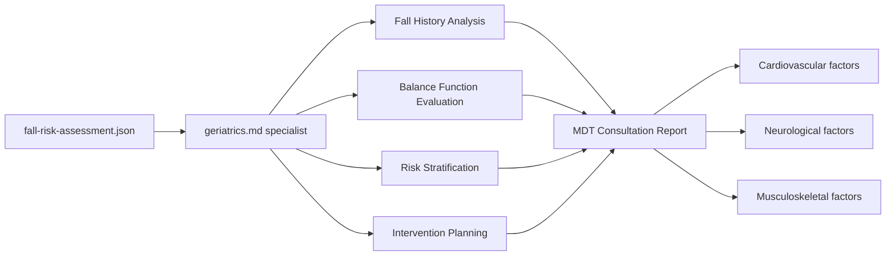
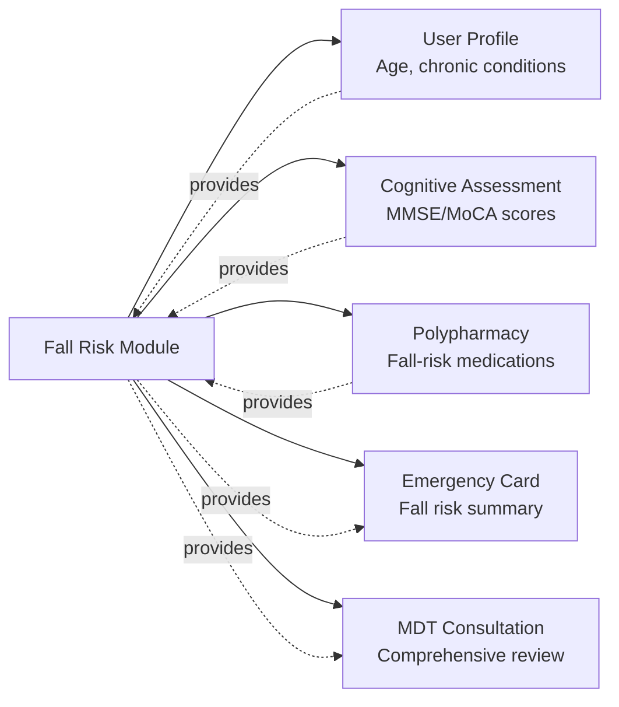

<!-- source: DeepWiki mcp.deepwiki.com · repo huifer/Claude-Ally-Health · extra page Fall Risk Management · fetched 2026-10-26 -->

# Fall Risk Management

<details>
<summary>Relevant source files</summary>

The following files were used as context for generating this wiki page:

- [.claude/commands/cognitive.md](.claude/commands/cognitive.md)
- [.claude/commands/fall.md](.claude/commands/fall.md)
- [.claude/commands/polypharmacy.md](.claude/commands/polypharmacy.md)
- [.claude/specialists/geriatrics.md](.claude/specialists/geriatrics.md)
- [data-example/index.json](data-example/index.json)
- [scripts/test-elderly-health.sh](scripts/test-elderly-health.sh)
- [todo/03-children-health.md](todo/03-children-health.md)
- [todo/04-elderly-health.md](todo/04-elderly-health.md)

</details>


## Purpose and Scope

The Fall Risk Management module provides comprehensive assessment and tracking of fall risk factors in elderly individuals. This system records fall events, conducts standardized balance function tests, evaluates home safety conditions, and generates risk scores to guide intervention planning.

This module is part of the larger Elderly Health system (see [Elderly Health](#4.4)) and integrates with the Geriatrics Specialist for comprehensive analysis (see [AI Consultation System](#7)). For medication-related fall risks, see [Polypharmacy Management](#4.4.3). For cognitive factors affecting fall risk, see [Cognitive Assessment](#4.4.1).

Sources: [.claude/commands/fall.md:1-20](), [todo/04-elderly-health.md:274-279]()

---

## System Architecture



**Figure 1: Fall Risk Management System Architecture**

The system implements a command-driven architecture where the `/fall` command triggers various assessment operations. All data persists in `data/fall-risk-assessment.json`, which is indexed via `data/index.json` for cross-module queries.

Sources: [.claude/commands/fall.md:1-10](), [todo/04-elderly-health.md:370-495](), [.claude/specialists/geriatrics.md:52-101]()

---

## Data Model

### Core Data Structure

The fall risk assessment system stores data in a hierarchical JSON structure:



**Figure 2: Fall Risk Assessment Data Model**

Sources: [todo/04-elderly-health.md:370-495](), [.claude/commands/fall.md:50-90]()

### Balance Test Score Thresholds

| Test | Score | Interpretation | Fall Risk |
|------|-------|----------------|-----------|
| **TUG** | <10 sec | Normal | Low |
| | 10-19 sec | Basically normal | Low-Moderate |
| | 20-29 sec | Mobility limited | Moderate-High |
| | ≥30 sec | Dependent on others | High |
| **Berg Balance Scale** | 41-56 | Independent walking | Low |
| | 21-40 | Needs assistance | Moderate |
| | 0-20 | Wheelchair required | High |
| **Single-leg stance** | Age-specific norms | | |
| | <60 yrs: >30 sec | Normal | Low |
| | 60-69 yrs: >15 sec | Normal | Low |
| | 70-79 yrs: >5 sec | Normal | Low |
| | ≥80 yrs: >3 sec | Normal | Low |

Sources: [.claude/commands/fall.md:115-234](), [.claude/specialists/geriatrics.md:70-86]()

### Gait Analysis Parameters

| Parameter | Threshold | Status |
|-----------|-----------|--------|
| **Gait Speed** | >1.0 m/s | Normal |
| | 0.6-1.0 m/s | Mobility impaired |
| | <0.6 m/s | Severely restricted |
| **Gait Abnormalities** | shortened_step | Step length reduced |
| | widened_base | Increased step width |
| | unsteady_gait | Balance issues |
| | shuffling | Dragging feet |
| | asymmetric | Uneven gait pattern |

Sources: [.claude/commands/fall.md:236-283](), [.claude/specialists/geriatrics.md:88-94]()

---

## Risk Assessment Framework

### Risk Scoring Algorithm

The system implements an 18-point risk scoring system that aggregates multiple risk factors:



**Figure 3: Risk Scoring Algorithm**

Sources: [todo/04-elderly-health.md:480-494](), [.claude/commands/fall.md:346-376]()

### Risk Stratification

```json
{
  "overall_risk": "moderate",
  "risk_score": 12,
  "max_score": 18,
  "risk_category": {
    "low": "0-5 points",
    "moderate": "6-12 points",
    "high": "13-18 points"
  }
}
```

Sources: [todo/04-elderly-health.md:480-482]()

---

## Command Operations

### 1. Recording Fall Events: `/fall record`

**Operation**: Documents fall incidents with contextual details.

**Parameters**:
- Date: YYYY-MM-DD format
- Location: `bathroom | bedroom | living_room | kitchen | stairs`
- Cause: `slippery_floor | trip | loss_balance | dizziness`
- Injury: `none | bruise | cut | fracture | head_injury`

**Processing Flow**:
1. Parse date using regex `(\d{4}-\d{2}-\d{2})`
2. Extract location keywords from predefined set
3. Identify cause and injury severity
4. Update `fall_history` object in `data/fall-risk-assessment.json`
5. Increment `fall_count_last_year` and `fall_count_last_6_months`
6. Update `last_fall` with full event details
7. Set `previous_falls` risk factor to `true`
8. Recalculate `overall_risk` score

**Example**:
```
/fall record 2025-03-15 bathroom slippery_floor bruise
```

Sources: [.claude/commands/fall.md:49-88](), [todo/04-elderly-health.md:362-369]()

### 2. TUG Test Recording: `/fall tug`

**Operation**: Records Timed Up and Go test results.

**Parameters**:
- Time in seconds (integer)
- Optional date (defaults to current date)

**Pattern Recognition**: `tug[:\s]+(\d+)` or `(\d+)\s*秒`

**Interpretation Logic**:
```javascript
if (time_seconds < 10) {
  interpretation = "normal";
  risk_level = "low";
} else if (time_seconds < 20) {
  interpretation = "mobility_limitation";
  risk_level = "low_moderate";
} else if (time_seconds < 30) {
  interpretation = "mobility_limitation";
  risk_level = "moderate_high";
} else {
  interpretation = "dependent";
  risk_level = "high";
}
```

**Data Update**:
```json
{
  "balance_tests": {
    "tug_test": {
      "date": "2025-06-20",
      "time_seconds": 18,
      "interpretation": "mobility_limitation",
      "reference": "<10_seconds_normal"
    }
  }
}
```

Sources: [.claude/commands/fall.md:115-152](), [todo/04-elderly-health.md:306-319]()

### 3. Berg Balance Scale: `/fall berg`

**Operation**: Records Berg Balance Scale assessment (0-56 points).

**Scoring Interpretation**:
- 41-56: Independent walking (low risk)
- 21-40: Needs assistance (moderate risk)
- 0-20: Wheelchair required (high risk)

**Pattern Recognition**: `berg[:\s]+(\d+)`

**Data Storage**:
```json
{
  "berg_balance_scale": {
    "date": "2025-06-20",
    "score": 42,
    "max_score": 56,
    "interpretation": "moderate_risk"
  }
}
```

Sources: [.claude/commands/fall.md:155-191](), [todo/04-elderly-health.md:311-318]()

### 4. Single-leg Stance Test: `/fall single-leg-stance`

**Operation**: Records single-leg balance test with age-adjusted norms.

**Parameters**:
- Duration in seconds
- Condition: `eyes_open | eyes_closed`

**Age-adjusted Reference Values**:
```python
def interpret_single_leg_stance(age, duration_seconds):
    if age < 60:
        normal_threshold = 30
    elif age < 70:
        normal_threshold = 15
    elif age < 80:
        normal_threshold = 5
    else:
        normal_threshold = 3
    
    return "normal" if duration_seconds > normal_threshold else "impaired"
```

Sources: [.claude/commands/fall.md:194-234](), [todo/04-elderly-health.md:321-326]()

### 5. Gait Analysis: `/fall gait`

**Operation**: Records gait speed and abnormalities.

**Sub-operations**:
- `speed`: Gait speed in m/s
- `abnormal`: List of gait abnormalities

**Abnormality Keywords**:
- `shortened_step`: Step length reduction
- `widened_base`: Increased step width for stability
- `unsteady_gait`: Balance issues during walking
- `shuffling`: Dragging feet
- `asymmetric`: Uneven gait pattern

**Pattern Recognition**: `speed[:\s]+([\d.]+)`

Sources: [.claude/commands/fall.md:236-283](), [todo/04-elderly-health.md:328-345]()

### 6. Home Safety Assessment: `/fall home`

**Operation**: Evaluates home environment safety across multiple rooms.

**Assessable Rooms and Safety Items**:



**Figure 4: Home Safety Assessment Matrix**

**Parameter Format**: `home <room> <safety_item> <true|false>`

**Example**:
```
/fall home bathroom grab_bars true
/fall home bedroom night_light false
```

**Data Structure**:
```json
{
  "home_safety": {
    "living_room": {
      "floor_slippery": false,
      "adequate_lighting": true,
      "obstacles_removed": true,
      "rugs_secure": true
    },
    "bedroom": {
      "bedside_light": true,
      "night_light": false,
      "bed_height_appropriate": true,
      "clutter_free": true
    },
    "bathroom": {
      "non_slip_mat": true,
      "grab_bars": true,
      "shower_chair": false,
      "easy_access": true
    },
    "stairs": {
      "handrails": true,
      "non_slip_treads": true,
      "adequate_lighting": true,
      "clutter_free": true
    },
    "overall_safety": "good",
    "recommendations": [
      "add_night_light_in_bedroom",
      "consider_shower_chair"
    ]
  }
}
```

Sources: [.claude/commands/fall.md:286-344](), [todo/04-elderly-health.md:336-361]()

### 7. Risk Assessment: `/fall risk`

**Operation**: Generates comprehensive fall risk evaluation.

**Processing Steps**:
1. Identify all intrinsic risk factors from `risk_factors` object
2. Identify all extrinsic risk factors
3. Evaluate balance test results (TUG, Berg, single-leg stance)
4. Assess gait analysis data
5. Review home safety evaluation
6. Calculate cumulative risk score (0-18)
7. Determine risk level: low (0-5), moderate (6-12), high (13-18)
8. Generate intervention recommendations

**Output Format**:
```
Fall Risk Assessment Report
===========================
Risk Level: MODERATE
Risk Score: 12/18

Primary Risk Factors:
- Previous falls (2 in last year)
- TUG test: 18 seconds (mobility limitation)
- Berg Balance Scale: 42/56 (moderate risk)
- Gait speed: 0.8 m/s (impaired)
- Home safety issues: Missing night light, no shower chair

Recommended Interventions:
- Physical therapy for balance improvement
- Home modifications (night light, shower chair)
- Medication review (3 fall-risk medications)
- Vision assessment
```

Sources: [.claude/commands/fall.md:346-376](), [todo/04-elderly-health.md:480-494]()

### 8. View Risk Factors: `/fall risk-factors`

**Operation**: Lists all identified fall risk factors categorized by type.

**Output Categories**:
- **Intrinsic Factors**: Age, previous falls, balance, gait, muscle strength, vision, cognition, chronic conditions, medications
- **Extrinsic Factors**: Environmental hazards, footwear, assistive devices
- **Controlled Factors**: Factors successfully mitigated
- **Uncontrolled Factors**: Active risk factors requiring intervention

Sources: [.claude/commands/fall.md:378-398]()

### 9. View Interventions: `/fall interventions`

**Operation**: Generates prioritized intervention recommendations based on risk profile.

**Intervention Categories**:
1. Balance and strength training
2. Home environment modifications
3. Medication review suggestions
4. Vision correction
5. Assistive device recommendations
6. Footwear guidance

Sources: [.claude/commands/fall.md:400-423]()

---

## Specialist Integration

### Geriatrics Specialist Analysis

The fall risk data integrates with the geriatrics specialist for comprehensive evaluation:



**Figure 5: Specialist Integration for Fall Risk Analysis**

The geriatrics specialist analyzes fall risk data as part of the multi-disciplinary consultation (see [Multi-Disciplinary Team Consultation](#7.1)).

**Key Analysis Points** (from `.claude/specialists/geriatrics.md:52-101`):
- Fall history patterns and frequency trends
- Balance test interpretation with age-adjustment
- Gait analysis in context of chronic conditions
- Home safety evaluation with specific recommendations
- Medication contribution to fall risk (anticholinergic burden, sedatives, antihypertensives)

Sources: [.claude/specialists/geriatrics.md:52-101](), [.claude/specialists/geriatrics.md:208-214]()

---

## Safety Constraints

### Medical Safety Red Lines

The system enforces strict safety boundaries defined in [.claude/commands/fall.md:20-34]():

| Prohibited Action | Rationale | Appropriate Response |
|-------------------|-----------|---------------------|
| **Treating fall injuries** | Injuries require professional medical evaluation | Direct to emergency services or urgent care |
| **Prescribing rehabilitation exercises** | Exercise prescriptions require physical therapy assessment | Suggest consultation with physical therapist |
| **Diagnosing underlying conditions** | Fall risk may indicate serious medical conditions | Recommend comprehensive medical evaluation |
| **Making definitive predictions** | Fall risk is probabilistic, not deterministic | Provide risk level and intervention options |

**Appropriate System Actions**:
- Record fall events with full context
- Calculate standardized test scores
- Aggregate risk factors
- Generate evidence-based intervention suggestions
- Provide medical consultation recommendations

Sources: [.claude/commands/fall.md:20-44](), [todo/04-elderly-health.md:776-806]()

### Warning Triggers

The system generates warnings for:
1. **Fall count ≥2 in past year**: High-risk indicator requiring medical evaluation
2. **TUG ≥20 seconds**: Mobility limitation, refer to rehabilitation
3. **Berg Balance Scale ≤40**: Moderate-to-high fall risk
4. **Gait speed <0.6 m/s**: Severe mobility restriction
5. **Multiple home safety hazards**: Urgent environmental modification needed

Sources: [.claude/commands/fall.md:346-376]()

---

## Testing and Validation

### Test Coverage

The module's test suite validates all core functionality:

```mermaid
graph TD
    Tests["test-elderly-health.sh"]
    
    Tests --> FileValidation["File Structure Tests"]
    Tests --> DataValidation["Data Structure Tests"]
    Tests --> SafetyValidation["Safety Constraint Tests"]
    Tests --> CommandValidation["Command Completeness Tests"]
    
    FileValidation --> CmdFile["fall.md exists"]
    FileValidation --> DataFile["fall-risk-assessment.json exists"]
    
    DataValidation --> FallHistory["fall_history section"]
    DataValidation --> BalanceTests["balance_tests section"]
    DataValidation --> HomeSafety["home_safety section"]
    DataValidation --> Statistics["statistics section"]
    
    SafetyValidation --> NoTreatment["No injury treatment phrases"]
    SafetyValidation --> NoDiagnosis["No definitive diagnoses"]
    SafetyValidation --> RedLines["Safety red lines documented"]
    
    CommandValidation --> RecordAction["record action"]
    CommandValidation --> TUGAction["tug action"]
    CommandValidation --> BergAction["berg action"]
    CommandValidation --> GaitAction["gait action"]
    CommandValidation --> HomeAction["home action"]
    CommandValidation --> RiskAction["risk action"]
```



**Figure 6: Test Architecture for Fall Risk Module**

**Test Script Location**: [scripts/test-elderly-health.sh:115-123]()

**Key Validations**:
- JSON structure integrity tests (lines 78-81)
- Medical safety constraint verification (lines 113-123)
- Command action completeness (lines 136-144)
- Pattern recognition validation (lines 192-194)

Sources: [scripts/test-elderly-health.sh:78-144]()

---

## Statistics Tracking

The system maintains aggregate statistics in the `statistics` object:

```json
{
  "statistics": {
    "total_falls": 2,
    "falls_last_year": 2,
    "falls_last_6_months": 1,
    "risk_level": "moderate",
    "last_assessment_date": "2025-06-20",
    "assessment_count": 5,
    "tug_test_count": 3,
    "berg_test_count": 2,
    "home_assessments": 1
  }
}
```

These statistics feed into the global index catalog at `data/index.json` for cross-module queries and emergency card generation.

Sources: [scripts/test-elderly-health.sh:94-96](), [data-example/index.json:1-61]()

---

## Medical Standards and References

The fall risk assessment implements evidence-based clinical standards:

| Standard | Reference | Implementation |
|----------|-----------|----------------|
| **TUG Test** | Podsiadlo & Richardson (1991) | [.claude/commands/fall.md:115-152]() |
| **Berg Balance Scale** | Berg et al. (1989) | [.claude/commands/fall.md:155-191]() |
| **Single-leg Stance** | Vellas et al. (1997) | [.claude/commands/fall.md:194-234]() |
| **AGS Fall Prevention Guidelines** | American Geriatrics Society (2018) | [.claude/specialists/geriatrics.md:392-396]() |

Sources: [.claude/commands/fall.md:444-451](), [.claude/specialists/geriatrics.md:392-408]()

---

## Integration Points

### Cross-Module Dependencies



**Figure 7: Fall Risk Module Integration Architecture**

**Data Flow**:
1. **Input**: Age from profile, cognitive scores, medication list
2. **Processing**: Risk assessment with multi-factor analysis
3. **Output**: Risk score, intervention plan, warnings
4. **Aggregation**: Included in emergency card and MDT consultation

Sources: [.claude/commands/fall.md:1-451](), [.claude/specialists/geriatrics.md:52-101]()

---

