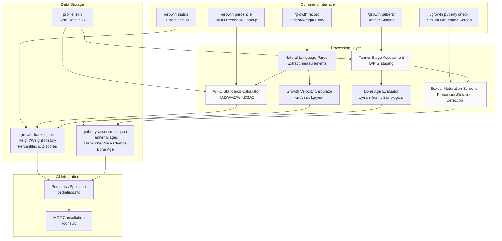
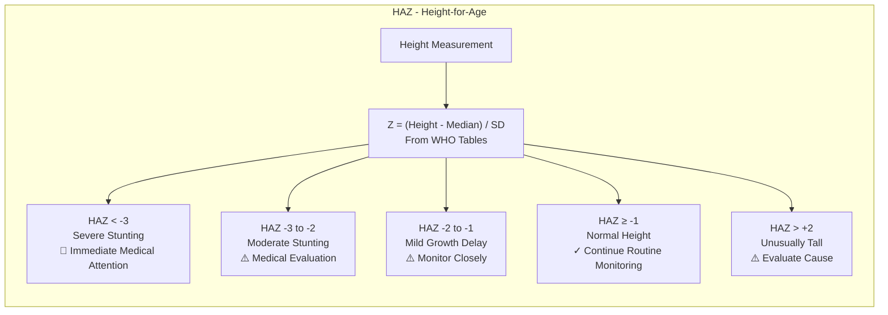
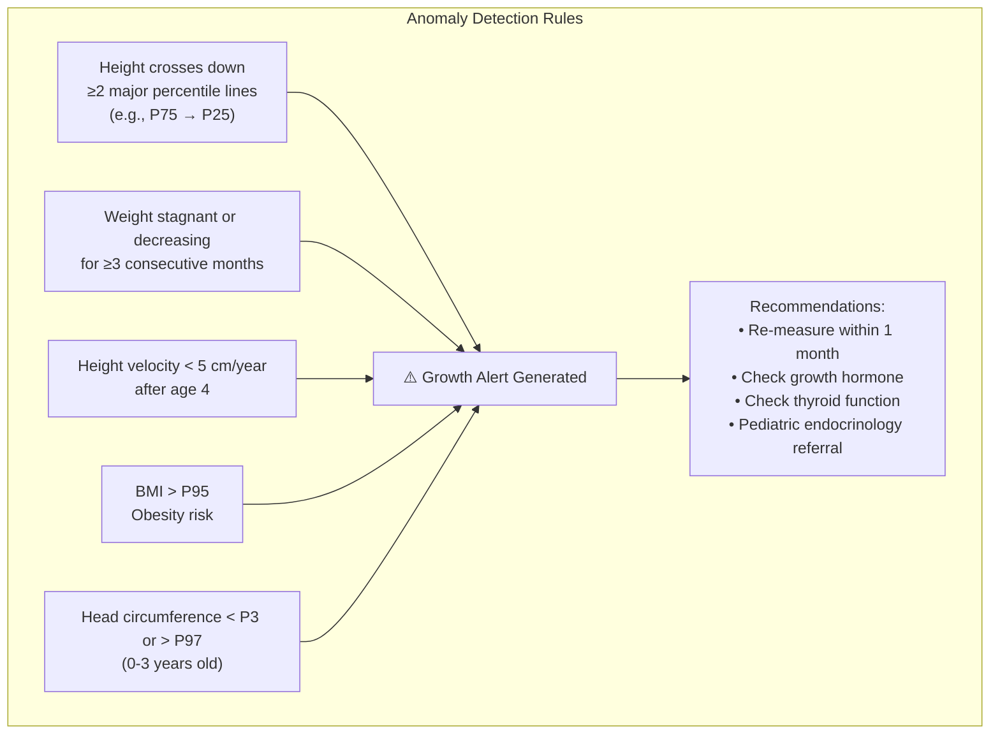
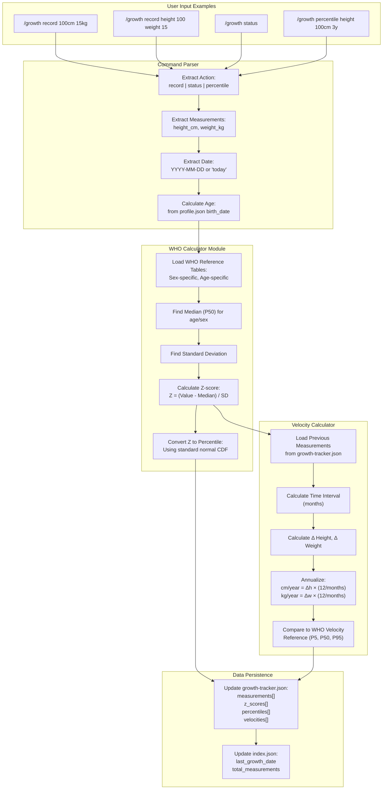
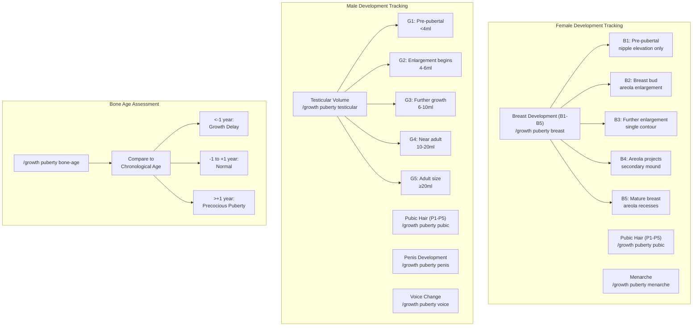
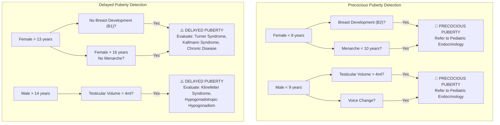
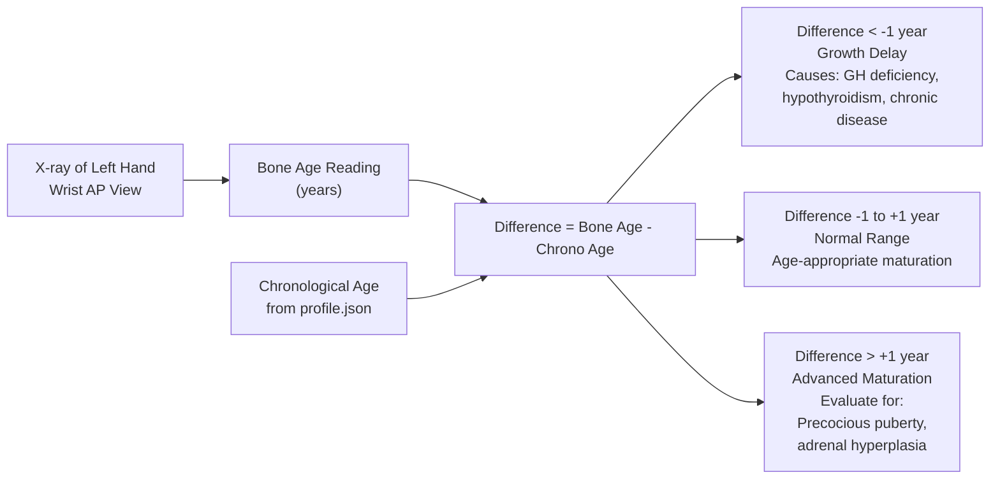
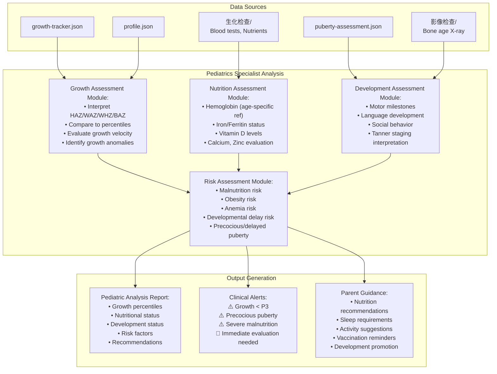
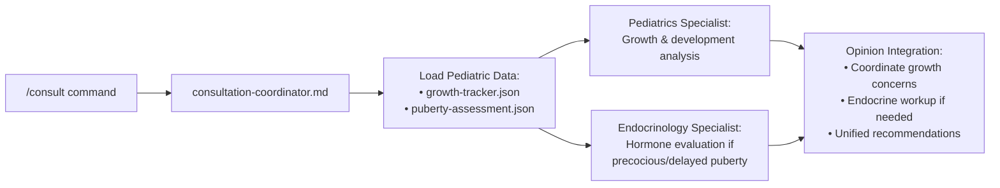

<!-- source: DeepWiki mcp.deepwiki.com · repo huifer/Claude-Ally-Health · extra page Growth & Development Monitoring · fetched 2026-10-26 -->

# Growth & Development Monitoring

<details>
<summary>Relevant source files</summary>

The following files were used as context for generating this wiki page:

- [.claude/commands/prostate-health.md](.claude/commands/prostate-health.md)
- [.claude/commands/puberty.md](.claude/commands/puberty.md)
- [.claude/specialists/pediatrics.md](.claude/specialists/pediatrics.md)
- [.claude/specialists/urology.md](.claude/specialists/urology.md)
- [data-example/andropause-tracker.json](data-example/andropause-tracker.json)
- [data-example/child-vaccinations.json](data-example/child-vaccinations.json)

</details>


This document describes the Growth & Development Monitoring system, which tracks pediatric growth using WHO Child Growth Standards and assesses puberty development using Tanner staging. The system provides Z-score calculations (HAZ, WAZ, WHZ, BAZ), growth velocity tracking, and sexual maturation screening for early detection of precocious or delayed puberty.

For vaccination tracking, see [Vaccination Tracking](#4.3.2). For general pediatric assessment and multi-disciplinary consultation, see [AI Specialist Framework](#3.3) and [Individual Specialist Consultations](#7.2).

## System Architecture

The growth monitoring system consists of three major components: growth measurement tracking using WHO standards, puberty assessment using Tanner staging, and integration with the pediatrics AI specialist for comprehensive evaluation.



**Sources:** [.claude/specialists/pediatrics.md:297-364](), [.claude/specialists/pediatrics.md:582-608](), [.claude/commands/puberty.md:1-214]()

## WHO Growth Standards Framework

The system implements the WHO Child Growth Standards (MGRS 2006) for comprehensive growth assessment. Four primary Z-score metrics are calculated to evaluate growth across multiple dimensions.

### Z-Score Metrics

| Metric | Full Name | Purpose | Normal Range |
|--------|-----------|---------|--------------|
| **HAZ** | Height-for-Age Z-score | Linear growth assessment | ≥ -1 SD |
| **WAZ** | Weight-for-Age Z-score | Overall nutritional status | ≥ -1 SD |
| **WHZ** | Weight-for-Height Z-score | Acute malnutrition detection | -2 to +1 SD |
| **BAZ** | BMI-for-Age Z-score | Body composition assessment | -2 to +1 SD |

**Sources:** [.claude/specialists/pediatrics.md:299-329]()

### Growth Status Classification

The system classifies growth status based on Z-score thresholds and provides clinical interpretations:



**Sources:** [.claude/specialists/pediatrics.md:303-307]()

### Growth Velocity Standards

Growth velocity is monitored to detect growth acceleration or deceleration. The system compares actual growth rates against age-specific reference values:

| Age Range | Expected Height Velocity | Expected Weight Velocity | Warning Threshold |
|-----------|-------------------------|-------------------------|-------------------|
| **0-1 year** | 25 cm/year (P50) | 6-7 kg/year | < P5 percentile |
| **1-2 years** | 12 cm/year (P50) | 2-3 kg/year | < P5 percentile |
| **2-3 years** | 9 cm/year (P50) | 2 kg/year | < P5 percentile |
| **3-4 years** | 7.7 cm/year (P50) | 2 kg/year | < P5 percentile |
| **≥4 years** | 5-7 cm/year | 3-4 kg/year (pre-pubertal) | < 5 cm/year |

**Sources:** [.claude/specialists/pediatrics.md:336-350]()

### Growth Anomaly Detection

The system implements multiple warning signals for abnormal growth patterns:



**Sources:** [.claude/specialists/pediatrics.md:351-357]()

## Growth Tracking Commands

The `/growth` command family provides natural language interfaces for recording and querying growth measurements.

### Command Processing Flow



**Sources:** [.claude/specialists/pediatrics.md:582-590]()

### Natural Language Parsing Patterns

The system recognizes diverse input formats for height and weight measurements:

| Input Pattern | Extracted Data |
|---------------|----------------|
| `"100cm 15kg"` | height: 100, weight: 15 |
| `"height 100 weight 15"` | height: 100, weight: 15 |
| `"身高100厘米 体重15公斤"` | height: 100, weight: 15 |
| `"100 15"` (space-separated) | height: 100, weight: 15 |
| `"1m 15kg"` | height: 100, weight: 15 |

**Sources:** [.claude/specialists/pediatrics.md:297-364]()

## Puberty Assessment System

The puberty assessment system implements Tanner staging for sexual maturation evaluation and screens for precocious or delayed puberty.

### Tanner Staging Framework



**Sources:** [.claude/specialists/pediatrics.md:367-445](), [.claude/commands/puberty.md:93-117]()

### Sexual Maturation Screening

The system implements age-based screening criteria to detect precocious or delayed puberty:



**Sources:** [.claude/specialists/pediatrics.md:448-508](), [.claude/commands/puberty.md:120-130]()

### Puberty Command Processing

The `/growth puberty` command family processes Tanner stage inputs and performs maturity screening:

| Command | Purpose | Example Input | Data Captured |
|---------|---------|---------------|---------------|
| `/growth puberty breast` | Female breast staging | `"breast B3"` | breast_stage: "B3" |
| `/growth puberty pubic` | Pubic hair staging | `"pubic P2"` | pubic_hair_stage: "P2" |
| `/growth puberty menarche` | First menstruation | `"menarche true 11.5"` | menarche_occurred: true, age_at_menarche: 11.5 |
| `/growth puberty testicular` | Male testicular volume | `"testicular 8ml"` | testicular_volume_ml: 8, stage: "G3" |
| `/growth puberty penis` | Penis development | `"penis 6.5cm"` | penis_length_cm: 6.5 |
| `/growth puberty voice` | Voice change | `"voice true"` | voice_change: true |
| `/growth puberty bone-age` | Bone maturation | `"bone-age 10.8"` | bone_age_years: 10.8 |
| `/growth puberty check` | Sexual maturity screen | (no parameters) | Runs age-based screening rules |

**Sources:** [.claude/commands/puberty.md:12-88]()

### Bone Age Evaluation

Bone age assessment compares skeletal maturation to chronological age:



**Sources:** [.claude/specialists/pediatrics.md:433-438]()

## Data Storage Architecture

Growth and puberty data are stored in separate JSON tracker files within the `data/` directory.

### Growth Tracker Data Structure

```json
{
  "created_at": "2020-01-01T00:00:00.000Z",
  "last_updated": "2025-06-20T10:00:00.000Z",
  
  "child_profile": {
    "child_id": "child_20200101",
    "name": "Child Name",
    "birth_date": "2020-01-01",
    "sex": "male"
  },
  
  "growth_measurements": [
    {
      "date": "2025-06-20",
      "age_months": 65,
      "age_years": 5.42,
      "height_cm": 110.5,
      "weight_kg": 18.3,
      "bmi": 15.0,
      "head_circumference_cm": null
    }
  ],
  
  "who_assessment": {
    "height_for_age": {
      "z_score": -0.5,
      "percentile": 31,
      "interpretation": "normal"
    },
    "weight_for_age": {
      "z_score": -0.2,
      "percentile": 42,
      "interpretation": "normal"
    },
    "bmi_for_age": {
      "z_score": 0.1,
      "percentile": 54,
      "interpretation": "normal"
    },
    "weight_for_height": {
      "z_score": 0.3,
      "percentile": 62,
      "interpretation": "normal"
    }
  },
  
  "growth_velocity": {
    "height_velocity_cm_per_year": 6.2,
    "weight_velocity_kg_per_year": 2.5,
    "measurement_interval_months": 6,
    "velocity_percentile": "P25-P50"
  },
  
  "alerts": [
    {
      "type": "growth_velocity_slow",
      "message": "Height velocity < P5 for age",
      "recommendation": "Consider growth hormone evaluation"
    }
  ]
}
```

**Sources:** [.claude/specialists/pediatrics.md:297-365]()

### Puberty Tracker Data Structure

```json
{
  "created_at": "2020-01-01T00:00:00.000Z",
  "last_updated": "2025-06-20T10:00:00.000Z",
  
  "puberty_tracking": {
    "child_id": "child_20200101",
    "chronological_age": 10.5,
    
    "female_development": {
      "breast_stage": "B3",
      "breast_stage_age": 10.2,
      "pubic_hair_stage": "P2",
      "pubic_hair_age": 10.5,
      "menarche": {
        "occurred": false,
        "age_at_menarche": null,
        "predicted_age": "11.5-12.0"
      }
    },
    
    "male_development": {
      "testicular_volume": {
        "left_ml": null,
        "right_ml": null,
        "stage": null
      },
      "penis_length_cm": null,
      "pubic_hair_stage": null,
      "voice_change": false,
      "facial_hair": false
    },
    
    "bone_age": {
      "chronological_age": 10.5,
      "bone_age_years": 10.8,
      "difference_years": 0.3,
      "interpretation": "normal",
      "assessment_date": "2025-06-15"
    },
    
    "assessment": {
      "overall_status": "normal_progression",
      "precocious_puberty_risk": false,
      "delayed_puberty_risk": false,
      "recommendations": [
        "Continue routine monitoring",
        "Next assessment in 6 months"
      ]
    }
  },
  
  "sexual_maturation_screening": {
    "last_screen_date": "2025-06-20",
    "precocious_criteria": {
      "age_threshold_years": 8.0,
      "current_age": 10.5,
      "criteria_met": false
    },
    "delayed_criteria": {
      "age_threshold_years": 13.0,
      "current_age": 10.5,
      "criteria_met": false
    }
  }
}
```

**Sources:** [.claude/commands/puberty.md:142-169]()

## Pediatrics Specialist Integration

The Pediatrics AI specialist (`pediatrics.md`) integrates growth and puberty data for comprehensive child health assessment.

### Specialist Analysis Framework



**Sources:** [.claude/specialists/pediatrics.md:59-67](), [.claude/specialists/pediatrics.md:78-140]()

### Specialist Output Format

The pediatrics specialist generates structured reports following this template:

| Report Section | Content | Data Sources |
|----------------|---------|--------------|
| **Growth Evaluation** | Height (value + percentile), Weight (value + percentile), BMI, Growth velocity | growth-tracker.json, WHO tables |
| **Nutrition Assessment** | Hemoglobin, Iron/Ferritin, Zinc, Vitamin D, Calcium levels with age-specific reference values | 生化检查/ directory |
| **Common Disease Screening** | Respiratory, Digestive, Allergic, Infectious disease markers | 生化检查/, 影像检查/ |
| **Development Assessment** | Motor, Language, Social-behavioral milestones, Tanner staging | puberty-assessment.json |
| **Risk Assessment** | Malnutrition risk, Obesity risk, Anemia risk, Developmental delay risk | Composite analysis |
| **Recommendations** | Nutrition guidance, Lifestyle suggestions, Vaccination schedule, Disease prevention, Development promotion, Follow-up timing | Clinical guidelines |

**Sources:** [.claude/specialists/pediatrics.md:68-140]()

### Multi-Disciplinary Consultation Integration

Growth and puberty data are automatically included in MDT consultations when relevant specialists are involved:



**Sources:** [.claude/specialists/pediatrics.md:610-629]()

## Clinical Safety Principles

The system enforces strict safety boundaries for pediatric growth and puberty assessment.

### Safety Red Lines

The following actions are explicitly prohibited by the system:

| Prohibited Action | Reason | Alternative |
|-------------------|--------|-------------|
| **Specific medication dosing** | Requires individualized medical evaluation | Refer to pediatrician for treatment |
| **Definitive diagnoses** | Cannot replace clinical examination | Provide risk assessment and screening results |
| **Prognosis predictions** | Cannot predict future outcomes (e.g., adult height) | Provide reference ranges only |
| **Medical procedures** | Cannot recommend invasive interventions | Suggest specialist consultation |
| **Vaccination contraindication judgments** | Requires physician assessment | List general principles, defer to physician |

**Sources:** [.claude/specialists/pediatrics.md:49-58](), [.claude/commands/puberty.md:175-188]()

### Appropriate vs. Prohibited Expressions

**✅ Appropriate Expressions:**
- "Height is at the 15th percentile, which is within normal range but trending downward. Monitor growth velocity closely."
- "Breast development at age 7.5 meets criteria for precocious puberty screening. Recommend pediatric endocrinology evaluation."
- "Growth velocity is 4.5 cm/year, below expected 6-7 cm/year for age. Consider growth hormone and thyroid function testing."
- "Bone age is 2 years ahead of chronological age, consistent with early pubertal development. Recommend further evaluation."

**❌ Prohibited Expressions:**
- "Administer growth hormone 0.03 mg/kg/day" (specific medication dosing)
- "Diagnosed with constitutional growth delay" (definitive diagnosis)
- "Adult height will be 165 cm" (prognosis prediction)
- "Start leuprolide injections for precocious puberty" (specific prescription)

**Sources:** [.claude/specialists/pediatrics.md:142-154](), [.claude/commands/puberty.md:175-181]()

### Emergency Referral Criteria

The system generates immediate referral recommendations for the following conditions:

```mermaid
graph TB
    subgraph "🚨 Immediate Referral Criteria"
        Severe_Stunting["HAZ < -3 SD<br/>Severe Stunting"]
        Severe_Wasting["WHZ < -3 SD<br/>Severe Acute Malnutrition"]
        Precocious_Early["Sexual development:<br/>Female < 8 years<br/>Male < 9 years"]
        Growth_Crossing["Height crosses down<br/>≥2 major percentiles"]
        Bone_Advanced["Bone age > +2 years<br/>ahead of chronological"]
    end
    
    subgraph "⚠️ Urgent Evaluation (1-4 weeks)"
        Moderate_Stunting["HAZ -3 to -2 SD<br/>Moderate Stunting"]
        Growth_Velocity["Height velocity < 4 cm/year<br/>after age 4"]
        Delayed_Puberty["No development:<br/>Female > 13 years<br/>Male > 14 years"]
        Obesity["BMI > P95<br/>Obesity"]
    end
    
    subgraph "✅ Routine Monitoring"
        Normal["All metrics within<br/>normal ranges"]
        Monitor["Continue<br/>routine checkups"]
    end
    
    Severe_Stunting --> Refer_Immediate["Refer immediately to:<br/>Pediatric Endocrinology<br/>or Child Health Center"]
    Severe_Wasting --> Refer_Immediate
    Precocious_Early --> Refer_Immediate
    Growth_Crossing --> Refer_Immediate
    Bone_Advanced --> Refer_Immediate
    
    Moderate_Stunting --> Refer_Urgent["Schedule evaluation<br/>within 1-4 weeks"]
    Growth_Velocity --> Refer_Urgent
    Delayed_Puberty --> Refer_Urgent
    Obesity --> Refer_Urgent
    
    Normal --> Monitor
```



**Sources:** [.claude/specialists/pediatrics.md:104-109](), [.claude/specialists/pediatrics.md:503-508]()

## Data Privacy and Storage

All growth and development data are stored locally in the `data/` directory with no cloud synchronization:

- **Primary trackers:** `growth-tracker.json`, `puberty-assessment.json`
- **Supplementary data:** Monthly directories under `生化检查/`, `影像检查/`
- **Index catalog:** `index.json` maintains references to all tracker files
- **Git exclusion:** `.gitignore` prevents accidental commit of personal health data
- **Access control:** File permissions restrict access to user only

**Sources:** [.claude/specialists/pediatrics.md:651-656]()

---

