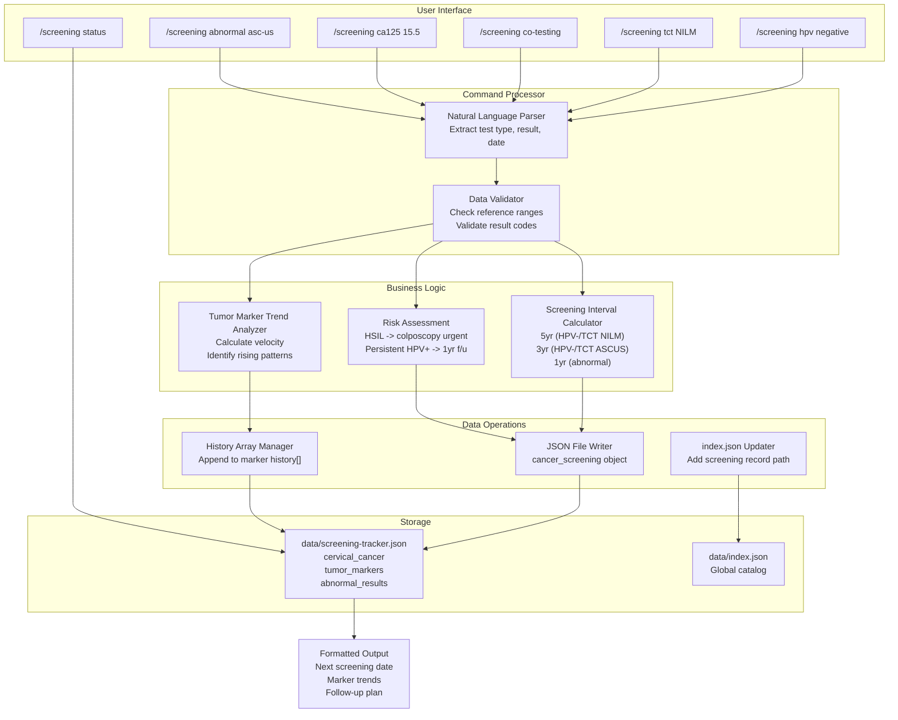
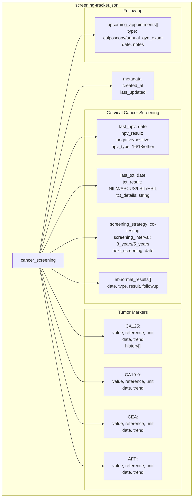
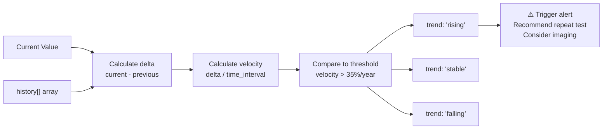
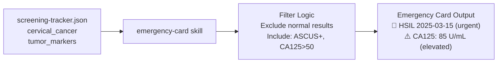
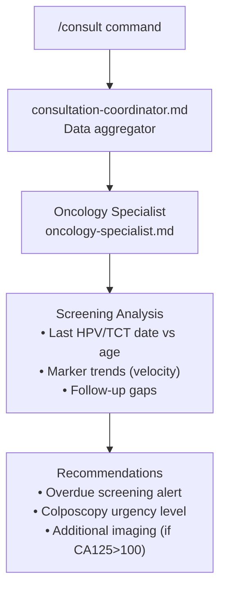
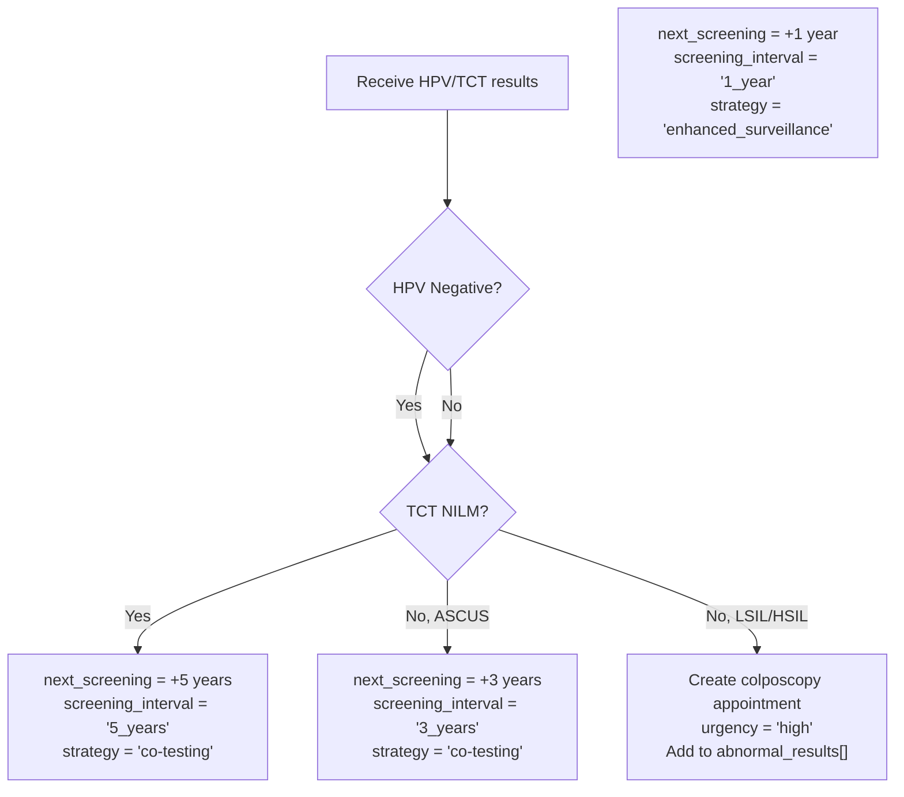
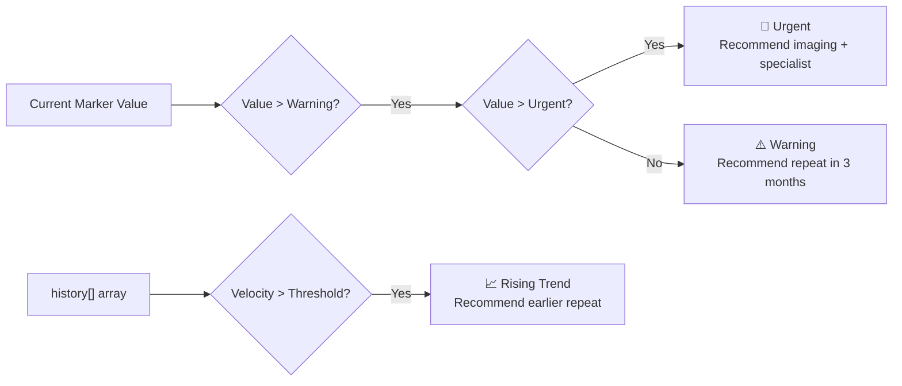

<!-- source: DeepWiki mcp.deepwiki.com · repo huifer/Claude-Ally-Health · extra page Gynecological Cancer Screening · fetched 2026-10-26 -->

# Gynecological Cancer Screening

<details>
<summary>Relevant source files</summary>

The following files were used as context for generating this wiki page:

- [.claude/settings.local.json](.claude/settings.local.json)
- [todo/01-womens-health.md](todo/01-womens-health.md)
- [todo/02-mens-health.md](todo/02-mens-health.md)

</details>


## Purpose and Scope

This document describes the Gynecological Cancer Screening module, which provides tracking and management capabilities for cervical, ovarian, and endometrial cancer screening programs. The module records HPV/TCT test results, tracks tumor marker levels (CA125, CA19-9, CEA, AFP), manages screening intervals based on co-testing strategies, and maintains abnormal result follow-up including colposcopy scheduling.

This module is part of the Women's Health tracking domain. For pregnancy management, see [Pregnancy Tracking](#4.1.1). For postpartum depression screening, see [Postpartum Care](#4.1.2). For menopause symptom tracking, see [Menopause Management](#4.1.3).

Sources: [todo/01-womens-health.md:534-636]()

## System Architecture

### Command Flow and Data Processing



Sources: [todo/01-womens-health.md:534-636]()

### Data Structure Organization



Sources: [todo/01-womens-health.md:564-613]()

## Core Components

### Cervical Cancer Screening Management

The cervical cancer screening component tracks HPV (Human Papillomavirus) and TCT (ThinPrep Cytology Test) results according to co-testing strategies. The system implements ASCCP guidelines for screening intervals.

#### HPV Testing

HPV detection identifies high-risk types (16, 18) and low-risk types. The system stores:
- `last_hpv`: Date of most recent HPV test
- `hpv_result`: "negative" or "positive"
- `hpv_type`: Specific HPV type detected (16, 18, or "other")

#### TCT Result Codes

The system recognizes standard Bethesda System classifications:
- **NILM**: Negative for Intraepithelial Lesion or Malignancy (normal)
- **ASC-US**: Atypical Squamous Cells of Undetermined Significance
- **LSIL**: Low-grade Squamous Intraepithelial Lesion
- **HSIL**: High-grade Squamous Intraepithelial Lesion
- **ASC-H**: Atypical Squamous Cells, cannot exclude HSIL
- **AGC**: Atypical Glandular Cells

#### Screening Interval Logic

The interval calculator determines next screening date based on test results:

| HPV Result | TCT Result | Screening Interval | Strategy |
|------------|------------|-------------------|----------|
| Negative   | NILM       | 5 years           | co-testing |
| Negative   | ASC-US     | 3 years           | co-testing |
| Positive   | NILM       | 1 year            | enhanced surveillance |
| Positive   | ASC-US+    | Immediate colposcopy | urgent follow-up |
| Any        | LSIL/HSIL  | Immediate colposcopy | urgent follow-up |

Sources: [todo/01-womens-health.md:541-577]()

### Tumor Marker Tracking

The tumor marker component maintains longitudinal tracking of serum markers with automatic trend analysis.

#### Supported Markers

Each marker includes value, reference range, unit, date, and historical trend:

**CA125** (Cancer Antigen 125):
- Reference: <35 U/mL
- Primary marker for ovarian cancer
- Also elevated in endometriosis, fibroids, pregnancy
- History array enables velocity calculation

**CA19-9** (Carbohydrate Antigen 19-9):
- Reference: <37 U/mL
- Marker for ovarian and endometrial cancer
- Can be elevated in benign conditions

**CEA** (Carcinoembryonic Antigen):
- Reference: <5 ng/mL
- Associated with endometrial cancer
- Cross-reference with gastrointestinal malignancies

**AFP** (Alpha-Fetoprotein):
- Reference: <10 ng/mL
- Marker for ovarian germ cell tumors (yolk sac tumor)
- Also elevated in hepatocellular carcinoma

#### Trend Analysis Algorithm



Sources: [todo/01-womens-health.md:554-599]()

### Abnormal Result Management

The abnormal results tracking component maintains a structured follow-up plan for non-normal findings.

#### Abnormal Result Data Structure

Each abnormal result record contains:
- `date`: Date of abnormal finding
- `type`: Test type (HPV, TCT, tumor marker)
- `result`: Specific abnormal value or classification
- `followup`: Recommended follow-up action
- `followup_date`: Scheduled date for follow-up
- `status`: "pending", "scheduled", "completed"

#### Colposcopy Scheduling

For ASCUS+, LSIL, or HSIL findings, the system:
1. Generates urgent follow-up recommendation
2. Creates colposcopy appointment entry in `upcoming_appointments[]`
3. Calculates recommended timing based on result severity:
   - HSIL: Within 4 weeks
   - LSIL: Within 3 months
   - ASC-US with HPV+: Within 6 months

Sources: [todo/01-womens-health.md:548-577]()

## Command Interface

### HPV/TCT Screening Commands

```bash
# Record individual test results
/screening hpv negative                     # HPV test negative
/screening hpv positive type 16             # HPV positive, type 16 detected
/screening tct NILM                         # TCT normal
/screening tct ASCUS                        # TCT atypical cells

# Record co-testing (HPV + TCT simultaneously)
/screening co-testing negative NILM         # Both tests normal → 5yr interval
/screening co-testing positive ASCUS        # Abnormal → colposcopy referral
```

### Tumor Marker Recording Commands

```bash
# Record marker values
/screening ca125 15.5                       # CA125 value in U/mL
/screening ca19-9 22.0                      # CA19-9 value in U/mL
/screening cea 3.2                          # CEA value in ng/mL
/screening afp 5.0                          # AFP value in ng/mL

# Batch recording (if lab report contains multiple)
/screening markers ca125 15.5 ca199 22.0 cea 3.2
```

### Follow-up Management Commands

```bash
# Record abnormal finding
/screening abnormal asc-us                  # ASCUS result
/screening abnormal hsil                    # High-grade lesion

# Schedule colposcopy
/screening colposcopy scheduled 2025-07-01  # Set appointment date
/screening colposcopy completed 2025-07-01  # Mark as done, record findings
```

### Query Commands

```bash
# View screening status
/screening status                           # Current screening status, next due date
/screening next                            # Next screening reminder with countdown
/screening trend                           # Tumor marker trend analysis with charts
/screening history                         # Complete screening history
```

Sources: [todo/01-womens-health.md:617-635]()

## Data File Structure

### Primary Storage: screening-tracker.json

The screening tracker maintains a single JSON file with nested objects:

```json
{
  "cancer_screening": {
    "cervical_cancer": {
      "last_hpv": "2025-01-15",
      "hpv_result": "negative",
      "hpv_type": null,
      "last_tct": "2025-01-15",
      "tct_result": "NILM",
      "tct_details": "阴性，上皮内病变或恶性病变",
      "next_screening": "2030-01-15",
      "screening_interval": "5_years",
      "screening_strategy": "co-testing",
      "abnormal_results": []
    },
    "tumor_markers": {
      "CA125": {
        "value": 15.5,
        "reference": "<35",
        "unit": "U/mL",
        "date": "2025-06-20",
        "trend": "stable",
        "history": [18.2, 16.5, 15.5]
      },
      "CA19-9": {
        "value": 22.0,
        "reference": "<37",
        "unit": "U/mL",
        "date": "2025-06-20",
        "trend": "stable"
      }
    },
    "upcoming_appointments": [
      {
        "type": "annual_gyn_exam",
        "date": "2026-01-15"
      }
    ],
    "metadata": {
      "created_at": "2025-01-01T00:00:00.000Z",
      "last_updated": "2025-06-20T00:00:00.000Z"
    }
  }
}
```

### File Location

```
data/
├── screening-tracker.json          # Primary screening data
└── index.json                      # Global catalog with pointer
```

The `index.json` maintains a reference to the screening tracker:

```json
{
  "screening_records": {
    "path": "data/screening-tracker.json",
    "last_update": "2025-06-20T00:00:00.000Z",
    "record_count": 1
  }
}
```

Sources: [todo/01-womens-health.md:564-613]()

## Integration with Other Modules

### Emergency Medical Information Card

The emergency card aggregates critical screening information for emergency situations. It includes:
- Most recent abnormal findings (HSIL, persistent HPV+)
- Elevated tumor markers (CA125 >100, indicating possible malignancy)
- Scheduled urgent procedures (upcoming colposcopy)

Integration flow:



For emergency card generation details, see [Emergency Medical Information Card](#5.3).

Sources: High-level architecture diagrams

### MDT Consultation System

The Oncology specialist in the MDT consultation system analyzes screening data for:
- Screening adherence (overdue screening alerts)
- Tumor marker trends (rapid elevation patterns)
- Follow-up compliance (missed colposcopy appointments)

The Oncology specialist receives screening data through the consultation coordinator and generates recommendations:



For MDT consultation architecture, see [Multi-Disciplinary Team Consultation](#7.1).

Sources: High-level architecture diagrams

## Clinical Decision Support

### Screening Interval Decision Tree

The system implements a decision algorithm based on ASCCP guidelines:



### Tumor Marker Alert Thresholds

The system generates alerts based on absolute values and trends:

| Marker | Warning Threshold | Urgent Threshold | Velocity Alert |
|--------|------------------|------------------|----------------|
| CA125  | 35-100 U/mL      | >100 U/mL        | >35%/year      |
| CA19-9 | 37-100 U/mL      | >100 U/mL        | >40%/year      |
| CEA    | 5-10 ng/mL       | >10 ng/mL        | >50%/year      |
| AFP    | 10-50 ng/mL      | >50 ng/mL        | >60%/year      |

Alert generation logic:



Sources: [todo/01-womens-health.md:554-577]()

## Medical Safety Principles

### System Boundaries

The gynecological cancer screening module adheres to strict medical safety red lines:

**The system DOES NOT**:
- Diagnose cancer or pre-cancerous conditions
- Recommend specific treatment plans
- Interpret imaging results (CT, MRI, ultrasound)
- Provide prognosis or survival estimates
- Suggest specific chemotherapy regimens

**The system DOES**:
- Track screening test results and dates
- Calculate next screening due dates based on guidelines
- Identify overdue screenings
- Record tumor marker trends
- Generate follow-up reminders
- Flag abnormal results requiring medical attention

### Warning Display

All abnormal results trigger explicit warnings with referral recommendations:

```
⚠️ ABNORMAL RESULT DETECTED

Test: TCT
Result: HSIL (High-grade Squamous Intraepithelial Lesion)
Date: 2025-06-20

RECOMMENDED ACTION:
• Colposcopy with biopsy within 4 weeks
• Contact gynecologist immediately
• Do not delay follow-up

⚠️ This system does not diagnose cancer.
   All abnormal results require professional evaluation.
```

Sources: [todo/01-womens-health.md:639-692]()

## Future Enhancements

Potential extensions to the screening module include:

1. **Imaging Integration**: Link to saved imaging reports (ultrasound, MRI) via the `/save-report` command, enabling correlation between markers and imaging findings

2. **Family History Risk Scoring**: Incorporate BRCA mutation status and family history to adjust screening intensity (annual vs. triennial)

3. **HPV Vaccination Tracking**: Record vaccination status (2-dose, 3-dose series) and adjust screening intervals for vaccinated individuals

4. **Biopsy Result Storage**: Maintain structured records of colposcopy and biopsy findings with pathology reports

5. **Screening Adherence Metrics**: Calculate screening compliance percentage and identify patients with gaps in care

Sources: Inferred from system architecture

## Related Documentation

- [Women's Health Overview](#4.1) - Parent module covering all women's health tracking
- [Pregnancy Tracking](#4.1.1) - Prenatal care and delivery tracking
- [Postpartum Care](#4.1.2) - EPDS screening and recovery monitoring
- [Saving Medical Reports](#5.1) - Upload and extract data from pathology reports
- [Emergency Medical Information Card](#5.3) - Aggregates screening data for emergencies
- [Multi-Disciplinary Team Consultation](#7.1) - Oncology specialist analysis of screening data

---

