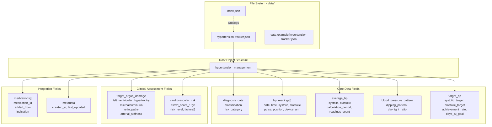
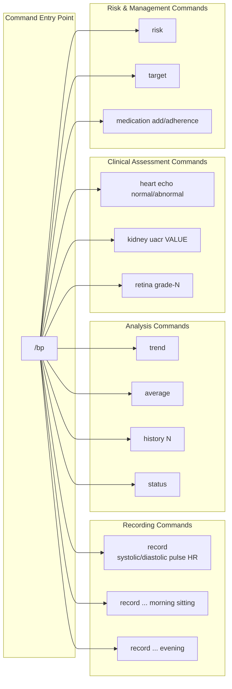
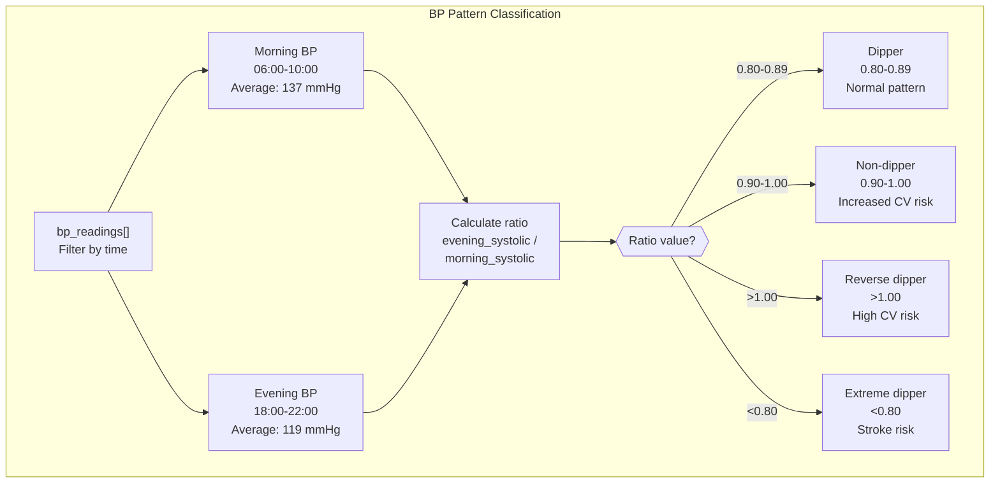
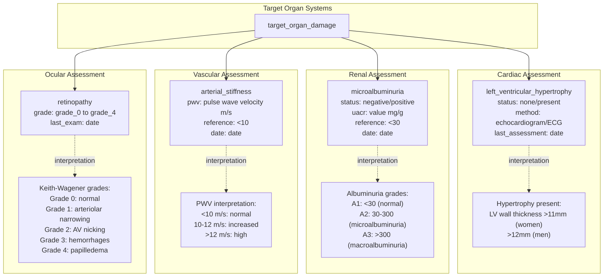
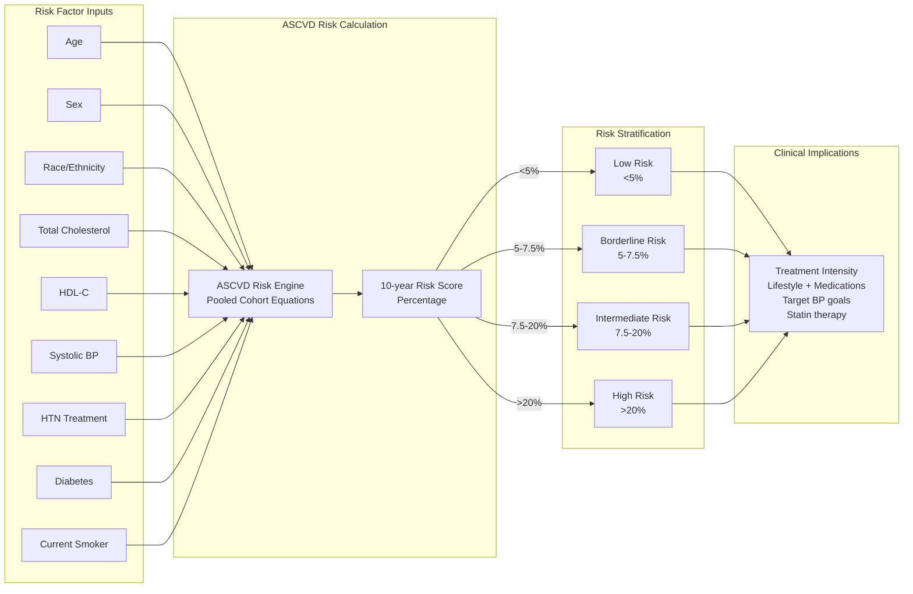
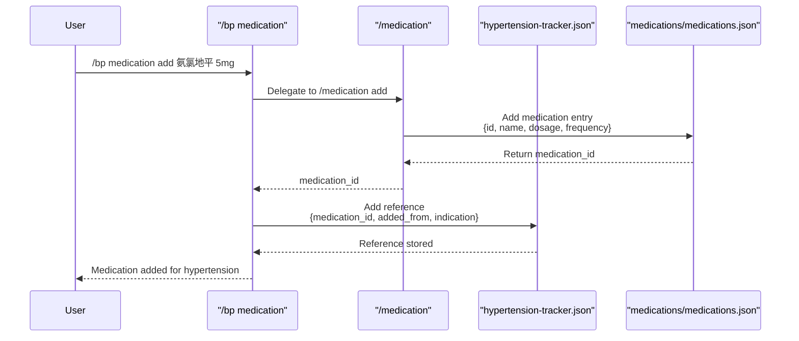
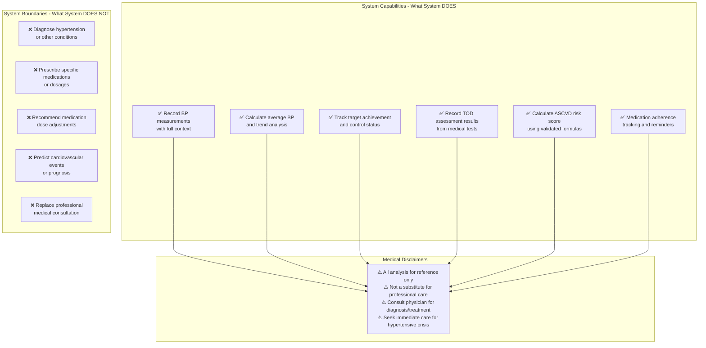

<!-- source: DeepWiki mcp.deepwiki.com · repo huifer/Claude-Ally-Health · extra page Hypertension Management · fetched 2026-10-26 -->

# Hypertension Management

<details>
<summary>Relevant source files</summary>

The following files were used as context for generating this wiki page:

- [.claude/skills/emergency-card/SKILL.md](.claude/skills/emergency-card/SKILL.md)
- [data-example/copd-tracker.json](data-example/copd-tracker.json)
- [data-example/diabetes-tracker.json](data-example/diabetes-tracker.json)
- [data-example/hypertension-tracker.json](data-example/hypertension-tracker.json)
- [scripts/test-chronic-diseases.sh](scripts/test-chronic-diseases.sh)
- [todo/06-chronic-diseases.md](todo/06-chronic-diseases.md)

</details>


## Purpose and Scope

The Hypertension Management module provides comprehensive blood pressure tracking, cardiovascular risk assessment, and target organ damage monitoring for patients with hypertension. This system records blood pressure readings with full context (time, position, device), analyzes trends including diurnal patterns (dipper/non-dipper classification), tracks target organ damage across four systems (heart, kidney, vessels, eyes), calculates ASCVD 10-year cardiovascular risk scores, and monitors blood pressure control achievement rates against individualized targets.

For diabetes management, see [Diabetes Management](#4.5.2). For COPD management, see [COPD Management](#4.5.3). For medication interaction checking, see [Drug Interaction Detection](#6.1). For emergency medical information aggregation, see [Emergency Medical Information Card](#5.3).

**Sources:** [todo/06-chronic-diseases.md:22-186](), [.claude/skills/emergency-card/SKILL.md:136-150]()

## Data Storage Architecture

The hypertension management system stores all data in `data/hypertension-tracker.json` with example data provided in `data-example/hypertension-tracker.json`. The system follows the privacy-first, local-only storage model with no cloud synchronization.



**Data Structure Schema**

| Field | Type | Description | Example |
|-------|------|-------------|---------|
| `diagnosis_date` | string (ISO date) | Hypertension diagnosis date | `"2023-01-01"` |
| `classification` | enum | BP grade: `grade_1`, `grade_2`, `grade_3` | `"grade_1"` |
| `risk_category` | enum | Risk level: `low`, `moderate`, `high`, `very_high` | `"moderate"` |
| `bp_readings[]` | array | Individual BP measurements | See BP Reading Structure below |
| `average_bp` | object | Calculated average BP | `{systolic: 132, diastolic: 82}` |
| `blood_pressure_pattern` | object | Diurnal pattern analysis | See Pattern Structure below |
| `target_bp` | object | BP goals and achievement | `{systolic_target: "<130"}` |
| `target_organ_damage` | object | TOD assessment results | See TOD Structure below |
| `cardiovascular_risk` | object | ASCVD risk calculation | `{ascvd_score_10yr: 0.12}` |
| `medications[]` | array | Medication references | `{medication_id: "med_001"}` |

**BP Reading Structure**

Each entry in `bp_readings[]` array follows this structure:

| Field | Type | Required | Description |
|-------|------|----------|-------------|
| `date` | string | Yes | Measurement date (YYYY-MM-DD) |
| `time` | string | Yes | Measurement time (HH:MM) |
| `systolic` | integer | Yes | Systolic BP in mmHg |
| `diastolic` | integer | Yes | Diastolic BP in mmHg |
| `pulse` | integer | No | Heart rate in bpm |
| `position` | enum | No | `sitting`, `lying`, `standing` |
| `measurement_device` | string | No | `home_monitor`, `clinic`, `ambulatory` |
| `arm` | enum | No | `left`, `right` |

**Sources:** [data-example/hypertension-tracker.json:1-113](), [todo/06-chronic-diseases.md:60-157]()

## Command Interface

The hypertension management system is accessed through the `/bp` command with multiple sub-commands. All commands are defined in `.claude/commands/hypertension.md`.



**Command Reference Table**

| Command | Syntax | Function |
|---------|--------|----------|
| **Recording** | | |
| `record` | `/bp record 135/85 pulse 78` | Record BP with heart rate |
| `record` | `/bp record 130/80 morning sitting` | Record morning BP with position |
| `record` | `/bp record 125/78 evening` | Record evening BP |
| **Analysis** | | |
| `trend` | `/bp trend` | Display BP trend visualization |
| `average` | `/bp average` | Calculate 7-day average BP |
| `history` | `/bp history 7` | Show last 7 days of readings |
| `status` | `/bp status` | Show control status and target achievement |
| **Target Organ Damage** | | |
| `heart` | `/bp heart echo normal` | Record echocardiogram result |
| `kidney` | `/bp kidney uacr 15` | Record urine albumin/creatinine ratio |
| `retina` | `/bp retina grade-0` | Record retinopathy grade |
| **Risk Assessment** | | |
| `risk` | `/bp risk` | Calculate ASCVD 10-year risk |
| `target` | `/bp target` | Show BP targets and achievement rate |
| **Medication** | | |
| `medication` | `/bp medication add 氨氯地平 5mg` | Add antihypertensive (delegates to `/medication`) |
| `adherence` | `/bp medication adherence` | Check medication compliance |

**Sources:** [todo/06-chronic-diseases.md:159-186]()

## Blood Pressure Recording and Monitoring

### Recording BP Readings

Each blood pressure measurement is stored with comprehensive context to enable accurate trend analysis and clinical interpretation. The system captures not only the BP values but also the measurement circumstances that affect interpretation.

```mermaid
graph LR
    subgraph "User Input"
        User["User: /bp record 135/85 pulse 78 morning sitting"]
    end
    
    subgraph "Command Parser"
        Parse["Parse BP values<br/>systolic=135, diastolic=85"]
        Context["Extract context<br/>pulse=78, time=morning<br/>position=sitting"]
        Device["Detect device<br/>measurement_device=home_monitor"]
    end
    
    subgraph "Data Validation"
        Range["Validate ranges<br/>systolic: 70-250<br/>diastolic: 40-150"]
        Consistency["Check consistency<br/>systolic > diastolic"]
    end
    
    subgraph "Data Storage"
        Generate["Generate entry<br/>{date, time, systolic,<br/>diastolic, pulse,<br/>position, device, arm}"]
        Append["Append to bp_readings[]"]
        Update["Update average_bp<br/>last_7_days"]
    end
    
    subgraph "Output"
        Confirm["Confirmation message<br/>BP recorded: 135/85<br/>Pulse: 78 bpm"]
        Alert["Alert if abnormal<br/>Stage 1 hypertension"]
    end
    
    User --> Parse
    Parse --> Context
    Context --> Device
    Device --> Range
    Range --> Consistency
    Consistency --> Generate
    Generate --> Append
    Append --> Update
    Update --> Confirm
    Confirm --> Alert
```



**Measurement Context Fields**

The system records critical context that affects BP interpretation:

- **Time of day**: Morning readings tend to be higher due to morning surge; evening readings reflect daytime activity effects
- **Body position**: Sitting is standard; standing may show orthostatic changes; lying typically shows lower values
- **Measurement device**: Home monitors may differ from clinic readings (white coat effect); ambulatory monitoring provides 24-hour data
- **Arm used**: Consistent arm use ensures comparable readings; inter-arm differences may indicate vascular disease

**Example BP Reading Entry**

From [data-example/hypertension-tracker.json:7-17]():

```json
{
  "date": "2025-06-20",
  "time": "08:00",
  "systolic": 135,
  "diastolic": 85,
  "pulse": 78,
  "position": "sitting",
  "measurement_device": "home_monitor",
  "arm": "left"
}
```

**Sources:** [data-example/hypertension-tracker.json:7-48](), [todo/06-chronic-diseases.md:30-35]()

## Blood Pressure Trend Analysis

### Average BP Calculation

The system maintains a rolling average BP calculation over the last 7 days, which is the clinically recommended period for assessing BP control. This calculation is stored in the `average_bp` object.

**Average BP Structure** ([data-example/hypertension-tracker.json:50-55]()):

```json
{
  "systolic": 134,
  "diastolic": 85,
  "calculation_period": "last_7_days",
  "readings_count": 14
}
```

The average requires a minimum of 4 readings per week (ideally 14 readings over 7 days, measured twice daily) for clinical validity.

### Diurnal Blood Pressure Patterns

The system analyzes morning vs. evening BP readings to classify diurnal patterns, which have prognostic significance for cardiovascular risk.



**Dipping Pattern Structure** ([data-example/hypertension-tracker.json:57-61]()):

```json
{
  "dipping_pattern": "dipper",
  "daynight_ratio": 0.87,
  "interpretation": "正常杓型血压"
}
```

**Clinical Significance:**
- **Dipper (0.80-0.89)**: Normal 10-20% nocturnal BP decrease, lowest CV risk
- **Non-dipper (0.90-1.00)**: <10% nocturnal decrease, associated with increased CV events, renal disease, sleep apnea
- **Reverse dipper (>1.00)**: Nocturnal BP increase, highest CV risk, associated with heart failure, autonomic dysfunction
- **Extreme dipper (<0.80)**: >20% nocturnal decrease, increased stroke risk, especially in elderly

**Sources:** [data-example/hypertension-tracker.json:57-61](), [todo/06-chronic-diseases.md:38-42]()

### Blood Pressure Target Achievement

The system tracks BP control against individualized targets, which vary based on patient age, comorbidities, and risk profile.

**Target BP Structure** ([data-example/hypertension-tracker.json:63-68]()):

```json
{
  "systolic_target": "<130",
  "diastolic_target": "<80",
  "achievement_rate": 0.65,
  "days_at_goal_last_month": 20
}
```

**Target BP Guidelines:**
- **General adults**: <130/80 mmHg (2018 Chinese Hypertension Guidelines, 2017 ACC/AHA Guidelines)
- **Elderly (≥65)**: <140/90 mmHg (if tolerated, can target <130/80)
- **High CV risk**: <130/80 mmHg
- **Diabetes or CKD**: <130/80 mmHg

The `achievement_rate` (0.65 = 65%) represents the proportion of readings meeting target in the last 30 days. Clinical goal is ≥80% of readings at target for good control.

**Sources:** [data-example/hypertension-tracker.json:63-68](), [todo/06-chronic-diseases.md:55-59]()

## Target Organ Damage Assessment

Hypertension causes progressive damage to four target organ systems: heart, kidneys, blood vessels, and eyes. The system tracks assessment results for each system to guide treatment intensity and monitor disease progression.



### Left Ventricular Hypertrophy (LVH)

LVH indicates long-standing hypertension and increased cardiovascular risk. Detection methods include:
- **Echocardiography** (gold standard): Measures LV wall thickness and mass
- **ECG** (screening): Sokolow-Lyon criteria, Cornell voltage criteria

**Example LVH Entry** ([data-example/hypertension-tracker.json:81-84]()):

```json
{
  "status": "none",
  "last_assessment": "2025-01-15",
  "method": "echocardiogram"
}
```

### Microalbuminuria

Urinary albumin excretion indicates early renal damage and predicts cardiovascular events. The urine albumin-to-creatinine ratio (UACR) is the preferred measurement.

**UACR Ranges:**
- **Normal (A1)**: <30 mg/g
- **Microalbuminuria (A2)**: 30-300 mg/g (early renal damage)
- **Macroalbuminuria (A3)**: >300 mg/g (advanced renal damage)

**Example Microalbuminuria Entry** ([data-example/hypertension-tracker.json:85-90]()):

```json
{
  "status": "negative",
  "uacr": 15,
  "reference": "<30",
  "date": "2025-06-10"
}
```

### Arterial Stiffness

Pulse wave velocity (PWV) measures arterial stiffness, an independent predictor of cardiovascular events. Measured by carotid-femoral PWV.

**PWV Interpretation:**
- **Normal**: <10 m/s
- **Increased**: 10-12 m/s
- **High**: >12 m/s

**Example Arterial Stiffness Entry** ([data-example/hypertension-tracker.json:95-99]()):

```json
{
  "pwv": 7.5,
  "reference": "<10",
  "date": "2025-02-15"
}
```

### Hypertensive Retinopathy

Fundoscopic examination reveals retinal vascular changes. Graded using Keith-Wagener-Barker classification.

**Retinopathy Grades:**
- **Grade 0**: Normal
- **Grade 1**: Arteriolar narrowing, increased light reflex
- **Grade 2**: Arteriovenous nicking, focal arteriolar narrowing
- **Grade 3**: Flame hemorrhages, cotton-wool spots, hard exudates
- **Grade 4**: Papilledema (malignant hypertension)

**Example Retinopathy Entry** ([data-example/hypertension-tracker.json:91-94]()):

```json
{
  "grade": "grade_0",
  "last_exam": "2025-03-20"
}
```

**Sources:** [data-example/hypertension-tracker.json:79-100](), [todo/06-chronic-diseases.md:43-49]()

## Cardiovascular Risk Assessment

The system calculates the ASCVD (Atherosclerotic Cardiovascular Disease) 10-year risk score, which predicts the probability of a major cardiovascular event (myocardial infarction, stroke, cardiovascular death) within 10 years.



**ASCVD Risk Structure** ([data-example/hypertension-tracker.json:102-106]()):

```json
{
  "ascvd_score_10yr": 0.12,
  "risk_level": "moderate",
  "factors": ["age", "hypertension", "dyslipidemia"]
}
```

**Risk Level Interpretation:**

| Risk Level | 10-Year Risk | Clinical Recommendations |
|------------|--------------|--------------------------|
| **Low** | <5% | Lifestyle modifications, BP target <130/80 if other risks |
| **Borderline** | 5-7.5% | Consider statin, BP target <130/80, reassess in 5 years |
| **Intermediate** | 7.5-20% | Statin recommended, BP target <130/80, annual follow-up |
| **High** | >20% | High-intensity statin, BP target <130/80, close monitoring |

The `factors[]` array lists contributing risk factors identified in the patient. Common factors include:
- `age` (>45 men, >55 women)
- `hypertension` (systolic ≥130 or on treatment)
- `dyslipidemia` (high LDL-C, low HDL-C)
- `diabetes`
- `smoking`
- `family_history` (premature CVD in first-degree relative)
- `chronic_kidney_disease`

**Sources:** [data-example/hypertension-tracker.json:102-106](), [todo/06-chronic-diseases.md:50-54]()

## Integration with Other Systems

### Emergency Medical Information Card

The emergency card system extracts hypertension diagnosis and current control status for emergency situations. The integration reads from `hypertension-tracker.json` to populate chronic condition information.

**Emergency Card Extraction Logic** ([.claude/skills/emergency-card/SKILL.md:136-150]()):

```javascript
// Extract hypertension data
const hypertensionData = readFile('data/hypertension-tracker.json');
if (hypertensionData.hypertension_management?.diagnosis_date) {
  chronicConditions.push({
    condition: '高血压',
    diagnosis_date: hypertensionData.hypertension_management.diagnosis_date,
    classification: hypertensionData.hypertension_management.classification,
    current_bp: hypertensionData.hypertension_management.average_bp,
    risk_level: hypertensionData.hypertension_management.cardiovascular_risk?.risk_level
  });
}
```

**Emergency Card Display Format:**

```
╠═══════════════════════════════════════════════════════════╣
║ 🏥 慢性疾病                                              ║
║ ─────────────────────────────────────────────────────── ║
║ • 高血压（2023-01-01诊断，1级，控制中）                 ║
║   平均血压：132/82 mmHg                                 ║
║   心血管风险：中度（ASCVD 10年风险 12%）                ║
╠═══════════════════════════════════════════════════════════╣
```

The emergency card includes:
- **Diagnosis date**: When hypertension was diagnosed
- **Classification**: BP grade (1, 2, or 3)
- **Control status**: Derived from `achievement_rate` (≥0.8 = "控制良好", <0.8 = "控制中")
- **Current average BP**: Last 7-day average from `average_bp`
- **CV risk level**: From `cardiovascular_risk.risk_level`

**Sources:** [.claude/skills/emergency-card/SKILL.md:136-150](), [.claude/skills/emergency-card/SKILL.md:276-288]()

### Medication Management Integration

Hypertension management integrates with the medication system through medication references stored in the `medications[]` array. Instead of duplicating medication data, the system stores references to medications managed by `/medication` command.

**Medication Reference Structure** ([data-example/hypertension-tracker.json:70-77]()):

```json
{
  "medication_id": "med_example_001",
  "added_from": "hypertension_management",
  "added_date": "2023-01-01",
  "indication": "高血压"
}
```

**Integration Flow:**



This design ensures:
- **Single source of truth**: Medication details (name, dosage, frequency) stored only in `medications.json`
- **Clear provenance**: `added_from` field indicates hypertension management initiated the medication
- **Clinical context**: `indication` field specifies the medication is for hypertension
- **Consistency**: Drug interaction checking automatically includes all medications regardless of which module added them

**Sources:** [data-example/hypertension-tracker.json:70-77](), [todo/06-chronic-diseases.md:731-732]()

### Specialist Consultation Integration

The cardiology specialist and general medicine specialist automatically access hypertension data when performing comprehensive assessments. The specialist reads `hypertension-tracker.json` to analyze:

- **BP control trends**: Whether average BP meets target
- **Treatment adequacy**: Medication adherence and effectiveness
- **Target organ damage**: Progression of cardiac, renal, vascular, or ocular damage
- **CV risk stratification**: ASCVD score and risk factors
- **Lifestyle factors**: Opportunities for non-pharmacological intervention

**Specialist Access Pattern** (as modified in `.claude/commands/specialist.md`):

```javascript
// Cardiology specialist reads hypertension data
const hypertensionData = readFile('data/hypertension-tracker.json');

// Analyze BP control
const avgBP = hypertensionData.hypertension_management?.average_bp;
const target = hypertensionData.hypertension_management?.target_bp;
const achievementRate = target?.achievement_rate;

// Include in specialist report
report.sections.push({
  title: "血压控制评估",
  content: `
    - 平均血压: ${avgBP.systolic}/${avgBP.diastolic} mmHg
    - 目标血压: ${target.systolic_target}/${target.diastolic_target} mmHg
    - 达标率: ${(achievementRate * 100).toFixed(0)}%
    - 控制状态: ${achievementRate >= 0.8 ? '控制良好' : '需改善'}
  `
});
```

For specialist consultation details, see [Multi-Disciplinary Team (MDT) Consultation](#7.1) and [Individual Specialist Consultations](#7.2).

**Sources:** [todo/06-chronic-diseases.md:732-733]()

## Medical Safety Principles

The hypertension management system adheres to strict medical safety principles defined in [Medical Safety Principles](#6.2). All analysis and recommendations are bounded by clear red lines.

### Safety Red Lines



### Specific Safety Constraints

**1. No Diagnostic Authority**

The system does not diagnose hypertension. It requires `diagnosis_date` to be entered by the user based on a physician's diagnosis. The `classification` field (grade_1, grade_2, grade_3) must be provided by the user from their medical records, not inferred by the system.

**2. No Prescription Generation**

The system does not recommend specific antihypertensive medications or dosages. When the user executes `/bp medication add`, the command delegates to `/medication` command, which requires the user to provide medication name and dosage from their prescription. The system only tracks medications, never prescribes them.

**3. No Dose Adjustment Recommendations**

The system does not suggest increasing or decreasing medication doses based on BP readings. If BP is not at target, the system displays:

```
⚠️ 血压未达标
平均血压: 142/88 mmHg
目标血压: <130/80 mmHg

💡 建议：
• 请咨询您的医生评估是否需要调整用药
• 继续记录血压并带记录就诊
• 加强生活方式干预（限盐、运动、减重）
```

Note: Medication adjustment suggestions are explicitly absent.

**4. No Prognostic Predictions**

The ASCVD risk score is presented as a statistical estimate from validated equations, not a prediction for the individual patient:

```
您的ASCVD 10年风险评分: 12%

⚠️ 重要提示：
• 此评分基于人群统计模型，不能预测个体结果
• 实际风险受更多因素影响（家族史、炎症标志物等）
• 请咨询医生进行综合评估和制定治疗方案
```

**5. Hypertensive Crisis Detection**

The system includes warnings for hypertensive urgency and emergency but always directs to immediate medical care:

```
🆘 血压危急值警告

您的血压: 185/110 mmHg

⚠️ 这可能是高血压急症，请立即：
1. 联系医疗急救服务（120/911）
2. 前往急诊科就诊
3. 如有胸痛、气短、意识改变、视力模糊，立即就医

❌ 不要尝试自行快速降压
```

The system never suggests self-management of hypertensive crisis.

**Sources:** [todo/06-chronic-diseases.md:606-625](), [todo/06-chronic-diseases.md:822-833]()

## Testing and Validation

The hypertension management system includes comprehensive testing through `scripts/test-chronic-diseases.sh`. The test script validates:

| Test Category | Tests | Description |
|---------------|-------|-------------|
| **Command File Tests** | 3 | Verify `.claude/commands/hypertension.md` exists and contains medical safety statements |
| **Data File Tests** | 2 | Verify `data/hypertension-tracker.json` exists and contains `hypertension_management` root object |
| **Example Data Tests** | 1 | Verify `data-example/hypertension-tracker.json` exists |
| **Medical Safety Tests** | 6 | Verify all command files contain required safety disclaimers ("不能替代", "仅供参考") |
| **Functionality Tests** | 4 | Verify command file contains `record`, `trend`, `medication`, `risk` functionality |
| **JSON Validation Tests** | 2 | Verify JSON files are valid and parseable |
| **Integration Tests** | 2 | Verify integration with `/medication` command and YAML header format |

**Test Execution** ([scripts/test-chronic-diseases.sh:1-264]()):

```bash
#!/bin/bash
./scripts/test-chronic-diseases.sh

# Sample output:
━━━━━━━━━━━━━━━━━━━━━━━━━━━━━━━━━━━━━━━━━━━━━━
🏥 慢性病管理功能测试
━━━━━━━━━━━━━━━━━━━━━━━━━━━━━━━━━━━━━━━━━━━━━━

📋 第1部分：命令文件测试
✅ 高血压管理命令文件
   文件: .claude/commands/hypertension.md
✅ 包含医学安全声明
✅ 包含免责声明

📊 测试结果汇总
总测试数: 48
通过: 46 ✅
失败: 2 ❌
通过率: 95%
```

The test framework ensures data structure integrity, command file completeness, and adherence to medical safety principles across all chronic disease management modules.

**Sources:** [scripts/test-chronic-diseases.sh:1-264](), [todo/06-chronic-diseases.md:803-818]()

---

