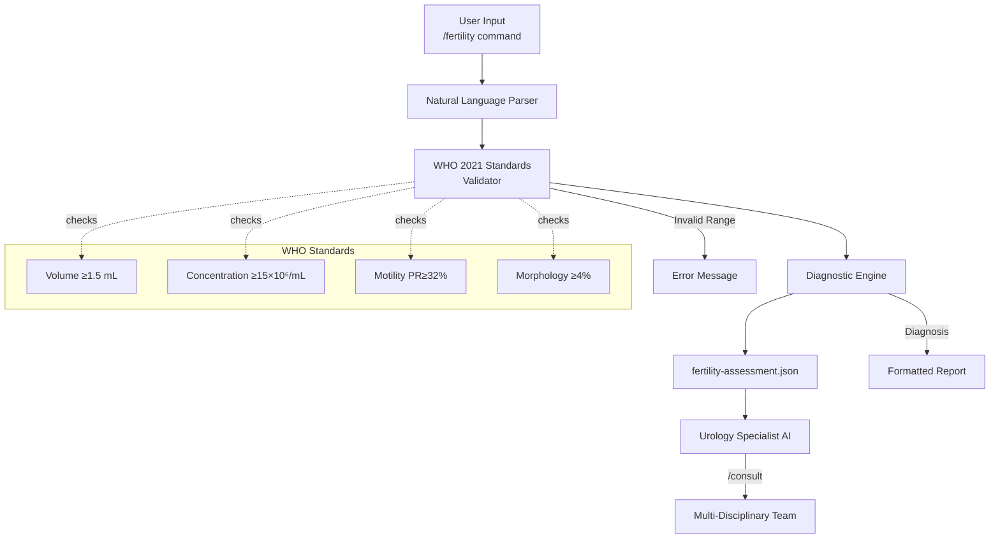
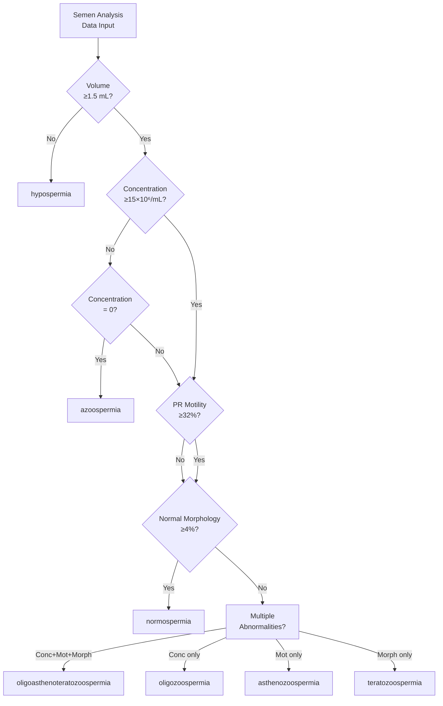
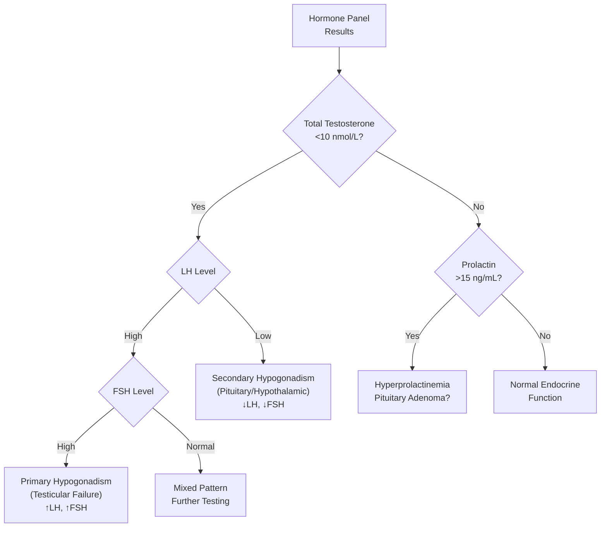
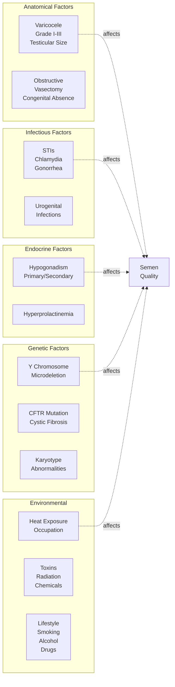
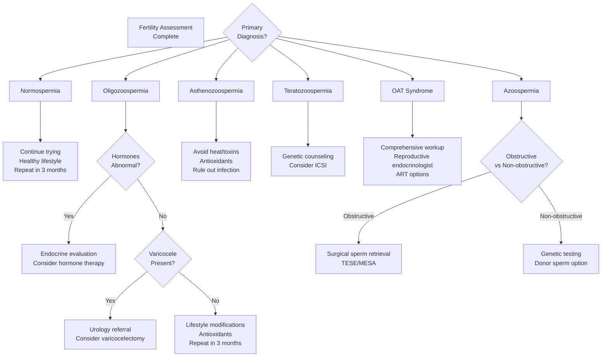

<!-- source: DeepWiki mcp.deepwiki.com · repo huifer/Claude-Ally-Health · extra page Male Fertility Assessment · fetched 2026-10-26 -->

# Male Fertility Assessment

<details>
<summary>Relevant source files</summary>

The following files were used as context for generating this wiki page:

- [.claude/commands/prostate-health.md](.claude/commands/prostate-health.md)
- [.claude/commands/puberty.md](.claude/commands/puberty.md)
- [.claude/settings.local.json](.claude/settings.local.json)
- [.claude/specialists/pediatrics.md](.claude/specialists/pediatrics.md)
- [.claude/specialists/urology.md](.claude/specialists/urology.md)
- [data-example/andropause-tracker.json](data-example/andropause-tracker.json)
- [data-example/child-vaccinations.json](data-example/child-vaccinations.json)
- [todo/01-womens-health.md](todo/01-womens-health.md)
- [todo/02-mens-health.md](todo/02-mens-health.md)

</details>


## Purpose and Scope

This document describes the Male Fertility Assessment module, which provides comprehensive tracking and analysis of male reproductive health. The system records semen analysis results, hormone levels, and clinical findings to support fertility evaluation according to WHO 2021 standards. It includes automated diagnostic interpretation, risk factor tracking, and integration with the AI specialist consultation system.

For prostate-specific health tracking (PSA monitoring, IPSS scoring), see [4.2.1](#4.2.1). For testosterone replacement therapy and male menopause management, see [4.2.3](#4.2.3).

---

## System Architecture

The Male Fertility Assessment module operates as a standalone tracking system with integration points to the urology specialist AI and the multi-disciplinary consultation system. It employs natural language parsing for user input, WHO standard-based validation, and automated diagnostic classification.

### High-Level System Flow



Sources: [todo/02-mens-health.md:180-424](), [.claude/specialists/urology.md:22-31]()

### Command Processing Pipeline

```mermaid
graph LR
    Input["/fertility semen<br/>volume 2.5<br/>concentration 45"]
    
    subgraph "Parsing Stage"
        Extract["Extract Parameters<br/>volume: 2.5<br/>concentration: 45"]
        Normalize["Normalize Units<br/>mL, 10⁶/mL"]
    end
    
    subgraph "Validation Stage"
        Range["Range Check<br/>0.1-10 mL<br/>0-200×10⁶/mL"]
        Logic["Logic Check<br/>total_count =<br/>volume × conc"]
    end
    
    subgraph "Analysis Stage"
        Classify["Classify Results<br/>normospermia<br/>oligozoospermia<br/>asthenozoospermia"]
        Risk["Risk Assessment"]
    end
    
    subgraph "Storage Stage"
        Update["Update JSON<br/>semen_analysis[]"]
        Index["Update statistics"]
    end
    
    Input --> Extract
    Extract --> Normalize
    Normalize --> Range
    Range --> Logic
    Logic --> Classify
    Classify --> Risk
    Risk --> Update
    Update --> Index
    Index --> Output["User Report"]
```



Sources: [todo/02-mens-health.md:401-424]()

---

## Semen Analysis Tracking

The system implements WHO Laboratory Manual for the Examination and Processing of Human Semen (6th edition, 2021) reference standards for comprehensive semen parameter tracking.

### WHO 2021 Reference Values

The diagnostic engine uses the following lower reference limits (5th percentile):

| Parameter | Reference Value | Unit | Classification |
|-----------|----------------|------|----------------|
| **Volume** | ≥1.5 | mL | <1.5: Hypospermia |
| **Concentration** | ≥15 | 10⁶/mL | <15: Oligozoospermia<br/>0: Azoospermia |
| **Total Count** | ≥39 | 10⁶ per ejaculate | <39: Oligozoospermia |
| **Progressive Motility (PR)** | ≥32 | % | <32: Asthenozoospermia |
| **Total Motility (PR+NP)** | ≥40 | % | <40: Asthenozoospermia |
| **Normal Morphology** | ≥4 | % | <4: Teratozoospermia |
| **pH** | 7.2-8.0 | - | <7.2 or >8.0: Abnormal |
| **Liquefaction Time** | ≤60 | minutes | >60: Delayed |

Sources: [todo/02-mens-health.md:188-233]()

### Semen Analysis Data Structure

```json
{
  "semen_analysis": {
    "date": "2025-06-20",
    "abstinence_period": "3_days",
    
    "volume": {
      "value": 2.5,
      "unit": "mL",
      "reference": "≥1.5",
      "result": "normal"
    },
    
    "concentration": {
      "value": 45,
      "unit": "10⁶/mL",
      "reference": "≥15",
      "result": "normal"
    },
    
    "total_count": {
      "value": 112.5,
      "unit": "10⁶",
      "reference": "≥39",
      "result": "normal"
    },
    
    "motility": {
      "pr": {
        "value": 35,
        "reference": "≥32",
        "result": "normal"
      },
      "np": {
        "value": 20,
        "reference": "≥40",
        "result": "normal"
      },
      "im": {
        "value": 45,
        "result": "normal"
      }
    },
    
    "morphology": {
      "value": 4,
      "unit": "%",
      "reference": "≥4",
      "result": "normal"
    },
    
    "ph": {
      "value": 7.5,
      "reference": "7.2-8.0",
      "result": "normal"
    },
    
    "liquefaction": {
      "value": 30,
      "unit": "minutes",
      "reference": "≤60",
      "result": "normal"
    },
    
    "diagnosis": "normospermia"
  }
}
```

Sources: [todo/02-mens-health.md:265-339]()

### Diagnostic Classification Engine



Sources: [todo/02-mens-health.md:336-339](), [.claude/specialists/urology.md:70-89]()

### Command Interface for Semen Analysis

The system provides natural language parsing for semen parameter input:

**Command Pattern:**
```
/fertility semen <parameter> <value> [unit]
/fertility semen complete
```

**Parameter Keywords:**

| Parameter | Keywords | Example Input |
|-----------|----------|---------------|
| Volume | `volume`, `vol`, `精液量` | `/fertility semen volume 2.5` |
| Concentration | `concentration`, `conc`, `density`, `精子密度` | `/fertility semen concentration 45` |
| Motility (PR) | `motility`, `pr`, `前向运动` | `/fertility semen motility pr 35` |
| Motility (NP) | `np`, `非前向运动` | `/fertility semen motility np 20` |
| Morphology | `morphology`, `形态` | `/fertility semen morphology 4` |
| pH | `ph`, `酸碱度` | `/fertility semen ph 7.5` |
| Liquefaction | `liquefaction`, `液化时间` | `/fertility semen liquefaction 30` |

**Complete Analysis Input:**
```bash
/fertility semen complete
# Interactive prompts for all parameters:
# Volume? 2.5 mL
# Concentration? 45 million/mL
# PR Motility? 35%
# NP Motility? 20%
# Morphology? 4%
# pH? 7.5
# Liquefaction time? 30 minutes
```

Sources: [todo/02-mens-health.md:401-424]()

---

## Hormone Level Monitoring

The system tracks male reproductive hormones to identify endocrine causes of infertility, including hypogonadism, pituitary dysfunction, and hyperprolactinemia.

### Hormone Reference Ranges

| Hormone | Reference Range | Unit | Clinical Significance |
|---------|----------------|------|----------------------|
| **Total Testosterone (T)** | 10-35 | nmol/L | <10: Hypogonadism |
| **Free Testosterone** | 0.22-0.65 | nmol/L | More accurate than total T |
| **LH** (Luteinizing Hormone) | 1.7-8.6 | IU/L | ↑: Primary hypogonadism<br/>↓: Secondary hypogonadism |
| **FSH** (Follicle-Stimulating Hormone) | 1.5-12.4 | IU/L | ↑: Spermatogenic failure<br/>↓: Pituitary dysfunction |
| **Prolactin (PRL)** | <15 | ng/mL | ↑: Hyperprolactinemia |
| **Estradiol (E2)** | <70 | pg/mL | ↑: T/E2 imbalance |

Sources: [todo/02-mens-health.md:218-238]()

### Hormone Pattern Interpretation



Sources: [.claude/specialists/urology.md:82-89]()

### Hormone Data Structure

```json
{
  "hormones": {
    "date": "2025-06-15",
    "testosterone": {
      "total": 15.5,
      "reference": "10-35",
      "unit": "nmol/L",
      "result": "normal",
      "free": 0.35,
      "free_reference": "0.22-0.65"
    },
    "lh": {
      "value": 5.2,
      "reference": "1.7-8.6",
      "unit": "IU/L",
      "result": "normal"
    },
    "fsh": {
      "value": 8.1,
      "reference": "1.5-12.4",
      "unit": "IU/L",
      "result": "normal"
    },
    "prl": {
      "value": 12.5,
      "reference": "<15",
      "unit": "ng/mL",
      "result": "normal"
    },
    "e2": {
      "value": 35,
      "reference": "<70",
      "unit": "pg/mL",
      "result": "normal"
    }
  }
}
```

Sources: [todo/02-mens-health.md:339-374]()

---

## Infertility Risk Factor Assessment

The system tracks multiple risk factors that contribute to male infertility, including anatomical, infectious, genetic, and environmental factors.

### Risk Factor Categories



Sources: [todo/02-mens-health.md:239-265]()

### Varicocele Tracking

**Varicocele Grading System:**

| Grade | Clinical Findings | Ultrasound Findings |
|-------|------------------|---------------------|
| **Grade I** | Palpable only with Valsalva maneuver | Vein diameter 2-3 mm |
| **Grade II** | Palpable without Valsalva | Vein diameter 3-4 mm |
| **Grade III** | Visible and palpable | Vein diameter >4 mm |

**Data Structure:**
```json
{
  "varicocele": {
    "present": true,
    "grade": "II",
    "side": "left",
    "vein_diameter_mm": 3.5,
    "testicular_volume": {
      "left": 15,
      "right": 18,
      "atrophy": "mild"
    },
    "surgery": {
      "performed": false,
      "date": null,
      "type": null
    }
  }
}
```

Sources: [todo/02-mens-health.md:374-380]()

### Infection Screening

```json
{
  "infections": {
    "date": "2025-06-10",
    "chlamydia": {
      "status": "negative",
      "test_type": "NAAT",
      "date": "2025-06-10"
    },
    "gonorrhea": {
      "status": "negative",
      "test_type": "NAAT",
      "date": "2025-06-10"
    },
    "ureaplasma": {
      "status": "not_tested"
    },
    "mycoplasma": {
      "status": "not_tested"
    }
  }
}
```

Sources: [todo/02-mens-health.md:380-386]()

### Genetic Testing Tracking

```json
{
  "genetic_testing": {
    "y_chromosome_microdeletion": {
      "tested": false,
      "result": null,
      "azoospermia_factor": null
    },
    "cftr_mutation": {
      "tested": false,
      "result": null,
      "mutations": []
    },
    "karyotype": {
      "tested": false,
      "result": null,
      "abnormalities": null
    }
  }
}
```

Sources: [todo/02-mens-health.md:386-392]()

---

## Diagnostic Recommendations Engine

The system generates tailored recommendations based on semen analysis results, hormone levels, and risk factors.

### Recommendation Logic



Sources: [todo/02-mens-health.md:392-397]()

### Recommendation Categories

| Diagnosis | Primary Recommendations | Timeframe |
|-----------|------------------------|-----------|
| **Normospermia** | Continue trying naturally<br/>Healthy lifestyle<br/>Partner evaluation | Repeat in 3-6 months |
| **Mild Oligozoospermia** | Lifestyle modifications<br/>Antioxidants (vitamin E, C, CoQ10)<br/>Avoid heat exposure | Repeat in 3 months |
| **Moderate Oligozoospermia** | Varicocele evaluation<br/>Hormone testing<br/>Consider IUI | 2-3 months |
| **Severe Oligozoospermia** | Genetic testing<br/>Comprehensive hormone panel<br/>Consider IVF/ICSI | 1-2 months |
| **Asthenozoospermia** | Rule out infection<br/>Antioxidants<br/>Avoid toxins | Repeat in 3 months |
| **Teratozoospermia** | Genetic counseling<br/>ICSI recommended | Immediate |
| **OAT Syndrome** | Reproductive endocrinologist<br/>Full infertility workup<br/>ART required | Immediate |
| **Azoospermia** | Urologist referral<br/>Genetic testing<br/>Testicular biopsy | Immediate |

Sources: [todo/02-mens-health.md:392-397](), [.claude/specialists/urology.md:82-89]()

---

## Command Interface

### Command Hierarchy

```
/fertility
  ├── semen
  │   ├── volume <value>
  │   ├── concentration <value>
  │   ├── motility pr <value> np <value>
  │   ├── morphology <value>
  │   ├── ph <value>
  │   ├── liquefaction <value>
  │   └── complete (interactive)
  │
  ├── hormone
  │   ├── testosterone <value>
  │   ├── lh <value>
  │   ├── fsh <value>
  │   ├── prl <value>
  │   └── e2 <value>
  │
  ├── varicocele <grade>|none
  ├── infection <test> <result>
  ├── genetic <test> <result>
  │
  ├── status
  ├── diagnosis
  └── recommendations
```

Sources: [todo/02-mens-health.md:401-424]()

### Natural Language Parsing Examples

**Semen Analysis:**
```
/fertility semen volume 2.5
/fertility semen 精液量2.5毫升 浓度45百万每毫升
/fertility semen concentration 45 motility pr 35 np 20
```

**Hormone Levels:**
```
/fertility hormone testosterone 15.5
/fertility hormone 睾酮15.5 LH 5.2 FSH 8.1
/fertility hormone prl 12.5 ng/mL
```

**Risk Factors:**
```
/fertility varicocele grade 2 left
/fertility infection chlamydia negative
/fertility genetic y-chromosome normal
```

Sources: [todo/02-mens-health.md:401-424]()

---

## Integration with AI Specialist System

### Urology Specialist Analysis

The fertility assessment data is automatically available to the Urology Specialist AI for comprehensive analysis.

**Urology Specialist Focus Areas:**
- Semen parameter interpretation
- Hormone pattern analysis
- Risk factor identification
- Treatment pathway recommendations
- Lifestyle modification guidance

**Analysis Framework:**
```markdown
## 泌尿科分析报告

### 生育健康评估

**精液分析**:
- 精液量: [X mL] - [正常/异常]
- 精子密度: [X × 10⁶/mL] - [正常/少精症/无精症]
- 前向运动(PR): [X%] - [正常/弱精症]
- 正常形态: [X%] - [正常/畸形精子症]
- 诊断: [normospermia/oligozoospermia/etc.]

**激素水平**:
- 睾酮: [X nmol/L] - [正常/偏低]
- LH: [X IU/L] - [正常/异常]
- FSH: [X IU/L] - [正常/异常]

**可能原因**:
- [列出可能的不育原因]

**建议**:
- [生活方式调整]
- [监测计划]
- [就医建议]
```

Sources: [.claude/specialists/urology.md:70-89]()

### Multi-Disciplinary Consultation

Fertility assessment can trigger consultations with multiple specialists:

**Consultation Triggers:**
```
/consult   # Triggers Urology + Endocrinology + General
```

**Specialist Contributions:**

| Specialist | Analysis Focus |
|------------|---------------|
| **Urology** | Semen analysis interpretation<br/>Anatomical causes<br/>Surgical options |
| **Endocrinology** | Hormone imbalances<br/>Hypogonadism treatment<br/>Metabolic factors |
| **General Medicine** | Overall health impact<br/>Lifestyle factors<br/>Comorbidities |

Sources: [.claude/specialists/urology.md:1-186]()

---

## Data Storage and Privacy

### File System Structure

```
data/
├── fertility-assessment.json          # Main tracker file
└── fertility-records/
    └── YYYY-MM/
        ├── YYYY-MM-DD_semen-analysis.json
        ├── YYYY-MM-DD_hormone-panel.json
        └── YYYY-MM-DD_ultrasound.json
```

### Main Tracker Schema

```json
{
  "created_at": "2025-01-01T00:00:00.000Z",
  "last_updated": "2025-06-20T10:00:00.000Z",
  
  "fertility_assessment": {
    "user_id": "user_001",
    "age": 35,
    "infertility_type": "primary",
    "partner_age": 32,
    "trying_to_conceive_months": 18,
    
    "semen_analysis": { },
    "hormones": { },
    "varicocele": { },
    "infections": { },
    "genetic_testing": { },
    "recommendations": []
  },
  
  "statistics": {
    "total_semen_analyses": 3,
    "last_analysis_date": "2025-06-20",
    "diagnosis": "normospermia",
    "tracking_duration_months": 6
  },
  
  "settings": {
    "reminder_frequency": "quarterly",
    "repeat_analysis_reminder": true
  }
}
```

Sources: [todo/02-mens-health.md:265-399]()

### Privacy Protection

All fertility data is stored **locally only**:
- No cloud synchronization
- No external database uploads
- Files excluded from version control via `.gitignore`
- OS-level encryption recommended (BitLocker/FileVault)

Sources: [todo/02-mens-health.md:265-399]()

---

## Medical Safety Principles

### Safety Red Lines

The system adheres to strict medical safety boundaries:

| ❌ System Will NOT | ✅ System Will Do |
|------------------|------------------|
| Diagnose specific causes of infertility | Track and classify semen parameters |
| Prescribe fertility medications | Suggest lifestyle modifications |
| Recommend specific IVF protocols | Provide WHO-standard interpretations |
| Guarantee fertility outcomes | Generate comprehensive reports for physicians |
| Replace medical consultation | Recommend appropriate specialist referrals |

### Example Safety-Compliant Output

**✅ Appropriate:**
```
精子密度偏低 (12×10⁶/mL, 参考值≥15×10⁶/mL)
建议:
- 改善生活方式 (避免高温环境、戒烟限酒)
- 补充抗氧化剂 (维生素E、C、辅酶Q10等)
- 3个月后复查精液分析
- 建议泌尿科或男科就诊评估
```

**❌ Prohibited:**
```
确诊为少精症 (诊断)
服用克罗米芬 50mg 每日 (处方药+剂量)
必须进行试管婴儿治疗 (治疗方案)
3个月后一定会改善 (预后判断)
```

Sources: [todo/02-mens-health.md:653-682](), [.claude/specialists/urology.md:32-39]()

### Clinical Disclaimer

All outputs include:
```
⚠️ 重要提示:
本系统仅供生育健康追踪,不能替代专业医疗建议。
所有不育评估和治疗决策需由生殖医学专家进行。
精液分析需2-3次确认,单次结果不能作为诊断依据。
```

Sources: [todo/02-mens-health.md:685-705]()

---

## References

### Medical Standards
- **WHO Laboratory Manual for the Examination and Processing of Human Semen** (6th edition, 2021) - Primary reference for semen analysis standards
- **EAU Guidelines on Male Sexual and Reproductive Health** - European Association of Urology clinical guidelines
- **Practice Committee of the American Society for Reproductive Medicine** - Male infertility guidelines

### Key File References
- [todo/02-mens-health.md:180-424]() - Complete module specification
- [.claude/specialists/urology.md:22-31]() - Urology specialist fertility analysis
- [data-example/andropause-tracker.json]() - Example data structure pattern

---

