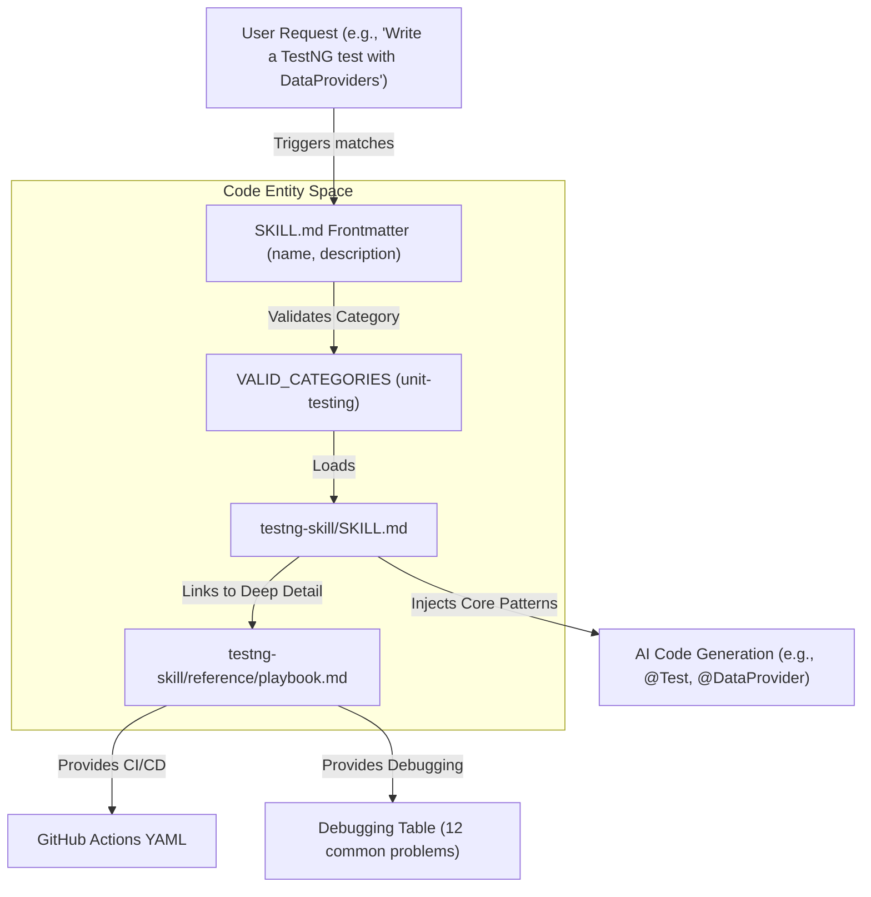
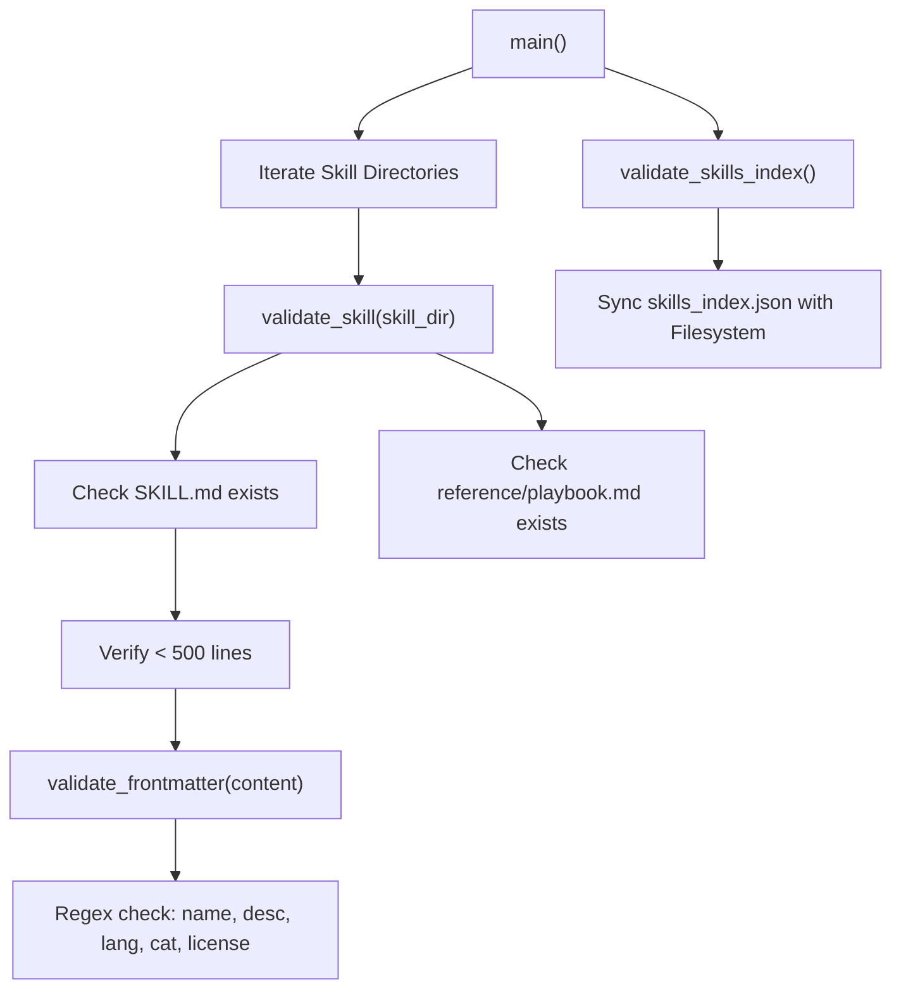

<!-- source: DeepWiki mcp.deepwiki.com · repo LambdaTest/agent-skills · page 1.2 Skill Architecture — SKILL.md Format and Structure · fetched 2026-10-26 -->

# Skill Architecture — SKILL.md Format and Structure

Relevant source files

The following files were used as context for generating this wiki page:

- [CONTRIBUTING.md](CONTRIBUTING.md)
- [scripts/rename_skills.py](scripts/rename_skills.py)
- [scripts/validate_skills.py](scripts/validate_skills.py)
- [skills_index.json](skills_index.json)
- [testng-skill/SKILL.md](testng-skill/SKILL.md)
- [testng-skill/reference/advanced-patterns.md](testng-skill/reference/advanced-patterns.md)

This page defines the **Agent Skills Standard**, the architectural blueprint used by the TestMu AI Agent to consume, process, and execute testing tasks across 46+ frameworks. The architecture relies on a structured metadata layer (Frontmatter) and a progressive-disclosure content model to balance high-level context with deep technical implementation details.

## The Progressive-Disclosure Model

To prevent context-window saturation in AI models, the repository implements a tiered documentation structure. This allows an AI agent to first understand the "what" and "when" of a skill before diving into the "how."

1.  **`SKILL.md` (Entry Point):** Contains core workflows, decision trees, and quick-reference patterns. It is strictly limited to 500 lines [scripts/validate_skills.py:11-11]().
2.  **`reference/playbook.md` (Implementation):** Detailed implementation guides, complete code examples, and debugging tables [CONTRIBUTING.md:46-46]().
3.  **`reference/advanced-patterns.md` (Edge Cases):** Optional file for complex configurations, multi-language nuances, and advanced optimizations [CONTRIBUTING.md:47-47]().

### Data Flow: Natural Language to Code Entity

The following diagram illustrates how a user's natural language request is mapped to specific code entities within the skill architecture.

**Diagram: Skill Resolution Flow**

Sources: [scripts/validate_skills.py:13-17](), [testng-skill/SKILL.md:1-15](), [CONTRIBUTING.md:43-49]()

---

## SKILL.md Frontmatter Structure

Every skill must begin with a YAML frontmatter block. This metadata is parsed by `scripts/validate_skills.py` to ensure the skill is discoverable and correctly categorized [scripts/validate_skills.py:24-62]().

### Required Fields

| Field | Description | Requirement |
| :--- | :--- | :--- |
| `name` | Unique identifier (e.g., `playwright-skill`) | Must match directory name [scripts/rename_skills.py:92-92]() |
| `description` | High-level summary and trigger keywords in quotes | Required for AI routing [scripts/validate_skills.py:41-42]() |
| `languages` | List of supported programming languages | e.g., Java, Python, JavaScript [skills_index.json:21-27]() |
| `category` | One of the 11 pre-defined functional categories | Must match `VALID_CATEGORIES` [scripts/validate_skills.py:13-17]() |
| `metadata` | Includes `author: TestMu AI` and `version` | Used for lifecycle tracking [scripts/validate_skills.py:54-61]() |

### Category Validation
The `scripts/validate_skills.py` script enforces strict categorization to maintain registry integrity. Valid categories include: `accessibility`, `api-testing`, `bdd-testing`, `cloud-testing`, `devops`, `e2e-testing`, `mobile-testing`, `performance-testing`, `security-testing`, `unit-testing`, and `visual-testing` [scripts/validate_skills.py:13-17]().

---

## Technical Implementation of Validation

The repository maintains quality through automated scripts that verify both the structure of individual skills and the global `skills_index.json`.

**Diagram: Validation Logic (validate_skills.py)**

Sources: [scripts/validate_skills.py:65-118](), [scripts/validate_skills.py:119-155]()

### Key Validation Rules
*   **Line Limit:** `SKILL.md` files exceeding 500 lines trigger an error to ensure the AI context remains concise [scripts/validate_skills.py:11-11](), [scripts/validate_skills.py:82-83]().
*   **Reference Linking:** `SKILL.md` must explicitly link to its `playbook.md` or `reference/` directory [scripts/validate_skills.py:97-99]().
*   **Cloud Integration:** E2E skills are recommended to include a `reference/cloud-integration.md` or link to `shared/testmu-cloud-reference.md` [scripts/validate_skills.py:101-108]().
*   **Debugging Content:** Playbooks are scanned for "debugging" sections to ensure troubleshooting support is present [scripts/validate_skills.py:110-116]().

---

## Contributing a New Skill

To contribute a skill to the Agent Skills Standard, follow the structured workflow defined in the contribution guidelines [CONTRIBUTING.md:5-14]().

### 1. Directory Setup
Create a directory named `[framework]-skill/` containing a `SKILL.md` and a `reference/` subdirectory [CONTRIBUTING.md:7-14]().

### 2. Implementation Standards
*   **Code Correctness:** All snippets must be syntactically correct and runnable [CONTRIBUTING.md:52-52]().
*   **Cloud Support:** Include both local and TestMu AI cloud execution paths [CONTRIBUTING.md:53-53]().
*   **Anti-Patterns:** Every skill should include a "Bad vs. Good" table to guide the AI away from common pitfalls (e.g., avoiding `Thread.sleep()` or hardcoded data) [testng-skill/SKILL.md:123-131](), [testng-skill/reference/advanced-patterns.md:111-117]().
*   **CI/CD:** Provide GitHub Actions configurations as the primary CI/CD pattern [CONTRIBUTING.md:55-55]().

### 3. Verification
Before submission, the `scripts/validate_skills.py` script must be executed to ensure compliance with the frontmatter and structure rules [CONTRIBUTING.md:36-39](). If a skill is renamed, the `scripts/rename_skills.py` utility is used to update the `skills_index.json`, directory names, and internal frontmatter `name` fields simultaneously [scripts/rename_skills.py:63-110]().

Sources: [CONTRIBUTING.md:5-61](), [scripts/validate_skills.py:1-172](), [scripts/rename_skills.py:1-115]()

---

