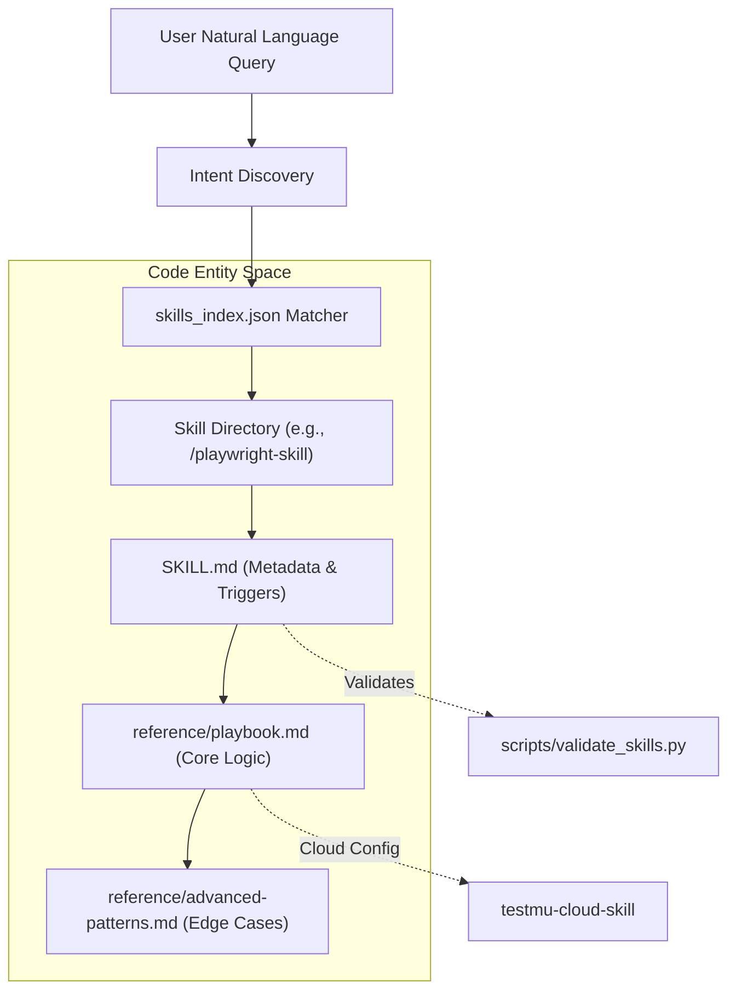
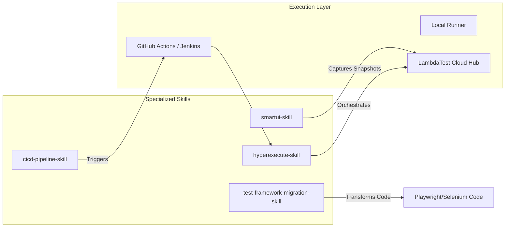

<!-- source: DeepWiki mcp.deepwiki.com · repo LambdaTest/agent-skills · page 1.3 Skill Registry — All 46 Skills by Category · fetched 2026-10-26 -->

# Skill Registry — All 46 Skills by Category

<details>
<summary>Relevant source files</summary>

The following files were used as context for generating this wiki page:

- [README.md](README.md)
- [skills_index.json](skills_index.json)
- [testng-skill/SKILL.md](testng-skill/SKILL.md)
- [testng-skill/reference/advanced-patterns.md](testng-skill/reference/advanced-patterns.md)

</details>


This page serves as the comprehensive technical index for the TestMu AI Agent Skills repository. It organizes all 46 production-grade skills into eight functional categories, providing a high-level mapping of supported languages, framework descriptions, and their respective entry points within the codebase.

## Overview of the Skill Registry

The repository is structured as a collection of self-contained skill modules, each following the **Agent Skills Standard** [README.md:8-15](). Every skill includes a `SKILL.md` file containing frontmatter metadata (name, category, triggers) and a `reference/` directory for deep-dive technical patterns [skills_index.json:17-39]().

### Data Flow: Natural Language to Code Entity

The following diagram illustrates how an AI Agent (such as Claude Code or Cursor) processes a user request to identify and load the correct skill entities from the registry.

**Agent Skill Resolution Flow**

**Sources:** [README.md:13-24](), [skills_index.json:1-15](), [testng-skill/SKILL.md:1-15]()

---

## 1. E2E Browser Testing Skills (15 Skills)
These skills focus on end-to-end web automation, supporting cross-browser execution and cloud integration via the LambdaTest/TestMu AI platform.

| Skill Name | Languages | Description |
|:---|:---|:---|
| **Selenium** | Java, Python, JS, C#, Ruby | Standard WebDriver automation with `RemoteWebDriver` and `LT:Options` support. |
| **Playwright** | JS, TS, Python, Java, C# | Modern browser automation with auto-waiting, tracing, and API mocking. |
| **Cypress** | JS, TS | Developer-centric E2E and component testing with `cy` command chaining. |
| **WebdriverIO** | JS, TS | Next-gen browser and mobile automation for Node.js. |
| **Puppeteer** | JS, TS | High-level API to control Chrome/Chromium over DevTools Protocol. |
| **TestCafe** | JS, TS | Driverless E2E testing with easy setup and cross-browser support. |
| **Nightwatch.js** | JS, TS | Integrated end-to-end testing solution powered by Node.js and WebDriver. |
| **Capybara** | Ruby | Acceptance testing DSL for Ruby web applications. |
| **Geb** | Groovy | Very high-level Groovy browser automation (Selenium + jQuery + Page Objects). |
| **Selenide** | Java | Concise API for Selenium WebDriver in Java with smart waits. |
| **NemoJS** | JS | PayPal's wrapper for Selenium-webdriver for Node.js. |
| **Protractor** | JS, TS | E2E test framework for Angular (includes migration paths to Playwright). |
| **Codeception** | PHP | Full-stack testing framework for PHP with BDD-style Actor pattern. |
| **Laravel Dusk** | PHP | Browser automation and testing API for Laravel. |
| **Robot Framework** | Python, Robot | Keyword-driven automation for acceptance testing. |

**Sources:** [README.md:89](), [skills_index.json:74-89](), [skills_index.json:108-115](), [skills_index.json:142-160]()

---

## 2. Unit Testing Skills (15 Skills)
Skills designed for isolated component testing, focusing on lifecycle hooks, mocking, and assertion libraries.

| Skill Name | Languages | Key Features / Entities |
|:---|:---|:---|
| **JUnit 5** | Java | `@Test`, `@ParameterizedTest`, Extensions API. |
| **TestNG** | Java | `@DataProvider`, `testng.xml` suites, parallel groups. |
| **pytest** | Python | Fixtures, `conftest.py`, `parametrize` decorator. |
| **unittest** | Python | `TestCase` classes, `mock.patch`, `MagicMock`. |
| **Jest** | JS, TS | Snapshot testing, `jest.config.js`, integrated mocking. |
| **Vitest** | JS, TS | Vite-native unit test framework with ESM support. |
| **Mocha** | JS, TS | Flexible test runner, usually paired with Chai/Sinon. |
| **Jasmine** | JS, TS | BDD-style framework with built-in spies and assertions. |
| **Karma** | JS, TS | Browser-based test runner for JavaScript. |
| **xUnit** | C# | `[Fact]`, `[Theory]`, constructor-based DI. |
| **NUnit** | C# | `[Test]`, `[TestCase]`, `[SetUp]`/`[TearDown]`. |
| **MSTest** | C# | `[TestMethod]`, `[DataRow]`, `TestContext`. |
| **RSpec** | Ruby | `describe`/`it` blocks, `let` helpers, shared examples. |
| **PHPUnit** | PHP | `TestCase`, Data Providers, Mockery integration. |
| **Test::Unit** | Ruby | Classic unit testing framework for Ruby. |

**Sources:** [README.md:90](), [testng-skill/SKILL.md:19-122](), [testng-skill/reference/advanced-patterns.md:3-61]()

---

## 3. Mobile Testing Skills (5 Skills)
Specialized skills for native, hybrid, and cross-platform mobile app automation.

| Skill Name | Platforms | Languages | Description |
|:---|:---|:---|:---|
| **Appium** | iOS, Android | Java, Python, JS, Ruby, C# | W3C Actions API, `UiAutomator2`, and `XCUITest` drivers. |
| **Espresso** | Android | Java, Kotlin | Native Android testing with `onView` and `ViewActions`. |
| **XCUITest** | iOS | Swift, Obj-C | Native iOS testing using `XCUIApplication` and `XCUIElement`. |
| **Flutter Testing** | Cross-platform | Dart | Widget and integration testing for Flutter apps. |
| **Detox** | React Native | JS, TS | Gray-box E2E testing for React Native. |

**Sources:** [README.md:91](), [skills_index.json:17-40](), [skills_index.json:162-164]()

---

## 4. BDD Testing Skills (7 Skills)
Frameworks that bridge the gap between business requirements (Gherkin/Markdown) and technical implementation.

| Skill Name | Languages | Core Components |
|:---|:---|:---|
| **Cucumber** | Java, JS, Ruby, TS | Feature files, Step Definitions, `ScenarioContext`. |
| **SpecFlow** | C# | Gherkin for .NET, `Binding` attributes, BoDi DI. |
| **Behave** | Python | `environment.py` hooks, `context` object. |
| **Behat** | PHP | `MinkContext` for browser BDD in PHP. |
| **Gauge** | Markdown | Markdown-based specs, `DataStore` scopes. |
| **Lettuce** | Python | Pythonic BDD inspired by Cucumber. |
| **Serenity BDD** | Java | Screenplay pattern and living documentation. |

**Sources:** [README.md:92](), [skills_index.json:42-72](), [skills_index.json:123-140]()

---

## 5. Specialized Skills (4 Skills)
Cross-cutting skills that enhance the core testing frameworks through orchestration, visual validation, migration, and deployment.

### Mapping Specialized Skills to Infrastructure
The diagram below shows how specialized skills interact with both the test code and the cloud infrastructure.

**Infrastructure and Specialized Skill Mapping**


| Category | Skill Name | Description |
|:---|:---|:---|
| **Visual** | **SmartUI** | Visual regression testing using `smartuiSnapshot` API and baseline comparison. |
| **Cloud** | **HyperExecute** | High-speed parallel orchestration using `autosplit` and `matrix` modes. |
| **Migration** | **Migration Skill** | Logic for converting between Selenium, Playwright, Puppeteer, and Cypress. |
| **DevOps** | **CI/CD Pipeline** | YAML generation for GitHub Actions, GitLab, and Jenkins pipelines. |

**Sources:** [README.md:93-96](), [skills_index.json:91-103](), [skills_index.json:118]()

---

## Technical Data Structures

### Skill Index Schema
The registry is governed by `skills_index.json`, which acts as the single source of truth for the AI Agent to discover available capabilities.

```json
{
  "name": "appium-skill",
  "path": "appium-skill",
  "description": "...",
  "languages": ["Java", "Python", "JavaScript", "Ruby", "C#"],
  "category": "mobile-testing",
  "files": {
    "skill_md": "appium-skill/SKILL.md",
    "reference": ["..."]
  }
}
```
**Sources:** [skills_index.json:17-39]()

### Validation Logic
All skills listed in this registry must pass the `validate_skills.py` script, which enforces:
1.  **Frontmatter Presence**: Every `SKILL.md` must have valid YAML headers [testng-skill/SKILL.md:1-15]().
2.  **Path Integrity**: Reference files listed in `skills_index.json` must exist on disk [skills_index.json:29-39]().
3.  **Category Alignment**: Skills must belong to one of the 8 approved categories [skills_index.json:7-15]().

**Sources:** [README.md:71-82](), [skills_index.json:1-16]()

---

