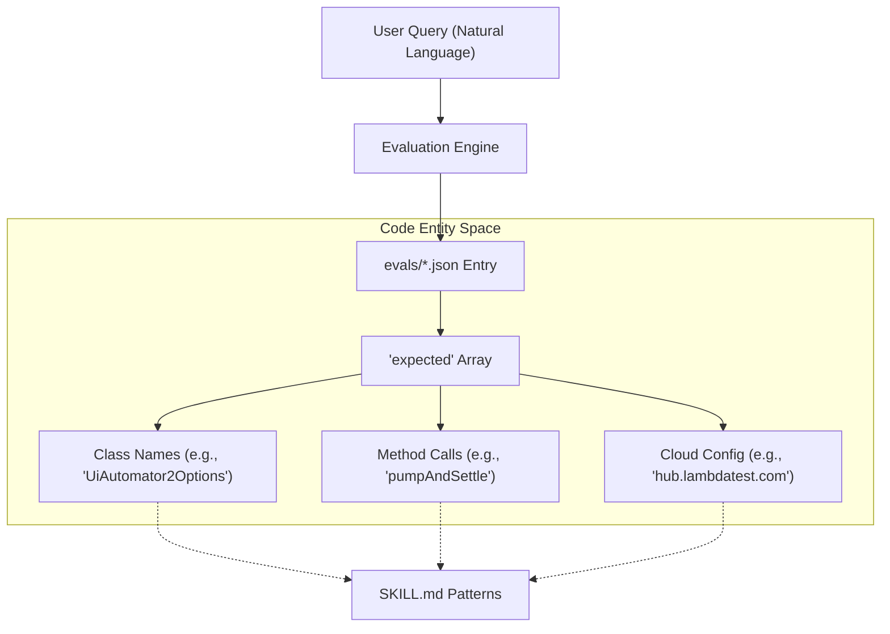
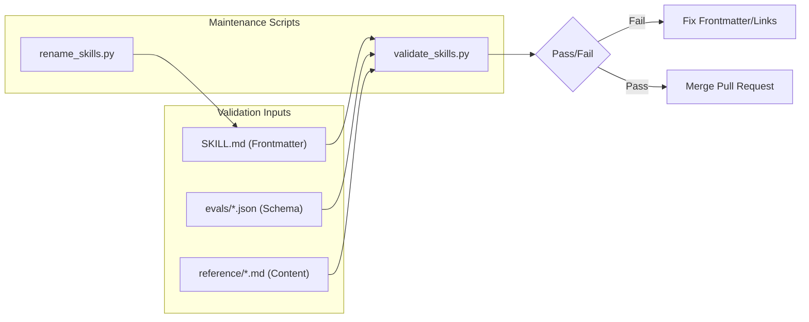

<!-- source: DeepWiki mcp.deepwiki.com · repo LambdaTest/agent-skills · page 10 Evaluation Framework — Skill Quality Assurance · fetched 2026-10-26 -->

# Evaluation Framework — Skill Quality Assurance

Relevant source files

The following files were used as context for generating this wiki page:

- [evals/appium-skill-evals.json](evals/appium-skill-evals.json)
- [evals/cypress-skill-evals.json](evals/cypress-skill-evals.json)
- [evals/detox-skill-evals.json](evals/detox-skill-evals.json)
- [evals/espresso-skill-evals.json](evals/espresso-skill-evals.json)
- [evals/flutter-testing-skill-evals.json](evals/flutter-testing-skill-evals.json)
- [evals/selenium-skill-evals.json](evals/selenium-skill-evals.json)
- [evals/webdriverio-skill-evals.json](evals/webdriverio-skill-evals.json)
- [evals/xcuitest-skill-evals.json](evals/xcuitest-skill-evals.json)
- [flutter-testing-skill/SKILL.md](flutter-testing-skill/SKILL.md)
- [flutter-testing-skill/reference/advanced-patterns.md](flutter-testing-skill/reference/advanced-patterns.md)

The Evaluation Framework provides a systematic method for validating the quality, accuracy, and behavior of AI agent outputs when using the TestMu AI Agent Skills. By utilizing a structured JSON format, the framework ensures that every skill—ranging from Selenium to Flutter—adheres to the Agent Skills Standard and produces technically sound test code.

## Framework Overview

The core of the evaluation system resides in the `evals/` directory, which contains 45+ JSON files, one for each skill in the repository. These evaluations act as "test cases for the AI," defining specific user queries and the expected code entities or patterns that the AI should generate in response.

### Core Objectives
*   **Validation:** Ensure AI agents use the correct libraries and classes (e.g., `RemoteWebDriver` for cloud vs `WebDriver` for local).
*   **Regression Testing:** Prevent updates to `SKILL.md` files from breaking existing generation patterns.
*   **Negative Triggering:** Verify that skills do not activate for irrelevant queries (e.g., a Cypress skill should not respond to a Selenium query).
*   **Cloud Routing:** Confirm that cloud-specific capabilities like `LT:Options` are suggested when users mention LambdaTest.

### Evaluation Mapping: Natural Language to Code Entity
The following diagram illustrates how the evaluation framework bridges the gap between a user's natural language intent and the required technical implementation defined in the skill files.

**Evaluation Flow: Intent to Code Validation**

Sources: [evals/appium-skill-evals.json:1-13](), [evals/flutter-testing-skill-evals.json:1-15]()

---

## The Evaluation Format

Each evaluation file follows a strict schema that identifies the skill and lists multiple test scenarios. These scenarios are categorized to cover different aspects of the skill's lifecycle, from basic generation to advanced anti-pattern correction.

### Key Schema Fields
| Field | Description | Example |
| :--- | :--- | :--- |
| `skill` | The unique identifier of the skill being tested. | `selenium-automation-skill` |
| `id` | A unique identifier for the specific evaluation case. | `sel-01` |
| `category` | The type of test (e.g., `cloud-routing`, `pom-structure`). | `cloud-routing` |
| `query` | The natural language prompt sent to the AI agent. | "Run my Selenium tests on LambdaTest" |
| `expected` | An array of strings/tokens that MUST appear in the output. | `["RemoteWebDriver", "LT:Options"]` |

For a deep dive into the available categories and specific examples from Playwright and Appium, see **[Eval File Format and Categories](#10.1)**.

Sources: [evals/selenium-skill-evals.json:1-25](), [evals/appium-skill-evals.json:1-35]()

---

## Validation and Maintenance

The repository includes specialized Python scripts to maintain the integrity of the skills and their corresponding evaluations. These scripts are used during CI/CD and before merging any Pull Requests to ensure that new contributions do not degrade the quality of the registry.

### Repository Quality Workflow
The diagram below shows how the validation scripts interact with the skill files and evaluation definitions.

**Skill Validation Logic**

Sources: [flutter-testing-skill/SKILL.md:1-16](), [evals/cypress-skill-evals.json:1-53]()

### Key Maintenance Utilities
*   **`validate_skills.py`**: Enforces the Agent Skills Standard, including frontmatter fields, line count limits, and the existence of required reference files.
*   **`rename_skills.py`**: A utility for bulk-updating skill identifiers across the registry and evaluation files to maintain consistency.

For details on running these scripts and the specific rules they enforce, see **[Validation Scripts — validate_skills.py and rename_skills.py](#10.2)**.

---

## Child Pages
*   **[Eval File Format and Categories](#10.1)**: Documents the JSON schema, category definitions (basic-generation, cloud-routing, etc.), and negative trigger patterns.
*   **[Validation Scripts — validate_skills.py and rename_skills.py](#10.2)**: Technical guide for using the maintenance scripts to validate frontmatter, line counts, and cross-references.

---

