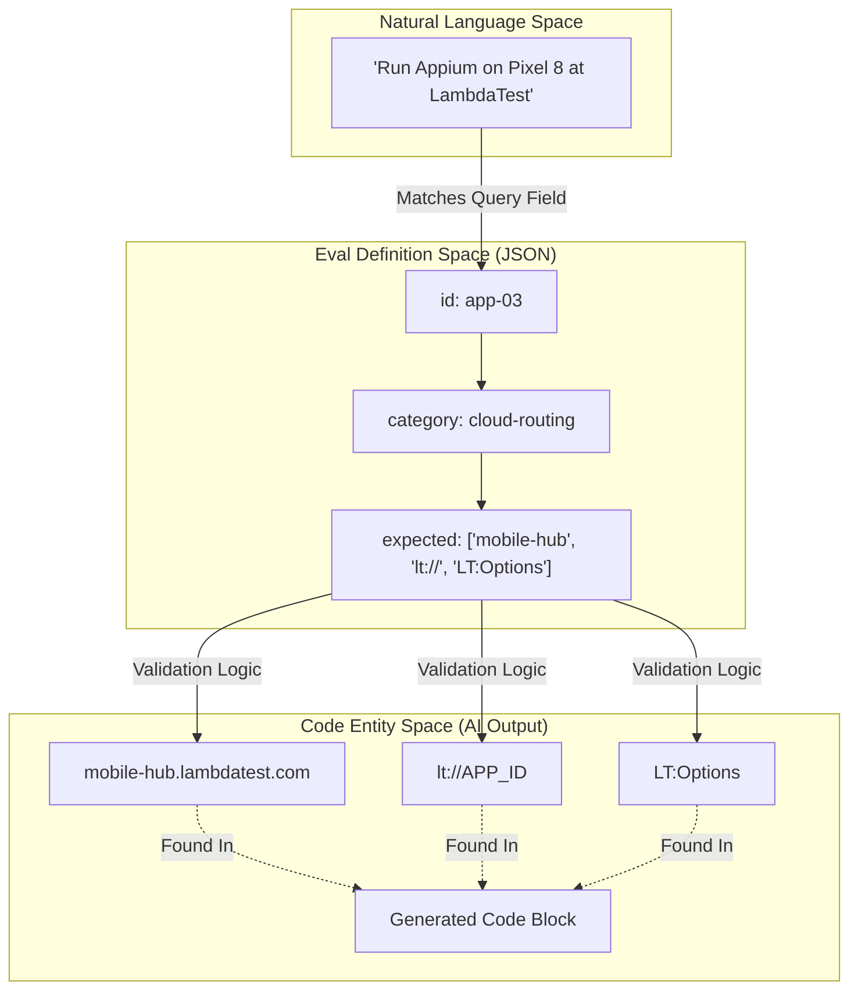
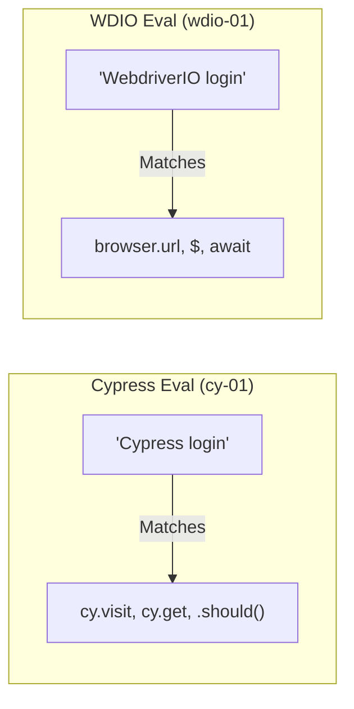

<!-- source: DeepWiki mcp.deepwiki.com · repo LambdaTest/agent-skills · page 10.1 Eval File Format and Categories · fetched 2026-10-26 -->

# Eval File Format and Categories

Relevant source files

The following files were used as context for generating this wiki page:

- [evals/appium-skill-evals.json](evals/appium-skill-evals.json)
- [evals/cypress-skill-evals.json](evals/cypress-skill-evals.json)
- [evals/espresso-skill-evals.json](evals/espresso-skill-evals.json)
- [evals/selenium-skill-evals.json](evals/selenium-skill-evals.json)
- [evals/webdriverio-skill-evals.json](evals/webdriverio-skill-evals.json)

The evaluation framework in the `agent-skills` repository provides a structured method for validating the quality and accuracy of AI agent outputs against the defined skills. Each skill in the repository is accompanied by a corresponding JSON evaluation file located in the `evals/` directory. These files define a series of test cases (queries) and the expected markers that an AI assistant must produce to demonstrate mastery of that specific skill.

## Eval JSON Schema

The evaluation files follow a consistent JSON schema that allows for automated validation of AI responses. Each file is dedicated to a single skill and contains an array of evaluation objects.

### Root Fields
*   `skill`: The unique identifier of the skill being evaluated (e.g., `appium-automation-skill`) [evals/appium-skill-evals.json:2]().
*   `evals`: An array of evaluation test cases [evals/appium-skill-evals.json:3]().

### Evaluation Object Fields
| Field | Type | Description |
| :--- | :--- | :--- |
| `id` | String | A unique identifier for the specific test case (e.g., `sel-01`, `app-02`) [evals/selenium-skill-evals.json:5](). |
| `category` | String | The functional area being tested (e.g., `cloud-routing`, `pom-structure`) [evals/selenium-skill-evals.json:6](). |
| `query` | String | The natural language prompt provided to the AI agent [evals/selenium-skill-evals.json:7](). |
| `expected` | Array | A list of strings, code symbols, or constraints that must be present (or absent) in the AI's response [evals/selenium-skill-evals.json:8-13](). |

**Sources:**
* [evals/appium-skill-evals.json:1-76]()
* [evals/selenium-skill-evals.json:1-65]()

## Eval Categories

Evaluations are categorized to ensure comprehensive coverage of the skill's capabilities, ranging from basic code generation to complex architectural patterns and platform-specific routing.

### 1. Basic Generation
Tests the agent's ability to generate fundamental test scripts using the framework's core syntax.
*   **Example (Selenium):** Verifies usage of `WebDriverWait`, `By.id`, and `driver.quit` [evals/selenium-skill-evals.json:6-13]().
*   **Example (Cypress):** Verifies usage of `cy.visit`, `cy.get`, and `.should()` [evals/cypress-skill-evals.json:5-14]().

### 2. Cloud Routing
Ensures the agent correctly configures the connection to the LambdaTest/TestMu AI cloud platform, including authentication and capability management.
*   **Key Markers:** `LT:Options`, `hub.lambdatest.com`, `LT_USERNAME`, and `RemoteWebDriver` [evals/selenium-skill-evals.json:17-24]().
*   **Mobile Specifics:** Use of `mobile-hub.lambdatest.com`, `isRealMobile`, and `lt://` app URLs [evals/appium-skill-evals.json:27-35]().

### 3. Language Detection
Validates that the agent respects the user's requested programming language and does not default to the framework's most common language (e.g., ensuring Python is used instead of Java for Selenium if requested).
*   **Constraint:** Often includes a `"NOT [Language]"` marker to ensure the agent doesn't mix stacks [evals/selenium-skill-evals.json:28-35]().

### 4. POM Structure
Evaluates the agent's understanding of the Page Object Model (POM) architectural pattern.
*   **Expected Elements:** `BasePage` classes, inheritance (e.g., `LoginPage extends`), and locators defined as class fields [evals/selenium-skill-evals.json:39-46]().

### 5. Mobile Specifics (Gestures & Hybrid)
For mobile skills like Appium, specific categories handle complex interactions like touch gestures and WebView switching.
*   **Gestures:** Checks for W3C Actions API components like `PointerInput` and `Sequence` [evals/appium-skill-evals.json:49-56]().
*   **Hybrid:** Validates context switching using `getContextHandles` and `WEBVIEW` [evals/appium-skill-evals.json:59-67]().

### 6. Anti-Patterns and Debugging
Tests if the agent can identify and correct poor testing practices or handle common exceptions.
*   **Anti-Pattern:** Identifying that `cy.wait(5000)` is flaky and suggesting `cy.intercept` instead [evals/cypress-skill-evals.json:37-44]().
*   **Debugging:** Suggesting `ExpectedConditions` and re-locating elements for `StaleElementReferenceException` [evals/selenium-skill-evals.json:49-56]().

### 7. Negative Triggers
Ensures the skill does **not** activate when the query is clearly intended for a different framework.
*   **Marker:** `should NOT activate` [evals/webdriverio-skill-evals.json:27-31]().

**Sources:**
* [evals/appium-skill-evals.json:5-75]()
* [evals/selenium-skill-evals.json:5-64]()
* [evals/cypress-skill-evals.json:5-52]()
* [evals/webdriverio-skill-evals.json:5-32]()

## Data Flow: From Query to Validation

The following diagram illustrates how a natural language query is mapped against the evaluation criteria defined in the JSON files to validate an AI agent's response.

### Logic Flow for Eval Validation

**Sources:**
* [evals/appium-skill-evals.json:27-35]()

## Framework Specific Examples

### Appium Mobile Evaluation
Appium evaluations distinguish between Android (`UiAutomator2Options`) and iOS (`XCUITestOptions`) to ensure platform-specific drivers are utilized correctly.

| ID | Category | Query Snippet | Expected Markers |
| :--- | :--- | :--- | :--- |
| `app-01` | basic-android | "Write an Appium test... Android" | `UiAutomator2Options`, `AndroidDriver` |
| `app-02` | basic-ios | "Write an Appium test... iOS" | `XCUITestOptions`, `IOSDriver` |

[evals/appium-skill-evals.json:4-24]()

### Cypress and WebdriverIO Comparison
Evaluations ensure that the agent uses the correct syntax for frameworks that might otherwise appear similar (e.g., both use JavaScript).

**Sources:**
* [evals/cypress-skill-evals.json:4-14]()
* [evals/webdriverio-skill-evals.json:4-14]()

## Implementation Details

The evaluation files are consumed by testing scripts to perform automated "LLM-as-a-judge" or string-matching validation.

1.  **Loading:** The script iterates through the `evals/` directory.
2.  **Execution:** For each `query` in the JSON, the AI agent is prompted.
3.  **Verification:** The resulting output is scanned for the presence of every string in the `expected` array.
4.  **Negative Constraints:** If a string starts with `NOT `, the validator ensures that specific term is **absent** from the output (e.g., `NOT Java` in a Python eval [evals/selenium-skill-evals.json:34]()).
5.  **Activation Check:** For `negative-trigger` categories, the validator ensures the agent does not provide a detailed implementation for a framework it isn't supposed to handle [evals/appium-skill-evals.json:69-75]().

**Sources:**
* [evals/appium-skill-evals.json:44]()
* [evals/selenium-skill-evals.json:34]()
* [evals/cypress-skill-evals.json:47-52]()

---

