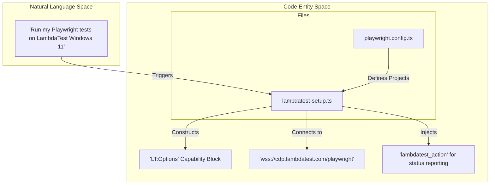
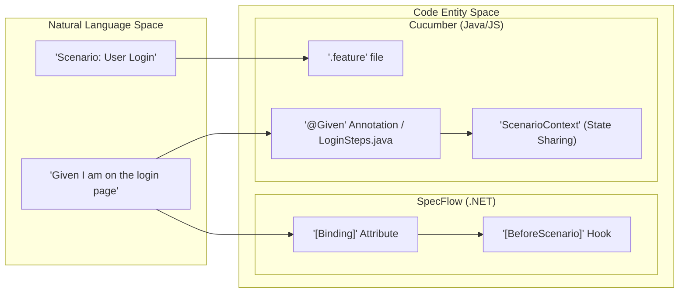

<!-- source: DeepWiki mcp.deepwiki.com · repo LambdaTest/agent-skills · page 11 Glossary — Key Terms, Jargon, and Abbreviations · fetched 2026-10-26 -->

# Glossary — Key Terms, Jargon, and Abbreviations

Relevant source files

The following files were used as context for generating this wiki page:

- [README.md](README.md)
- [appium-skill/SKILL.md](appium-skill/SKILL.md)
- [appium-skill/reference/cloud-integration.md](appium-skill/reference/cloud-integration.md)
- [appium-skill/reference/ios-specific.md](appium-skill/reference/ios-specific.md)
- [appium-skill/reference/playbook.md](appium-skill/reference/playbook.md)
- [behave-skill/reference/playbook.md](behave-skill/reference/playbook.md)
- [capybara-skill/SKILL.md](capybara-skill/SKILL.md)
- [capybara-skill/reference/advanced-patterns.md](capybara-skill/reference/advanced-patterns.md)
- [capybara-skill/reference/cloud-integration.md](capybara-skill/reference/cloud-integration.md)
- [capybara-skill/reference/playbook.md](capybara-skill/reference/playbook.md)
- [cicd-pipeline-skill/SKILL.md](cicd-pipeline-skill/SKILL.md)
- [cicd-pipeline-skill/reference/playbook.md](cicd-pipeline-skill/reference/playbook.md)
- [cucumber-skill/SKILL.md](cucumber-skill/SKILL.md)
- [cucumber-skill/reference/playbook.md](cucumber-skill/reference/playbook.md)
- [detox-skill/SKILL.md](detox-skill/SKILL.md)
- [detox-skill/reference/playbook.md](detox-skill/reference/playbook.md)
- [gauge-skill/reference/playbook.md](gauge-skill/reference/playbook.md)
- [hyperexecute-skill/SKILL.md](hyperexecute-skill/SKILL.md)
- [jest-skill/reference/advanced-patterns.md](jest-skill/reference/advanced-patterns.md)
- [jest-skill/reference/playbook.md](jest-skill/reference/playbook.md)
- [junit-5-skill/reference/advanced-patterns.md](junit-5-skill/reference/advanced-patterns.md)
- [junit-5-skill/reference/playbook.md](junit-5-skill/reference/playbook.md)
- [playwright-skill/SKILL.md](playwright-skill/SKILL.md)
- [playwright-skill/reference/cloud-integration.md](playwright-skill/reference/cloud-integration.md)
- [playwright-skill/reference/python-patterns.md](playwright-skill/reference/python-patterns.md)
- [protractor-skill/reference/cloud-integration.md](protractor-skill/reference/cloud-integration.md)
- [rspec-skill/reference/playbook.md](rspec-skill/reference/playbook.md)
- [selenium-skill/reference/page-object-model.md](selenium-skill/reference/page-object-model.md)
- [selenium-skill/reference/playbook.md](selenium-skill/reference/playbook.md)
- [shared/testmu-cloud-reference.md](shared/testmu-cloud-reference.md)
- [skills_index.json](skills_index.json)
- [smartui-skill/SKILL.md](smartui-skill/SKILL.md)
- [smartui-skill/reference/playbook.md](smartui-skill/reference/playbook.md)
- [specflow-skill/SKILL.md](specflow-skill/SKILL.md)
- [specflow-skill/reference/playbook.md](specflow-skill/reference/playbook.md)
- [test-framework-migration-skill/SKILL.md](test-framework-migration-skill/SKILL.md)
- [test-framework-migration-skill/reference/overview.md](test-framework-migration-skill/reference/overview.md)
- [testng-skill/SKILL.md](testng-skill/SKILL.md)
- [testng-skill/reference/advanced-patterns.md](testng-skill/reference/advanced-patterns.md)

This glossary defines the technical terms, framework-specific jargon, and internal abbreviations used throughout the `agent-skills` repository. It serves as a reference for onboarding engineers to understand the implementation details of the **Agent Skills Standard** and the integration patterns for the **TestMu AI** cloud platform.

## Core System Terms

### Agent Skill
A self-contained directory containing instructions (in `SKILL.md`) and reference implementations that enable an AI coding assistant (like Claude Code or Cursor) to generate production-grade test code for a specific framework.
*   **Implementation**: Each skill is a top-level directory containing a `SKILL.md` file and a `reference/` subdirectory [skills_index.json:16-40]().
*   **Validation**: Skills are validated against schema rules defined in maintenance scripts [scripts/validate_skills.py:1-50]().

### SKILL.md
The entry point for an AI agent. It uses a **Progressive Disclosure** model, providing high-level triggers and core patterns while linking to deeper technical playbooks for complex tasks.
*   **Frontmatter**: Contains metadata like `name`, `description`, `languages`, and `category` [playwright-skill/SKILL.md:1-22]().
*   **Triggers**: Natural language strings that help the AI determine when to activate the skill [appium-skill/SKILL.md:8-10]().

### Skill Registry (`skills_index.json`)
A centralized JSON manifest listing all 46 available skills, their metadata, and file paths. This is the primary index consumed by the Evaluation Framework to map queries to specific skill sets.
*   **File**: [skills_index.json:1-100]().

---

## TestMu AI & Cloud Jargon

### LT:Options
A specific capability block used in Selenium, Playwright, and Appium to configure LambdaTest-specific features such as video recording, network logs, and build naming.
*   **Structure**: A dictionary/object passed within the driver capabilities [playwright-skill/reference/cloud-integration.md:30-39]().
*   **Key Keys**: `platform`, `build`, `name`, `user`, `accessKey`, `video`, `network` [playwright-skill/reference/cloud-integration.md:98-108]().

### lambdatest_action
A mechanism to communicate test status or custom commands from the test script to the TestMu AI cloud during execution using `page.evaluate` or `driver.executeScript`.
*   **Usage**: `page.evaluate((_) => {}, 'lambdatest_action: {"action": "setTestStatus", "arguments": {"status": "passed"}}')` [playwright-skill/reference/cloud-integration.md:55-60]().

### SmartUI
The visual regression testing service that captures screenshots and compares them against baselines using AI-driven diffing.
*   **Command**: `smartuiSnapshot` [smartui-skill/SKILL.md:1-20]().

### HyperExecute
A high-speed test orchestration platform that shards and executes tests in parallel across multiple virtual machines.
*   **Config**: Defined via a YAML file containing `testDiscovery` and `testRunnerCommand` [hyperexecute-skill/SKILL.md:1-30]().

---

## Framework-Specific Jargon

### BDD (Behavior Driven Development)
A testing methodology using Gherkin syntax (`Given/When/Then`) to define application behavior.
*   **Entities**:
    *   **Feature File**: Markdown-like `.feature` files containing Scenarios [cucumber-skill/SKILL.md:24-59]().
    *   **Step Definitions**: Code that maps Gherkin strings to executable functions [cucumber-skill/SKILL.md:61-102]().
    *   **Hooks**: Setup/Teardown logic (e.g., `@Before`, `@After`) [cucumber-skill/SKILL.md:130-148]().

### POM (Page Object Model)
A design pattern that abstracts web pages into classes, separating the UI structure (locators) from the test logic.
*   **Implementation**: Often uses a `BasePage` and framework-specific annotations like `@FindBy` [selenium-skill/reference/page-object-model.md:1-50]().

### Gray-Box Testing
A testing approach where the runner has internal knowledge of the application state (e.g., Detox for React Native), allowing for automatic synchronization between the test and the app's asynchronous operations.
*   **Context**: [detox-skill/SKILL.md:3-8]().

---

## Technical Mapping: Natural Language to Code

The following diagrams bridge the gap between user requirements and the specific code entities defined in the repository.

### Diagram 1: Cloud Integration Flow
This diagram maps the "Natural Language Space" of a user request to the "Code Entity Space" of the TestMu AI integration.

**Sources:** [playwright-skill/reference/cloud-integration.md:75-144](), [playwright-skill/reference/cloud-integration.md:27-40]()

### Diagram 2: BDD Execution Architecture
This diagram shows how BDD-related terms map to specific file types and classes within the `cucumber-skill` and `specflow-skill`.

**Sources:** [cucumber-skill/SKILL.md:24-102](), [specflow-skill/SKILL.md:21-135](), [specflow-skill/reference/playbook.md:162-237]()

---

## Abbreviations Table

| Abbreviation | Full Term | Context / Code Pointer |
| :--- | :--- | :--- |
| **POM** | Page Object Model | Used in E2E skills [selenium-skill/reference/page-object-model.md:1-10]() |
| **BDD** | Behavior Driven Development | Used in Cucumber, SpecFlow, Behave [cucumber-skill/SKILL.md:2-7]() |
| **CDP** | Chrome DevTools Protocol | Used for Playwright/Puppeteer cloud connection [playwright-skill/reference/cloud-integration.md:44-46]() |
| **WDA** | WebDriverAgent | iOS automation engine for Appium [appium-skill/reference/ios-specific.md:1-20]() |
| **OIDC** | OpenID Connect | Used for secure CI/CD authentication [cicd-pipeline-skill/reference/playbook.md:1-50]() |
| **APK/IPA** | Android/iOS App Package | Mobile application binaries used in Appium/Detox [appium-skill/SKILL.md:49-54]() |
| **DI** | Dependency Injection | Used for state sharing in BDD (e.g., PicoContainer) [cucumber-skill/reference/playbook.md:225-225]() |

**Sources:** [playwright-skill/reference/cloud-integration.md:44-46](), [appium-skill/SKILL.md:49-54](), [cucumber-skill/reference/playbook.md:225-225](), [selenium-skill/reference/page-object-model.md:1-10]()