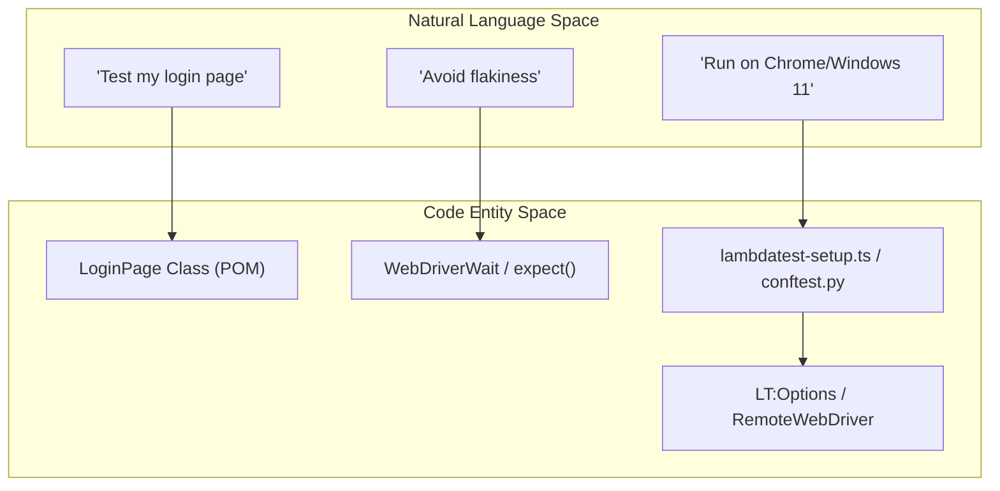

<!-- source: DeepWiki mcp.deepwiki.com · repo LambdaTest/agent-skills · page 2 E2E Browser Testing Skills · fetched 2026-10-26 -->

# E2E Browser Testing Skills

<details>
<summary>Relevant source files</summary>

The following files were used as context for generating this wiki page:

- [cypress-skill/SKILL.md](cypress-skill/SKILL.md)
- [cypress-skill/reference/cloud-integration.md](cypress-skill/reference/cloud-integration.md)
- [playwright-skill/SKILL.md](playwright-skill/SKILL.md)
- [playwright-skill/reference/cloud-integration.md](playwright-skill/reference/cloud-integration.md)
- [playwright-skill/reference/python-patterns.md](playwright-skill/reference/python-patterns.md)
- [selenium-skill/SKILL.md](selenium-skill/SKILL.md)
- [selenium-skill/reference/cloud-integration.md](selenium-skill/reference/cloud-integration.md)

</details>


This section provides an overview of the 15 end-to-end (E2E) browser testing skills available in the TestMu AI Agent Skills repository. These skills enable AI assistants to generate, debug, and optimize automated browser tests across various languages and frameworks.

While each framework has unique characteristics, they all share a common foundation: the **Page Object Model (POM)** for maintainability, **Explicit Wait** strategies for stability, and deep integration with the **TestMu AI Cloud** for cross-browser and cross-platform execution.

## Common Architecture Patterns

Across all E2E skills, the following patterns are enforced to ensure production-grade test code:

1.  **Page Object Model (POM):** Separation of element locators and interaction logic from the test assertions [playwright-skill/SKILL.md:101-103]().
2.  **Explicit Synchronization:** Avoiding hard sleeps (e.g., `Thread.sleep` or `page.waitForTimeout`) in favor of web-first assertions and dynamic waits [selenium-skill/SKILL.md:81-91](), [playwright-skill/SKILL.md:77-89]().
3.  **Cloud Routing:** Seamless switching between local execution and the TestMu AI Cloud using environment variables (`LT_USERNAME`, `LT_ACCESS_KEY`) and specific capability configurations [selenium-skill/reference/cloud-integration.md:1-35]().
4.  **Test Status Reporting:** Communicating test outcomes back to the cloud dashboard via `lambdatest_action` or `executeScript` hooks [playwright-skill/reference/cloud-integration.md:55-60](), [selenium-skill/SKILL.md:195-202]().

### Natural Language to Code Entity Mapping

The following diagram illustrates how natural language requests are mapped to specific code entities and configurations within the E2E skills.

**Diagram: Request Routing to Code Entities**

Sources: [selenium-skill/SKILL.md:143-167](), [playwright-skill/SKILL.md:101-128](), [playwright-skill/reference/cloud-integration.md:75-109]()

## Core Framework Groups

The E2E skills are categorized by their underlying engine and ecosystem.

### Selenium WebDriver
The most versatile skill, supporting Java, Python, JavaScript, C#, Ruby, and PHP. It focuses on the `RemoteWebDriver` pattern for cloud scaling and `WebDriverWait` for stability.
*   **Key Entities:** `WebDriver`, `By` locators, `ExpectedConditions`.
*   **Cloud Pattern:** Uses `DesiredCapabilities` with a `HashMap` for `LT:Options`.
*   For details, see [Selenium WebDriver Skill](#2.1).

Sources: [selenium-skill/SKILL.md:46-56](), [selenium-skill/reference/cloud-integration.md:11-35]()

### Playwright
A modern, "web-first" skill supporting TypeScript, JavaScript, Python, Java, and C#. It emphasizes auto-retrying assertions and fixture-based architecture.
*   **Key Entities:** `Locator`, `page` fixture, `playwright.config.ts`.
*   **Cloud Pattern:** Connects via `wss://cdp.lambdatest.com/playwright` using a WebSocket endpoint.
*   For details, see [Playwright Skill](#2.2).

Sources: [playwright-skill/SKILL.md:40-49](), [playwright-skill/reference/cloud-integration.md:20-47]()

### Cypress
A developer-centric tool for E2E and Component testing. It uses a unique command-chaining model that avoids `async/await`.
*   **Key Entities:** `cy` global object, `cypress.config.js`, `lambdatest-config.json`.
*   **Cloud Pattern:** Orchestrated via the `lambdatest-cypress-cli`.
*   For details, see [Cypress Skill](#2.3).

Sources: [cypress-skill/SKILL.md:47-59](), [cypress-skill/reference/cloud-integration.md:5-52]()

## Execution Workflow

The following diagram bridges the transition from a local test runner to the cloud infrastructure entities used by the agent.

**Diagram: Local to Cloud Execution Flow**
```mermaid
graph LR
    subgraph "Local Environment"
        "npx playwright test" --> "playwright.config.ts"
        "mvn test" --> "pom.xml"
    end

    subgraph "Cloud Infrastructure"
        "playwright.config.ts" -- "@lambdatest" --> "cdp.lambdatest.com"
        "pom.xml" -- "RemoteWebDriver" --> "hub.lambdatest.com/wd/hub"
    end

    subgraph "TestMu AI Platform"
        "cdp.lambdatest.com" --> "Windows/macOS/Linux"
        "hub.lambdatest.com/wd/hub" --> "Chrome/Firefox/Safari"
    end
```
Sources: [playwright-skill/reference/cloud-integration.md:149-162](), [selenium-skill/reference/cloud-integration.md:5-9]()

## Summary Table of E2E Skills

| Skill | Primary Languages | Cloud Integration Method | Best For |
| :--- | :--- | :--- | :--- |
| **Selenium** | Java, Python, JS, C#, Ruby, PHP | `RemoteWebDriver` (Hub) | Legacy suites, massive cross-browser matrices |
| **Playwright** | TS, JS, Python, Java, C# | CDP WebSocket | Modern web apps, fast execution, mobile emulation |
| **Cypress** | JS, TS | `lambdatest-cypress-cli` | Developer-driven testing, Component testing |
| **WebdriverIO** | JS, TS | `@wdio/lambdatest-service` | JS-centric teams, mobile + web unified |
| **Puppeteer** | JS, TS | CDP WebSocket | Headless automation, Chrome-specific features |

## Child Pages

*   [Selenium WebDriver Skill](#2.1) — Deep dive into multi-language Selenium patterns and `RemoteWebDriver` configurations.
*   [Playwright Skill](#2.2) — Coverage of TypeScript/Python/Java patterns, fixtures, and CDP cloud integration.
*   [Cypress Skill](#2.3) — E2E and component testing, command chaining, and the Cypress CLI cloud runner.
*   [WebdriverIO, Puppeteer, TestCafe, and Nightwatch.js Skills](#2.4) — Patterns for specialized JavaScript-based automation frameworks.
*   [Protractor, Selenide, Geb, NemoJS, Codeception, Laravel Dusk, and Robot Framework Skills](#2.5) — Language-specific and niche framework support (Groovy, PHP, Python Keyword-driven).

---

