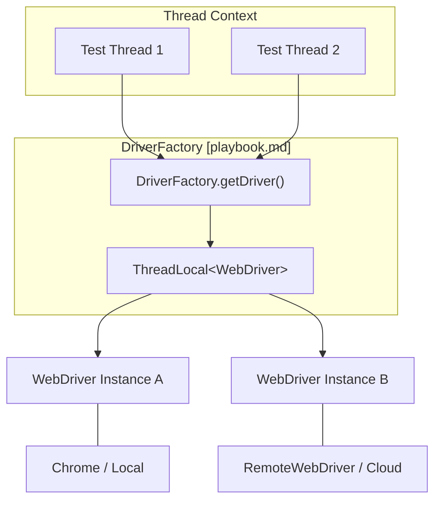
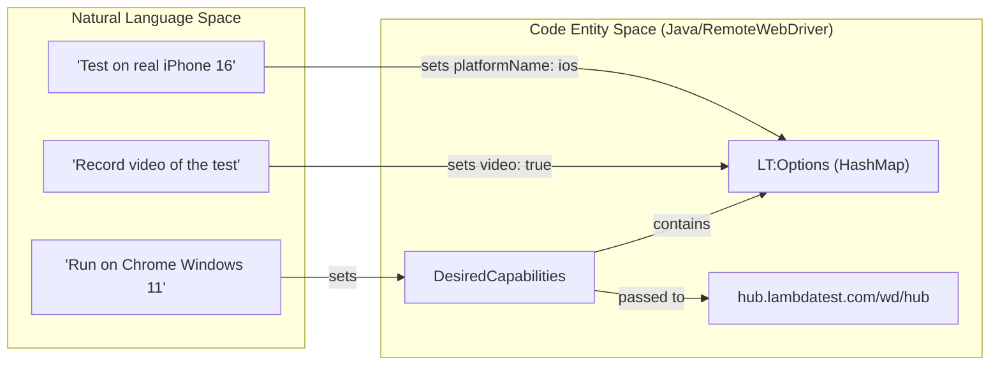

<!-- source: DeepWiki mcp.deepwiki.com · repo LambdaTest/agent-skills · page 2.1 Selenium WebDriver Skill · fetched 2026-10-26 -->

# Selenium WebDriver Skill

Relevant source files

The following files were used as context for generating this wiki page:

- [behave-skill/reference/playbook.md](behave-skill/reference/playbook.md)
- [gauge-skill/reference/playbook.md](gauge-skill/reference/playbook.md)
- [selenium-skill/SKILL.md](selenium-skill/SKILL.md)
- [selenium-skill/reference/cloud-integration.md](selenium-skill/reference/cloud-integration.md)
- [selenium-skill/reference/csharp-patterns.md](selenium-skill/reference/csharp-patterns.md)
- [selenium-skill/reference/debugging-common-issues.md](selenium-skill/reference/debugging-common-issues.md)
- [selenium-skill/reference/javascript-patterns.md](selenium-skill/reference/javascript-patterns.md)
- [selenium-skill/reference/php-patterns.md](selenium-skill/reference/php-patterns.md)
- [selenium-skill/reference/playbook.md](selenium-skill/reference/playbook.md)
- [selenium-skill/reference/python-patterns.md](selenium-skill/reference/python-patterns.md)
- [selenium-skill/reference/ruby-patterns.md](selenium-skill/reference/ruby-patterns.md)
- [selenium-skill/scripts/scaffold-project.sh](selenium-skill/scripts/scaffold-project.sh)

The Selenium WebDriver skill provides production-grade automation capabilities for cross-browser testing across six major programming languages. It supports local execution via native drivers (ChromeDriver, GeckoDriver) and cloud execution on the TestMu AI / LambdaTest platform, offering access to over 3000 browser and OS combinations.

## Multi-Language Support

The skill dynamically adapts its output based on the user's environment or explicit request. While Java (Maven + JUnit 5) is the default, the skill includes specialized patterns for five other ecosystems.

| Language | Frameworks | Package Manager | Configuration File |
| :--- | :--- | :--- | :--- |
| **Java** | JUnit 5 / TestNG | Maven / Gradle | `pom.xml` / `build.gradle` |
| **Python** | pytest | pip | `pytest.ini` / `conftest.py` |
| **JavaScript** | Mocha / Jest | npm | `package.json` |
| **C#** | NUnit / xUnit | NuGet | `.csproj` |
| **Ruby** | RSpec | Gem | `Gemfile` |
| **PHP** | PHPUnit | Composer | `composer.json` |

Sources: `[selenium-skill/SKILL.md:46-56]()`, `[selenium-skill/reference/php-patterns.md:9-20]()`, `[selenium-skill/reference/csharp-patterns.md:5-11]()`.

## Architecture & Patterns

### DriverFactory and ThreadLocal
To support parallel execution without state leakage, the skill implements a `ThreadLocal` driver pattern. This ensures each test thread maintains its own isolated `WebDriver` instance.

Sources: `[selenium-skill/reference/playbook.md:5-33]()`.

### BasePage Abstraction
The skill promotes a robust `BasePage` class that encapsulates common interactions and synchronization logic, preventing flaky tests.

*   **Explicit Waits**: Uses `WebDriverWait` and `ExpectedConditions` for all interactions `[selenium-skill/SKILL.md:83-91]()`.
*   **Interaction Wrappers**: Methods like `click(By locator)` and `type(By locator, String text)` include built-in visibility checks `[selenium-skill/reference/playbook.md:141-162]()`.
*   **JavaScript Fallbacks**: Provides `clickJS` and `scrollToElement` for handling complex DOM scenarios where standard Selenium actions might be intercepted `[selenium-skill/reference/playbook.md:153-156]()`.

## Cloud Integration

Integration with TestMu AI is achieved via `RemoteWebDriver` and the `LT:Options` capability block.

### Capability Mapping

| Option | Description | Example |
| :--- | :--- | :--- |
| `platform` | Target Operating System | `Windows 11`, `macOS Sequoia` |
| `browserName` | Browser Type | `Chrome`, `MicrosoftEdge`, `Safari` |
| `video` | Record test execution | `true` |
| `network` | Capture network logs | `true` |
| `tunnel` | Access localhost/private servers | `true` |

Sources: `[selenium-skill/reference/cloud-integration.md:13-35]()`.

### Natural Language to Code Mapping: Cloud Execution

Sources: `[selenium-skill/reference/cloud-integration.md:13-35]()`, `[selenium-skill/reference/cloud-integration.md:118-127]()`.

## Language-Specific Implementations

### C# and .NET
Uses `ChromeOptions.AddAdditionalOption("LT:Options", ...)` to pass cloud configurations. Tests are typically structured using the `[TestFixture]` and `[SetUp]` attributes in NUnit `[selenium-skill/reference/csharp-patterns.md:21-33]()`.

### Python
Leverages `pytest` fixtures for driver lifecycle management. The `yield` keyword is used to ensure `driver.quit()` is called even if tests fail `[selenium-skill/reference/python-patterns.md:43-49]()`.

### PHP
Uses the `php-webdriver/webdriver` package. Cloud capabilities are defined as an associative array and passed to `RemoteWebDriver::create()` `[selenium-skill/reference/php-patterns.md:70-94]()`.

## Debugging Common Issues

The skill includes a playbook for resolving standard Selenium exceptions:

*   **StaleElementReferenceException**: Solved by re-locating the element inside a wait block instead of reusing a stored `WebElement` variable `[selenium-skill/reference/debugging-common-issues.md:13-15]()`.
*   **ElementClickInterceptedException**: Resolved by using `JavascriptExecutor` to trigger a click directly on the DOM node or by scrolling the element into the center of the viewport `[selenium-skill/reference/debugging-common-issues.md:29-40]()`.
*   **Iframe Switching**: Managed via `driver.switchTo().frame()` and `driver.switchTo().defaultContent()` `[selenium-skill/reference/debugging-common-issues.md:61-70]()`.

## Scaffolding

The repository provides a shell script `scaffold-project.sh` to quickly generate a standard Java/Maven Selenium project structure.

**Key Directories Created:**
*   `src/main/java/pages`: For Page Object classes.
*   `src/test/java/tests`: For test execution logic.
*   `src/test/resources`: For `config.properties` and test data.

Sources: `[selenium-skill/scripts/scaffold-project.sh:15-18]()`.

---

