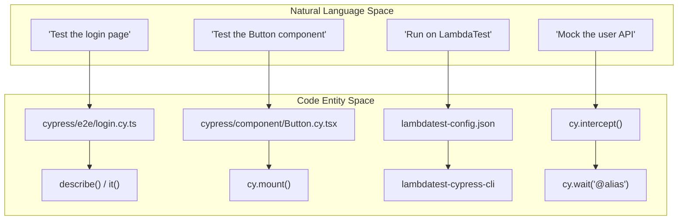
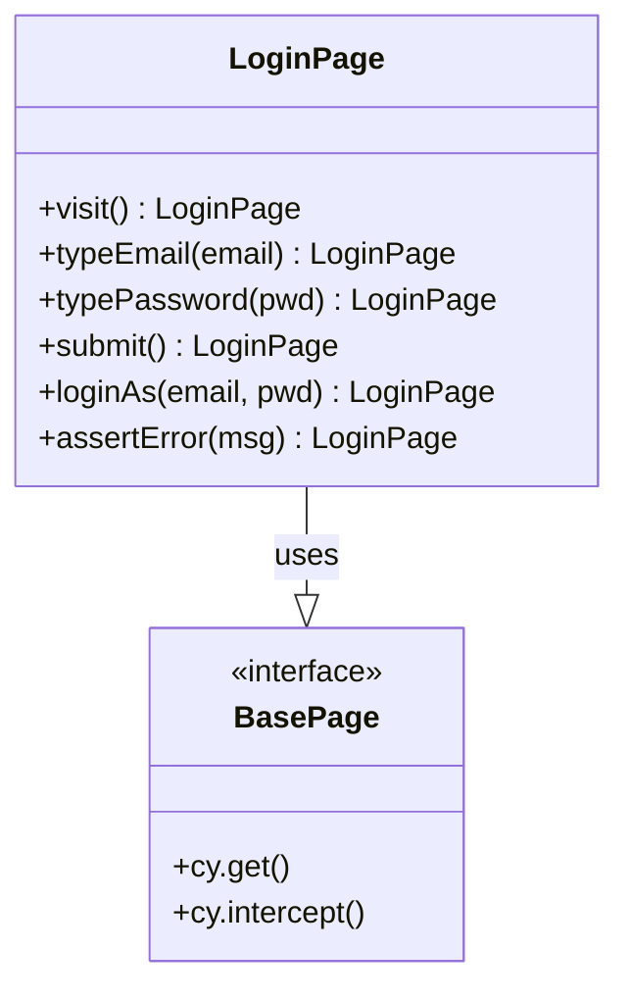
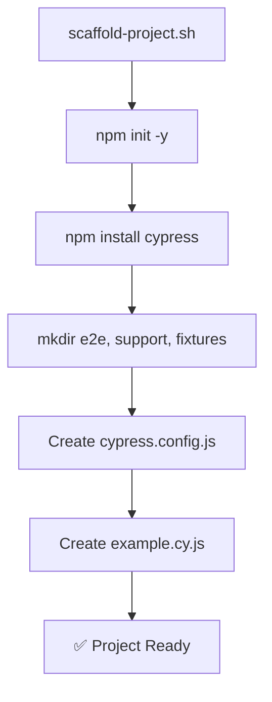

<!-- source: DeepWiki mcp.deepwiki.com · repo LambdaTest/agent-skills · page 2.3 Cypress Skill · fetched 2026-10-26 -->

# Cypress Skill

Relevant source files

The following files were used as context for generating this wiki page:

- [codeception-skill/reference/advanced-patterns.md](codeception-skill/reference/advanced-patterns.md)
- [codeception-skill/reference/playbook.md](codeception-skill/reference/playbook.md)
- [cypress-skill/SKILL.md](cypress-skill/SKILL.md)
- [cypress-skill/reference/cloud-integration.md](cypress-skill/reference/cloud-integration.md)
- [cypress-skill/reference/component-testing.md](cypress-skill/reference/component-testing.md)
- [cypress-skill/reference/custom-commands.md](cypress-skill/reference/custom-commands.md)
- [cypress-skill/reference/debugging-flaky.md](cypress-skill/reference/debugging-flaky.md)
- [cypress-skill/reference/playbook.md](cypress-skill/reference/playbook.md)
- [cypress-skill/scripts/scaffold-project.sh](cypress-skill/scripts/scaffold-project.sh)
- [cypress-skill/templates/cypress.config.js](cypress-skill/templates/cypress.config.js)

The Cypress skill provides a comprehensive framework for generating production-grade end-to-end (E2E) and component tests in JavaScript and TypeScript [cypress-skill/SKILL.md:4-5](). It emphasizes Cypress-native patterns such as command chaining, automatic retry-ability, and network interception, while providing seamless integration with the TestMu AI cloud for cross-browser execution [cypress-skill/SKILL.md:28-29]().

## System Architecture and Data Flow

The Cypress skill operates by translating natural language testing requirements into structured Cypress command chains. It distinguishes between E2E tests (targeting full page URLs) and component tests (targeting React/Vue/Angular units) [cypress-skill/SKILL.md:39-44]().

### Natural Language to Code Entity Mapping

The following diagram illustrates how user intent is mapped to specific Cypress code entities and configurations.

**Intent to Entity Mapping**

**Sources:** [cypress-skill/SKILL.md:39-44](), [cypress-skill/reference/cloud-integration.md:7-12](), [cypress-skill/reference/component-testing.md:25-33]()

## Core Implementation Patterns

### Command Chaining and Async Model
Cypress uses a unique execution model where commands are enqueued and managed by the framework. A critical requirement of this skill is the avoidance of `async/await` and variable assignment for Cypress commands [cypress-skill/SKILL.md:47-59]().

| Pattern | Bad Practice | Best Practice |
|:---|:---|:---|
| **Async** | `const el = await cy.get('...')` | `cy.get('...').should(...)` |
| **Waiting** | `cy.wait(5000)` | `cy.intercept().as('req')` + `cy.wait('@req')` |
| **Variables** | `const btn = cy.get('button')` | `cy.get('button').click()` |

**Sources:** [cypress-skill/SKILL.md:49-59](), [cypress-skill/SKILL.md:73-77]()

### Page Object Model (POM) vs. App Actions
While Cypress supports the Page Object Model, it encourages a "Fluent" interface where methods return `this` to allow for continued chaining [cypress-skill/reference/playbook.md:89-114]().

**Page Object Structure**

**Sources:** [cypress-skill/reference/playbook.md:89-120]()

## Component Testing
Cypress component testing allows for testing UI components in isolation using a real browser environment. This is configured via the `component` key in `cypress.config.js` [cypress-skill/templates/cypress.config.js:15-20]().

*   **Mounting:** Uses `cy.mount()` to render components (e.g., React, Vue) [cypress-skill/reference/component-testing.md:31]().
*   **Stubs:** Uses `cy.stub()` to mock component props and event handlers [cypress-skill/reference/component-testing.md:36]().
*   **Bundlers:** Supports Vite and Webpack for component compilation [cypress-skill/reference/playbook.md:39]().

**Sources:** [cypress-skill/reference/component-testing.md:1-66](), [cypress-skill/reference/playbook.md:187-214]()

## Cloud Integration with TestMu AI

The skill integrates with TestMu AI via the `lambdatest-cypress-cli`. This enables parallel execution across various browser and OS combinations [cypress-skill/reference/cloud-integration.md:1-3]().

### Configuration (lambdatest-config.json)
The configuration defines authentication, the browser matrix, and execution settings:
*   **Authentication:** Uses `${LT_USERNAME}` and `${LT_ACCESS_KEY}` environment variables [cypress-skill/reference/cloud-integration.md:16-19]().
*   **Parallelism:** The `parallels` key determines how many instances run concurrently [cypress-skill/reference/cloud-integration.md:40]().
*   **Tunneling:** Support for testing local applications via `tunnel_settings` [cypress-skill/reference/cloud-integration.md:47-50]().

**Sources:** [cypress-skill/reference/cloud-integration.md:14-52](), [cypress-skill/SKILL.md:156-172]()

## Debugging and Flaky Tests

Cypress provides automatic retry-ability for assertions, but not for action commands like `.click()`. Flakiness is often addressed through network synchronization [cypress-skill/reference/debugging-flaky.md:3-14]().

1.  **Network Interception:** Use `cy.intercept()` to wait for specific API responses before interacting with the UI [cypress-skill/reference/debugging-flaky.md:25-29]().
2.  **DOM Stability:** Re-querying elements after actions to avoid "detached from DOM" errors [cypress-skill/reference/debugging-flaky.md:39-42]().
3.  **Time Travel:** Utilizing `npx cypress open` for interactive debugging and state inspection [cypress-skill/reference/debugging-flaky.md:64]().

**Sources:** [cypress-skill/reference/debugging-flaky.md:1-73]()

## Project Scaffolding

The skill includes a `scaffold-project.sh` script to quickly initialize a standard Cypress environment [cypress-skill/scripts/scaffold-project.sh:1-3]().

**Scaffold Logic**

**Sources:** [cypress-skill/scripts/scaffold-project.sh:7-35]()

## Advanced Custom Commands

Custom commands are defined in `cypress/support/commands.js` and should be typed in `cypress/support/index.d.ts` for TypeScript projects [cypress-skill/reference/custom-commands.md:6-36]().

*   **Session Management:** `cy.session()` is used to persist authentication state across tests, significantly improving performance [cypress-skill/reference/custom-commands.md:7-14]().
*   **API Login:** Bypassing the UI for faster authentication in non-login tests [cypress-skill/reference/custom-commands.md:18-22]().
*   **Utility Locators:** Implementing `cy.getByDataCy()` to enforce the use of `data-cy` attributes [cypress-skill/reference/custom-commands.md:41-43]().

**Sources:** [cypress-skill/reference/custom-commands.md:1-50](), [cypress-skill/reference/playbook.md:216-246]()

---

