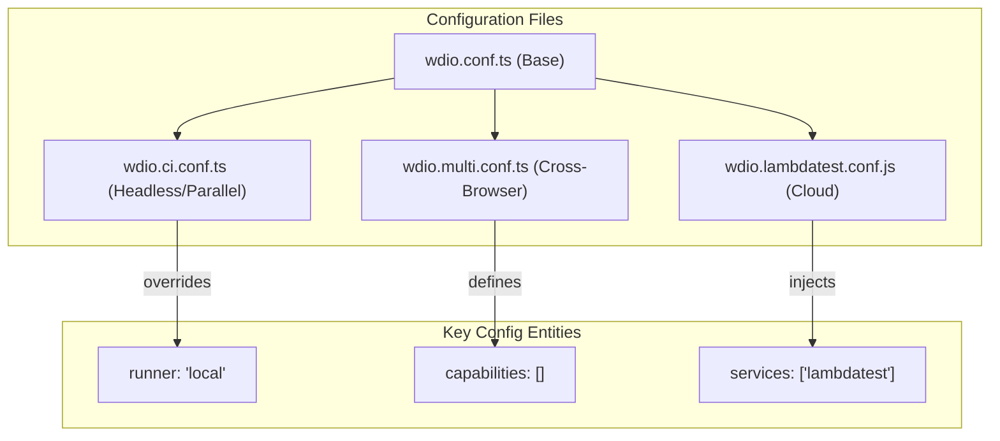
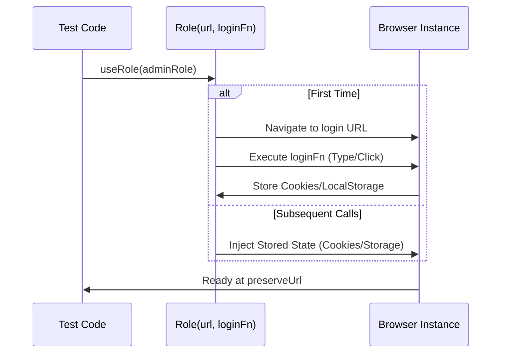
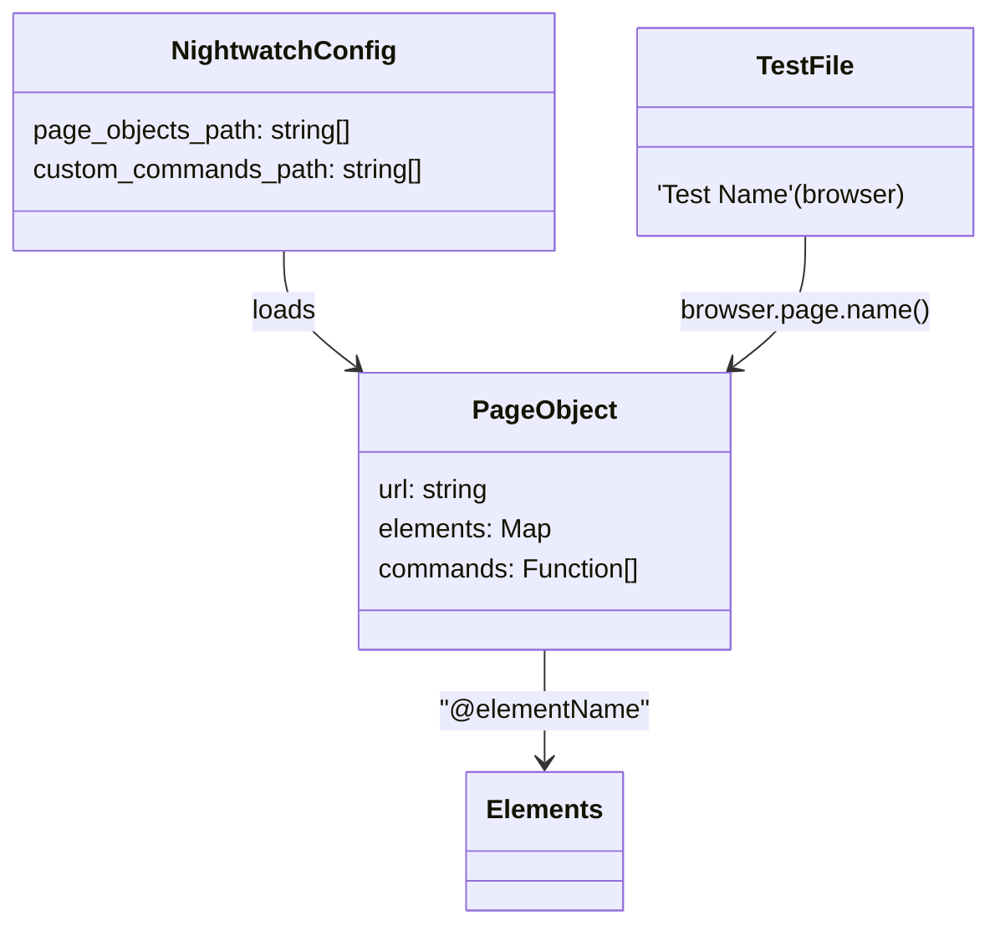

<!-- source: DeepWiki mcp.deepwiki.com · repo LambdaTest/agent-skills · page 2.4 WebdriverIO, Puppeteer, TestCafe, and Nightwatch.js Skills · fetched 2026-10-26 -->

# WebdriverIO, Puppeteer, TestCafe, and Nightwatch.js Skills

<details>
<summary>Relevant source files</summary>

The following files were used as context for generating this wiki page:

- [nightwatchjs-skill/SKILL.md](nightwatchjs-skill/SKILL.md)
- [nightwatchjs-skill/reference/advanced-patterns.md](nightwatchjs-skill/reference/advanced-patterns.md)
- [nightwatchjs-skill/reference/cloud-integration.md](nightwatchjs-skill/reference/cloud-integration.md)
- [puppeteer-skill/SKILL.md](puppeteer-skill/SKILL.md)
- [puppeteer-skill/reference/advanced-patterns.md](puppeteer-skill/reference/advanced-patterns.md)
- [puppeteer-skill/reference/cloud-integration.md](puppeteer-skill/reference/cloud-integration.md)
- [puppeteer-skill/reference/playbook.md](puppeteer-skill/reference/playbook.md)
- [selenide-skill/reference/advanced-patterns.md](selenide-skill/reference/advanced-patterns.md)
- [testcafe-skill/SKILL.md](testcafe-skill/SKILL.md)
- [testcafe-skill/reference/advanced-patterns.md](testcafe-skill/reference/advanced-patterns.md)
- [testcafe-skill/reference/playbook.md](testcafe-skill/reference/playbook.md)
- [webdriverio-skill/SKILL.md](webdriverio-skill/SKILL.md)
- [webdriverio-skill/reference/advanced-patterns.md](webdriverio-skill/reference/advanced-patterns.md)
- [webdriverio-skill/reference/cloud-integration.md](webdriverio-skill/reference/cloud-integration.md)
- [webdriverio-skill/reference/playbook.md](webdriverio-skill/reference/playbook.md)

</details>


This section provides a deep technical dive into four major JavaScript/TypeScript end-to-end (E2E) testing frameworks supported by the Agent Skills repository. While each framework has a unique architecture—ranging from WebDriver-based (WebdriverIO, Nightwatch.js) to Chrome DevTools Protocol (Puppeteer) and driverless proxy-based (TestCafe)—they all share common patterns for Page Object Model (POM) implementation, cloud integration with TestMu AI, and advanced network manipulation.

## 1. WebdriverIO (WDIO)

WebdriverIO is a progressive automation framework that can run on both the WebDriver Protocol and the Chrome DevTools Protocol (CDP) [webdriverio-skill/SKILL.md:1-10](). It is highly extensible via services and supports multiple test runners including Mocha, Jasmine, and Cucumber [webdriverio-skill/SKILL.md:24-31]().

### 1.1 Configuration and Multi-Environment Setup
WDIO uses a central `wdio.conf.ts` (or `.js`) file to manage runners, specs, and capabilities. Production-grade setups often use a base configuration extended for CI or multi-browser execution [webdriverio-skill/reference/playbook.md:5-43]().

**Data Flow: Configuration Inheritance**

*Sources: [webdriverio-skill/reference/playbook.md:5-107](), [webdriverio-skill/reference/cloud-integration.md:13-48]()*

### 1.2 WebdriverIO Page Object Model
The implementation utilizes a `BasePage` class for shared utilities like `waitForPageLoad` and `waitAndClick`, which are then inherited by specific page classes [webdriverio-skill/reference/playbook.md:111-155]().

*   **Selectors**: Uses `$` for single elements and `$$` for element arrays [webdriverio-skill/SKILL.md:36-47]().
*   **Custom Commands**: Browser and Element scopes can be extended via `browser.addCommand` to encapsulate complex logic like `waitForNetworkIdle` [webdriverio-skill/reference/playbook.md:214-244]().

### 1.3 Cloud Integration
Integration with TestMu AI is achieved through the `@wdio/lambdatest-service` [webdriverio-skill/reference/cloud-integration.md:5-9](). Capabilities are defined using the `LT:Options` block to enable features like video recording and network logs [webdriverio-skill/SKILL.md:82-103]().

---

## 2. Puppeteer

Puppeteer provides a high-level API to control Chrome or Chromium over the DevTools Protocol. It is primarily used for performance testing, PDF generation, and fast E2E execution [puppeteer-skill/SKILL.md:1-5]().

### 2.1 Core Execution Logic
Unlike WebDriver frameworks, Puppeteer scripts typically involve launching a browser instance and managing pages (tabs) directly [puppeteer-skill/SKILL.md:22-40]().

**System Mapping: Puppeteer Logic to Code Entities**
```mermaid
graph LR
    subgraph "Natural Language Space"
        "Start Browser"
        "Mock API"
        "Wait for Element"
        "Cloud Execution"
    end

    subgraph "Code Entity Space"
        "Start Browser" --> launch["puppeteer.launch()"]
        "Mock API" --> intercept["page.setRequestInterception(true)"]
        "Wait for Element" --> wait["page.waitForSelector()"]
        "Cloud Execution" --> connect["puppeteer.connect()"]
    end

    launch --> config["puppeteer.config.ts"]
    intercept --> mock["page.on('request')"]
    connect --> wss["browserWSEndpoint"]
```
*Sources: [puppeteer-skill/SKILL.md:22-108](), [puppeteer-skill/reference/playbook.md:5-55]()*

### 2.2 Advanced Patterns
*   **Network Interception**: Puppeteer excels at request/response manipulation. Using `page.on('request')`, users can abort resource types (images/fonts) to speed up CI or mock JSON responses for specific API endpoints [puppeteer-skill/SKILL.md:71-90](), [puppeteer-skill/reference/playbook.md:158-181]().
*   **Wait Strategies**: Supports `networkidle0` (no more than 0 connections for 500ms) and `waitForFunction` for complex state evaluations [puppeteer-skill/SKILL.md:43-62]().

---

## 3. TestCafe

TestCafe utilizes a unique architecture that does not require a browser driver (like ChromeDriver). It uses a proxy mechanism to inject scripts into the browser, allowing it to run on any browser that supports JavaScript [testcafe-skill/SKILL.md:1-5]().

### 3.1 The Role System (Authentication)
One of TestCafe's most powerful features is the `Role` object, which encapsulates authentication state. This allows tests to switch between user profiles without re-executing login UI steps [testcafe-skill/reference/playbook.md:63-89]().

**Data Flow: Authentication with Roles**

*Sources: [testcafe-skill/reference/playbook.md:63-89](), [testcafe-skill/reference/advanced-patterns.md:51-66]()*

### 3.2 Request Hooks and Mocking
TestCafe provides `RequestMock` and `RequestLogger` to handle API interactions. Mocks can be applied at the `fixture` or `test` level [testcafe-skill/reference/playbook.md:144-168]().

*   **Selectors**: Built-in smart assertions automatically wait for elements to appear, reducing flakiness [testcafe-skill/SKILL.md:36-43]().
*   **Client Functions**: Used to execute code in the browser context to retrieve state like `localStorage` or `window.location` [testcafe-skill/reference/playbook.md:201-228]().

---

## 4. Nightwatch.js

Nightwatch.js is an integrated E2E testing solution written in Node.js and using the W3C WebDriver API. It includes its own test runner, assertion library, and page object support [nightwatchjs-skill/SKILL.md:1-7]().

### 4.1 Page Object Architecture
Nightwatch page objects use a declarative JSON-like structure for `elements` and a `commands` array for encapsulating actions [nightwatchjs-skill/SKILL.md:61-81]().

**Entity Mapping: Nightwatch Page Objects**

*Sources: [nightwatchjs-skill/SKILL.md:61-92](), [nightwatchjs-skill/reference/advanced-patterns.md:3-38]()*

### 4.2 Custom Extensions
Nightwatch allows for easy extension through:
*   **Custom Commands**: Files in the `custom_commands_path` become available on the `browser` object (e.g., `browser.dragAndDrop()`) [nightwatchjs-skill/reference/advanced-patterns.md:42-50]().
*   **Custom Assertions**: Allow for domain-specific validations like `browser.assert.hasMinLength()` [nightwatchjs-skill/reference/advanced-patterns.md:52-62]().

### 4.3 Cloud Integration
Nightwatch connects to TestMu AI via the `test_settings` in `nightwatch.conf.js`. It requires setting the `selenium.host` to `hub.lambdatest.com` and passing credentials through `LT:Options` [nightwatchjs-skill/SKILL.md:109-142](), [nightwatchjs-skill/reference/cloud-integration.md:9-40]().

---

## 5. Summary Matrix

| Feature | WebdriverIO | Puppeteer | TestCafe | Nightwatch.js |
| :--- | :--- | :--- | :--- | :--- |
| **Protocol** | WebDriver / CDP | CDP | Proxy-based | WebDriver |
| **Main Selector** | `$(selector)` | `page.$(selector)` | `Selector(selector)` | `browser.setValue(sel)` |
| **Wait Logic** | Explicit / Built-in | Explicit | Auto-retry assertions | Explicit / Built-in |
| **Cloud Service** | `@wdio/lambdatest-service` | `puppeteer.connect()` | `lambdatest` browser provider | `selenium` config |
| **Page Objects** | Class-based (ES6) | Class-based (ES6) | Class-based / Object | Declarative Object |

*Sources: [webdriverio-skill/SKILL.md:32-60](), [puppeteer-skill/SKILL.md:18-41](), [testcafe-skill/SKILL.md:18-34](), [nightwatchjs-skill/SKILL.md:28-59]()*

---

