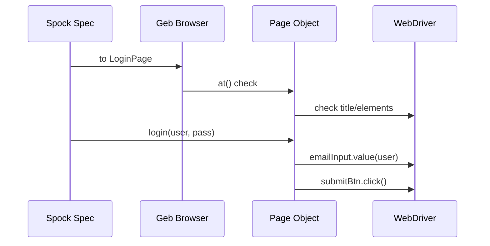

<!-- source: DeepWiki mcp.deepwiki.com · repo LambdaTest/agent-skills · page 2.5 Protractor, Selenide, Geb, NemoJS, Codeception, Laravel Dusk, and Robot Framework Skills · fetched 2026-10-26 -->

# Protractor, Selenide, Geb, NemoJS, Codeception, Laravel Dusk, and Robot Framework Skills

<details>
<summary>Relevant source files</summary>

The following files were used as context for generating this wiki page:

- [behat-skill/SKILL.md](behat-skill/SKILL.md)
- [codeception-skill/SKILL.md](codeception-skill/SKILL.md)
- [geb-skill/SKILL.md](geb-skill/SKILL.md)
- [geb-skill/reference/advanced-patterns.md](geb-skill/reference/advanced-patterns.md)
- [geb-skill/reference/playbook.md](geb-skill/reference/playbook.md)
- [laravel-dusk-skill/SKILL.md](laravel-dusk-skill/SKILL.md)
- [laravel-dusk-skill/reference/advanced-patterns.md](laravel-dusk-skill/reference/advanced-patterns.md)
- [laravel-dusk-skill/reference/playbook.md](laravel-dusk-skill/reference/playbook.md)
- [nemojs-skill/SKILL.md](nemojs-skill/SKILL.md)
- [nemojs-skill/reference/advanced-patterns.md](nemojs-skill/reference/advanced-patterns.md)
- [nemojs-skill/reference/playbook.md](nemojs-skill/reference/playbook.md)
- [nightwatchjs-skill/reference/playbook.md](nightwatchjs-skill/reference/playbook.md)
- [playwright-skill/reference/debugging-flaky.md](playwright-skill/reference/debugging-flaky.md)
- [playwright-skill/reference/playbook.md](playwright-skill/reference/playbook.md)
- [protractor-skill/SKILL.md](protractor-skill/SKILL.md)
- [protractor-skill/reference/advanced-patterns.md](protractor-skill/reference/advanced-patterns.md)
- [protractor-skill/reference/playbook.md](protractor-skill/reference/playbook.md)
- [robot-framework-skill/SKILL.md](robot-framework-skill/SKILL.md)
- [robot-framework-skill/reference/advanced-patterns.md](robot-framework-skill/reference/advanced-patterns.md)
- [robot-framework-skill/reference/playbook.md](robot-framework-skill/reference/playbook.md)
- [selenide-skill/SKILL.md](selenide-skill/SKILL.md)
- [selenide-skill/reference/playbook.md](selenide-skill/reference/playbook.md)

</details>


This section covers the specialized E2E browser testing skills within the Agent Skills repository. These skills support a diverse range of ecosystems, from legacy Angular applications (Protractor) and modern Java fluent APIs (Selenide) to PHP-specific frameworks (Laravel Dusk, Codeception) and keyword-driven automation (Robot Framework).

## 1. Protractor (Angular & Migration)

Protractor is a legacy framework for Angular and AngularJS applications. While officially deprecated, the skill provides patterns for maintaining existing suites and migrating them to modern alternatives like Playwright.

### Core Implementation
Protractor utilizes a `protractor.conf.js` file to manage browser capabilities and test execution. It extends WebDriverJS and provides Angular-specific locators such as `by.model` and `by.repeater` `[protractor-skill/reference/playbook.md:9-56]()`.

### Data Flow and Synchronization
Protractor's primary value was its automatic synchronization with Angular's `$http` and `$timeout` services via `browser.waitForAngularEnabled(true)` `[protractor-skill/reference/playbook.md:39-40]()`. For non-Angular pages, this must be explicitly disabled `[protractor-skill/reference/playbook.md:213-219]()`.

**Protractor Entity Mapping**
Title: Protractor Code Entity Relationship
```mermaid
graph TD
    subgraph "Natural Language Space"
        A["'Wait for Angular'"]
        B["'Angular Locator'"]
        C["'Page Object'"]
    end

    subgraph "Code Entity Space"
        A --> D["browser.waitForAngularEnabled(true)"]
        B --> E["by.model('user.name')"]
        B --> F["by.repeater('item in items')"]
        C --> G["BasePage class"]
        G --> H["ElementFinder"]
    end
    
    D --- [protractor-skill/reference/playbook.md:40-40]
    E --- [protractor-skill/reference/playbook.md:237-237]
    G --- [protractor-skill/reference/playbook.md:88-88]
```
Sources: `[protractor-skill/reference/playbook.md:9-243]()`

---

## 2. Selenide (Java Fluent API)

Selenide is a wrapper around Selenium WebDriver that provides a fluent API, smart waiting, and simplified configuration for Java.

### Implementation Details
*   **Selectors**: Uses `$` for single elements and `$$` for collections `[selenide-skill/reference/playbook.md:118-151]()`.
*   **Smart Waits**: Assertions like `.shouldBe(visible)` or `.shouldHave(text(...))` automatically retry until the timeout is reached `[selenide-skill/reference/playbook.md:122-130]()`.
*   **Configuration**: Managed via `selenide.properties` or the `Configuration` class `[selenide-skill/reference/playbook.md:87-98]()`.

### Key Functions
| Function | Description |
| :--- | :--- |
| `open(url)` | Opens the browser to the specified URL `[selenide-skill/reference/playbook.md:115-115]()` |
| `$(selector)` | Returns a `SelenideElement` (Proxy) `[selenide-skill/reference/playbook.md:118-118]()` |
| `$$(selector)` | Returns a `ElementsCollection` `[selenide-skill/reference/playbook.md:151-151]()` |
| `.shouldBe(condition)`| Performs a "Smart Wait" assertion `[selenide-skill/reference/playbook.md:122-122]()` |

Sources: `[selenide-skill/reference/playbook.md:102-177]()`

---

## 3. Geb (Groovy & Spock)

Geb brings together the power of WebDriver, the elegance of jQuery content selection, and the expressiveness of the Groovy language.

### Implementation Pattern
Geb uses a Domain Specific Language (DSL) for Page Objects. The `static content` block defines elements using jQuery-style selectors `[geb-skill/reference/playbook.md:149-156]()`.

### Geb Configuration
The `GebConfig.groovy` file defines environments and driver logic, including cloud integration with LambdaTest using `RemoteWebDriver` and `LT:Options` `[geb-skill/reference/playbook.md:41-111]()`.

**Geb to Spock Integration**
Title: Geb and Spock Interaction

Sources: `[geb-skill/reference/playbook.md:145-171]()`, `[geb-skill/reference/playbook.md:118-120]()`

---

## 4. Nemo.js (PayPal Framework)

Nemo.js is a Node.js framework developed by PayPal. Its standout feature is the separation of locators into JSON files.

### View Pattern
Locators are stored in `locators/*.json` files `[nemojs-skill/reference/playbook.md:12-27]()`. These are automatically loaded into the `nemo.view` object, allowing for clean test code: `await nemo.view.login.emailInput().sendKeys(...)` `[nemojs-skill/reference/playbook.md:42-44]()`.

### Plugin Architecture
Nemo is highly extensible through plugins like `nemo-view` (for JSON locators) and `nemo-drivex` (for extended search methods) `[nemojs-skill/reference/playbook.md:184-201]()`.

Sources: `[nemojs-skill/SKILL.md:27-67]()`, `[nemojs-skill/reference/playbook.md:3-58]()`

---

## 5. Laravel Dusk & Codeception (PHP)

These two skills cover the PHP ecosystem, with Dusk focusing on Laravel-specific features and Codeception providing a general-purpose BDD actor pattern.

### Laravel Dusk
Dusk provides an expressive API for browser testing without requiring Selenium. It uses a `DuskTestCase` base class and a `browse` closure to execute tests `[laravel-dusk-skill/SKILL.md:32-44]()`.
*   **Authentication**: Supports `loginAs($user)` to bypass login forms in tests `[laravel-dusk-skill/reference/playbook.md:158-159]()`.
*   **Database**: Integrates with Laravel's `DatabaseMigrations` trait to reset state between tests `[laravel-dusk-skill/reference/playbook.md:106-106]()`.

### Codeception
Codeception uses an "Actor" pattern (usually `$I`) to describe test steps in a readable way `[codeception-skill/SKILL.md:27-42]()`.
*   **Suites**: Organizes tests into `Acceptance`, `Functional`, and `Unit` suites `[codeception-skill/SKILL.md:120-137]()`.
*   **Cest Format**: Uses the `Cest` format where each class method is a test case `[codeception-skill/SKILL.md:23-27]()`.

Sources: `[laravel-dusk-skill/SKILL.md:23-58]()`, `[codeception-skill/SKILL.md:21-53]()`

---

## 6. Robot Framework (Keyword-Driven)

Robot Framework is a generic open-source automation framework that uses a tabular, keyword-driven approach.

### Implementation Structure
*   **Settings**: Import libraries (e.g., `SeleniumLibrary`, `RequestsLibrary`) and resource files `[robot-framework-skill/reference/playbook.md:100-106]()`.
*   **Keywords**: Custom business-level keywords are defined in `.resource` files to abstract low-level interactions `[robot-framework-skill/reference/playbook.md:148-173]()`.
*   **Variables**: Environment-specific data is stored in YAML or Python files `[robot-framework-skill/reference/playbook.md:51-67]()`.

**Robot Framework Entity Mapping**
Title: Robot Framework Keyword Mapping
```mermaid
graph LR
    subgraph "Natural Language Space"
        A["'Login with Credentials'"]
        B["'Verify Dashboard'"]
    end

    subgraph "Code Entity Space"
        A --> C["Keywords: Login With Credentials"]
        C --> D["Input Text | id:email"]
        C --> E["Input Password | id:password"]
        B --> F["Keywords: Verify Dashboard Is Displayed"]
        F --> G["Wait Until Location Contains | /dashboard"]
    end

    C --- [robot-framework-skill/reference/playbook.md:156-156]
    F --- [robot-framework-skill/reference/playbook.md:165-165]
```
Sources: `[robot-framework-skill/reference/playbook.md:98-173]()`

---

