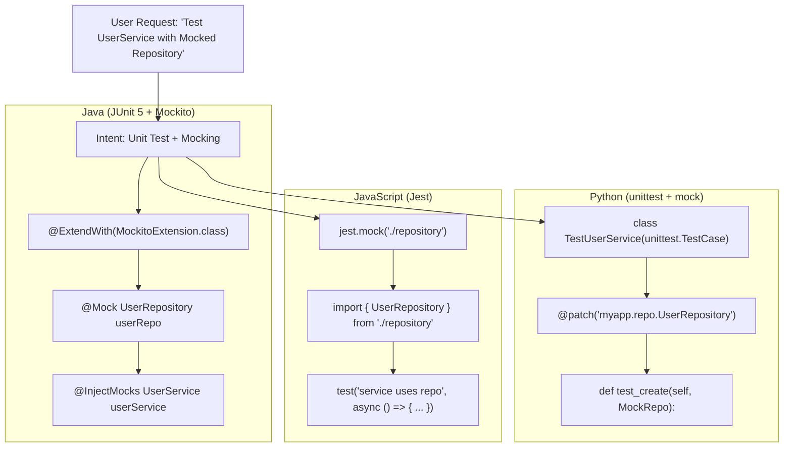
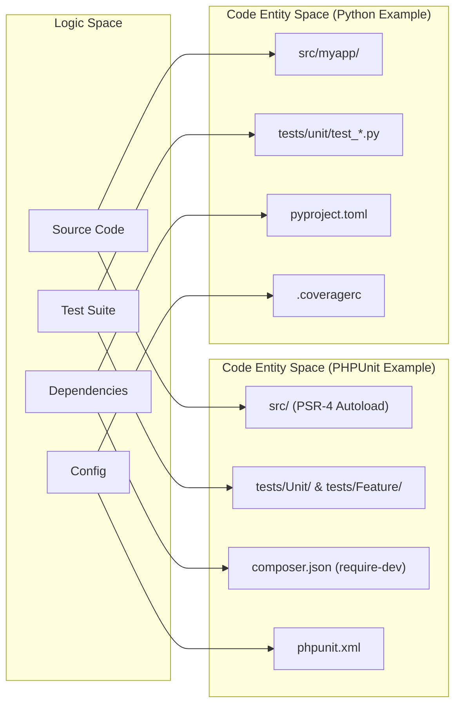

<!-- source: DeepWiki mcp.deepwiki.com · repo LambdaTest/agent-skills · page 3 Unit Testing Skills · fetched 2026-10-26 -->

# Unit Testing Skills

Relevant source files

The following files were used as context for generating this wiki page:

- [cicd-pipeline-skill/SKILL.md](cicd-pipeline-skill/SKILL.md)
- [cicd-pipeline-skill/reference/playbook.md](cicd-pipeline-skill/reference/playbook.md)
- [jest-skill/reference/advanced-patterns.md](jest-skill/reference/advanced-patterns.md)
- [jest-skill/reference/playbook.md](jest-skill/reference/playbook.md)
- [junit-5-skill/SKILL.md](junit-5-skill/SKILL.md)
- [junit-5-skill/reference/advanced-patterns.md](junit-5-skill/reference/advanced-patterns.md)
- [junit-5-skill/reference/playbook.md](junit-5-skill/reference/playbook.md)
- [phpunit-skill/reference/playbook.md](phpunit-skill/reference/playbook.md)
- [testunit-skill/reference/playbook.md](testunit-skill/reference/playbook.md)
- [unittest-skill/SKILL.md](unittest-skill/SKILL.md)
- [unittest-skill/reference/playbook.md](unittest-skill/reference/playbook.md)

The **Unit Testing Skills** category encompasses 15 distinct skills designed to generate production-grade unit tests across major programming ecosystems. These skills enable AI agents to author tests that include complex mocking, lifecycle management, parameterized data sets, and coverage enforcement.

While End-to-End (E2E) testing focuses on user journeys, these unit testing skills target individual code entities (functions, classes, and services) to ensure logic correctness at the most granular level.

## Language Ecosystems

The unit testing category is divided into five primary sub-groups based on the language runtime and framework architecture.

| Ecosystem | Primary Frameworks | Key Capabilities |
|-----------|--------------------|------------------|
| **Java** | JUnit 5, TestNG | Extension models, Mockito integration, Parallel execution. |
| **JavaScript/TS** | Jest, Vitest, Mocha, Jasmine, Karma | Snapshot testing, JSDOM, ESM support, Spies. |
| **Python** | pytest, unittest | Fixtures, MagicMock, Parametrization, Coverage.py. |
| **.NET** | NUnit, xUnit, MSTest | Attributes/Traits, Theories, IClassFixture. |
| **Ruby & PHP** | RSpec, Test::Unit, PHPUnit | Shared examples, Mockery, Data providers, RR mocking. |

For details on specific implementations, see the child pages:
*   [Java Unit Testing — JUnit 5 and TestNG Skills](#3.1)
*   [JavaScript/TypeScript Unit Testing — Jest, Vitest, Mocha, Jasmine, and Karma Skills](#3.2)
*   [Python Unit Testing — pytest and unittest Skills](#3.3)
*   [.NET Unit Testing — NUnit, xUnit, and MSTest Skills](#3.4)
*   [Ruby and PHP Unit Testing — RSpec, Test::Unit, and PHPUnit Skills](#3.5)

---

## Shared Concepts & Architecture

Across all supported languages, the unit testing skills follow a standardized architecture for test structure and dependency isolation.

### 1. Test Lifecycle Hooks
Every skill implements a variation of the Setup/Teardown pattern to ensure test isolation. For example, Java's `@BeforeEach` [junit-5-skill/SKILL.md:43-46]() maps directly to Python's `setUp()` [unittest-skill/SKILL.md:27-29]() and PHPUnit's `setUp(): void` [phpunit-skill/reference/playbook.md:243-248]().

### 2. Mocking and Dependency Injection
To isolate the Unit Under Test (UUT), skills utilize industry-standard mocking libraries.
*   **Java:** Uses `Mockito` with `@Mock` and `@InjectMocks` [junit-5-skill/SKILL.md:128-132]().
*   **JavaScript:** Uses `jest.mock()` for module-level isolation [jest-skill/reference/playbook.md:44-48]().
*   **Python:** Uses `unittest.mock.patch` to intercept calls at the import site [unittest-skill/SKILL.md:93-96]().

### 3. Data-Driven Testing (Parameterized)
To avoid "dry" test suites, all skills support injecting multiple data sets into a single test logic.
*   **PHPUnit:** Uses `#[DataProvider]` attributes [phpunit-skill/reference/playbook.md:127-128]().
*   **JUnit 5:** Uses `@CsvSource` or `@MethodSource` [junit-5-skill/SKILL.md:97-101]().
*   **Ruby (Test::Unit):** Uses the `data` method for named test cases [testunit-skill/reference/playbook.md:212-223]().

---

## Mapping Natural Language to Code Entities

The following diagrams illustrate how the AI Agent translates high-level requirements into specific code structures within the unit testing domain.

### Requirement Translation Flow
This diagram shows how a user request for "mocking a service" is mapped to framework-specific code entities.

**Sources:** [junit-5-skill/SKILL.md:128-132](), [unittest-skill/SKILL.md:93-96](), [jest-skill/reference/playbook.md:44-48]()

### Test Project Structure Mapping
This diagram bridges the conceptual "Project Setup" to the actual file system entities defined in the playbooks.

**Sources:** [phpunit-skill/reference/playbook.md:5-29](), [phpunit-skill/reference/playbook.md:82-108](), [unittest-skill/reference/playbook.md:5-38](), [unittest-skill/reference/playbook.md:40-68]()

---

## CI/CD Integration & Coverage

Unit tests are designed to be executed within CI/CD pipelines to enforce quality gates. The `cicd-pipeline-skill` provides the infrastructure to run these tests and collect coverage reports.

*   **GitHub Actions:** Automates execution via `npm test` or `mvn test` [cicd-pipeline-skill/SKILL.md:24-44]().
*   **Coverage Enforcement:** Tools like `SimpleCov` (Ruby) [testunit-skill/reference/playbook.md:47-54](), `Xdebug` (PHP) [phpunit-skill/reference/playbook.md:25](), and `coverage.py` (Python) [unittest-skill/reference/playbook.md:55-68]() are used to set minimum thresholds (e.g., 80%) which fail the build if not met.
*   **Reporting:** Test results are often uploaded as artifacts in JUnit XML format to provide visibility in the CI dashboard [cicd-pipeline-skill/SKILL.md:104-106]().

For more information on pipeline design, see [CI/CD Pipeline and DevOps Skill](#7).

**Sources:**
* `junit-5-skill/SKILL.md`
* `unittest-skill/SKILL.md`
* `phpunit-skill/reference/playbook.md`
* `jest-skill/reference/playbook.md`
* `testunit-skill/reference/playbook.md`
* `cicd-pipeline-skill/SKILL.md`

---

