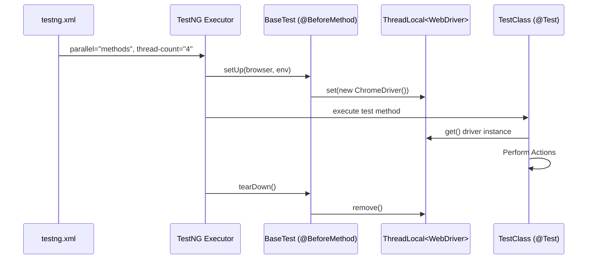
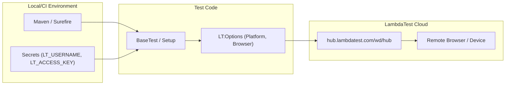

<!-- source: DeepWiki mcp.deepwiki.com · repo LambdaTest/agent-skills · page 3.1 Java Unit Testing — JUnit 5 and TestNG Skills · fetched 2026-10-26 -->

# Java Unit Testing — JUnit 5 and TestNG Skills

<details>
<summary>Relevant source files</summary>

The following files were used as context for generating this wiki page:

- [cicd-pipeline-skill/SKILL.md](cicd-pipeline-skill/SKILL.md)
- [cicd-pipeline-skill/reference/playbook.md](cicd-pipeline-skill/reference/playbook.md)
- [jest-skill/reference/advanced-patterns.md](jest-skill/reference/advanced-patterns.md)
- [jest-skill/reference/playbook.md](jest-skill/reference/playbook.md)
- [junit-5-skill/reference/advanced-patterns.md](junit-5-skill/reference/advanced-patterns.md)
- [junit-5-skill/reference/playbook.md](junit-5-skill/reference/playbook.md)
- [skills_index.json](skills_index.json)
- [testng-skill/SKILL.md](testng-skill/SKILL.md)
- [testng-skill/reference/advanced-patterns.md](testng-skill/reference/advanced-patterns.md)
- [testng-skill/reference/playbook.md](testng-skill/reference/playbook.md)

</details>


This page provides a technical deep dive into the Java unit testing skills available in the `agent-skills` repository, specifically focusing on **JUnit 5** and **TestNG**. These skills enable AI agents to generate production-grade test suites featuring advanced lifecycle management, dependency injection, mocking, and cloud-integrated parallel execution.

## 1. JUnit 5 (Jupiter) Skill Implementation

The JUnit 5 skill focuses on the modern "Jupiter" programming model, moving away from the legacy JUnit 4 architecture. It emphasizes the use of the Extension model and modular test construction.

### 1.1. Core Lifecycle and Annotations
JUnit 5 uses a hierarchical lifecycle. By default, a new test instance is created for every test method, but this can be overridden to `PER_CLASS` to share state across methods within the same class [junit-5-skill/reference/playbook.md:44-45]().

| Annotation | Function |
| :--- | :--- |
| `@BeforeAll` / `@AfterAll` | Static methods executed once per class (unless `PER_CLASS` is set) [junit-5-skill/reference/playbook.md:56-89](). |
| `@BeforeEach` / `@AfterEach` | Executed before/after every individual `@Test` [junit-5-skill/reference/playbook.md:61-84](). |
| `@Nested` | Allows grouping tests into inner classes for better organization [junit-5-skill/reference/playbook.md:214-229](). |
| `@Tag` | Filters tests for specific execution environments (e.g., "smoke", "regression") [junit-5-skill/reference/playbook.md:69](). |

### 1.2. Data-Driven Testing
JUnit 5 provides several ways to inject data into tests via the `junit-jupiter-params` artifact.

*   **CsvSource**: For simple inline comma-separated values [junit-5-skill/reference/playbook.md:97-106]().
*   **MethodSource**: For complex objects generated by a static factory method [junit-5-skill/reference/playbook.md:117-133]().
*   **ArgumentsProvider**: A reusable class-based provider for dynamic data generation [junit-5-skill/reference/advanced-patterns.md:34-43]().

### 1.3. Extension Model and Mockito Integration
The JUnit 5 extension model replaces the `Runner` and `Rule` APIs from JUnit 4. The `MockitoExtension` is the primary method for integrating mocking [junit-5-skill/reference/playbook.md:153-158]().

**Data Flow: Mockito Injection**
The following diagram illustrates how the `MockitoExtension` processes annotations to prepare the test instance.

Title: JUnit 5 Mockito Extension Data Flow
```mermaid
graph TD
    subgraph "JUnit_5_Engine"
        A["TestInstanceFactory"] --> B["MockitoExtension::postProcessTestInstance"]
    end

    subgraph "Mockito_Processing"
        B --> C{"Scan Annotations"}
        C -->|@Mock| D["Instantiate Mock Proxy"]
        C -->|@Spy| E["Wrap Real Instance"]
        C -->|@InjectMocks| F["Inject Dependencies into Target"]
    end

    D --> G["OrderServiceTest instance"]
    E --> G
    F --> G
    G --> H["@Test Method Execution"]
```
Sources: [junit-5-skill/reference/playbook.md:153-172](), [junit-5-skill/reference/advanced-patterns.md:121-140]()

---

## 2. TestNG Skill Implementation

TestNG is designed for more complex integration testing scenarios, offering powerful features like native XML-based suite configuration and method-level dependency management.

### 2.1. Suite Configuration (testng.xml)
Unlike JUnit, TestNG relies heavily on an XML configuration file to define execution logic, parallelization strategies, and global parameters [testng-skill/reference/playbook.md:49-84]().

*   **Parallelization**: Can be set at the `methods`, `classes`, or `tests` level [testng-skill/SKILL.md:88-91]().
*   **Listeners**: Intercept test events for custom reporting or retries (e.g., `IRetryAnalyzer`) [testng-skill/reference/advanced-patterns.md:66-73]().

### 2.2. Thread-Safe Driver Management
For parallel browser testing, the TestNG skill implements a `ThreadLocal` pattern within a `BaseTest` class to ensure that each thread maintains its own `WebDriver` instance [testng-skill/reference/playbook.md:103-147]().

Title: TestNG Thread-Safe Execution Flow

Sources: [testng-skill/reference/playbook.md:50-55](), [testng-skill/reference/playbook.md:103-147]()

### 2.3. Advanced Data Providers
TestNG's `@DataProvider` supports parallel execution and can return an `Iterator<Object[]>`, allowing for memory-efficient processing of large datasets from CSV or Excel [testng-skill/reference/playbook.md:182-219]().

---

## 3. Comparison of Core Capabilities

| Feature | JUnit 5 Implementation | TestNG Implementation |
| :--- | :--- | :--- |
| **Parallelism** | `junit-platform.properties` [junit-5-skill/reference/playbook.md:39-45]() | `testng.xml` suite attributes [testng-skill/SKILL.md:88-91]() |
| **Data Driving** | `@ParameterizedTest` + `@MethodSource` [junit-5-skill/reference/playbook.md:117-125]() | `@Test(dataProvider = "name")` [testng-skill/SKILL.md:51-67]() |
| **Dependencies** | Not natively supported (uses `@Nested`) | `dependsOnMethods` or `dependsOnGroups` [testng-skill/SKILL.md:36-39]() |
| **Assertions** | AssertJ or `Assertions.assertAll` [junit-5-skill/reference/playbook.md:74-79]() | `SoftAssert` (collects multiple failures) [testng-skill/SKILL.md:95-101]() |

---

## 4. LambdaTest Cloud Integration

Both skills support routing tests to the LambdaTest cloud. This is achieved by configuring a `RemoteWebDriver` (for Selenium-based tests) or utilizing environment variables for authentication.

### 4.1. Implementation via CI/CD
The `cicd-pipeline-skill` provides the YAML structure for injecting `LT_USERNAME` and `LT_ACCESS_KEY` into the test environment [cicd-pipeline-skill/SKILL.md:45-50]().

Title: Cloud Integration Architecture

Sources: [cicd-pipeline-skill/SKILL.md:24-56](), [testng-skill/reference/playbook.md:103-136]()

### 4.2. Reporting and Listeners
In production environments, both frameworks use listeners to report results back to the cloud dashboard:
*   **JUnit 5**: Uses `TestExecutionListener` to update test status via the LambdaTest API.
*   **TestNG**: Uses `ITestListener` to capture screenshots on failure and attach them to Allure reports [testng-skill/reference/playbook.md:149-156]().

Sources:
- [junit-5-skill/reference/playbook.md:1-235]()
- [testng-skill/SKILL.md:1-158]()
- [testng-skill/reference/playbook.md:1-219]()
- [junit-5-skill/reference/advanced-patterns.md:1-191]()
- [cicd-pipeline-skill/SKILL.md:1-122]()
- [testng-skill/reference/advanced-patterns.md:1-118]()

---

