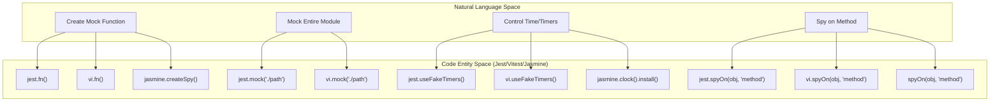
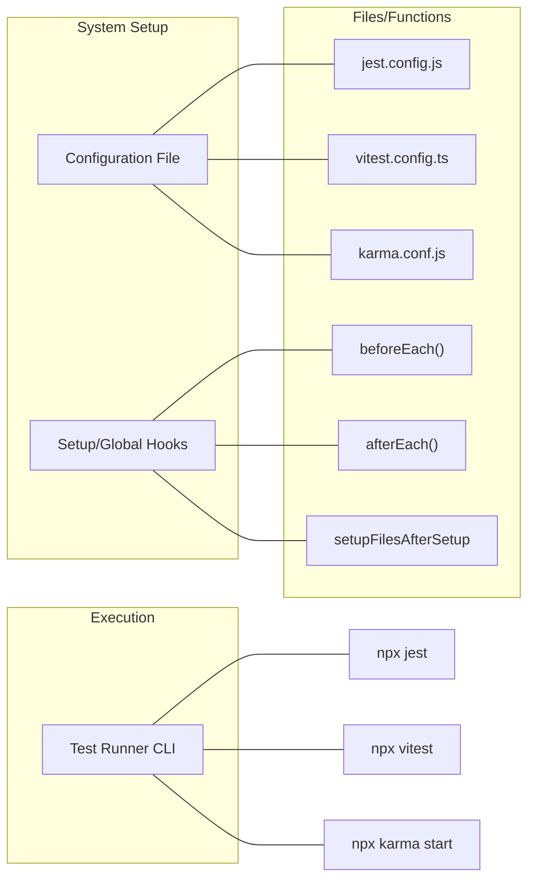

<!-- source: DeepWiki mcp.deepwiki.com · repo LambdaTest/agent-skills · page 3.2 JavaScript/TypeScript Unit Testing — Jest, Vitest, Mocha, Jasmine, and Karma Skills · fetched 2026-10-26 -->

# JavaScript/TypeScript Unit Testing — Jest, Vitest, Mocha, Jasmine, and Karma Skills

Relevant source files

The following files were used as context for generating this wiki page:

- [cicd-pipeline-skill/SKILL.md](cicd-pipeline-skill/SKILL.md)
- [cicd-pipeline-skill/reference/playbook.md](cicd-pipeline-skill/reference/playbook.md)
- [jasmine-skill/SKILL.md](jasmine-skill/SKILL.md)
- [jasmine-skill/reference/advanced-patterns.md](jasmine-skill/reference/advanced-patterns.md)
- [jasmine-skill/reference/playbook.md](jasmine-skill/reference/playbook.md)
- [jest-skill/SKILL.md](jest-skill/SKILL.md)
- [jest-skill/reference/advanced-patterns.md](jest-skill/reference/advanced-patterns.md)
- [jest-skill/reference/playbook.md](jest-skill/reference/playbook.md)
- [junit-5-skill/reference/advanced-patterns.md](junit-5-skill/reference/advanced-patterns.md)
- [junit-5-skill/reference/playbook.md](junit-5-skill/reference/playbook.md)
- [karma-skill/SKILL.md](karma-skill/SKILL.md)
- [karma-skill/reference/advanced-patterns.md](karma-skill/reference/advanced-patterns.md)
- [karma-skill/reference/playbook.md](karma-skill/reference/playbook.md)
- [mocha-skill/SKILL.md](mocha-skill/SKILL.md)
- [mocha-skill/reference/advanced-patterns.md](mocha-skill/reference/advanced-patterns.md)
- [mocha-skill/reference/playbook.md](mocha-skill/reference/playbook.md)
- [vitest-skill/SKILL.md](vitest-skill/SKILL.md)
- [vitest-skill/reference/advanced-patterns.md](vitest-skill/reference/advanced-patterns.md)
- [vitest-skill/reference/playbook.md](vitest-skill/reference/playbook.md)

This page provides technical documentation for the JavaScript and TypeScript unit testing skills within the `agent-skills` repository. It covers the configuration, mocking APIs, and advanced testing patterns for five major frameworks: Jest, Vitest, Mocha, Jasmine, and Karma.

## 1. Jest Skill

Jest is a comprehensive testing framework focusing on simplicity and support for large-scale projects. It includes a built-in runner, assertion library, and mocking support.

### Implementation and Configuration
Jest configuration is typically handled via `jest.config.js`. Key settings include `testEnvironment` (e.g., `node` or `jsdom`), `transform` (for TypeScript support via `ts-jest` or `@swc/jest`), and `coverageThreshold` for quality gates [jest-skill/reference/playbook.md:6-25]().

### Mocking and Spies
Jest provides a powerful mocking API to isolate units of code:
*   **Module Mocking:** `jest.mock()` allows for full or partial replacement of modules [jest-skill/reference/playbook.md:44-54]().
*   **Manual Mocks:** Located in `__mocks__/` directories for consistent behavior across tests [jest-skill/reference/playbook.md:56-61]().
*   **Timer Mocking:** `jest.useFakeTimers()` allows controlling time-dependent logic like debouncing [jest-skill/reference/advanced-patterns.md:52-60]().

### React Testing Library (RTL) Integration
For UI testing, Jest integrates with RTL to test components from a user's perspective.
*   **Setup:** Requires `jsdom` and `@testing-library/jest-dom` [jest-skill/reference/playbook.md:31-32]().
*   **Patterns:** Uses `screen` for querying elements and `userEvent` for simulating interactions [jest-skill/reference/advanced-patterns.md:142-154]().

### Snapshot Testing
Jest captures the serialized state of a component or object to detect regressions.
*   **File Snapshots:** `toMatchSnapshot()` [jest-skill/SKILL.md:135-138]().
*   **Inline Snapshots:** `toMatchInlineSnapshot()` where the expectation is written back into the source code [jest-skill/reference/advanced-patterns.md:113-118]().

**Sources:** [jest-skill/SKILL.md:1-179](), [jest-skill/reference/playbook.md:1-100](), [jest-skill/reference/advanced-patterns.md:1-218]()

---

## 2. Vitest Skill

Vitest is a Vite-native testing framework that provides a Jest-compatible API with faster execution and native ESM support.

### Core Features
*   **Vite-Native:** Reuses Vite's configuration and transformers [vitest-skill/SKILL.md:3-7]().
*   **In-Source Testing:** Allows writing tests directly within the source files using `import.meta.vitest` [vitest-skill/SKILL.md:73-82]().
*   **Workspace Support:** Manages monorepos via `vitest.workspace.ts` [vitest-skill/reference/playbook.md:44-52]().

### Mocking API
While Jest uses the `jest` namespace, Vitest uses `vi`.
*   **Mocking:** `vi.mock()` and `vi.fn()` [vitest-skill/SKILL.md:45-56]().
*   **Globals:** `vi.stubGlobal()` for mocking browser APIs like `fetch` or `IntersectionObserver` [vitest-skill/reference/playbook.md:68-83]().

### Performance and Parallelism
Vitest supports concurrent test execution within a single file using `describe.concurrent` and configurable worker pools (`threads`, `forks`, or `vmThreads`) [vitest-skill/reference/advanced-patterns.md:60-76]().

**Sources:** [vitest-skill/SKILL.md:1-145](), [vitest-skill/reference/playbook.md:1-235](), [vitest-skill/reference/advanced-patterns.md:1-167]()

---

## 3. Jasmine and Karma Skills

Jasmine is a Behavior-Driven Development (BDD) framework, while Karma is a test runner that executes Jasmine tests in real browsers.

### Jasmine Spies
Jasmine relies heavily on "spies" to track calls and mock behavior:
*   `spyOn(obj, 'method')`: Tracks an existing method [jasmine-skill/reference/playbook.md:79-88]().
*   `jasmine.createSpyObj('name', ['methods'])`: Creates a full mock object [jasmine-skill/reference/playbook.md:125-137]().
*   **Clock Control:** `jasmine.clock().install()` for mocking `setTimeout` and `Date` [jasmine-skill/reference/playbook.md:206-233]().

### Karma Configuration
Karma's `karma.conf.js` manages the browser lifecycle.
*   **Launchers:** Supports `ChromeHeadless`, `Firefox`, and custom launchers for CI environments [karma-skill/reference/playbook.md:73-84]().
*   **Reporters:** Generates coverage (via `karma-coverage`) and JUnit results for CI integration [karma-skill/reference/playbook.md:35-65]().

### Angular Testing Pattern
Karma is the default runner for Angular, utilizing `TestBed` for component compilation and `fakeAsync` for handling zone-based asynchronous tasks [karma-skill/reference/playbook.md:114-145]().

**Sources:** [jasmine-skill/reference/playbook.md:1-258](), [karma-skill/reference/playbook.md:1-94](), [karma-skill/reference/advanced-patterns.md:1-101]()

---

## 4. Code Entity Space Mapping

The following diagrams bridge natural language concepts to specific code entities within the repository.

### Diagram 1: Mocking and Spying Entity Mapping
This diagram maps common testing actions to the specific framework functions.

**Sources:** [jest-skill/SKILL.md:60-86](), [vitest-skill/SKILL.md:45-68](), [jasmine-skill/reference/playbook.md:68-121]()

### Diagram 2: Configuration and Lifecycle Mapping
This diagram maps the setup and execution phases to specific files and hooks.

**Sources:** [jest-skill/reference/playbook.md:6-25](), [vitest-skill/reference/playbook.md:6-39](), [karma-skill/reference/playbook.md:5-94]()

---

## 5. Summary Table: Framework Comparison

| Feature | Jest | Vitest | Jasmine |
| :--- | :--- | :--- | :--- |
| **Runner** | Built-in | Built-in | Requires Karma (for browser) |
| **Mocking Namespace** | `jest` | `vi` | `jasmine` / `spyOn` |
| **TypeScript Support** | via `ts-jest` / `@swc/jest` | Native (Vite) | via `jasmine-ts` |
| **Snapshots** | Built-in | Built-in | Requires plugins |
| **Async Support** | `async/await`, `done` | `async/await` | `async/await`, `done` |

**Sources:** [jest-skill/SKILL.md:144-149](), [vitest-skill/SKILL.md:115-120](), [jasmine-skill/reference/playbook.md:5-11]()

## 6. CI/CD Integration

All frameworks are designed to run in CI/CD pipelines. A common pattern involves:
1.  **Sharding:** Splitting tests across multiple runners using `--shard` [cicd-pipeline-skill/reference/playbook.md:48]().
2.  **Coverage Gates:** Enforcing a minimum percentage (e.g., 80%) via `coverageThreshold` [jest-skill/reference/playbook.md:15]().
3.  **Artifacts:** Uploading JUnit XML and HTML coverage reports for visibility [cicd-pipeline-skill/reference/playbook.md:49-52]().

**Sources:** [cicd-pipeline-skill/reference/playbook.md:34-53](), [jest-skill/reference/playbook.md:12-16]()

---

