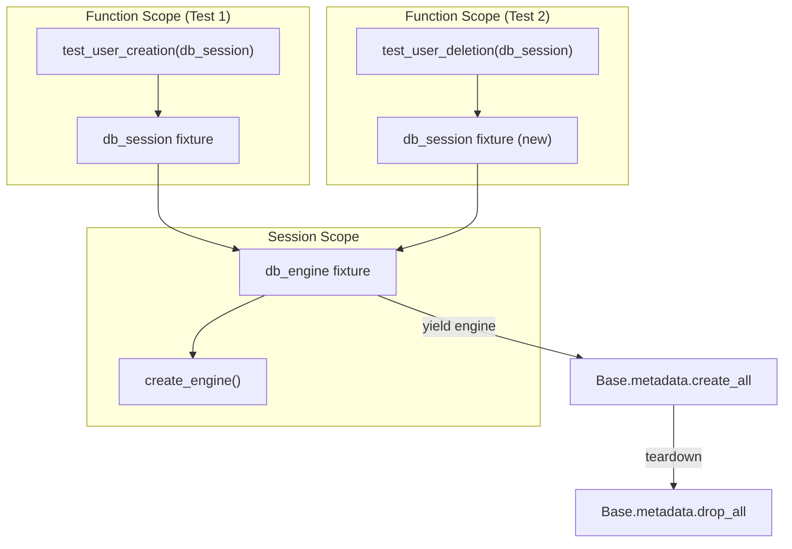
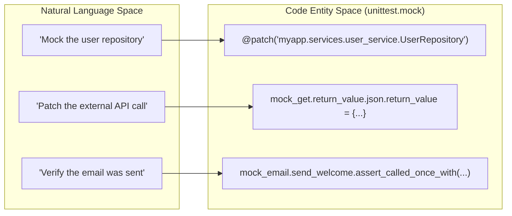
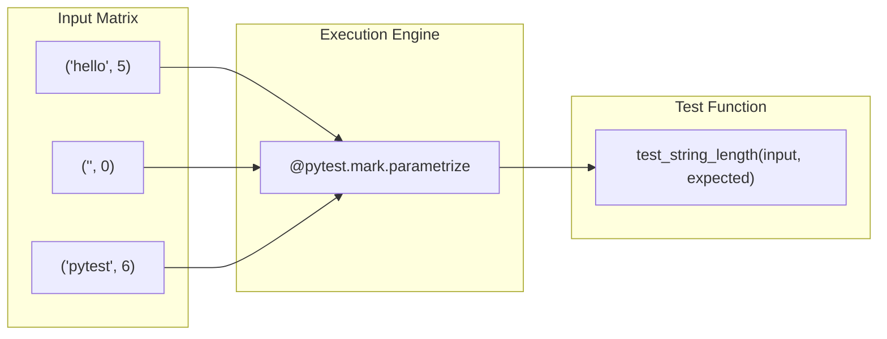

<!-- source: DeepWiki mcp.deepwiki.com · repo LambdaTest/agent-skills · page 3.3 Python Unit Testing — pytest and unittest Skills · fetched 2026-10-26 -->

# Python Unit Testing — pytest and unittest Skills

<details>
<summary>Relevant source files</summary>

The following files were used as context for generating this wiki page:

- [junit-5-skill/SKILL.md](junit-5-skill/SKILL.md)
- [phpunit-skill/reference/playbook.md](phpunit-skill/reference/playbook.md)
- [pytest-skill/SKILL.md](pytest-skill/SKILL.md)
- [pytest-skill/reference/advanced-patterns.md](pytest-skill/reference/advanced-patterns.md)
- [pytest-skill/reference/playbook.md](pytest-skill/reference/playbook.md)
- [testunit-skill/reference/playbook.md](testunit-skill/reference/playbook.md)
- [unittest-skill/SKILL.md](unittest-skill/SKILL.md)
- [unittest-skill/reference/playbook.md](unittest-skill/reference/playbook.md)

</details>


This page provides a technical deep dive into the Python unit testing ecosystem within the `agent-skills` repository. It covers the two primary frameworks: `pytest` (the modern, fixture-based standard) and `unittest` (the Python standard library's xUnit-style framework). The documentation includes implementation details for fixtures, mocking, parameterized testing, and CI/CD integration.

## 1. Framework Comparison and Selection

The repository maintains two distinct skills for Python unit testing, triggered by specific natural language cues or code signatures.

| Feature | `pytest` | `unittest` |
| :--- | :--- | :--- |
| **Style** | Functional (functions/fixtures) | Object-Oriented (`TestCase` classes) |
| **Assertions** | Plain `assert` (via bytecode rewriting) | `self.assert*` methods |
| **Fixtures** | Dependency Injection (scoped) | `setUp`/`tearDown` hooks |
| **Parametrization** | `@pytest.mark.parametrize` | `self.subTest` or `parameterized` lib |
| **Mocking** | `pytest-mock` (mocker fixture) | `unittest.mock` (patch/MagicMock) |

Sources: [pytest-skill/SKILL.md:1-15](), [unittest-skill/SKILL.md:1-15]()

---

## 2. Pytest Implementation

`pytest` is the recommended framework for modern Python projects due to its powerful fixture system and simplified assertion syntax.

### 2.1. Fixture Lifecycle and Scoping
Fixtures in `pytest` use a dependency injection model. They are defined using the `@pytest.fixture` decorator and can be scoped to `function` (default), `class`, `module`, or `session`.

**Fixture Data Flow:**
The diagram below illustrates how a session-scoped database engine is shared across multiple function-scoped sessions.

**Title: Pytest Fixture Dependency Graph**

Sources: [pytest-skill/reference/playbook.md:51-69](), [pytest-skill/reference/advanced-patterns.md:10-27]()

### 2.2. Advanced Patterns
*   **Factory Fixtures**: Used to create multiple instances of a model within a single test while ensuring cleanup [pytest-skill/reference/playbook.md:71-85]().
*   **Indirect Parametrization**: Allows passing parameters to a fixture rather than the test function directly [pytest-skill/reference/advanced-patterns.md:49-58]().
*   **Conftest.py**: Centralized location for shared fixtures and custom hooks like `pytest_addoption` [pytest-skill/reference/advanced-patterns.md:124-133]().

---

## 3. Python unittest Implementation

`unittest` follows the xUnit pattern, requiring tests to be wrapped in classes inheriting from `unittest.TestCase`.

### 3.1. Core Structure and Lifecycle
The framework relies on specific method names for lifecycle management:
*   `setUp()`: Runs before every test method [unittest-skill/SKILL.md:112]().
*   `tearDown()`: Runs after every test method [unittest-skill/SKILL.md:114]().
*   `setUpClass()` / `tearDownClass()`: Class-level hooks for expensive resources [unittest-skill/SKILL.md:111-115]().

### 3.2. Mocking and Patching
`unittest` uses the `unittest.mock` library. A critical pattern is patching "at the destination": patching the reference where the object is *imported*, not where it is *defined*.

**Title: Natural Language to unittest Mocking Entities**

Sources: [unittest-skill/reference/playbook.md:191-204](), [unittest-skill/SKILL.md:90-106]()

---

## 4. Data-Driven Testing Patterns

Both frameworks support data-driven testing, though the implementation differs significantly.

| Pattern | pytest Implementation | unittest Implementation |
| :--- | :--- | :--- |
| **Basic** | `@pytest.mark.parametrize` [pytest-skill/SKILL.md:78-89]() | `self.subTest()` context manager [unittest-skill/SKILL.md:80-86]() |
| **Matrix** | Stacked decorators (Cartesian product) [pytest-skill/reference/playbook.md:127-132]() | Nested loops with `self.subTest` |
| **External** | Fixture reading CSV/JSON [pytest-skill/reference/playbook.md:94-99]() | `parameterized` library or manual loading |

**Title: Parameterized Test Flow (pytest)**

Sources: [pytest-skill/SKILL.md:78-82](), [pytest-skill/reference/playbook.md:107-115]()

---

## 5. Configuration and CI/CD Integration

### 5.1. Project Configuration
Modern Python projects utilize `pyproject.toml` to centralize testing configuration, including markers, coverage thresholds, and default options.

**Example `pyproject.toml` for pytest:**
```toml
[tool.pytest.ini_options]
testpaths = ["tests"]
addopts = "-v --strict-markers --tb=short"
markers = [
    "slow: marks tests as slow",
    "integration: integration tests"
]
```
Sources: [pytest-skill/reference/playbook.md:23-41](), [pytest-skill/SKILL.md:172-177]()

### 5.2. Coverage Enforcement
The `coverage.py` tool is used across both frameworks to enforce quality gates. Configuration is typically stored in `.coveragerc` or `pyproject.toml`.

*   **Source**: Defines which directories to measure [unittest-skill/reference/playbook.md:56]().
*   **Fail Under**: Sets the minimum percentage for CI to pass [unittest-skill/reference/playbook.md:61]().
*   **Branch Coverage**: Tracks whether both branches of conditional statements are executed [unittest-skill/reference/playbook.md:58]().

### 5.3. Execution Commands
| Task | pytest | unittest |
| :--- | :--- | :--- |
| **Run All** | `pytest` | `python -m unittest discover` |
| **Specific File** | `pytest tests/test_api.py` | `python -m unittest tests/test_api.py` |
| **By Marker/Name**| `pytest -m smoke` | N/A (Standard) |
| **With Coverage** | `pytest --cov=src` | `coverage run -m unittest` |

Sources: [pytest-skill/SKILL.md:157-168](), [unittest-skill/SKILL.md:118-119]()

---
**Sources:**
* `pytest-skill/SKILL.md`
* `pytest-skill/reference/playbook.md`
* `pytest-skill/reference/advanced-patterns.md`
* `unittest-skill/SKILL.md`
* `unittest-skill/reference/playbook.md`

---

