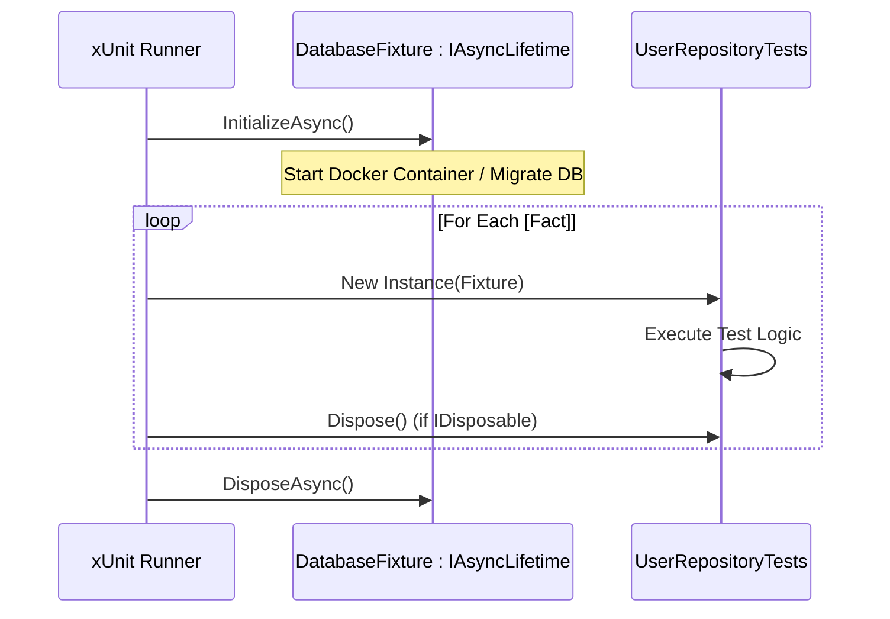

<!-- source: DeepWiki mcp.deepwiki.com · repo LambdaTest/agent-skills · page 3.4 .NET Unit Testing — NUnit, xUnit, and MSTest Skills · fetched 2026-10-26 -->

# .NET Unit Testing — NUnit, xUnit, and MSTest Skills

<details>
<summary>Relevant source files</summary>

The following files were used as context for generating this wiki page:

- [mstest-skill/SKILL.md](mstest-skill/SKILL.md)
- [mstest-skill/reference/advanced-patterns.md](mstest-skill/reference/advanced-patterns.md)
- [mstest-skill/reference/playbook.md](mstest-skill/reference/playbook.md)
- [nunit-skill/SKILL.md](nunit-skill/SKILL.md)
- [nunit-skill/reference/advanced-patterns.md](nunit-skill/reference/advanced-patterns.md)
- [nunit-skill/reference/playbook.md](nunit-skill/reference/playbook.md)
- [testunit-skill/reference/advanced-patterns.md](testunit-skill/reference/advanced-patterns.md)
- [unittest-skill/reference/advanced-patterns.md](unittest-skill/reference/advanced-patterns.md)
- [xunit-skill/SKILL.md](xunit-skill/SKILL.md)
- [xunit-skill/reference/advanced-patterns.md](xunit-skill/reference/advanced-patterns.md)
- [xunit-skill/reference/playbook.md](xunit-skill/reference/playbook.md)

</details>


This page provides a technical deep dive into the three primary .NET unit testing frameworks supported by the Agent Skills repository. It covers framework-specific attributes, lifecycle management, data-driven testing patterns, and advanced integration with mocking libraries like `Moq` and assertion libraries like `FluentAssertions`.

## Framework Comparison and Mapping

While all three frameworks target the .NET ecosystem, they differ in their approach to test discovery, lifecycle hooks, and parallelization.

### Natural Language to Code Entity Mapping

The following diagram maps common testing concepts to their specific implementations across the three frameworks.

**Diagram: .NET Framework Entity Mapping**

```mermaid
graph TD
    subgraph "Testing Concept"
        TC1["Test Class Container"]
        TC2["Individual Test"]
        TC3["Parameterized Test"]
        TC4["Per-Test Setup"]
        TC5["Shared Context"]
    end

    subgraph "NUnit Entities"
        N1["[TestFixture]"]
        N2["[Test]"]
        N3["[TestCase]"]
        N4["[SetUp]"]
        N5["[OneTimeSetUp]"]
    end

    subgraph "xUnit Entities"
        X1["Public Class"]
        X2["[Fact]"]
        X3["[Theory]"]
        X4["Constructor"]
        X5["IClassFixture<T>"]
    end

    subgraph "MSTest Entities"
        M1["[TestClass]"]
        M2["[TestMethod]"]
        M3["[DataTestMethod]"]
        M4["[TestInitialize]"]
        M5["[ClassInitialize]"]
    end

    TC1 --> N1
    TC1 --> X1
    TC1 --> M1
    
    TC2 --> N2
    TC2 --> X2
    TC2 --> M2
    
    TC3 --> N3
    TC3 --> X3
    TC3 --> M3
    
    TC4 --> N4
    TC4 --> X4
    TC4 --> M4
    
    TC5 --> N5
    TC5 --> X5
    TC5 --> M5
```

**Sources:** [nunit-skill/SKILL.md:129-137](), [xunit-skill/SKILL.md:123-135](), [mstest-skill/SKILL.md:93-103]()

---

## NUnit 3 Testing Skill

NUnit uses a constraint-based assertion model (`Assert.That`) and provides extensive attributes for controlling test execution and lifecycle.

### Lifecycle and Configuration
NUnit tests are organized within classes marked with the `[TestFixture]` attribute [nunit-skill/SKILL.md:26-27](). Setup and teardown are handled via `[SetUp]` and `[TearDown]` for individual tests, and `[OneTimeSetUp]` / `[OneTimeTearDown]` for the entire fixture [nunit-skill/reference/playbook.md:219-230]().

### Data-Driven Testing
NUnit supports multiple ways to parameterize tests:
*   **`[TestCase]`**: For simple inline values [nunit-skill/reference/playbook.md:111-115]().
*   **`[TestCaseSource]`**: For complex data sets generated by a method or property [nunit-skill/reference/playbook.md:121-132]().
*   **`[Combinatorial]`**: To test all possible combinations of provided values [nunit-skill/reference/advanced-patterns.md:30-38]().

### Constraint Model (Assert.That)
The modern NUnit syntax emphasizes readability through the constraint model:
```csharp
Assert.That(actual, Is.EqualTo(expected));
Assert.That(list, Has.Exactly(5).Items.And.Is.Ordered);
Assert.That(() => service.Do(), Throws.TypeOf<ArgumentException>());
```
**Sources:** [nunit-skill/reference/playbook.md:163-180](), [nunit-skill/reference/playbook.md:197-203]()

---

## xUnit.net Testing Skill

xUnit is designed for maximum test isolation. Unlike NUnit or MSTest, it creates a **new instance of the test class** for every single test execution [xunit-skill/reference/advanced-patterns.md:119-122]().

### Architecture and Data Flow
The following diagram illustrates how xUnit manages shared state via `IClassFixture`.

**Diagram: xUnit IClassFixture Data Flow**

**Sources:** [xunit-skill/reference/playbook.md:157-186](), [xunit-skill/reference/advanced-patterns.md:47-57]()

### Key Patterns
*   **`[Fact]` vs `[Theory]`**: `[Fact]` is for invariant tests; `[Theory]` is for data-driven tests using `[InlineData]`, `[MemberData]`, or `[ClassData]` [xunit-skill/SKILL.md:30-74]().
*   **Shared Context**: Use `IClassFixture<T>` for sharing state within a class and `[CollectionDefinition]` with `ICollectionFixture<T>` for sharing across multiple classes [xunit-skill/reference/playbook.md:155-208]().
*   **Async Testing**: Prefers `IAsyncLifetime` over `IDisposable` for asynchronous setup/teardown [xunit-skill/reference/advanced-patterns.md:47-57]().

---

## MSTest Testing Skill

MSTest is Microsoft's official testing framework. It is often preferred in enterprise environments due to its tight integration with Visual Studio.

### Core Implementation
MSTest requires the `[TestClass]` attribute on classes and `[TestMethod]` on test methods [mstest-skill/SKILL.md:26-34](). It uses static methods for assembly and class-level initialization [mstest-skill/SKILL.md:96-102]().

### Data-Driven Features
*   **`[DataRow]`**: Standard inline data [mstest-skill/reference/playbook.md:152-156]().
*   **`[DynamicData]`**: Loads data from a method or property [mstest-skill/reference/playbook.md:190-192]().
*   **`[CsvDataSource]`**: MSTest has built-in support for external files like CSVs [mstest-skill/reference/advanced-patterns.md:28-30]().

### Advanced Integration
MSTest often utilizes `FluentAssertions` to improve its native assertion library:
```csharp
// Native
Assert.AreEqual(expected, actual);
// Fluent
actual.Should().Be(expected).And.NotBeNull();
```
**Sources:** [mstest-skill/reference/playbook.md:208-216](), [mstest-skill/SKILL.md:78-91]()

---

## Shared .NET Patterns and CI/CD

Regardless of the framework, several patterns are standard across the .NET ecosystem.

### Project Dependencies (.csproj)
All frameworks require the `Microsoft.NET.Test.Sdk` and their respective test adapters for execution via `dotnet test`.
```xml
<ItemGroup>
  <PackageReference Include="Microsoft.NET.Test.Sdk" Version="17.9.0" />
  <PackageReference Include="FluentAssertions" Version="6.12.0" />
  <PackageReference Include="Moq" Version="4.20.70" />
  <PackageReference Include="coverlet.collector" Version="6.0.0" />
</ItemGroup>
```
**Sources:** [nunit-skill/reference/playbook.md:15-25](), [xunit-skill/reference/playbook.md:15-27](), [mstest-skill/reference/playbook.md:15-28]()

### Execution and Parallelization
Parallelization is typically configured via a `.runsettings` file or framework-specific attributes.
*   **NUnit**: Uses `[Parallelizable]` attribute [nunit-skill/reference/advanced-patterns.md:112-113]().
*   **xUnit**: Parallelizes by test collection (class) by default [xunit-skill/reference/playbook.md:31-41]().
*   **MSTest**: Configured in `.runsettings` under the `<Parallelize>` tag [mstest-skill/reference/playbook.md:36-39]().

### Code Coverage
Code coverage is enforced using `coverlet.collector`. The configuration in `.runsettings` allows excluding generated code or specific namespaces [nunit-skill/reference/playbook.md:39-48](), [mstest-skill/reference/playbook.md:43-55]().

**Sources:**
* `nunit-skill/reference/playbook.md`
* `xunit-skill/reference/playbook.md`
* `mstest-skill/reference/playbook.md`
* `nunit-skill/SKILL.md`
* `xunit-skill/SKILL.md`
* `mstest-skill/SKILL.md`
* `nunit-skill/reference/advanced-patterns.md`
* `xunit-skill/reference/advanced-patterns.md`
* `mstest-skill/reference/advanced-patterns.md`

---

