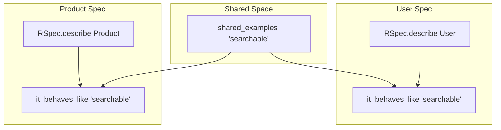
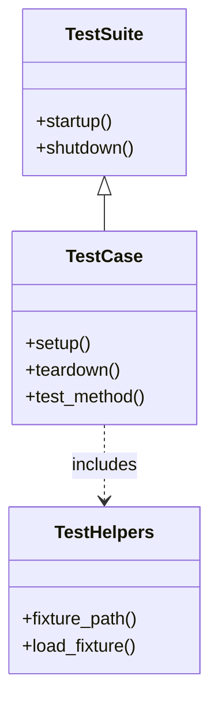
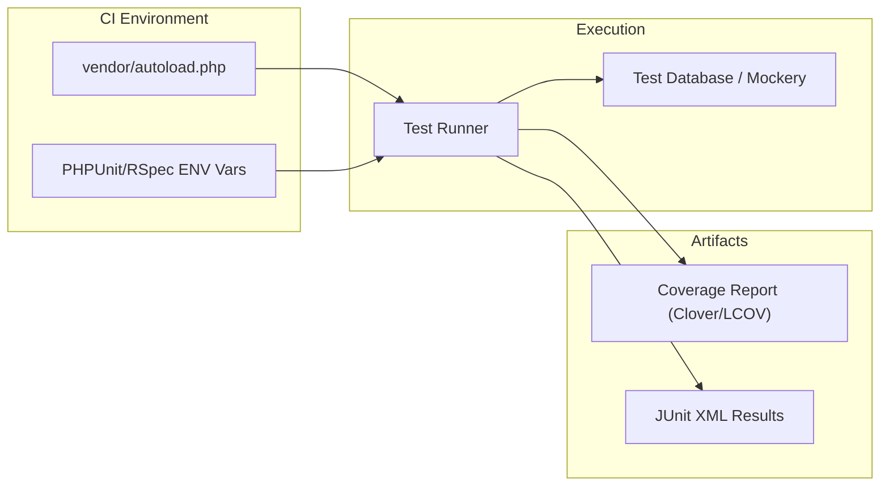

<!-- source: DeepWiki mcp.deepwiki.com · repo LambdaTest/agent-skills · page 3.5 Ruby and PHP Unit Testing — RSpec, Test::Unit, and PHPUnit Skills · fetched 2026-10-26 -->

# Ruby and PHP Unit Testing — RSpec, Test::Unit, and PHPUnit Skills

<details>
<summary>Relevant source files</summary>

The following files were used as context for generating this wiki page:

- [capybara-skill/SKILL.md](capybara-skill/SKILL.md)
- [capybara-skill/reference/advanced-patterns.md](capybara-skill/reference/advanced-patterns.md)
- [capybara-skill/reference/cloud-integration.md](capybara-skill/reference/cloud-integration.md)
- [capybara-skill/reference/playbook.md](capybara-skill/reference/playbook.md)
- [nunit-skill/reference/advanced-patterns.md](nunit-skill/reference/advanced-patterns.md)
- [phpunit-skill/SKILL.md](phpunit-skill/SKILL.md)
- [phpunit-skill/reference/advanced-patterns.md](phpunit-skill/reference/advanced-patterns.md)
- [phpunit-skill/reference/playbook.md](phpunit-skill/reference/playbook.md)
- [protractor-skill/reference/cloud-integration.md](protractor-skill/reference/cloud-integration.md)
- [rspec-skill/SKILL.md](rspec-skill/SKILL.md)
- [rspec-skill/reference/advanced-patterns.md](rspec-skill/reference/advanced-patterns.md)
- [rspec-skill/reference/playbook.md](rspec-skill/reference/playbook.md)
- [testunit-skill/SKILL.md](testunit-skill/SKILL.md)
- [testunit-skill/reference/advanced-patterns.md](testunit-skill/reference/advanced-patterns.md)
- [testunit-skill/reference/playbook.md](testunit-skill/reference/playbook.md)
- [unittest-skill/reference/advanced-patterns.md](unittest-skill/reference/advanced-patterns.md)
- [unittest-skill/reference/playbook.md](unittest-skill/reference/playbook.md)

</details>


This section provides a technical deep dive into the unit testing skills for Ruby and PHP within the TestMu AI Agent Skills repository. It covers the implementation of BDD-style testing with RSpec, classic xUnit patterns with Ruby's `Test::Unit`, and enterprise-grade PHP testing with PHPUnit.

## 1. RSpec Skill (Ruby)

RSpec is a Behavior-Driven Development (BDD) framework for Ruby. The skill focuses on using the `expect().to` syntax, lazy-loaded `let` blocks, and sophisticated mocking with `instance_double`.

### 1.1 Core Architecture and DSL
RSpec tests are structured using `describe` and `context` blocks to create a readable hierarchy of behaviors [rspec-skill/SKILL.md:24-46]().

| Feature | Code Entity | Purpose |
| :--- | :--- | :--- |
| **Lazy Loading** | `let(:user) { ... }` | Memoized helper method; only evaluates when called [rspec-skill/SKILL.md:94-96](). |
| **Subject** | `subject(:calc) { ... }` | Defines the primary object under test [rspec-skill/SKILL.md:25](). |
| **Hooks** | `before(:each)`, `after(:all)` | Lifecycle management for setup/teardown [rspec-skill/SKILL.md:98-104](). |
| **Doubles** | `instance_double(Class)` | Verifying doubles that check if methods exist on the real class [rspec-skill/reference/playbook.md:98-99](). |

### 1.2 Advanced Patterns: Shared Examples
Shared examples allow for dry testing of polymorphic interfaces or common behaviors across different classes.

**Data Flow for Shared Examples**
The following diagram illustrates how `it_behaves_like` injects test logic into different resource specs.

Title: RSpec Shared Examples Logic

Sources: [rspec-skill/reference/playbook.md:193-224]()

## 2. Test::Unit Skill (Ruby)

`Test::Unit` follows the classic xUnit architecture, utilizing class inheritance and specific method naming conventions (`test_*`).

### 2.1 Implementation Details
Tests inherit from `Test::Unit::TestCase`. Unlike RSpec, it relies on instance variables defined in `setup` and explicit assertion methods [testunit-skill/SKILL.md:24-50]().

*   **Data-Driven Testing**: The `data` method allows running the same test logic against multiple inputs [testunit-skill/reference/playbook.md:212-228]().
*   **Sub-Test Grouping**: Use `sub_test_case` to group related assertions within a single test class [testunit-skill/reference/playbook.md:277-278]().
*   **Mocking**: Integrated via `test-unit-rr` for double-entry mocking [testunit-skill/reference/playbook.md:12]().

### 2.2 Project Structure and Lifecycle
Title: Test::Unit Entity Mapping

Sources: [testunit-skill/reference/playbook.md:46-85](), [testunit-skill/SKILL.md:81-102]()

## 3. PHPUnit Skill (PHP)

PHPUnit is the standard testing framework for PHP. The skill implements modern PHP 8+ features including Attributes for metadata and Generators for data providers.

### 3.1 Modern Configuration (PHP 8.2+)
The skill promotes the use of Attributes over legacy DocBlock annotations for better static analysis support.

| Attribute | Purpose |
| :--- | :--- |
| `#[Test]` | Marks a method as a test case [phpunit-skill/reference/playbook.md:125](). |
| `#[CoversClass(X::class)]` | Specifies which class is being tested for coverage [phpunit-skill/reference/playbook.md:126](). |
| `#[DataProvider('method')]` | Links a test to a data source [phpunit-skill/reference/playbook.md:127](). |

### 3.2 Mocking and Test Doubles
The skill supports both PHPUnit's native `createMock()` and the more expressive `Mockery` library.

**PHPUnit Mocking Implementation:**
1.  **Creation**: `$this->createMock(Interface::class)` [phpunit-skill/SKILL.md:104]().
2.  **Expectation**: `expects($this->once())` [phpunit-skill/SKILL.md:105]().
3.  **Constraint**: `with($this->isInstanceOf(User::class))` [phpunit-skill/SKILL.md:107]().
4.  **Action**: `willReturn($value)` [phpunit-skill/SKILL.md:108]().

### 3.3 Data Providers with Generators
Using `\Generator` for data providers is recommended for large datasets to reduce memory consumption.
```php
public static function invalidEmailProvider(): \Generator
{
    yield 'no @ symbol' => ['invalid', 'missing @'];
    yield 'no domain' => ['user@', 'missing domain'];
}
```
Sources: [phpunit-skill/reference/playbook.md:180-188]()

## 4. CI/CD and Coverage Integration

All three skills emphasize automated coverage enforcement and environment isolation.

### 4.1 Coverage Tooling
*   **Ruby (RSpec/Test::Unit)**: Uses `SimpleCov`. Configuration typically sets a `minimum_coverage` threshold (e.g., 80-90%) [rspec-skill/reference/playbook.md:31-39](), [testunit-skill/reference/playbook.md:48-54]().
*   **PHP**: Uses `Xdebug` in `coverage` mode. The `phpunit.xml` file defines the `source` directory and the `report` output format (HTML/Clover) [phpunit-skill/reference/playbook.md:31-79]().

### 4.2 Pipeline Architecture
Title: Unit Test Pipeline Data Flow

Sources: [phpunit-skill/reference/playbook.md:23-27](), [rspec-skill/reference/playbook.md:5-19](), [testunit-skill/reference/playbook.md:87-111]()

## 5. Summary Table of Assertions

| Assertion Type | RSpec (Expect) | Test::Unit (Assert) | PHPUnit (Assert) |
| :--- | :--- | :--- | :--- |
| **Equality** | `expect(a).to eq(b)` | `assert_equal(a, b)` | `$this->assertEquals(a, b)` |
| **Identity** | `expect(a).to be(b)` | `assert_same(a, b)` | `$this->assertSame(a, b)` |
| **Exceptions** | `expect {}.to raise_error` | `assert_raise(E) {}` | `$this->expectException(E)` |
| **Regex** | `expect(s).to match(/r/)` | `assert_match(/r/, s)` | `$this->assertMatchesRegularExpression()` |
| **Nullity** | `expect(a).to be_nil` | `assert_nil(a)` | `$this->assertNull(a)` |

Sources: [rspec-skill/SKILL.md:52-89](), [testunit-skill/SKILL.md:55-77](), [phpunit-skill/SKILL.md:80-97]()

---

