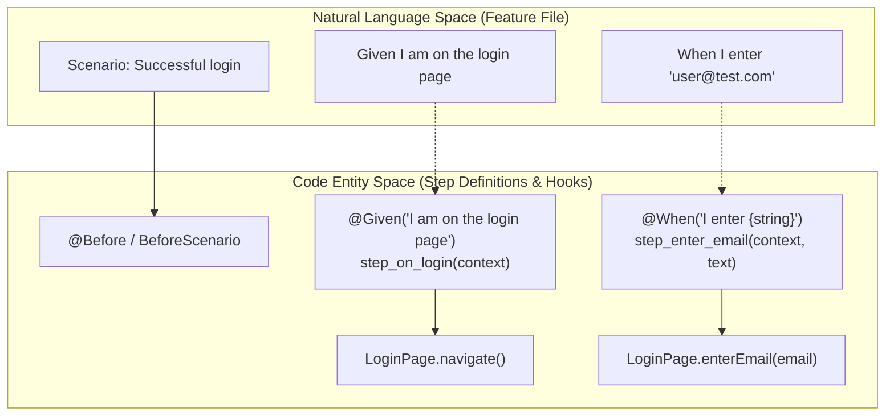
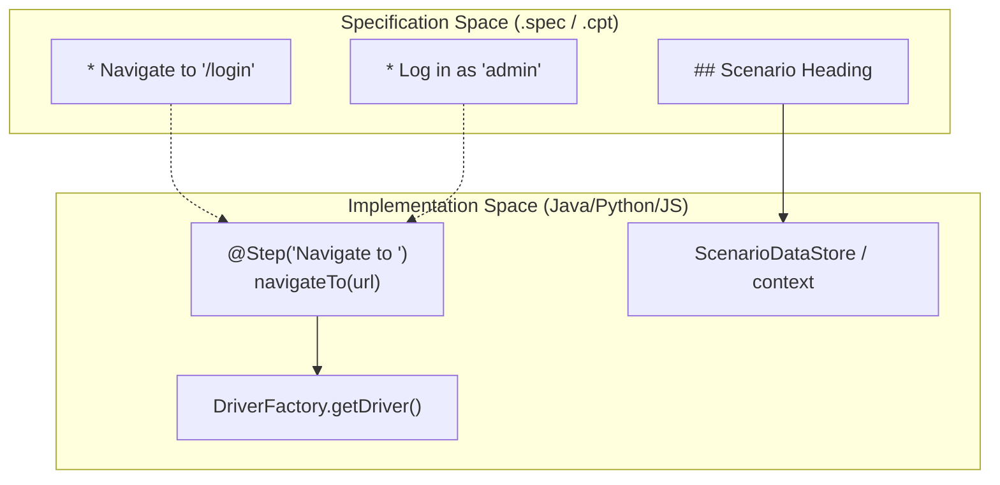

<!-- source: DeepWiki mcp.deepwiki.com · repo LambdaTest/agent-skills · page 4 BDD Testing Skills · fetched 2026-10-26 -->

# BDD Testing Skills

Relevant source files

The following files were used as context for generating this wiki page:

- [behat-skill/reference/advanced-patterns.md](behat-skill/reference/advanced-patterns.md)
- [behat-skill/reference/playbook.md](behat-skill/reference/playbook.md)
- [behave-skill/SKILL.md](behave-skill/SKILL.md)
- [behave-skill/reference/playbook.md](behave-skill/reference/playbook.md)
- [cucumber-skill/SKILL.md](cucumber-skill/SKILL.md)
- [cucumber-skill/reference/playbook.md](cucumber-skill/reference/playbook.md)
- [gauge-skill/SKILL.md](gauge-skill/SKILL.md)
- [gauge-skill/reference/playbook.md](gauge-skill/reference/playbook.md)
- [selenium-skill/reference/playbook.md](selenium-skill/reference/playbook.md)
- [specflow-skill/SKILL.md](specflow-skill/SKILL.md)

Behavior-Driven Development (BDD) skills in the Agent Skills repository provide a structured approach to bridge the gap between business requirements and executable code. These skills leverage Gherkin or Markdown to define specifications that are then bound to automated test code across various languages and frameworks.

## Architecture of BDD Skills

All BDD skills in this repository follow a common four-layer architecture that separates business logic from technical implementation.

### 1. Specification Layer
The entry point where scenarios are defined using natural language.
*   **Gherkin:** Used by Cucumber, SpecFlow, Behave, and Behat. Uses `Given/When/Then` keywords [cucumber-skill/SKILL.md:26-59]().
*   **Markdown:** Used by Gauge. Uses headings for scenarios and bullet points for steps [gauge-skill/SKILL.md:28-55]().

### 2. Step Definition / Binding Layer
The "glue" code that maps natural language steps to executable functions.
*   **Attributes/Annotations:** Frameworks use decorators like `@Given` (Java/Python) [cucumber-skill/SKILL.md:71-75]() or `[Given]` (C#) [specflow-skill/SKILL.md:73-77]() to link Gherkin text to methods.
*   **Regex/Cucumber Expressions:** Used to extract parameters from steps, such as strings or numbers [behave-skill/SKILL.md:69-73]().

### 3. Page Object / Domain Layer
Encapsulates the technical details of the system under test (SUT).
*   **UI Testing:** Uses Page Objects to interact with WebDrivers [behat-skill/reference/playbook.md:81-83]().
*   **API Testing:** Uses client libraries (e.g., `requests` in Python, `Guzzle` in PHP) to perform REST actions [behave-skill/reference/playbook.md:184-210]().

### 4. Infrastructure Layer
Handles lifecycle, state, and external integrations.
*   **Hooks:** `Before` and `After` routines for setup (e.g., starting a browser) and teardown [cucumber-skill/SKILL.md:130-147]().
*   **Context Injection:** Sharing state between steps using objects like `ScenarioContext` [cucumber-skill/reference/playbook.md:197-210]() or `context` in Behave [behave-skill/SKILL.md:105-107]().

## System Mapping: Natural Language to Code

The following diagrams illustrate how BDD frameworks translate human-readable specifications into technical execution.

### Gherkin Execution Flow (Cucumber/SpecFlow/Behave)
This diagram shows how a Gherkin feature file triggers specific code entities.

Sources: [cucumber-skill/SKILL.md:26-102](), [behave-skill/SKILL.md:21-98](), [specflow-skill/SKILL.md:21-109]()

### Gauge Markdown Execution Flow
Gauge uses Markdown for specifications and maintains state via DataStores.

Sources: [gauge-skill/SKILL.md:26-90](), [gauge-skill/reference/playbook.md:165-231]()

## BDD Framework Comparison

| Framework | Primary Language | Spec Format | Dependency Injection | Key Config File |
| :--- | :--- | :--- | :--- | :--- |
| **Cucumber** | Java, JS, Ruby | Gherkin | PicoContainer (Java) | `cucumber.xml` / `pom.xml` |
| **SpecFlow** | C# (.NET) | Gherkin | BoDi | `specflow.json` |
| **Behave** | Python | Gherkin | `context` object | `behave.ini` |
| **Behat** | PHP | Gherkin | Symfony Container | `behat.yml` |
| **Gauge** | Multi-language | Markdown | Built-in DataStores | `manifest.json` |

Sources: [cucumber-skill/reference/playbook.md:5-31](), [specflow-skill/SKILL.md:140-145](), [behave-skill/reference/playbook.md:37-54](), [behat-skill/reference/playbook.md:20-72](), [gauge-skill/reference/playbook.md:54-71]()

## Cloud Integration (TestMu AI)

All BDD skills support cloud execution via the `LT:Options` capability. This is typically configured in the **Hooks** or **Infrastructure** layer to ensure every scenario runs in a clean remote environment.

*   **Java (Cucumber):** Configured in `CucumberHooks.java` using `RemoteWebDriver` [cucumber-skill/SKILL.md:185-197]().
*   **Python (Behave):** Configured in `environment.py` within the `before_scenario` hook [behave-skill/SKILL.md:140-161]().
*   **C# (SpecFlow):** Configured in `Hooks.cs` using `AddAdditionalOption("LT:Options", ...)` [specflow-skill/SKILL.md:156-175]().

## Detailed BDD Skill Pages

For specific implementation details, directory structures, and advanced patterns for each framework, see the child pages:

*   **[Cucumber Skill — Java, JavaScript, and Ruby](#4.1)**: Deep dive into Gherkin, PicoContainer, and parallel execution.
*   **[SpecFlow Skill — .NET BDD with Gherkin](#4.2)**: Covers C# bindings, BoDi injection, and LivingDoc.
*   **[Behave, Behat, Gauge, Lettuce, and Serenity BDD Skills](#4.3)**: Covers Python, PHP, and Markdown-based BDD testing.

---

