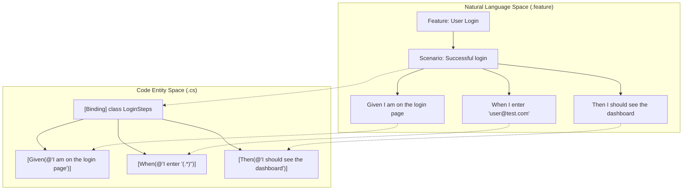
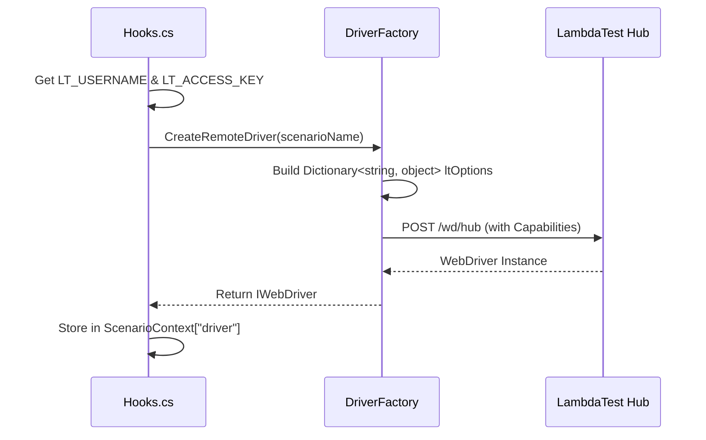

<!-- source: DeepWiki mcp.deepwiki.com · repo LambdaTest/agent-skills · page 4.2 SpecFlow Skill — .NET BDD with Gherkin · fetched 2026-10-26 -->

# SpecFlow Skill — .NET BDD with Gherkin

<details>
<summary>Relevant source files</summary>

The following files were used as context for generating this wiki page:

- [cucumber-skill/SKILL.md](cucumber-skill/SKILL.md)
- [cucumber-skill/reference/playbook.md](cucumber-skill/reference/playbook.md)
- [detox-skill/SKILL.md](detox-skill/SKILL.md)
- [detox-skill/reference/playbook.md](detox-skill/reference/playbook.md)
- [lettuce-skill/reference/playbook.md](lettuce-skill/reference/playbook.md)
- [selenium-skill/reference/page-object-model.md](selenium-skill/reference/page-object-model.md)
- [specflow-skill/SKILL.md](specflow-skill/SKILL.md)
- [specflow-skill/reference/advanced-patterns.md](specflow-skill/reference/advanced-patterns.md)
- [specflow-skill/reference/playbook.md](specflow-skill/reference/playbook.md)

</details>


SpecFlow is the standard BDD framework for the .NET ecosystem, enabling the bridge between natural language business requirements (Gherkin) and C# executable code. This skill focuses on high-quality test generation using the Page Object Model (POM), dependency injection via BoDi, and seamless integration with the LambdaTest cloud for cross-browser execution.

## System Architecture

The SpecFlow skill implements a multi-layered architecture to separate concerns between business logic, test orchestration, and browser automation.

### Natural Language to Code Mapping

The following diagram illustrates how Gherkin elements in `.feature` files map to specific C# attributes and classes within the SpecFlow framework.

**Gherkin to C# Entity Mapping**

Sources: [specflow-skill/SKILL.md:21-53](), [specflow-skill/SKILL.md:57-110]()

## Implementation Details

### Dependency Injection (BoDi)
SpecFlow uses an internal DI container (BoDi) to manage object lifecycles. Instead of static drivers, the skill promotes injecting `ScenarioContext` or custom Page Objects directly into step definition constructors.

*   **ScenarioContext**: Used to share state between steps (e.g., storing a generated user ID) [specflow-skill/SKILL.md:67-71]().
*   **Context Injection**: SpecFlow automatically instantiates and injects classes like `LoginPage` if they are included in the constructor [specflow-skill/SKILL.md:139-146]().

### Lifecycle Management (Hooks)
The `WebDriverHooks` class manages the browser lifecycle using SpecFlow's hook attributes.

| Attribute | Execution Timing | Typical Use Case |
|-----------|------------------|------------------|
| `[BeforeScenario]` | Before every scenario | Driver initialization [specflow-skill/SKILL.md:122-127]() |
| `[AfterScenario]` | After every scenario | `driver.Quit()` and screenshot capture [specflow-skill/SKILL.md:129-134]() |
| `[BeforeTestRun]` | Once before the entire suite | Database migrations or global config [specflow-skill/reference/advanced-patterns.md:89-91]() |

### DriverFactory and Cloud Integration
To support local and cloud execution, the skill utilizes a `DriverFactory` pattern. For LambdaTest, `LT:Options` are passed via `ChromeOptions` to the `RemoteWebDriver`.

**Data Flow: Cloud Driver Initialization**

Sources: [specflow-skill/SKILL.md:153-175](), [specflow-skill/reference/playbook.md:48-50]()

## Advanced Gherkin Patterns

### Step Argument Transformation
To keep step definitions clean, `[StepArgumentTransformation]` is used to convert Gherkin strings or tables into strongly-typed C# objects.

*   **Table Conversion**: Use `table.CreateSet<T>()` or `table.CreateInstance<T>()` from the `TechTalk.SpecFlow.Assist` namespace [specflow-skill/reference/advanced-patterns.md:54-63]().
*   **Date Transformation**: Converting "5 days ago" into a `DateTime` object [specflow-skill/reference/advanced-patterns.md:65-67]().

### Scoped Bindings
Bindings can be restricted to specific features or scenarios using tags, preventing step definition collisions.
```csharp
[Binding, Scope(Tag = "smoke")]
public class SmokeSteps { ... }
```
Sources: [specflow-skill/reference/playbook.md:67-68](), [specflow-skill/reference/advanced-patterns.md:75-78]()

## Project Configuration

### .csproj and specflow.json
The project requires specific NuGet packages and configuration for the test runner (NUnit or xUnit) and the LivingDoc generator.

*   **Key Packages**: `SpecFlow.NUnit`, `SpecFlow.Plus.LivingDocPlugin`, `Selenium.WebDriver` [specflow-skill/reference/playbook.md:14-25]().
*   **specflow.json**: Configures the feature language, binding culture, and step assemblies [specflow-skill/reference/playbook.md:57-73]().

## CI/CD and Reporting

### LivingDoc Generation
SpecFlow LivingDoc turns test results into documentation. In CI/CD pipelines, the following command is executed after `dotnet test`:
```bash
livingdoc test-assembly SpecFlowProject.dll -t TestExecution.json
```
Sources: [specflow-skill/SKILL.md:176](), [specflow-skill/reference/playbook.md:17]()

### GitHub Actions Integration
Workflows typically follow a pattern of setting up the .NET environment, installing the LivingDoc CLI, running tests with environment variables for cloud access, and uploading the resulting HTML report.

| Step | Command/Action |
|------|----------------|
| Setup .NET | `actions/setup-dotnet@v4` |
| Install Tools | `dotnet tool install --global SpecFlow.Plus.LivingDoc.CLI` |
| Run Tests | `dotnet test --logger "console;verbosity=normal"` |
| Publish | `actions/upload-artifact@v4` |

Sources: [specflow-skill/reference/playbook.md:230-231](), [specflow-skill/reference/playbook.md:5-26]()

---

