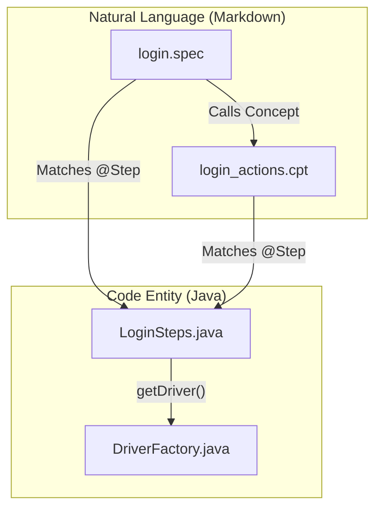
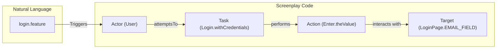

<!-- source: DeepWiki mcp.deepwiki.com · repo LambdaTest/agent-skills · page 4.3 Behave, Behat, Gauge, Lettuce, and Serenity BDD Skills · fetched 2026-10-26 -->

# Behave, Behat, Gauge, Lettuce, and Serenity BDD Skills

Relevant source files

The following files were used as context for generating this wiki page:

- [behat-skill/reference/advanced-patterns.md](behat-skill/reference/advanced-patterns.md)
- [behat-skill/reference/playbook.md](behat-skill/reference/playbook.md)
- [behave-skill/SKILL.md](behave-skill/SKILL.md)
- [behave-skill/reference/advanced-patterns.md](behave-skill/reference/advanced-patterns.md)
- [behave-skill/reference/playbook.md](behave-skill/reference/playbook.md)
- [gauge-skill/SKILL.md](gauge-skill/SKILL.md)
- [gauge-skill/reference/playbook.md](gauge-skill/reference/playbook.md)
- [lettuce-skill/SKILL.md](lettuce-skill/SKILL.md)
- [lettuce-skill/reference/advanced-patterns.md](lettuce-skill/reference/advanced-patterns.md)
- [lettuce-skill/reference/playbook.md](lettuce-skill/reference/playbook.md)
- [selenium-skill/reference/playbook.md](selenium-skill/reference/playbook.md)
- [serenity-bdd-skill/SKILL.md](serenity-bdd-skill/SKILL.md)
- [serenity-bdd-skill/reference/advanced-patterns.md](serenity-bdd-skill/reference/advanced-patterns.md)
- [serenity-bdd-skill/reference/playbook.md](serenity-bdd-skill/reference/playbook.md)
- [specflow-skill/reference/advanced-patterns.md](specflow-skill/reference/advanced-patterns.md)

This page provides a technical deep dive into the implementation of five distinct Behavior-Driven Development (BDD) frameworks supported by the Agent Skills ecosystem. It covers the transition from natural language specifications (Gherkin/Markdown) to executable code across Python, PHP, Java, and multi-language environments.

## 1. Behave (Python BDD)

Behave is the primary Python BDD framework, utilizing Gherkin feature files and a `context` object for state management across steps.

### 1.1 Implementation Architecture
The framework relies on a specific directory structure where `features/` contains `.feature` files and a `steps/` subdirectory contains Python implementations.

*   **Context Object**: A shared state container passed to every step definition [behave-skill/SKILL.md:66-67]().
*   **Environment Hooks**: Defined in `environment.py`, these manage the lifecycle of the test runner, such as initializing browsers in `before_scenario` [behave-skill/SKILL.md:105-116]().
*   **Type Registration**: Custom types can be registered using `register_type` to simplify step matching logic [behave-skill/reference/playbook.md:149-153]().

### 1.2 Data Flow and Hooks
The `environment.py` file acts as the orchestration hub for the framework.

| Hook Name | Purpose | Code Entity |
| :--- | :--- | :--- |
| `before_all` | Global setup (e.g., Base URL) | `def before_all(context)` [behave-skill/SKILL.md:105-106]() |
| `before_scenario` | Driver initialization | `context.browser = webdriver.Chrome()` [behave-skill/SKILL.md:108-110]() |
| `after_scenario` | Cleanup and failure handling | `context.browser.quit()` [behave-skill/SKILL.md:112-115]() |

**Sources:** [behave-skill/SKILL.md:100-116](), [behave-skill/reference/playbook.md:15-35]()

---

## 2. Behat (PHP BDD)

Behat is the standard for PHP BDD, frequently integrated with the **Mink** extension for browser automation and **Symfony** for application-level testing.

### 2.1 Mink Integration and Profiles
Behat uses `behat.yml` to define suites and extension settings. Mink allows switching between different drivers (e.g., `selenium2`, `browserkit`) through configuration profiles [behat-skill/reference/playbook.md:20-57]().

### 2.2 Context and Helpers
*   **FeatureContext**: Inherits from `MinkContext` to gain access to built-in browser interactions like `visit()`, `fillField()`, and `pressButton()` [behat-skill/reference/playbook.md:198-222]().
*   **DatabaseHelper**: A common pattern for resetting and seeding the database before scenarios [behat-skill/reference/playbook.md:203-212]().

**Sources:** [behat-skill/reference/playbook.md:5-18](), [behat-skill/reference/playbook.md:20-57](), [behat-skill/reference/playbook.md:198-222]()

---

## 3. Gauge (Markdown Specs)

Gauge differs from Gherkin-based frameworks by using **Markdown** for specifications and supporting multiple language runners (Java, Python, JS, C#, Ruby).

### 3.1 Concepts and DataStores
*   **Concepts (.cpt)**: Reusable groups of steps defined in Markdown, allowing high-level abstractions [gauge-skill/SKILL.md:112-120]().
*   **DataStores**: Gauge provides three scopes for sharing data: `ScenarioDataStore`, `SpecDataStore`, and `SuiteDataStore` [gauge-skill/SKILL.md:157]().

### 3.2 Implementation Mapping
The following diagram bridges the Markdown specification space to the Java implementation space.

**Gauge: Markdown to Java Mapping**

**Sources:** [gauge-skill/SKILL.md:26-55](), [gauge-skill/SKILL.md:59-90](), [gauge-skill/reference/playbook.md:129-145]()

---

## 4. Serenity BDD (Screenplay Pattern)

Serenity BDD is a Java-based framework that emphasizes "living documentation" and the **Screenplay Pattern**.

### 4.1 Screenplay vs. Step Library
*   **Step Library**: Uses `@Steps` and `ScenarioSteps` for a simplified Page Object approach [serenity-bdd-skill/reference/playbook.md:181-213]().
*   **Screenplay Pattern**: Focuses on **Actors**, **Tasks**, and **Actions**. An Actor "attemptsTo" perform Tasks using their "Abilities" [serenity-bdd-skill/SKILL.md:80-109]().

### 4.2 Living Documentation
Serenity generates detailed HTML reports that include screenshots for every step, requirement coverage, and test results [serenity-bdd-skill/SKILL.md:111-117]().

**Serenity Screenplay Data Flow**

**Sources:** [serenity-bdd-skill/SKILL.md:80-109](), [serenity-bdd-skill/reference/playbook.md:90-103]()

---

## 5. Lettuce (Legacy Python BDD)

Lettuce is a legacy Python BDD framework. While similar to Behave, it uses a global `world` object for state and a `terrain.py` file for hooks.

### 5.1 Key Differences from Behave
*   **State**: Uses `lettuce.world` instead of Behave's `context` [lettuce-skill/SKILL.md:45-52]().
*   **Hooks**: Defined in `terrain.py` using decorators like `@before.all` and `@after.each_scenario` [lettuce-skill/SKILL.md:82-100]().
*   **Step Matching**: Uses regex-based decorators `@step(r'...')` [lettuce-skill/SKILL.md:49-50]().

### 5.2 Migration Path
Due to its unmaintained status, a migration path to Behave is recommended, mapping `world` to `context` and `terrain.py` to `environment.py` [lettuce-skill/reference/playbook.md:157-168]().

**Sources:** [lettuce-skill/SKILL.md:19-21](), [lettuce-skill/SKILL.md:79-100](), [lettuce-skill/reference/playbook.md:157-168]()

---

## 6. Framework Comparison Table

| Feature | Behave | Behat | Gauge | Serenity BDD |
| :--- | :--- | :--- | :--- | :--- |
| **Language** | Python | PHP | Multi (Java/Py/JS) | Java |
| **Spec Format** | Gherkin | Gherkin | Markdown | Gherkin / JUnit |
| **State Mgmt** | `context` | Context Class | DataStores | Actors / Context |
| **Browser Ext** | Selenium | Mink | Screenshot Plugin | Screenplay/WebDriver |
| **Reporting** | Allure/HTML | JUnit/HTML | HTML/XML | Living Doc (HTML) |

**Sources:** [behave-skill/SKILL.md:8-10](), [behat-skill/reference/playbook.md:5-15](), [gauge-skill/SKILL.md:9-14](), [serenity-bdd-skill/SKILL.md:8-10]()

---

