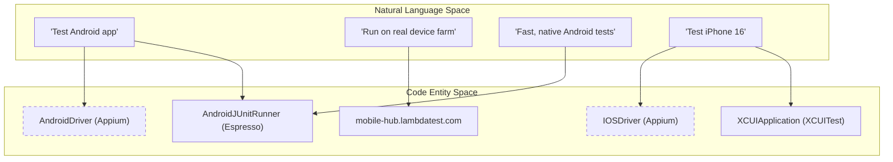
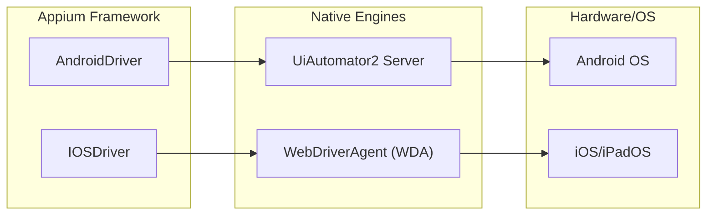

<!-- source: DeepWiki mcp.deepwiki.com · repo LambdaTest/agent-skills · page 5 Mobile Testing Skills · fetched 2026-10-26 -->

# Mobile Testing Skills

Relevant source files

The following files were used as context for generating this wiki page:

- [appium-skill/SKILL.md](appium-skill/SKILL.md)
- [appium-skill/reference/cloud-integration.md](appium-skill/reference/cloud-integration.md)
- [appium-skill/reference/ios-specific.md](appium-skill/reference/ios-specific.md)
- [appium-skill/reference/playbook.md](appium-skill/reference/playbook.md)
- [espresso-skill/SKILL.md](espresso-skill/SKILL.md)
- [espresso-skill/reference/advanced-patterns.md](espresso-skill/reference/advanced-patterns.md)
- [espresso-skill/reference/cloud-integration.md](espresso-skill/reference/cloud-integration.md)
- [espresso-skill/reference/playbook.md](espresso-skill/reference/playbook.md)
- [xcuitest-skill/SKILL.md](xcuitest-skill/SKILL.md)
- [xcuitest-skill/reference/advanced-patterns.md](xcuitest-skill/reference/advanced-patterns.md)
- [xcuitest-skill/reference/playbook.md](xcuitest-skill/reference/playbook.md)

The Mobile Testing category provides a comprehensive set of skills for automating applications across Android and iOS platforms. These skills cover the full spectrum of mobile automation: from high-level cross-platform frameworks like Appium and Detox to low-level native engines like Espresso and XCUITest, as well as specialized tooling for Flutter.

The ecosystem is built around the **TestMu AI Cloud**, providing access to over 100+ real devices [appium-skill/SKILL.md:34-35](), while maintaining full support for local development using emulators and simulators [appium-skill/SKILL.md:37-38]().

## Automation Ecosystem Overview

Mobile testing in this repository is categorized by the "closeness" to the application code and the underlying automation engine used.

### Conceptual Mapping: Natural Language to Code Entities

This diagram illustrates how user intent and platform requirements map to specific code implementations and drivers within the repository.

Title: Mobile Intent to Code Mapping

Sources: [appium-skill/SKILL.md:82-101](), [espresso-skill/SKILL.md:201-205](), [xcuitest-skill/SKILL.md:193-201]()

## Core Mobile Testing Skills

### Appium Skill — Cross-Platform Mobile Automation
Appium is the primary tool for cross-platform automation, supporting Java, Python, JavaScript, Ruby, and C# [appium-skill/SKILL.md:11-16](). It utilizes the **W3C Actions API** for complex gestures like long presses and swipes [appium-skill/SKILL.md:148-177]().

*   **Android Engine:** `UiAutomator2` [appium-skill/SKILL.md:50]().
*   **iOS Engine:** `XCUITest` [appium-skill/SKILL.md:53]().
*   **Key Pattern:** Thread-safe `AppiumDriver` management using `ThreadLocal` [appium-skill/reference/playbook.md:69-71]().

For details, see [Appium Skill — Cross-Platform Mobile Automation](#5.1).

### Espresso and XCUITest Skills — Native Testing
Native frameworks provide the fastest execution by running within the application process or having direct access to the OS accessibility layer.

*   **Espresso:** Targeted at Android (Kotlin/Java). It uses `onView` matchers and `ViewActions` [espresso-skill/SKILL.md:49-58](). It features automatic synchronization via `IdlingResource` [espresso-skill/reference/playbook.md:181-189]().
*   **XCUITest:** The native Swift framework for iOS. It uses `XCUIApplication` and `XCUIElement` queries [xcuitest-skill/SKILL.md:43-64](). It handles system-level interruptions like permission dialogs via `addUIInterruptionMonitor` [xcuitest-skill/reference/playbook.md:230-240]().

For details, see [Espresso and XCUITest Skills — Native Android and iOS Testing](#5.2).

### Flutter and Detox Skills — Specialized Frameworks
These skills address the unique needs of modern cross-platform development frameworks.

*   **Flutter:** Focuses on `WidgetTester` for unit-style widget tests and integration tests for end-to-end flows.
*   **Detox:** A gray-box testing library for React Native that aims to eliminate flakiness through automatic synchronization.

For details, see [Flutter Testing and Detox Skills — Cross-Platform Mobile](#5.3).

## Shared Mobile Concepts

### Execution Targets: Local vs. Cloud
All mobile skills distinguish between local execution (emulators/simulators) and cloud execution (real devices).

| Feature | Local (Emulator/Simulator) | Cloud (TestMu AI Real Devices) |
| :--- | :--- | :--- |
| **Endpoint** | `http://localhost:4723` [appium-skill/SKILL.md:83]() | `mobile-hub.lambdatest.com/wd/hub` [appium-skill/reference/cloud-integration.md:44]() |
| **Setup** | Android Studio / Xcode [xcuitest-skill/SKILL.md:208-209]() | `LT:Options` Capabilities [appium-skill/reference/cloud-integration.md:33-41]() |
| **App Source** | Local file path [appium-skill/SKILL.md:76]() | `lt://APP_ID` (after upload) [appium-skill/reference/cloud-integration.md:30]() |

### W3C Actions & Gestures
While native frameworks have their own gesture APIs, Appium standardizes mobile interactions using the **PointerInput** and **Sequence** classes [appium-skill/SKILL.md:154-177](). This allows for precise control over touch coordinates and durations for complex interactions like "swipe to delete" or "pinch to zoom".

### Locator Strategy Priority
To maintain maintainable tests across platforms, a strict locator hierarchy is recommended [appium-skill/SKILL.md:103-111]():
1.  **AccessibilityId:** The gold standard for cross-platform stability.
2.  **ID / Resource-ID:** Platform-specific unique identifiers.
3.  **iOS Predicates / Android UiAutomator:** Advanced OS-specific selectors.
4.  **XPath:** Discouraged due to performance overhead and fragility.

### Automation Engine Architecture
The following diagram bridges the high-level framework classes to the low-level drivers that interact with the mobile hardware.

Title: Mobile Driver Architecture

Sources: [appium-skill/SKILL.md:50-53](), [appium-skill/reference/playbook.md:35-64]()

---
**Next Steps:**
- For cross-platform Appium patterns, see [Appium Skill — Cross-Platform Mobile Automation](#5.1).
- For native Android/iOS performance, see [Espresso and XCUITest Skills — Native Android and iOS Testing](#5.2).
- For React Native or Flutter specific testing, see [Flutter Testing and Detox Skills — Cross-Platform Mobile](#5.3).

---

