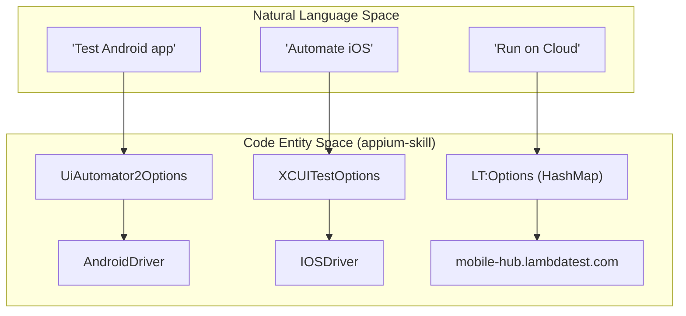
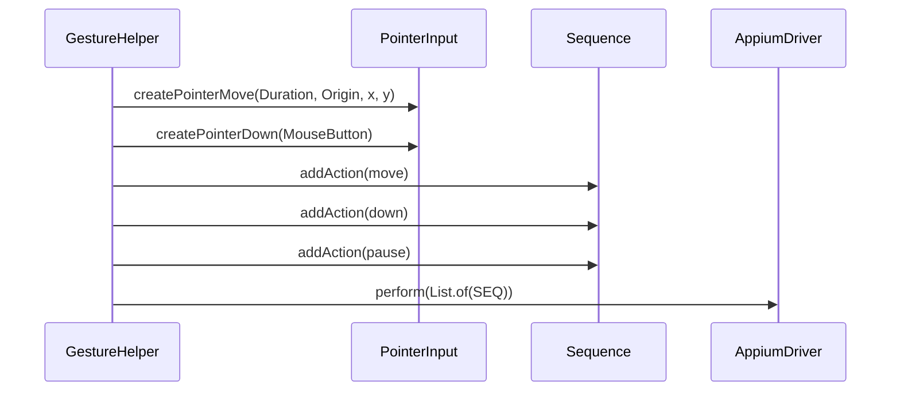
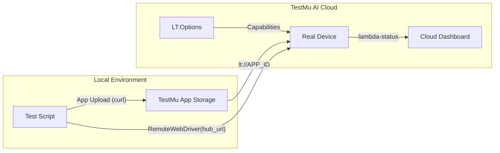

<!-- source: DeepWiki mcp.deepwiki.com · repo LambdaTest/agent-skills · page 5.1 Appium Skill — Cross-Platform Mobile Automation · fetched 2026-10-26 -->

# Appium Skill — Cross-Platform Mobile Automation

Relevant source files

The following files were used as context for generating this wiki page:

- [appium-skill/SKILL.md](appium-skill/SKILL.md)
- [appium-skill/reference/cloud-integration.md](appium-skill/reference/cloud-integration.md)
- [appium-skill/reference/hybrid-apps.md](appium-skill/reference/hybrid-apps.md)
- [appium-skill/reference/ios-specific.md](appium-skill/reference/ios-specific.md)
- [appium-skill/reference/javascript-patterns.md](appium-skill/reference/javascript-patterns.md)
- [appium-skill/reference/playbook.md](appium-skill/reference/playbook.md)
- [appium-skill/reference/python-patterns.md](appium-skill/reference/python-patterns.md)

The Appium skill provides a comprehensive framework for generating production-grade mobile automation scripts for Android and iOS. It supports multiple languages including Java, Python, and JavaScript, targeting both local emulators/simulators and the TestMu AI cloud infrastructure with over 100 real devices [appium-skill/SKILL.md:4-10]().

## System Architecture and Flow

The Appium skill transitions from natural language requirements to platform-specific execution engines. It differentiates between Android (UiAutomator2) and iOS (XCUITest) while maintaining a unified Page Object Model (POM) approach where possible [appium-skill/SKILL.md:46-56]().

### Request to Execution Mapping
The following diagram illustrates how user intent is mapped to specific code entities and drivers within the Appium skill.

**Intent to Entity Mapping**

Sources: [appium-skill/SKILL.md:46-56](), [appium-skill/reference/cloud-integration.md:25-45](), [appium-skill/reference/cloud-integration.md:51-68]()

## Core Implementation Patterns

### 1. Thread-Safe Driver Management
To support parallel execution, the skill implements a `ThreadLocal` pattern within a `BaseTest` class. This ensures that each test thread maintains its own `AppiumDriver` instance [appium-skill/reference/playbook.md:69-110]().

*   **`BaseTest`**: Manages the lifecycle of the driver using `@BeforeMethod` and `@AfterMethod` [appium-skill/reference/playbook.md:69-71]().
*   **`driverThread`**: A `ThreadLocal<AppiumDriver>` variable that prevents race conditions during parallel runs [appium-skill/reference/playbook.md:70]().
*   **`getDriver()`**: Provides a safe way for Page Objects to access the current thread's driver [appium-skill/reference/playbook.md:109]().

### 2. Cross-Platform Page Objects
The skill utilizes `AppiumFieldDecorator` and specialized annotations to handle element location across different platforms within a single class [appium-skill/reference/playbook.md:129-177]().

| Annotation | Purpose |
| :--- | :--- |
| `@AndroidFindBy` | Locates elements using Android-specific strategies like `accessibility` or `id` [appium-skill/reference/playbook.md:133](). |
| `@iOSXCUITFindBy` | Locates elements using iOS strategies like `iOSNsPredicate` or `accessibility` [appium-skill/reference/playbook.md:134](). |
| `AppiumFieldDecorator` | Enables lazy loading of elements and supports the platform-specific annotations [appium-skill/reference/playbook.md:152](). |

### 3. W3C Actions API (GestureHelper)
Standard `click()` and `sendKeys()` are often insufficient for mobile. The `GestureHelper` class abstracts the complex W3C Actions API for common gestures [appium-skill/reference/playbook.md:182-205]().

**Gesture Implementation Flow**

Sources: [appium-skill/SKILL.md:154-177](), [appium-skill/reference/playbook.md:182-205]()

## Platform Specifics

### Android (UiAutomator2)
Android automation relies on the `UiAutomator2` engine. Key features include:
*   **Locators**: Priority is given to `AccessibilityId`, followed by `id` (resource-id) and `androidUIAutomator` [appium-skill/SKILL.md:106-126]().
*   **Capabilities**: `setAutoGrantPermissions(true)` is commonly used to bypass system permission popups [appium-skill/reference/playbook.md:41]().

### iOS (XCUITest)
iOS automation uses the `XCUITest` driver, which has unique lifecycle requirements:
*   **WDA (WebDriverAgent)**: Requires specific timeouts like `wdaLaunchTimeout` and `wdaConnectionTimeout` [appium-skill/reference/ios-specific.md:14-15]().
*   **Locators**: Supports `iOSNsPredicateString` and `iOSClassChain` for high-performance element queries [appium-skill/reference/ios-specific.md:22-30]().
*   **Biometrics**: Supports Face ID/Touch ID simulation via `mobile: enrollBiometric` and `mobile: sendBiometricMatch` scripts [appium-skill/reference/ios-specific.md:72-79]().

### Hybrid App Context Switching
For apps containing WebViews, the skill manages transitions between `NATIVE_APP` and `WEBVIEW` contexts [appium-skill/reference/hybrid-apps.md:5-13]().
*   **`getContextHandles()`**: Retrieves all available contexts [appium-skill/reference/hybrid-apps.md:9]().
*   **`context(String name)`**: Switches the driver's focus to the specified WebView or Native view [appium-skill/reference/hybrid-apps.md:13-18]().

## TestMu AI Cloud Integration

Integration with TestMu AI cloud allows tests to run on real mobile devices by routing the `RemoteWebDriver` to the LambdaTest hub [appium-skill/reference/cloud-integration.md:43-45]().

### Data Flow for Cloud Execution

Sources: [appium-skill/reference/cloud-integration.md:7-21](), [appium-skill/reference/cloud-integration.md:33-45](), [appium-skill/reference/cloud-integration.md:99-108]()

### Key Cloud Capabilities (`LT:Options`)
*   **`isRealMobile`**: Must be set to `true` for real device access [appium-skill/reference/cloud-integration.md:37]().
*   **`video` / `network` / `devicelog`**: Enables debugging artifacts on the cloud dashboard [appium-skill/reference/cloud-integration.md:38-40]().
*   **`lambda-status`**: A JavaScript executor command used to report the final test result (passed/failed) to the platform [appium-skill/reference/cloud-integration.md:101-107]().

## Multi-Language Patterns

While Java is the primary reference, the skill provides native patterns for Python and JavaScript.

*   **Python**: Uses `Appium-Python-Client` with `pytest` fixtures for driver setup and teardown [appium-skill/reference/python-patterns.md:6-30]().
*   **JavaScript**: Utilizes `WebdriverIO` as the client, featuring the `~` shorthand for `accessibilityId` locators [appium-skill/reference/javascript-patterns.md:12-34]().

Sources:
- [appium-skill/SKILL.md:4-10]()
- [appium-skill/SKILL.md:46-56]()
- [appium-skill/SKILL.md:106-126]()
- [appium-skill/SKILL.md:154-177]()
- [appium-skill/reference/playbook.md:41]()
- [appium-skill/reference/playbook.md:69-110]()
- [appium-skill/reference/playbook.md:129-177]()
- [appium-skill/reference/playbook.md:182-205]()
- [appium-skill/reference/cloud-integration.md:7-21]()
- [appium-skill/reference/cloud-integration.md:25-45]()
- [appium-skill/reference/cloud-integration.md:51-68]()
- [appium-skill/reference/cloud-integration.md:99-108]()
- [appium-skill/reference/python-patterns.md:6-30]()
- [appium-skill/reference/javascript-patterns.md:12-34]()
- [appium-skill/reference/ios-specific.md:14-15]()
- [appium-skill/reference/ios-specific.md:22-30]()
- [appium-skill/reference/ios-specific.md:72-79]()
- [appium-skill/reference/hybrid-apps.md:5-18]()

---

