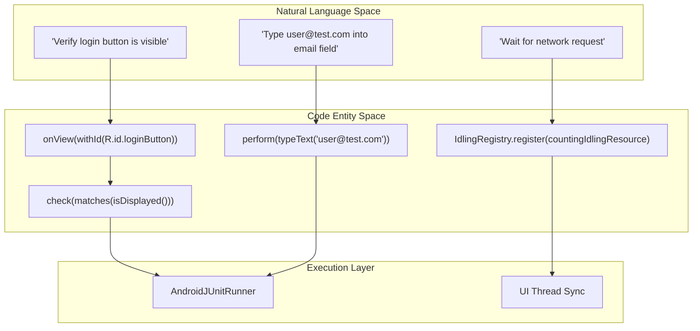
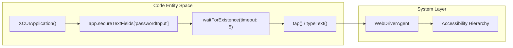

<!-- source: DeepWiki mcp.deepwiki.com · repo LambdaTest/agent-skills · page 5.2 Espresso and XCUITest Skills — Native Android and iOS Testing · fetched 2026-10-26 -->

# Espresso and XCUITest Skills — Native Android and iOS Testing

Relevant source files

The following files were used as context for generating this wiki page:

- [espresso-skill/SKILL.md](espresso-skill/SKILL.md)
- [espresso-skill/reference/advanced-patterns.md](espresso-skill/reference/advanced-patterns.md)
- [espresso-skill/reference/cloud-integration.md](espresso-skill/reference/cloud-integration.md)
- [espresso-skill/reference/playbook.md](espresso-skill/reference/playbook.md)
- [xcuitest-skill/SKILL.md](xcuitest-skill/SKILL.md)
- [xcuitest-skill/reference/advanced-patterns.md](xcuitest-skill/reference/advanced-patterns.md)
- [xcuitest-skill/reference/playbook.md](xcuitest-skill/reference/playbook.md)

This page provides a technical deep dive into native mobile automation using Espresso for Android and XCUITest for iOS. These skills focus on "gray-box" testing, where tests run inside the application process, providing high synchronization and reliability compared to black-box alternatives.

## 1. Espresso (Android Native)

Espresso is the native testing framework for Android, running as part of the instrumentation process. It provides automatic synchronization between the test actions and the UI thread.

### 1.1 Core Architecture and Lifecycle
Espresso tests are typically written in Kotlin or Java and utilize `ActivityScenarioRule` to manage the lifecycle of the Activity under test.

Title: Espresso Test Flow and Code Entities

Sources: [espresso-skill/SKILL.md:39-64](), [espresso-skill/reference/playbook.md:36-57]()

### 1.2 ViewMatchers, ViewActions, and ViewAssertions
The Espresso API is built on three pillars:
*   **ViewMatchers**: Locate views in the hierarchy (e.g., `withId`, `withText`, `withContentDescription`) [espresso-skill/SKILL.md:81-105]().
*   **ViewActions**: Interact with views (e.g., `click()`, `typeText()`, `scrollTo()`, `swipeLeft()`) [espresso-skill/SKILL.md:107-122]().
*   **ViewAssertions**: Verify state (e.g., `matches(isDisplayed())`, `doesNotExist()`) [espresso-skill/SKILL.md:124-134]().

### 1.3 Advanced RecyclerView and Intent Testing
For complex views like `RecyclerView`, Espresso requires the `espresso-contrib` library.
*   **RecyclerViewActions**: Allows scrolling to positions or performing actions on items at specific positions [espresso-skill/reference/playbook.md:142-175]().
*   **Intents**: Using `IntentsTestRule` to validate outgoing intents (e.g., sharing, opening a browser) [espresso-skill/reference/advanced-patterns.md:3-24]().

### 1.4 Synchronization with Idling Resources
To handle asynchronous operations (API calls, animations), Espresso uses `IdlingResource`. The `CountingIdlingResource` is the standard implementation for tracking active background tasks [espresso-skill/reference/playbook.md:177-201]().

Sources: [espresso-skill/reference/playbook.md:90-140](), [espresso-skill/reference/advanced-patterns.md:27-43]()

---

## 2. XCUITest (iOS Native)

XCUITest is Apple's first-party framework for UI testing, integrated directly into Xcode. It uses the `XCTest` framework and communicates with the application via the Accessibility hierarchy.

### 2.1 XCUIApplication and Element Queries
The entry point for any test is `XCUIApplication`. Elements are queried through various collections like `buttons`, `textFields`, and `staticTexts`.

Title: XCUITest Query and Interaction Model

Sources: [xcuitest-skill/SKILL.md:39-77](), [xcuitest-skill/reference/playbook.md:12-57]()

### 2.2 Page Object (Screen) Pattern in Swift
The repository promotes a `Screen` protocol to encapsulate element definitions and common interactions, improving maintainability.

| Entity | Role | Key Function/Property |
| :--- | :--- | :--- |
| `Screen` Protocol | Base interface for page objects | `verifyOnScreen()` [xcuitest-skill/reference/playbook.md:65-74]() |
| `LoginScreen` | Encapsulates login UI | `login(email:password:)` [xcuitest-skill/reference/playbook.md:76-131]() |
| `XCUIElement` Ext | Utility for common actions | `clearAndType(_:)` [xcuitest-skill/reference/playbook.md:168-198]() |

### 2.3 Handling System Alerts
XCUITest provides `addUIInterruptionMonitor` to handle asynchronous system dialogs (e.g., location permissions) that appear during test execution [xcuitest-skill/SKILL.md:127-139](), [xcuitest-skill/reference/playbook.md:224-242]().

---

## 3. Cloud Integration (TestMu AI)

Both Espresso and XCUITest skills support execution on LambdaTest/TestMu AI real device clouds. This involves a three-step process: building the artifacts, uploading them, and triggering the execution via API.

### 3.1 Espresso Cloud Workflow
1.  **Build**: Generate the app APK and the test instrumentation APK using `./gradlew assembleDebug assembleDebugAndroidTest` [espresso-skill/SKILL.md:181-182]().
2.  **Upload**: Send both files to the `realDevice` upload endpoint [espresso-skill/reference/cloud-integration.md:5-19]().
3.  **Execute**: Post a JSON payload to the Espresso build endpoint specifying `app` URL, `testSuite` URL, and target `device` list [espresso-skill/reference/cloud-integration.md:21-37]().

### 3.2 XCUITest Cloud Workflow
1.  **Build**: Create an `.ipa` for the app and a Test Runner `.ipa` (Product → Archive in Xcode) [xcuitest-skill/SKILL.md:181-189]().
2.  **Upload**: Upload both `.ipa` files to LambdaTest [xcuitest-skill/SKILL.md:183-189]().
3.  **Execute**: Trigger the build via the `/xcui/build` endpoint [xcuitest-skill/SKILL.md:191-202]().

### 3.3 Implementation Comparison

| Feature | Espresso | XCUITest |
| :--- | :--- | :--- |
| **Language** | Kotlin / Java | Swift / Objective-C |
| **Artifacts** | App APK + Test APK | App IPA + Runner IPA |
| **Sync** | Automatic (Idling Resources) | Manual (`waitForExistence`) |
| **Wait API** | `IdlingRegistry` | `XCTWaiter` / `NSPredicate` |
| **Gestures** | `ViewActions` (click, swipe) | `XCUIElement` (tap, pinch, rotate) |

Sources: [espresso-skill/SKILL.md:178-206](), [xcuitest-skill/SKILL.md:178-202](), [espresso-skill/reference/cloud-integration.md:1-45]()

---

