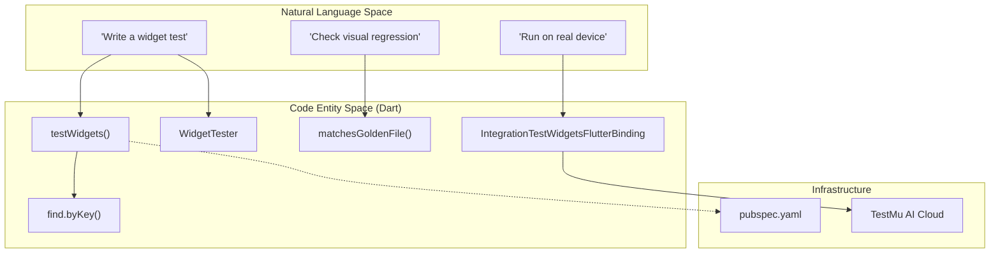
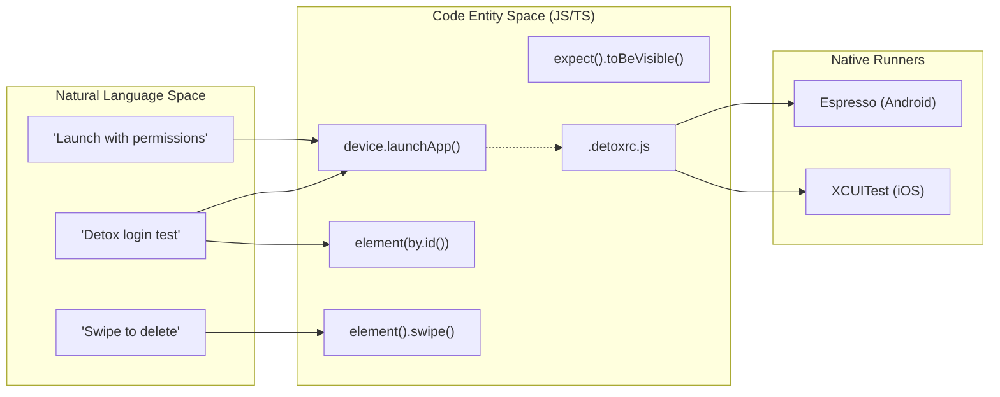

<!-- source: DeepWiki mcp.deepwiki.com · repo LambdaTest/agent-skills · page 5.3 Flutter Testing and Detox Skills — Cross-Platform Mobile · fetched 2026-10-26 -->

# Flutter Testing and Detox Skills — Cross-Platform Mobile

<details>
<summary>Relevant source files</summary>

The following files were used as context for generating this wiki page:

- [detox-skill/SKILL.md](detox-skill/SKILL.md)
- [detox-skill/reference/advanced-patterns.md](detox-skill/reference/advanced-patterns.md)
- [detox-skill/reference/playbook.md](detox-skill/reference/playbook.md)
- [evals/flutter-testing-skill-evals.json](evals/flutter-testing-skill-evals.json)
- [evals/xcuitest-skill-evals.json](evals/xcuitest-skill-evals.json)
- [flutter-testing-skill/SKILL.md](flutter-testing-skill/SKILL.md)
- [flutter-testing-skill/reference/advanced-patterns.md](flutter-testing-skill/reference/advanced-patterns.md)
- [flutter-testing-skill/reference/playbook.md](flutter-testing-skill/reference/playbook.md)
- [selenium-skill/reference/page-object-model.md](selenium-skill/reference/page-object-model.md)
- [specflow-skill/reference/playbook.md](specflow-skill/reference/playbook.md)

</details>


This page provides a technical deep dive into the cross-platform mobile testing capabilities of the TestMu AI Agent. It covers **Flutter** (Dart) for high-performance UI and integration testing, and **Detox** (JavaScript/TypeScript) for gray-box React Native automation. Both frameworks are integrated with the TestMu AI cloud for real-device execution.

---

## 1. Flutter Testing

Flutter testing is divided into three primary tiers: Widget tests (component-level), Integration tests (app-level), and Golden tests (visual regression).

### 1.1 Implementation Architecture
The agent utilizes the `flutter_test` and `integration_test` packages to drive the application. For unit and widget testing, the agent implements mocking using `mockito` or `mocktail` to isolate dependencies.

**Data Flow: Flutter Test Execution**
The following diagram illustrates how the test code interacts with the Flutter framework and the TestMu AI Cloud.

Title: Flutter Test Entity Mapping

Sources: [flutter-testing-skill/SKILL.md:42-86](), [flutter-testing-skill/reference/playbook.md:130-160](), [evals/flutter-testing-skill-evals.json:7-14]()

### 1.2 Key Testing Patterns

| Pattern | Code Entity | Purpose |
|:---|:---|:---|
| **Widget Testing** | `testWidgets(description, callback)` | Renders a widget in a virtual environment for fast UI validation. [flutter-testing-skill/SKILL.md:50-58]() |
| **Finder Strategy** | `find.byKey(Key('id'))` | Best practice for stable selectors over `find.text()`. [flutter-testing-skill/SKILL.md:91-93]() |
| **Frame Pumping** | `tester.pumpAndSettle()` | Advances the clock until no more frames are scheduled (waits for animations). [flutter-testing-skill/SKILL.md:124-128]() |
| **Integration** | `IntegrationTestWidgetsFlutterBinding` | Initializes the binding required for E2E tests on real devices. [flutter-testing-skill/SKILL.md:139-140]() |
| **Golden Tests** | `matchesGoldenFile('path.png')` | Performs pixel-by-pixel comparison against a baseline image. [flutter-testing-skill/SKILL.md:165-174]() |

### 1.3 Dependency Mocking
The agent supports both code-generation (`mockito`) and no-generation (`mocktail`) approaches for mocking services and repositories.

*   **Mockito:** Requires `@GenerateMocks([Class])` and `build_runner`. [flutter-testing-skill/reference/playbook.md:46-52]()
*   **Mocktail:** Uses `Mock` class inheritance and `registerFallbackValue`. [flutter-testing-skill/reference/playbook.md:97-108]()

Sources: [flutter-testing-skill/reference/playbook.md:5-26](), [flutter-testing-skill/reference/playbook.md:46-94](), [flutter-testing-skill/reference/advanced-patterns.md:5-48]()

---

## 2. Detox (React Native) Testing

Detox is a gray-box testing framework for React Native that provides automatic synchronization, eliminating the need for manual `sleep()` or `wait()` calls by monitoring the app's internal state (network, main thread, etc.).

### 2.1 Implementation Architecture
Detox tests are typically written in JavaScript/TypeScript using Jest as the runner. The agent configures `.detoxrc.js` to define build paths and device targets.

Title: Detox Entity Mapping

Sources: [detox-skill/SKILL.md:27-52](), [detox-skill/SKILL.md:121-146](), [detox-skill/reference/advanced-patterns.md:59-83]()

### 2.2 Core Detox Operations

*   **Matchers:** The agent prioritizes `by.id('testID')` for stability. [detox-skill/SKILL.md:57-69]()
*   **Actions:** Includes `tap()`, `longPress()`, `typeText()`, and `replaceText()`. Note that `replaceText()` is preferred over `typeText()` for pre-filled fields to avoid appending. [detox-skill/SKILL.md:73-84](), [detox-skill/reference/advanced-patterns.md:111-111]()
*   **Synchronization:** Detox automatically waits for the app to be idle. Manual `waitFor()` is only used for specific timeouts or while-scrolling conditions. [detox-skill/reference/playbook.md:223-227]()
*   **Device Control:** Supports `device.reloadReactNative()`, `device.setOrientation()`, and `device.openURL()` for deep links. [detox-skill/SKILL.md:99-108](), [detox-skill/reference/advanced-patterns.md:67-81]()

### 2.3 Page Object Model (POM) in Detox
The agent implements a `BasePage` and `Screen Object` pattern to encapsulate element selectors and common interactions.

```javascript
class BasePage {
  async tapById(testID) {
    await element(by.id(testID)).tap();
  }
}

class LoginPage extends BasePage {
  get emailInput() { return element(by.id('email_input')); }
  async login(email, password) {
    await this.emailInput.replaceText(email);
    // ...
  }
}
```
Sources: [detox-skill/reference/playbook.md:90-149](), [detox-skill/reference/advanced-patterns.md:5-35]()

---

## 3. Cloud Execution on TestMu AI

Both Flutter and Detox tests can be offloaded to the TestMu AI real-device cloud.

### 3.1 Flutter Cloud Execution
Integration tests are built as native artifacts and uploaded to LambdaTest.
1.  **Build:** `flutter build apk --debug` (Android) or `flutter build ios --simulator` (iOS). [flutter-testing-skill/SKILL.md:230-231]()
2.  **Upload:** Artifacts are sent via the `app/upload/realDevice` endpoint. [flutter-testing-skill/SKILL.md:234-237]()

### 3.2 Detox Cloud Execution
Detox translates tests into native runners (**Espresso** for Android, **XCUITest** for iOS). The agent generates the necessary `curl` commands to trigger these builds.

*   **Android:** Requires `app-debug.apk` and `app-debug-androidTest.apk`. [detox-skill/SKILL.md:154-171]()
*   **iOS:** Requires `.ipa` artifacts for the app and the test runner. [detox-skill/SKILL.md:189-201]()
*   **Trigger:** A POST request to `mobile-api.lambdatest.com/framework/v1/[espresso|xcui]/build` starts the execution. [detox-skill/SKILL.md:173-184](), [detox-skill/SKILL.md:203-214]()

Sources: [detox-skill/SKILL.md:148-214](), [flutter-testing-skill/SKILL.md:225-240](), [evals/xcuitest-skill-evals.json:16-24]()

---

