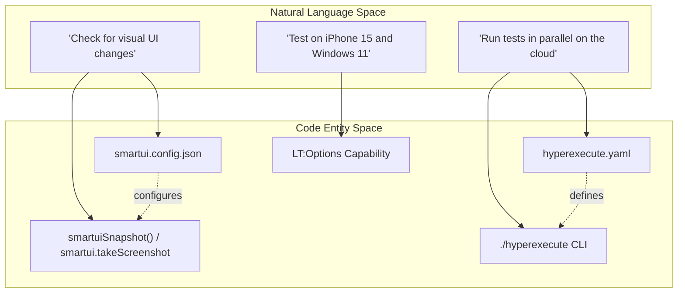
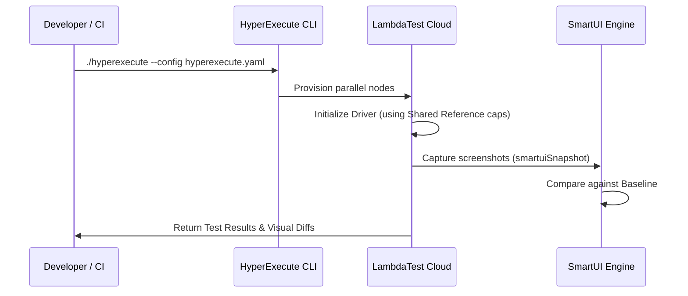

<!-- source: DeepWiki mcp.deepwiki.com · repo LambdaTest/agent-skills · page 6 Cloud Testing and Visual Regression Skills · fetched 2026-10-26 -->

# Cloud Testing and Visual Regression Skills

Relevant source files

The following files were used as context for generating this wiki page:

- [hyperexecute-skill/SKILL.md](hyperexecute-skill/SKILL.md)
- [shared/testmu-cloud-reference.md](shared/testmu-cloud-reference.md)
- [smartui-skill/SKILL.md](smartui-skill/SKILL.md)
- [smartui-skill/reference/playbook.md](smartui-skill/reference/playbook.md)

This section provides a high-level overview of the cloud-native capabilities provided by the TestMu AI / LambdaTest platform. These skills enable high-speed parallel test orchestration, automated visual regression testing, and a standardized approach to cloud infrastructure across all supported testing frameworks.

## Cloud Ecosystem Overview

The cloud testing suite is divided into three primary functional areas: shared infrastructure references, high-speed orchestration via HyperExecute, and visual regression via SmartUI.

### Conceptual Architecture: Natural Language to Cloud Entities

The following diagram maps natural language requirements to the specific code entities and configurations used in the cloud skills.

**Cloud Entity Mapping**

**Sources:** [hyperexecute-skill/SKILL.md:22-58](), [smartui-skill/SKILL.md:69-80](), [shared/testmu-cloud-reference.md:102-123]()

---

## 6.1 TestMu AI Cloud Integration — Shared Reference

The **Shared Reference** serves as the foundational configuration guide for every cloud-enabled skill in the repository. It defines the standard authentication methods, browser/platform matrices, and the `LT:Options` capability structure required to route tests to the LambdaTest Selenium Hub or Playwright CDP WebSocket.

*   **Authentication**: Requires `LT_USERNAME` and `LT_ACCESS_KEY` [shared/testmu-cloud-reference.md:18-27]().
*   **Endpoints**: Connects via `wss://cdp.lambdatest.com/playwright` or `https://hub.lambdatest.com/wd/hub` [shared/testmu-cloud-reference.md:29-41]().
*   **Capabilities**: Standardized `LT:Options` for network logs, video recording, and geo-location [shared/testmu-cloud-reference.md:102-123]().
*   **Status Reporting**: Explicitly marking tests as `passed` or `failed` via `lambdatest_action` or `lambda-status` [shared/testmu-cloud-reference.md:125-159]().

For details, see [TestMu AI Cloud Integration — Shared Reference](#6.1).

**Sources:** [shared/testmu-cloud-reference.md:1-201]()

---

## 6.2 HyperExecute Skill — High-Speed Parallel Orchestration

**HyperExecute** is a framework-agnostic test orchestration platform that provides faster execution than standard grids by moving the orchestration logic closer to the execution environment.

*   **Orchestration Modes**: Supports `autosplit` (dynamic test distribution), `matrix` (cross-browser/OS), and `hybrid` modes [hyperexecute-skill/SKILL.md:33-79]().
*   **Discovery**: Uses `testDiscovery` commands to find test files dynamically at runtime [hyperexecute-skill/SKILL.md:43-46]().
*   **Execution**: Controlled via the `hyperexecute.yaml` file and the HyperExecute CLI [hyperexecute-skill/SKILL.md:22-58](), [hyperexecute-skill/SKILL.md:102-110]().

For details, see [HyperExecute Skill — High-Speed Parallel Test Orchestration](#6.2).

**Sources:** [hyperexecute-skill/SKILL.md:1-169]()

---

## 6.3 SmartUI Skill — Visual Regression Testing

**SmartUI** provides automated visual regression testing by capturing screenshots and comparing them against established baselines using AI-driven pixel-to-pixel and DOM-aware comparisons.

*   **Integration**: Works with Playwright, Selenium, Cypress, and Puppeteer [smartui-skill/SKILL.md:3-9]().
*   **SDK Usage**: Uses `smartuiSnapshot(page, name)` for Playwright [smartui-skill/SKILL.md:27-43]() or `smartui.takeScreenshot` script injection for Selenium [smartui-skill/SKILL.md:47-52]().
*   **Configuration**: Managed via `smartui.config.json` (formerly `.smartui.json`), defining browsers and viewports [smartui-skill/reference/playbook.md:33-56](), [smartui-skill/SKILL.md:69-80]().
*   **Workflow**: Follows a "Baseline → Comparison → Approval" workflow managed in the SmartUI dashboard [smartui-skill/SKILL.md:88-94]().

For details, see [SmartUI Skill — Visual Regression Testing](#6.3).

**Sources:** [smartui-skill/SKILL.md:1-148](), [smartui-skill/reference/playbook.md:1-216]()

---

## Skill Relationship Matrix

The following table describes how these skills interact during a typical CI/CD execution.

| Feature | Shared Reference | HyperExecute | SmartUI |
| :--- | :--- | :--- | :--- |
| **Primary Goal** | Connectivity & Metadata | Execution Speed | Visual Accuracy |
| **Config File** | Code-based (Capabilities) | `hyperexecute.yaml` | `smartui.config.json` |
| **Trigger** | `RemoteWebDriver` init | `./hyperexecute` CLI | `smartuiSnapshot` API |
| **Cloud Asset** | Video/Network Logs | Parallel Runner Nodes | Diff Screenshots |

**Interaction Flow**

**Sources:** [hyperexecute-skill/SKILL.md:102-110](), [smartui-skill/SKILL.md:88-94](), [shared/testmu-cloud-reference.md:102-123]()

---

