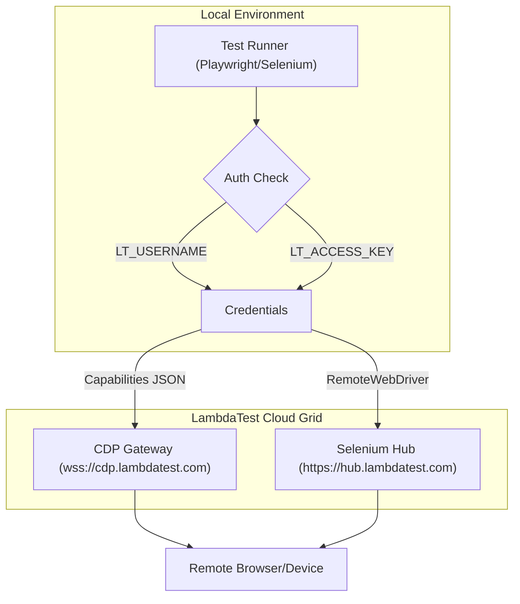

<!-- source: DeepWiki mcp.deepwiki.com · repo LambdaTest/agent-skills · page 6.1 TestMu AI Cloud Integration — Shared Reference · fetched 2026-10-26 -->

# TestMu AI Cloud Integration — Shared Reference

<details>
<summary>Relevant source files</summary>

The following files were used as context for generating this wiki page:

- [playwright-skill/scripts/validate-config.py](playwright-skill/scripts/validate-config.py)
- [shared/scripts/check-tunnel.sh](shared/scripts/check-tunnel.sh)
- [shared/scripts/validate-capabilities.py](shared/scripts/validate-capabilities.py)
- [shared/testmu-cloud-reference.md](shared/testmu-cloud-reference.md)

</details>


This page serves as the centralized technical reference for all cloud-enabled skills within the `agent-skills` repository. It defines the authentication protocols, connection endpoints, platform matrices, and specialized capabilities required to execute automated tests on the TestMu AI / LambdaTest cloud infrastructure [shared/testmu-cloud-reference.md:1-3]().

## Cloud Architecture & Connectivity

The integration bridges local test execution with remote cloud environments using two primary communication protocols depending on the framework type.

### Connection Endpoints
*   **CDP WebSocket:** Modern frameworks like Playwright, Puppeteer, and Cypress connect via the Chrome DevTools Protocol (CDP) [shared/testmu-cloud-reference.md:29-35]().
*   **Selenium Hub:** Traditional WebDriver-based frameworks (Selenium, Appium, WebdriverIO) use the standard JSON Wire Protocol / W3C endpoint [shared/testmu-cloud-reference.md:37-41]().

### Connectivity Flow Diagram

The following diagram illustrates how local test runners authenticate and establish sessions with the cloud grid.

**Cloud Session Initiation Flow**

**Sources:** [shared/testmu-cloud-reference.md:18-41](), [shared/scripts/validate-capabilities.py:56-63]()

## Authentication

All cloud-enabled skills expect two mandatory environment variables for authentication [shared/testmu-cloud-reference.md:20-25]().

| Variable | Description |
| :--- | :--- |
| `LT_USERNAME` | Your LambdaTest account username |
| `LT_ACCESS_KEY` | Your unique API access key |

The `validate-capabilities.py` script specifically checks for these keys within the `LT:Options` block and returns an error if they are missing or set to `"None"` [shared/scripts/validate-capabilities.py:56-63]().

## Platform and Browser Matrix

### Desktop Browsers
TestMu AI supports a variety of browsers, with specific identifiers for Playwright-optimized builds [shared/testmu-cloud-reference.md:45-54]().

| Browser | Value | Supported Frameworks |
| :--- | :--- | :--- |
| Chrome | `Chrome` | All |
| Edge | `MicrosoftEdge` | All |
| Playwright Chromium | `pw-chromium` | Playwright |
| Playwright Firefox | `pw-firefox` | Playwright |
| Playwright WebKit | `pw-webkit` | Playwright |
| Firefox | `Firefox` | Selenium |
| Safari | `Safari` | Selenium (macOS only) |

### Desktop Operating Systems
Desktop tests must specify a `platform` within `LT:Options` [shared/testmu-cloud-reference.md:55-67](). Validated platforms include Windows 10/11 and macOS versions from Catalina to Sequoia [shared/scripts/validate-capabilities.py:19-23]().

## Mobile Device Catalog

Mobile testing requires `platformName` (`android` or `ios`) and `isRealMobile: true` [shared/testmu-cloud-reference.md:70-88]().

### Android Devices
| Device | `deviceName` | OS Versions |
| :--- | :--- | :--- |
| Pixel 8 | `Pixel 8` | 14 |
| Galaxy S24 | `Galaxy S24` | 14 |
| OnePlus 11 | `OnePlus 11` | 13 |

### iOS Devices
**Critical Requirement:** iOS devices always use the `webkit` browser. Attempting to use `chromium` on iOS will trigger a validation error [shared/testmu-cloud-reference.md:90](), [shared/scripts/validate-capabilities.py:74-75]().

| Device | `deviceName` | OS Versions |
| :--- | :--- | :--- |
| iPhone 16 Pro Max | `iPhone 16 Pro Max` | 18 |
| iPhone 15 | `iPhone 15` | 17, 18 |
| iPad Pro 12.9 | `iPad Pro 12.9 (2022)` | 16, 17 |

**Sources:** [shared/testmu-cloud-reference.md:68-101](), [shared/scripts/validate-capabilities.py:65-75]()

## LT:Options Capability Reference

The `LT:Options` object is the primary configuration block for cloud behavior.

| Capability | Type | Role |
| :--- | :--- | :--- |
| `build` | string | Groups tests in the dashboard [shared/testmu-cloud-reference.md:107]() |
| `network` | boolean | Captures network logs [shared/testmu-cloud-reference.md:111]() |
| `video` | boolean | Records execution video [shared/testmu-cloud-reference.md:112]() |
| `tunnel` | boolean | Enables Lambda Tunnel for localhost [shared/testmu-cloud-reference.md:114]() |
| `geoLocation` | string | Sets country code (e.g., `US`, `GB`) [shared/testmu-cloud-reference.md:116]() |

**Sources:** [shared/testmu-cloud-reference.md:102-124](), [shared/scripts/validate-capabilities.py:26-32]()

## Implementation: Test Status Reporting

Cloud tests are marked as "Completed" by default. To reflect actual assertion results in the dashboard, frameworks must explicitly send a status update [shared/testmu-cloud-reference.md:127]().

### Logic Mapping: Language to Cloud Action

```mermaid
graph LR
    subgraph "Language Execution"
        JS["JavaScript/TypeScript"]
        JV["Java/C#/Python/Ruby"]
    end

    subgraph "Cloud Action Entity"
        LTA["lambdatest_action"]
        LST["lambda-status"]
    end

    JS -->| "page.evaluate()" | LTA
    JV -->| "execute_script()" | LST

    LTA --> Result["Dashboard Status: Passed/Failed"]
    LST --> Result
```

*   **JS/TS (Playwright/Cypress):** Uses `page.evaluate` to send a JSON string containing `setTestStatus` [shared/testmu-cloud-reference.md:130-137]().
*   **Selenium/Appium (Java/Python/Ruby/C#):** Uses `executeScript` with the string `"lambda-status=passed"` [shared/testmu-cloud-reference.md:139-159]().

**Sources:** [shared/testmu-cloud-reference.md:125-160]()

## Localhost Testing via Lambda Tunnel

To test applications running on `localhost`, a secure tunnel must be established using the `LT` binary [shared/testmu-cloud-reference.md:161-169]().

### Validation Workflow
The repository provides `shared/scripts/check-tunnel.sh` to verify tunnel availability before test execution.

1.  **Binary Check:** Verifies `./LT` or `LT` is in the path [shared/scripts/check-tunnel.sh:9-14]().
2.  **Process Check:** Uses `pgrep` to find running tunnel processes [shared/scripts/check-tunnel.sh:17-18]().
3.  **Name Verification:** Ensures the `tunnelName` in the running process matches the one provided in capabilities [shared/scripts/check-tunnel.sh:22-30]().

**Sources:** [shared/testmu-cloud-reference.md:161-176](), [shared/scripts/check-tunnel.sh:1-39]()

## Validation Scripts

The repository includes scripts to ensure configurations adhere to cloud requirements.

### `validate-capabilities.py`
This script performs schema validation on the capabilities JSON [shared/scripts/validate-capabilities.py:1-12]().
*   **Errors:** Missing `browserName`, invalid `platform`, missing `user`/`accessKey`, or incorrect browser for iOS [shared/scripts/validate-capabilities.py:39-83]().
*   **Warnings:** Missing `build` tags, or disabled `video`/`network` logs [shared/scripts/validate-capabilities.py:85-90]().

### `validate-config.py` (Playwright)
Specifically for Playwright, this script checks `playwright.config.ts` [playwright-skill/scripts/validate-config.py:1-10]().
*   **Cloud Project Format:** Ensures project names follow `browserName:version:platform@lambdatest` [playwright-skill/scripts/validate-config.py:44-51]().
*   **Anti-Patterns:** Flags the use of `waitForTimeout` [playwright-skill/scripts/validate-config.py:32-33]().

**Sources:** [shared/scripts/validate-capabilities.py:1-128](), [playwright-skill/scripts/validate-config.py:1-106]()

---

