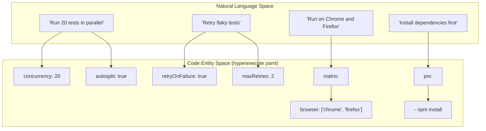
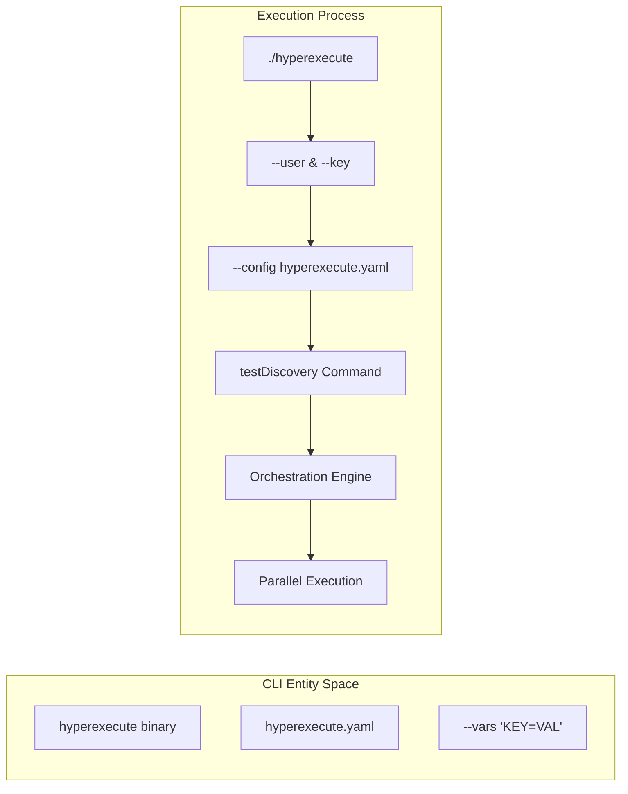

<!-- source: DeepWiki mcp.deepwiki.com · repo LambdaTest/agent-skills · page 6.2 HyperExecute Skill — High-Speed Parallel Test Orchestration · fetched 2026-10-26 -->

# HyperExecute Skill — High-Speed Parallel Test Orchestration

<details>
<summary>Relevant source files</summary>

The following files were used as context for generating this wiki page:

- [hyperexecute-skill/SKILL.md](hyperexecute-skill/SKILL.md)
- [hyperexecute-skill/reference/playbook.md](hyperexecute-skill/reference/playbook.md)

</details>


HyperExecute is a high-speed test orchestration platform provided by LambdaTest that allows for blazing-fast test execution through intelligent sharding and parallelization. This skill enables the generation of `hyperexecute.yaml` configurations, CLI execution patterns, and framework-specific optimizations for Playwright, Selenium, Cypress, and more [hyperexecute-skill/SKILL.md:1-8]().

## §1 Core Configuration & Orchestration Modes

HyperExecute operates using a YAML configuration file that defines how tests are discovered, distributed, and executed. It supports three primary orchestration modes: **Autosplit**, **Matrix**, and **Hybrid**.

### Configuration Schema
The `hyperexecute.yaml` file controls the execution lifecycle, including environment setup (`pre`), test identification (`testDiscovery`), and execution (`testRunnerCommand`) [hyperexecute-skill/reference/playbook.md:6-46]().

| Key | Description | Example |
|:---|:---|:---|
| `version` | Configuration version | `0.1` |
| `runson` | Execution OS (linux, win, mac) | `linux` |
| `concurrency` | Number of parallel machines/containers | `15` |
| `autosplit` | Enable automatic test distribution | `true` |
| `testDiscovery` | Command to find test files/methods | `grep -rn 'test\(' ...` |
| `testRunnerCommand`| Command to execute a single test unit | `npx playwright test $test` |

### Orchestration Modes

1.  **Autosplit Mode**: Automatically distributes tests across available concurrency slots. It uses `testDiscovery` to find tests and `$test` as a placeholder in the runner command [hyperexecute-skill/SKILL.md:26-58]().
2.  **Matrix Mode**: Executes the same set of tests across multiple combinations of browsers, OS, or environments [hyperexecute-skill/reference/playbook.md:118-128]().
3.  **Hybrid Mode**: Combines static test suite definitions with dynamic discovery [hyperexecute-skill/SKILL.md:79-98]().

### Data Flow: Natural Language to HyperExecute YAML
This diagram maps natural language requirements to the specific YAML entities used in the HyperExecute skill.

"HyperExecute Configuration Logic"

Sources: [hyperexecute-skill/SKILL.md:26-77](), [hyperexecute-skill/reference/playbook.md:157-162]()

---

## §2 Framework-Specific Implementations

HyperExecute is framework-agnostic but requires specific `testDiscovery` and `testRunnerCommand` patterns to extract the maximum performance for different ecosystems.

### Playwright Implementation
Playwright configurations typically use `grep` for discovery and the `$test` variable for sharding [hyperexecute-skill/reference/playbook.md:6-31]().

```yaml
testDiscovery:
  type: raw
  mode: dynamic
  command: grep -rn 'test\(' tests/ --include='*.spec.ts' -l

testRunnerCommand: npx playwright test $test --reporter=list
```

### Selenium Java Implementation
For Maven-based Selenium projects, the discovery command parses Java files to identify `@Test` annotations [hyperexecute-skill/reference/playbook.md:81-104]().

```yaml
pre:
  - mvn -Dmaven.test.skip=true clean install

testDiscovery:
  type: raw
  mode: dynamic
  command: grep -rn '@Test' src/test --include='*.java' -l | sed 's/.*\///' | sed 's/\.java//'

testRunnerCommand: mvn test -Dtest=$test -pl module-name
```

### Cypress Implementation
Cypress requires the installation of the binary in the `pre` step and utilizes the `--spec` flag for execution [hyperexecute-skill/reference/playbook.md:48-72]().

```yaml
pre:
  - npm ci
  - npx cypress install

testDiscovery:
  type: raw
  mode: dynamic
  command: find cypress/e2e -name '*.cy.ts' -o -name '*.cy.js'

testRunnerCommand: npx cypress run --spec $test
```

Sources: [hyperexecute-skill/reference/playbook.md:5-111](), [hyperexecute-skill/SKILL.md:114-145]()

---

## §3 Advanced Features & CLI Usage

### Smart Features
HyperExecute provides built-in resilience and performance features:
*   **Smart Ordering**: Runs recently failed tests first to shorten the feedback loop [hyperexecute-skill/reference/playbook.md:159]().
*   **Artifact Management**: Automatically uploads logs, videos, and reports using the `uploadArtefacts` key [hyperexecute-skill/reference/playbook.md:32-35]().
*   **Caching**: Speeds up the `pre` step by caching `node_modules` or `.m2` directories using `cacheKey` and `cacheDirectories` [hyperexecute-skill/reference/playbook.md:36-38]().
*   **Tunnels**: Enables testing of private/local environments by setting `tunnel: true` [hyperexecute-skill/reference/playbook.md:147-155]().

### CLI Execution
The `hyperexecute` binary is used to trigger jobs from local machines or CI/CD runners [hyperexecute-skill/reference/playbook.md:214-256]().

"CLI Execution Flow"

Sources: [hyperexecute-skill/reference/playbook.md:230-256](), [hyperexecute-skill/SKILL.md:100-110]()

### CLI Installation Commands
| OS | Command |
|:---|:---|
| Linux | `curl -O https://downloads.lambdatest.com/hyperexecute/linux/hyperexecute` |
| macOS | `curl -O https://downloads.lambdatest.com/hyperexecute/darwin/hyperexecute` |
| Windows | `curl -O https://downloads.lambdatest.com/hyperexecute/windows/hyperexecute.exe` |

Sources: [hyperexecute-skill/reference/playbook.md:216-228]()

---

## §4 CI/CD Pipeline Integration

HyperExecute is designed to be triggered from CI/CD pipelines, offloading the heavy lifting of test execution from the CI runner to the HyperExecute cloud.

### GitHub Actions Example
Integration involves downloading the CLI and executing it with repository secrets [hyperexecute-skill/reference/playbook.md:262-289]().

```yaml
jobs:
  hyperexecute:
    runs-on: ubuntu-latest
    steps:
      - uses: actions/checkout@v4
      - name: Run HyperExecute
        run: |
          curl -O https://downloads.lambdatest.com/hyperexecute/linux/hyperexecute
          chmod +x hyperexecute
          ./hyperexecute \
            --user ${{ secrets.LT_USERNAME }} \
            --key ${{ secrets.LT_ACCESS_KEY }} \
            --config hyperexecute.yaml
```

Sources: [hyperexecute-skill/reference/playbook.md:260-305]()

---

