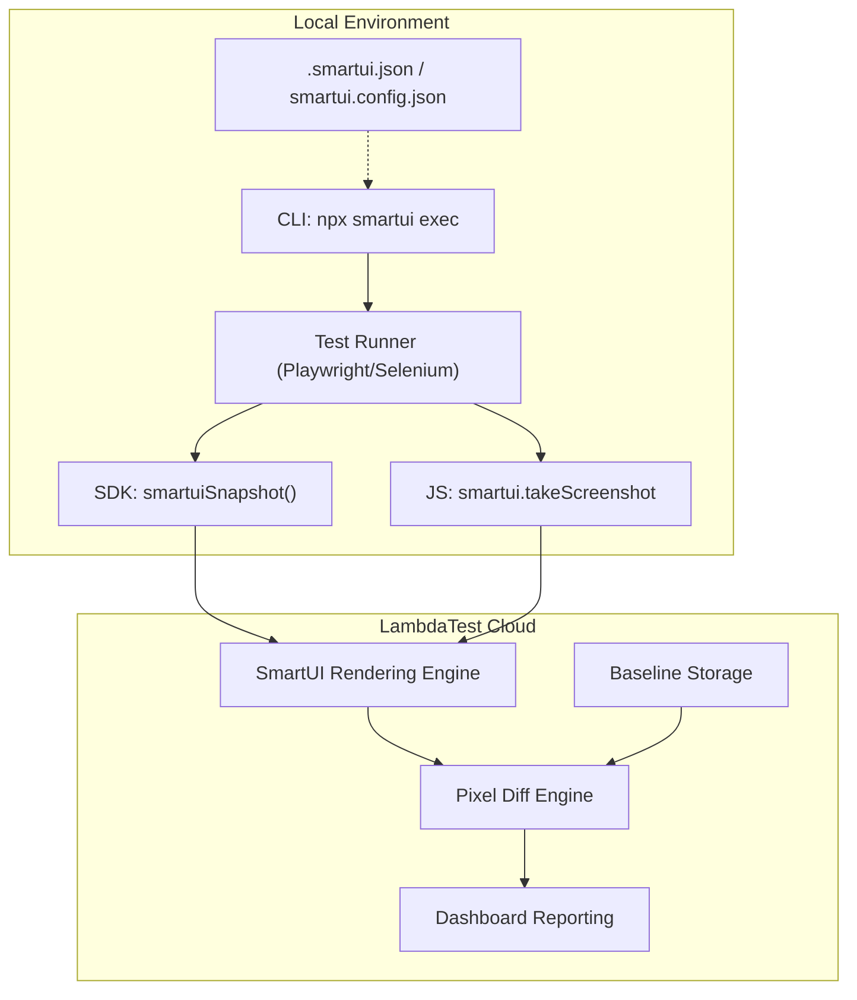
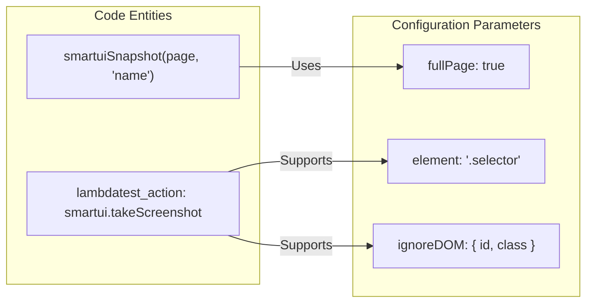

<!-- source: DeepWiki mcp.deepwiki.com · repo LambdaTest/agent-skills · page 6.3 SmartUI Skill — Visual Regression Testing · fetched 2026-10-26 -->

# SmartUI Skill — Visual Regression Testing

<details>
<summary>Relevant source files</summary>

The following files were used as context for generating this wiki page:

- [smartui-skill/SKILL.md](smartui-skill/SKILL.md)
- [smartui-skill/reference/playbook.md](smartui-skill/reference/playbook.md)

</details>


The SmartUI skill provides automated visual regression testing capabilities by capturing screenshots and performing pixel-by-pixel comparisons on the LambdaTest cloud. It is framework-agnostic, supporting integration with Playwright, Selenium, Cypress, and Puppeteer, as well as standalone static URL crawling and Storybook component testing [smartui-skill/SKILL.md:3-9]().

## System Architecture and Data Flow

The SmartUI workflow transitions from local test execution to cloud-based visual analysis. Tests are executed via the `@lambdatest/smartui-cli`, which orchestrates the screenshot capture and uploads them to the SmartUI dashboard for comparison against baselines.

### Visual Regression Lifecycle

| Phase | Description | Key Entity |
| :--- | :--- | :--- |
| **Initialization** | Creation of `smartui.config.json` defining browsers and viewports. | `smartui config:create` [smartui-skill/SKILL.md:139-139]() |
| **Execution** | Wrapper command `smartui exec` runs the underlying test suite. | `npx smartui exec` [smartui-skill/SKILL.md:64-66]() |
| **Capture** | Screenshots are triggered via SDK or JavaScript injection. | `smartuiSnapshot` / `smartui.takeScreenshot` [smartui-skill/SKILL.md:29-52]() |
| **Comparison** | LambdaTest engine compares new screenshots against baseline. | SmartUI Dashboard [smartui-skill/SKILL.md:92-93]() |
| **Approval** | User reviews diffs and approves/rejects to update baselines. | Approval Workflow [smartui-skill/SKILL.md:88-95]() |

### Code-to-Cloud Interaction Diagram
This diagram illustrates how local code entities interact with the LambdaTest SmartUI cloud infrastructure.

Title: SmartUI Execution and Upload Flow

Sources: [smartui-skill/SKILL.md:27-67](), [smartui-skill/reference/playbook.md:102-111]()

## Configuration and Setup

### Project Configuration
The `smartui.config.json` (or `.smartui.json`) file defines the matrix of environments where screenshots will be rendered.

```json
{
  "web": {
    "browsers": ["chrome", "firefox", "safari", "edge"],
    "viewports": [
      [1920, 1080],
      [375, 812]
    ]
  },
  "waitForPageRender": 5000,
  "waitForTimeout": 1000,
  "enableJavaScript": true
}
```
Sources: [smartui-skill/SKILL.md:71-80](), [smartui-skill/reference/playbook.md:34-56]()

### Environment Variables
Authentication requires three primary keys set in the environment:
* `PROJECT_TOKEN`: Unique identifier for the SmartUI project [smartui-skill/SKILL.md:110-110]().
* `LT_USERNAME`: LambdaTest account username [smartui-skill/SKILL.md:111-111]().
* `LT_ACCESS_KEY`: LambdaTest account access key [smartui-skill/SKILL.md:112-112]().

## Integration Patterns

### Playwright Integration
Playwright users can utilize the `smartuiSnapshot` function from `@lambdatest/smartui-cli` for high-level capture or use `page.evaluate` to send custom `lambdatest_action` commands.

Title: Playwright SmartUI Integration Mapping

Sources: [smartui-skill/SKILL.md:27-43](), [smartui-skill/reference/playbook.md:162-214]()

### Selenium Integration
Selenium integration typically involves executing JavaScript directly on the driver instance. For cloud-native execution, SmartUI options are passed via `LT:Options` [smartui-skill/SKILL.md:121-132]().

**JavaScript Injection:**
```java
((JavascriptExecutor) driver).executeScript("smartui.takeScreenshot=Login Page");
```
Sources: [smartui-skill/SKILL.md:45-52]()

## Specialized Testing Modes

### Static URL Crawl Mode
For applications without a complex test suite, SmartUI can crawl a list of URLs defined in a JSON file.
* **Command**: `npx smartui capture urls.json` [smartui-skill/reference/playbook.md:104-104]().
* **Structure**: `urls.json` contains objects with `name`, `url`, and optional `waitForTimeout` [smartui-skill/reference/playbook.md:71-99]().

### Storybook Integration
SmartUI can automatically capture all stories from a running Storybook instance.
* **Command**: `npx smartui storybook <url> --config smartui.config.json` [smartui-skill/SKILL.md:85-85]().

## Advanced Capture Controls

SmartUI allows for fine-grained control over the screenshot process to reduce noise and handle dynamic content:

| Feature | Implementation | Purpose |
| :--- | :--- | :--- |
| **Full Page** | `fullPage: true` | Captures the entire scrollable height [smartui-skill/reference/playbook.md:167-167](). |
| **Element Capture** | `element: '.hero-section'` | Focuses only on a specific DOM element [smartui-skill/reference/playbook.md:184-184](). |
| **DOM Masking** | `ignoreDOM: { id: [...], class: [...] }` | Masks dynamic elements (ads, timestamps) to prevent false positives [smartui-skill/reference/playbook.md:207-212](). |
| **Wait Strategies** | `waitForPageRender` / `waitForTimeout` | Ensures assets/animations are loaded before capture [smartui-skill/SKILL.md:77-78](). |

## Approval Workflow and Dashboard

The visual regression process follows a strict approval loop:
1.  **Baseline Generation**: The first execution on a branch creates the "Gold Standard" screenshots [smartui-skill/SKILL.md:90-90]().
2.  **Comparison**: Subsequent runs generate "Diffs" highlighted in the dashboard [smartui-skill/SKILL.md:91-92]().
3.  **Review**: Users visit `https://smartui.lambdatest.com` to inspect changes [smartui-skill/SKILL.md:142-142]().
4.  **Action**: 
    *   **Approve**: The new screenshot becomes the new baseline [smartui-skill/SKILL.md:94-94]().
    *   **Reject**: The build is marked as failed, indicating a visual regression [smartui-skill/SKILL.md:93-93]().

Sources: [smartui-skill/SKILL.md:88-95](), [smartui-skill/SKILL.md:134-142]()

---

