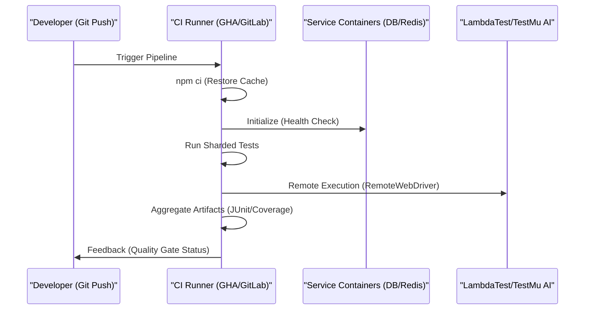

<!-- source: DeepWiki mcp.deepwiki.com · repo LambdaTest/agent-skills · page 7 CI/CD Pipeline and DevOps Skill · fetched 2026-10-26 -->

# 7. CI/CD Pipeline and DevOps Skill

<details>
<summary>Relevant source files</summary>

The following files were used as context for generating this wiki page:

- [behave-skill/reference/playbook.md](behave-skill/reference/playbook.md)
- [capybara-skill/SKILL.md](capybara-skill/SKILL.md)
- [capybara-skill/reference/advanced-patterns.md](capybara-skill/reference/advanced-patterns.md)
- [capybara-skill/reference/cloud-integration.md](capybara-skill/reference/cloud-integration.md)
- [capybara-skill/reference/playbook.md](capybara-skill/reference/playbook.md)
- [cicd-pipeline-skill/SKILL.md](cicd-pipeline-skill/SKILL.md)
- [cicd-pipeline-skill/reference/playbook.md](cicd-pipeline-skill/reference/playbook.md)
- [gauge-skill/reference/playbook.md](gauge-skill/reference/playbook.md)
- [jest-skill/reference/advanced-patterns.md](jest-skill/reference/advanced-patterns.md)
- [jest-skill/reference/playbook.md](jest-skill/reference/playbook.md)
- [junit-5-skill/reference/advanced-patterns.md](junit-5-skill/reference/advanced-patterns.md)
- [junit-5-skill/reference/playbook.md](junit-5-skill/reference/playbook.md)
- [protractor-skill/reference/cloud-integration.md](protractor-skill/reference/cloud-integration.md)
- [rspec-skill/reference/playbook.md](rspec-skill/reference/playbook.md)
- [selenium-skill/reference/playbook.md](selenium-skill/reference/playbook.md)

</details>


The **CI/CD Pipeline and DevOps Skill** provides a standardized approach for integrating automated testing into modern software delivery lifecycles. It focuses on creating robust, "fail-fast" pipelines that balance execution speed with comprehensive quality gates. This skill encompasses configuration patterns for major CI providers, efficient resource management through sharding, and the enforcement of quality standards via coverage aggregation.

### System Architecture Overview

The following diagram illustrates the relationship between CI/CD configuration entities and the execution environment.

**CI/CD Entity Mapping**
```mermaid
graph TD
  subgraph "Natural Language Space"
    A["Pipeline Definition"]
    B["Quality Gate"]
    C["Infrastructure"]
  end

  subgraph "Code Entity Space"
    A --> D["workflow.yaml"]
    A --> E["gitlab-ci.yml"]
    A --> F["Jenkinsfile"]
    
    B --> G["coverageThreshold"]
    B --> H["junit_report"]
    
    C --> I["services: postgres"]
    C --> J["strategy: matrix"]
  end

  D -- "defines" --> J
  G -- "enforced in" --> D [cicd-pipeline-skill/reference/playbook.md:15-101]()
  I -- "spins up" --> K["Service Containers"] [cicd-pipeline-skill/reference/playbook.md:60-68]()
```
**Sources:** [cicd-pipeline-skill/reference/playbook.md:6-144](), [cicd-pipeline-skill/reference/playbook.md:197-271]()

---

### Core Components

#### 1. Multi-Stage Pipeline Design
The skill advocates for a tiered execution strategy to optimize developer feedback loops:
*   **Linting/Type-Checking:** Initial fast-fail stage to catch syntax and style issues [cicd-pipeline-skill/reference/playbook.md:24-32]().
*   **Unit Testing:** Parallelized execution of isolated tests with coverage collection [cicd-pipeline-skill/reference/playbook.md:34-52]().
*   **E2E Testing:** Integration tests requiring service containers (PostgreSQL, Redis) and browser binaries [cicd-pipeline-skill/reference/playbook.md:54-86]().
*   **Quality Gates:** Aggregation of results and enforcement of coverage thresholds [cicd-pipeline-skill/reference/playbook.md:87-99]().

#### 2. Test Sharding and Parallelization
To reduce total execution time, the skill implements matrix strategies and sharding:
*   **GitHub Actions Matrix:** Running tests across multiple Node.js versions and browser engines simultaneously [cicd-pipeline-skill/reference/playbook.md:37-40]().
*   **Manual Sharding:** Splitting test suites into chunks (e.g., `--shard=1/3`) to distribute load across multiple runners [cicd-pipeline-skill/reference/playbook.md:48]().
*   **GitLab Parallelism:** Using the `parallel` keyword to instantiate multiple job instances [cicd-pipeline-skill/reference/playbook.md:224]().

#### 3. Service Containers and Environment Management
Complex E2E tests often require sidecar services. The skill provides patterns for:
*   **Ephemeral Databases:** Defining PostgreSQL or Redis services with health checks within the CI runner [cicd-pipeline-skill/reference/playbook.md:60-68]().
*   **OIDC and Secrets:** Securely injecting credentials like `LT_USERNAME` and `LT_ACCESS_KEY` for cloud execution [capybara-skill/reference/playbook.md:54](), [cicd-pipeline-skill/reference/playbook.md:96]().

**CI Execution Flow**

**Sources:** [cicd-pipeline-skill/reference/playbook.md:6-86](), [selenium-skill/reference/playbook.md:35-47]()

---

### Child Pages

#### [GitHub Actions Integration Patterns](#7.1)
Detailed implementation guide for GitHub Actions. Covers advanced `concurrency` control to `cancel-in-progress` workflows [cicd-pipeline-skill/reference/playbook.md:14-16](), dependency caching for various languages (npm, pip, bundler, nuget) [cicd-pipeline-skill/reference/playbook.md:150-173](), and Playwright-specific browser caching [cicd-pipeline-skill/reference/playbook.md:175-183]().

#### [Coverage Enforcement and Quality Gates](#7.2)
Focuses on the "Quality Gate" stage of the pipeline. Explains how to collect coverage from sharded runs [cicd-pipeline-skill/reference/playbook.md:49-52](), merge them using tools like Codecov [cicd-pipeline-skill/reference/playbook.md:94-98](), and enforce minimum thresholds (e.g., 80% branches/lines) in `jest.config.js` or `spec_helper.rb` [jest-skill/reference/playbook.md:15](), [rspec-skill/reference/playbook.md:38]().

---

### Best Practices Summary

| Category | Recommendation | Code Pointer |
| :--- | :--- | :--- |
| **Optimization** | Use `actions/cache` for dependencies and browser binaries | [cicd-pipeline-skill/reference/playbook.md:150-183]() |
| **Stability** | Implement `cancel-in-progress` to prevent redundant builds | [cicd-pipeline-skill/reference/playbook.md:14-16]() |
| **Isolation** | Use `services` for databases instead of manual installation | [cicd-pipeline-skill/reference/playbook.md:60-68]() |
| **Observability** | Always upload test artifacts (reports/screenshots) on failure | [cicd-pipeline-skill/reference/playbook.md:81-85]() |
| **Security** | Use OIDC/Workload Identity over long-lived secrets where possible | [cicd-pipeline-skill/reference/playbook.md:103-112]() |

**Sources:** [cicd-pipeline-skill/reference/playbook.md:6-191](), [jest-skill/reference/playbook.md:15](), [rspec-skill/reference/playbook.md:32-39]()

---

