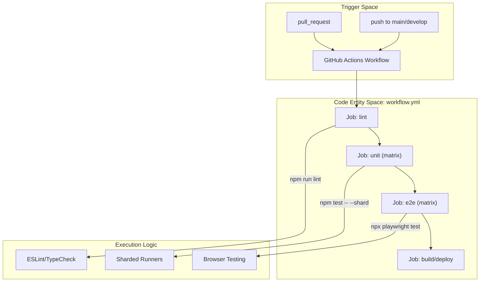
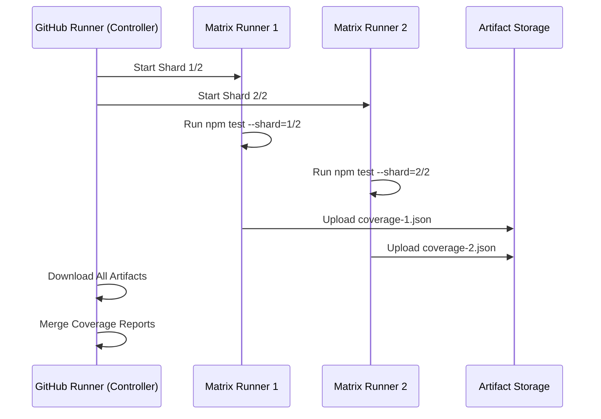

<!-- source: DeepWiki mcp.deepwiki.com · repo LambdaTest/agent-skills · page 7.1 GitHub Actions Integration Patterns · fetched 2026-10-26 -->

# GitHub Actions Integration Patterns

Relevant source files

The following files were used as context for generating this wiki page:

- [behat-skill/reference/advanced-patterns.md](behat-skill/reference/advanced-patterns.md)
- [behat-skill/reference/playbook.md](behat-skill/reference/playbook.md)
- [behave-skill/SKILL.md](behave-skill/SKILL.md)
- [capybara-skill/SKILL.md](capybara-skill/SKILL.md)
- [capybara-skill/reference/advanced-patterns.md](capybara-skill/reference/advanced-patterns.md)
- [capybara-skill/reference/cloud-integration.md](capybara-skill/reference/cloud-integration.md)
- [capybara-skill/reference/playbook.md](capybara-skill/reference/playbook.md)
- [cicd-pipeline-skill/SKILL.md](cicd-pipeline-skill/SKILL.md)
- [cicd-pipeline-skill/reference/playbook.md](cicd-pipeline-skill/reference/playbook.md)
- [gauge-skill/SKILL.md](gauge-skill/SKILL.md)
- [jest-skill/reference/advanced-patterns.md](jest-skill/reference/advanced-patterns.md)
- [jest-skill/reference/playbook.md](jest-skill/reference/playbook.md)
- [junit-5-skill/reference/advanced-patterns.md](junit-5-skill/reference/advanced-patterns.md)
- [junit-5-skill/reference/playbook.md](junit-5-skill/reference/playbook.md)
- [protractor-skill/reference/cloud-integration.md](protractor-skill/reference/cloud-integration.md)
- [rspec-skill/reference/playbook.md](rspec-skill/reference/playbook.md)

This page documents the standardized integration patterns for GitHub Actions within the `agent-skills` repository. It covers the end-to-end lifecycle of a CI/CD pipeline, from workflow triggers and concurrency management to advanced testing strategies like sharding, service containers, and automated reporting.

## Workflow Orchestration and Triggers

Production-grade workflows in this ecosystem utilize a multi-stage approach to ensure code quality before deployment. This includes linting, type-checking, unit testing, and finally E2E browser testing.

### Concurrency and Fail-Fast
To optimize runner usage, workflows implement concurrency control to cancel outdated runs on the same branch when new commits are pushed [cicd-pipeline-skill/reference/playbook.md:14-16]().

### Trigger Strategy
Workflows are typically triggered on `push` to primary branches (`main`, `develop`) and on any `pull_request` targeting those branches [cicd-pipeline-skill/reference/playbook.md:7-12]().

**Workflow Execution Flow**

Sources: [cicd-pipeline-skill/reference/playbook.md:7-35]()

---

## Service Containers and Environment Injection

For integration and E2E testing, GitHub Actions provides "Services" to host ephemeral databases and caches.

### Database and Cache Setup
Common service patterns include:
*   **PostgreSQL**: Configured with health checks to ensure the database is ready before the test steps begin [cicd-pipeline-skill/reference/playbook.md:61-65]().
*   **Redis**: Used for session or caching layer testing [cicd-pipeline-skill/reference/playbook.md:66-68]().

### Environment Variable Injection
Sensitive credentials and service URLs are injected via the `env` block, often referencing secrets or service aliases (e.g., `localhost` for services mapped to host ports) [cicd-pipeline-skill/reference/playbook.md:78-80]().

| Service | Image | Default Port | Usage |
| :--- | :--- | :--- | :--- |
| PostgreSQL | `postgres:16` | 5432 | Relational data storage for E2E/Unit tests |
| Redis | `redis:7` | 6379 | Distributed caching and pub/sub testing |
| Selenium | `selenium/standalone-chrome` | 4444 | Local browser grid for Selenium/Capybara |

Sources: [cicd-pipeline-skill/reference/playbook.md:60-80](), [behat-skill/reference/playbook.md:41-57]()

---

## Test Sharding and Matrix Strategies

To reduce execution time, tests are distributed across multiple parallel runners using the GitHub Actions `strategy.matrix`.

### Sharding Pattern
Tests are split using framework-specific sharding flags (e.g., `jest --shard=1/3` or `playwright test --shard=1/3`) [cicd-pipeline-skill/reference/playbook.md:37-48]().

### Data Flow for Sharded Execution

Sources: [cicd-pipeline-skill/reference/playbook.md:37-53](), [cicd-pipeline-skill/reference/playbook.md:87-98]()

---

## Artifact Management and Reporting

Post-execution steps focus on preserving test results, screenshots, and coverage data.

### Artifact Uploads
*   **Screenshots/Videos**: Captured on failure in frameworks like Capybara [capybara-skill/reference/playbook.md:30]() or Behave [behave-skill/SKILL.md:113-114]().
*   **Test Reports**: HTML or JUnit XML reports are uploaded as artifacts for debugging [cicd-pipeline-skill/reference/playbook.md:81-86]().

### Coverage Enforcement
Coverage artifacts from sharded runs are merged in a final `coverage` job. Tools like `Codecov` are used to provide PR comments and enforce quality gates [cicd-pipeline-skill/reference/playbook.md:94-98](). Frameworks like Jest [jest-skill/reference/playbook.md:12-15]() and RSpec [rspec-skill/reference/playbook.md:32-39]() are configured to generate `json-summary` or `lcov` formats compatible with these actions.

| Artifact Type | Source Path | Action | Retention |
| :--- | :--- | :--- | :--- |
| Coverage | `coverage/` | `actions/upload-artifact` | Defined in workflow |
| E2E Reports | `playwright-report/` | `actions/upload-artifact` | if: always() |
| Screenshots | `tmp/screenshots/` | `actions/upload-artifact` | if: failure() |

Sources: [cicd-pipeline-skill/reference/playbook.md:49-53](), [cicd-pipeline-skill/reference/playbook.md:81-86](), [capybara-skill/reference/playbook.md:30]()

---

## Caching and Optimization

To minimize "cold start" times, workflows utilize aggressive caching for dependencies and browser binaries.

*   **Package Managers**: `actions/setup-node`, `actions/setup-python`, and `ruby/setup-ruby` include built-in caching for `npm`, `pip`, and `bundle` respectively [cicd-pipeline-skill/reference/playbook.md:150-163]().
*   **Playwright Browsers**: Browser binaries are cached separately to avoid multi-gigabyte downloads on every run [cicd-pipeline-skill/reference/playbook.md:175-183]().
*   **Docker Layers**: Uses `type=gha` cache backend for faster container builds [cicd-pipeline-skill/reference/playbook.md:185-191]().

Sources: [cicd-pipeline-skill/reference/playbook.md:148-191]()

---

