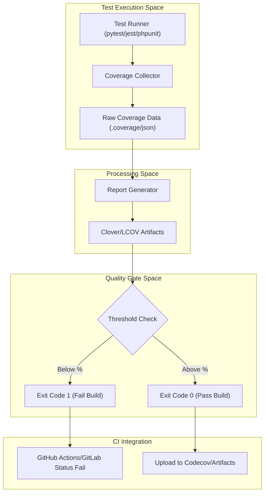
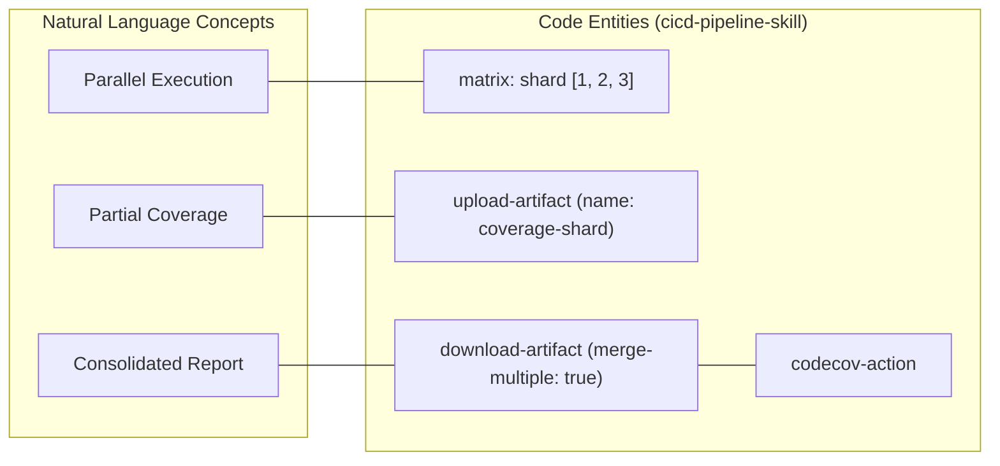

<!-- source: DeepWiki mcp.deepwiki.com · repo LambdaTest/agent-skills · page 7.2 Coverage Enforcement and Quality Gates · fetched 2026-10-26 -->

# Coverage Enforcement and Quality Gates

Relevant source files

The following files were used as context for generating this wiki page:

- [cicd-pipeline-skill/SKILL.md](cicd-pipeline-skill/SKILL.md)
- [cicd-pipeline-skill/reference/playbook.md](cicd-pipeline-skill/reference/playbook.md)
- [jest-skill/reference/advanced-patterns.md](jest-skill/reference/advanced-patterns.md)
- [jest-skill/reference/playbook.md](jest-skill/reference/playbook.md)
- [junit-5-skill/reference/advanced-patterns.md](junit-5-skill/reference/advanced-patterns.md)
- [junit-5-skill/reference/playbook.md](junit-5-skill/reference/playbook.md)
- [phpunit-skill/reference/playbook.md](phpunit-skill/reference/playbook.md)
- [pytest-skill/SKILL.md](pytest-skill/SKILL.md)
- [pytest-skill/reference/advanced-patterns.md](pytest-skill/reference/advanced-patterns.md)
- [pytest-skill/reference/playbook.md](pytest-skill/reference/playbook.md)
- [testunit-skill/reference/playbook.md](testunit-skill/reference/playbook.md)
- [unittest-skill/reference/playbook.md](unittest-skill/reference/playbook.md)

This page details the implementation of code coverage tracking and enforcement across multiple language ecosystems within the `agent-skills` framework. It covers the configuration of language-specific tooling, the logic for threshold enforcement, and the integration of these checks into CI/CD pipelines to ensure code quality standards are met before deployment.

## Language-Specific Coverage Tooling

The repository leverages standard industry tools for each supported language to generate coverage artifacts (e.g., LCOV, Clover XML, JSON).

### Tooling Matrix

| Language | Tool | Configuration File | Key Artifacts |
| :--- | :--- | :--- | :--- |
| **Python** | `coverage.py` | `.coveragerc` / `pyproject.toml` | `coverage.xml`, `.coverage` |
| **JavaScript** | `Istanbul` (via Jest) | `jest.config.js` | `lcov.info`, `clover.xml` |
| **PHP** | `Xdebug` / `php-code-coverage` | `phpunit.xml` | `clover.xml`, `coverage-html/` |
| **Ruby** | `SimpleCov` | `.simplecov` | `coverage/.resultset.json` |
| **Java** | `JaCoCo` | `pom.xml` | `target/site/jacoco/` |

### Python (coverage.py)
Python skills utilize `coverage.py` configured via `pyproject.toml` [unittest-skill/reference/playbook.md:40-68](). It tracks branch coverage and excludes boilerplate such as `pragma: no cover` or `NotImplementedError` [unittest-skill/reference/playbook.md:58-67]().

### JavaScript (Jest/Istanbul)
Jest projects define coverage thresholds directly in `jest.config.js` [jest-skill/reference/playbook.md:12-16](). This includes global thresholds for branches, functions, lines, and statements, typically set at a minimum of 80% [jest-skill/reference/playbook.md:15-15]().

### PHP (Xdebug/PHPUnit)
PHP coverage requires the `Xdebug` extension set to `XDEBUG_MODE=coverage` [phpunit-skill/reference/playbook.md:25-25](). The `phpunit.xml` file defines the source directories to include (e.g., `src/`) and excludes migrations or external dependencies [phpunit-skill/reference/playbook.md:65-72]().

### Ruby (SimpleCov)
Ruby skills use `SimpleCov`, initialized in a `test_helper.rb` [testunit-skill/reference/playbook.md:47-54](). It groups coverage by application layer (Models, Services) and enforces a `minimum_coverage` threshold [testunit-skill/reference/playbook.md:51-53]().

**Sources:**
- [unittest-skill/reference/playbook.md:40-80]()
- [jest-skill/reference/playbook.md:5-26]()
- [phpunit-skill/reference/playbook.md:31-80]()
- [testunit-skill/reference/playbook.md:46-54]()

---

## Threshold Enforcement and Quality Gates

Quality gates are enforced at two levels: local execution via CLI flags and CI/CD pipeline blocking.

### Threshold Configuration
Thresholds are defined in project metadata files to ensure consistency across developer environments and build servers.

| Entity | Implementation | File Reference |
| :--- | :--- | :--- |
| **Python Fail Under** | `fail_under = 80` | [pytest-skill/reference/playbook.md:39-41]() |
| **Jest Global Threshold** | `coverageThreshold: { global: { lines: 80 } }` | [jest-skill/reference/playbook.md:15-15]() |
| **Ruby Minimum** | `minimum_coverage 80` | [testunit-skill/reference/playbook.md:53-53]() |

### Data Flow: From Execution to Enforcement

The following diagram illustrates how coverage data flows from test execution through the quality gate check.

**Coverage Enforcement Flow**

**Sources:**
- [cicd-pipeline-skill/reference/playbook.md:87-99]()
- [pytest-skill/reference/playbook.md:162-166]()
- [jest-skill/reference/playbook.md:12-16]()

---

## Sharded Coverage Merging

In high-scale CI pipelines, tests are often sharded across multiple runners to reduce execution time. This requires a "merge" step to aggregate coverage from all shards before evaluating the quality gate.

### Sharding Strategy
Pipelines use a matrix strategy to split tests. For example, a Node.js project might use `npm test -- --coverage --shard=${{ matrix.shard }}/3` [cicd-pipeline-skill/reference/playbook.md:48-48]().

### Merging Logic
1.  **Upload:** Each shard uploads its partial coverage directory as a named artifact (e.g., `coverage-1`, `coverage-2`) [cicd-pipeline-skill/reference/playbook.md:49-52]().
2.  **Download:** A downstream `coverage` job downloads all artifacts using a pattern match [cicd-pipeline-skill/reference/playbook.md:92-93]().
3.  **Aggregate:** Tools like `codecov-action` or language-specific merge commands (e.g., `coverage combine` for Python) unify the data [cicd-pipeline-skill/reference/playbook.md:94-98]().

**Natural Language to Code Entity Mapping: Sharding**

**Sources:**
- [cicd-pipeline-skill/reference/playbook.md:37-52]()
- [cicd-pipeline-skill/reference/playbook.md:87-99]()
- [cicd-pipeline-skill/reference/playbook.md:224-234]()

---

## CI Pipeline Integration

Coverage checks are integrated into GitHub Actions and GitLab CI to act as blocking quality gates.

### GitHub Actions Workflow
The pipeline is designed with a `needs` dependency where the `coverage` job depends on the completion of `unit` test shards [cicd-pipeline-skill/reference/playbook.md:87-88](). The `fail_ci_if_error: true` flag ensures that a failure to upload or process coverage results in a failed build [cicd-pipeline-skill/reference/playbook.md:97-97]().

### GitLab CI Configuration
GitLab uses regex-based coverage parsing and Cobertura report artifacts [cicd-pipeline-skill/reference/playbook.md:228-234]().
*   **Regex Extraction:** `coverage: '/Lines\s*:\s*(\d+\.?\d*)%/'` [cicd-pipeline-skill/reference/playbook.md:228-228]().
*   **Artifact Path:** `coverage/cobertura-coverage.xml` [cicd-pipeline-skill/reference/playbook.md:234-234]().

### Quality Gate Summary Table

| CI Platform | Gate Mechanism | Configuration Key |
| :--- | :--- | :--- |
| **GitHub Actions** | Action Failure | `fail_ci_if_error: true` |
| **GitLab CI** | Artifact Reporting | `artifacts: reports: coverage_report` |
| **Local CLI** | Process Exit Code | `fail_under` (Python) / `coverageThreshold` (JS) |

**Sources:**
- [cicd-pipeline-skill/reference/playbook.md:87-99]()
- [cicd-pipeline-skill/reference/playbook.md:220-235]()
- [cicd-pipeline-skill/SKILL.md:51-56]()

---

